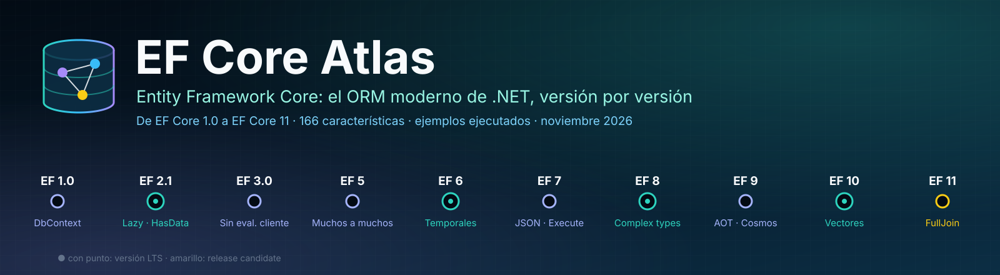
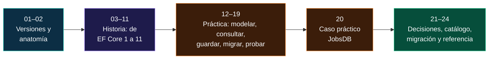
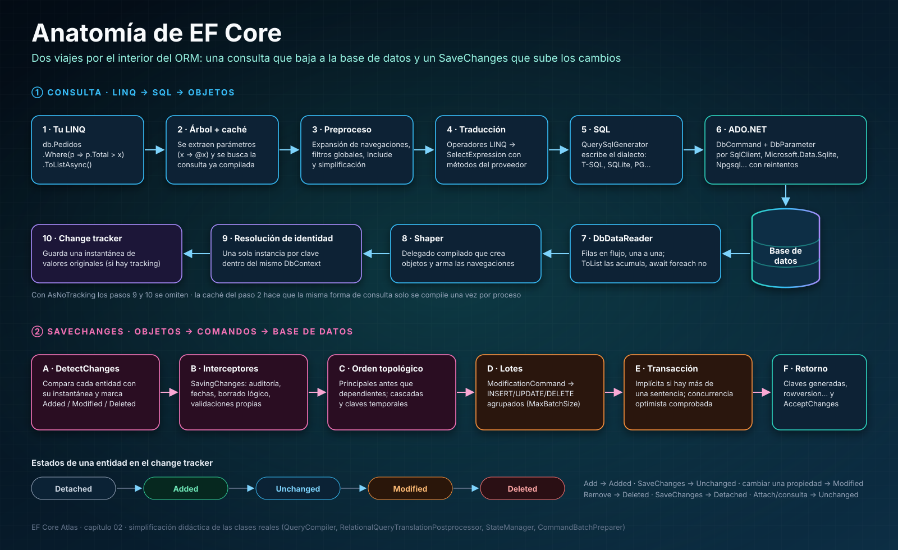
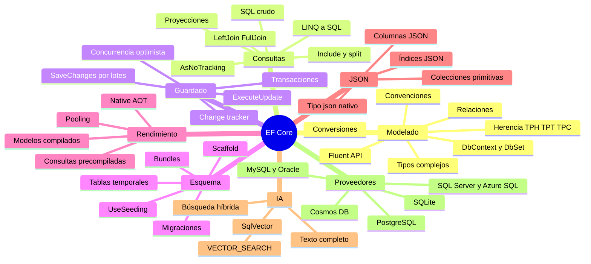
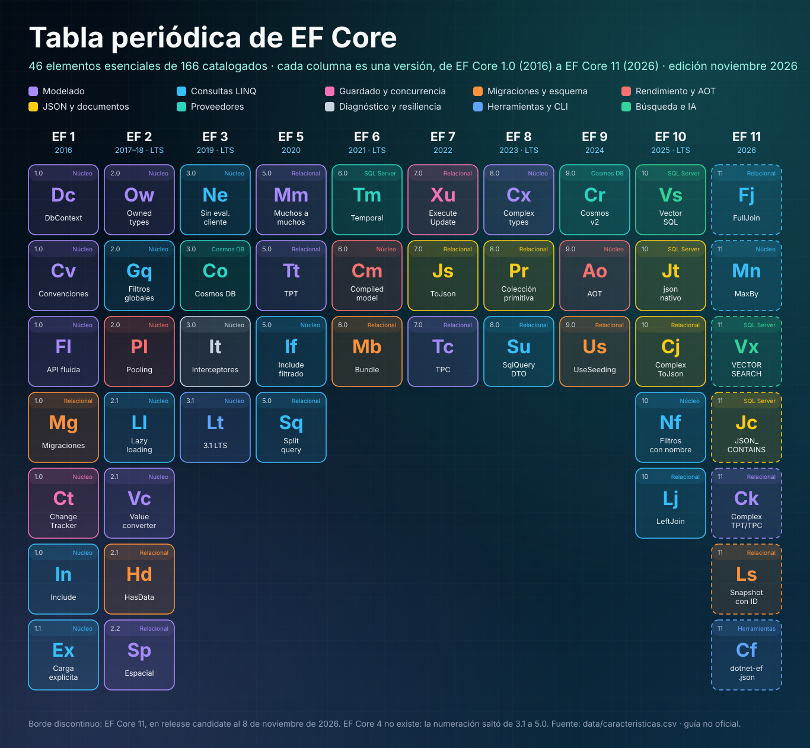
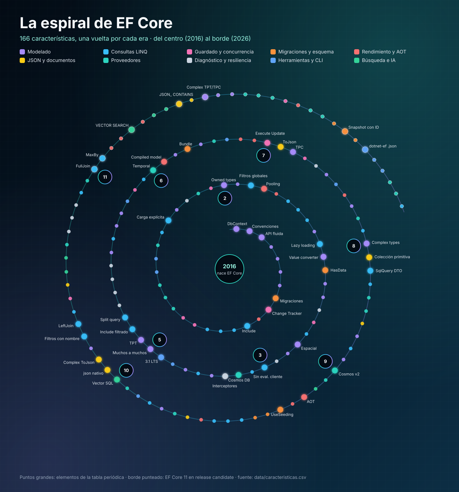
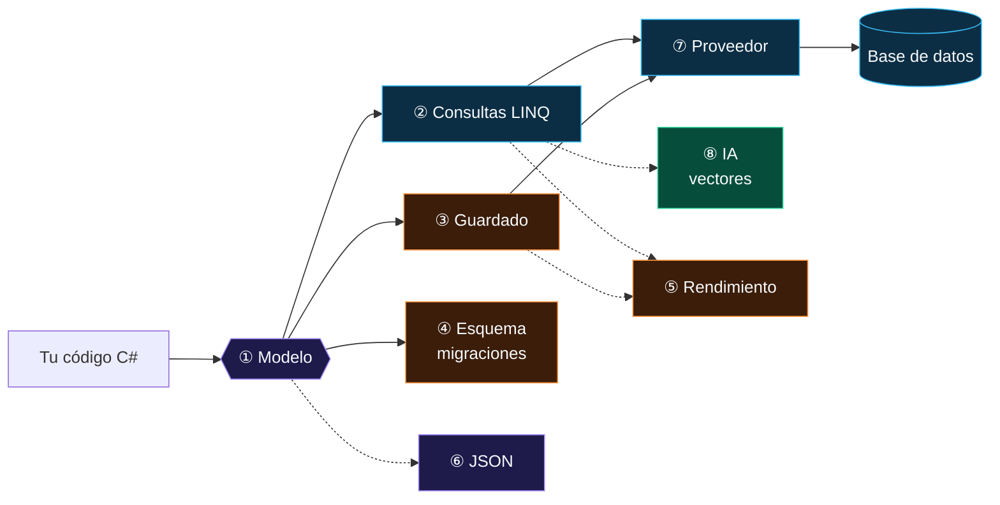

<p align="center">
  
</p>

<p align="center">
  
  
  
  
  
  
  
  
</p>

<p align="center">
  <b>EF Core Atlas</b> es una guía técnica en español sobre <b>Entity Framework Core</b>, el ORM moderno de .NET:<br>
  su historia versión a versión, de EF Core 1.0 (2016) a EF Core 11 (2026), su anatomía interna, y cómo modelar, consultar, guardar, migrar,<br>
  probar, medir y desplegar con él hoy. Cada ejemplo se compila, y la mayoría se ejecuta, contra <b>EF Core 10.0.14</b>, verificado al <b>8 de noviembre de 2026</b>.
</p>

---

## Contenido

- [¿Qué es Entity Framework Core?](#qué-es-entity-framework-core)
- [Estado actual](#estado-actual)
- [Cómo usar este atlas](#cómo-usar-este-atlas)
- [Cómo funciona, en una imagen](#cómo-funciona-en-una-imagen)
- [El universo EF Core en un mapa](#el-universo-ef-core-en-un-mapa)
- [Tabla periódica de características](#tabla-periódica-de-características)
- [Índice de capítulos](#índice-de-capítulos)
- [Línea de tiempo: versión a versión](#línea-de-tiempo-versión-a-versión)
- [Antes y después en una línea](#antes-y-después-en-una-línea)
- [Las ocho grandes ideas](#las-ocho-grandes-ideas)
- [Lo que todo experto debe dominar](#lo-que-todo-experto-debe-dominar)
- [Primeros pasos y comandos esenciales](#primeros-pasos-y-comandos-esenciales)
- [Impacto y desafíos](#impacto-y-desafíos)
- [EF Core en cifras](#ef-core-en-cifras)
- [Qué cambió en 2025–2026](#qué-cambió-en-20252026)
- [Plazos que no puedes ignorar](#plazos-que-no-puedes-ignorar)
- [El caso práctico de este repositorio](#el-caso-práctico-de-este-repositorio)
- [Estructura del repositorio](#estructura-del-repositorio)
- [Convenciones](#convenciones)
- [Metodología y fuentes](#metodología-y-fuentes)

---

## ¿Qué es Entity Framework Core?

**Entity Framework Core (EF Core)** es un **mapeador objeto-relacional** (ORM) de código abierto y multiplataforma para .NET, desarrollado por Microsoft en
[`dotnet/efcore`](https://github.com/dotnet/efcore) bajo licencia MIT. Permite trabajar con una base de datos usando **clases de .NET** y consultas
[**LINQ**](https://github.com/CristianSifuentes/LINQ-s) en lugar de escribir SQL a mano, y se encarga de traducir, ejecutar, materializar objetos, seguir sus
cambios y guardarlos.

Nació en 2016 como una **reescritura completa** de Entity Framework 6 para el .NET multiplataforma. Lo que lo hace singular es su trayectoria: empezó con menos
funciones que su predecesor y, versión a versión, no solo lo alcanzó, sino que lo superó con columnas JSON, operaciones masivas, tipos complejos, tablas
temporales, Native AOT y, desde 2025, **búsqueda vectorial** para aplicaciones de inteligencia artificial.

| Pieza | Qué hace | Capítulo |
|---|---|---|
| **`DbContext`** | Unidad de trabajo y punto de entrada: gestiona la conexión, las consultas y el seguimiento de cambios | [02](docs/02-anatomia-de-ef-core.md#2-el-dbcontext-unidad-de-trabajo-y-repositorio) |
| **Entidades** | Clases de .NET que representan tablas (o documentos) | [12](docs/12-modelado.md) |
| **Modelo** | Metadatos que describen cómo se mapea cada clase, construidos por convenciones, anotaciones y Fluent API | [12](docs/12-modelado.md#1-tres-capas-de-configuración) |
| **Consultas LINQ** | Se traducen a SQL a través de una canalización de compilación con caché | [13](docs/13-consultas.md) |
| ***Change tracker*** | Detecta qué cambió en tus objetos para generar los `INSERT`, `UPDATE` y `DELETE` justos | [14](docs/14-guardado-y-concurrencia.md) |
| **Migraciones** | Evolucionan el esquema de la base como código versionado | [15](docs/15-migraciones-y-despliegue.md) |
| **Proveedores** | Adaptan EF Core a SQL Server, PostgreSQL, SQLite, MySQL, Oracle, Cosmos DB… | [16](docs/16-proveedores.md) |

> [!IMPORTANT]
> **Este atlas trata de EF Core, no de Entity Framework 6.** Son dos productos distintos con el mismo apellido: consulta
> [01 · El modelo de versiones](docs/01-modelo-de-versiones.md#1-dos-productos-con-el-mismo-apellido).

---

## Estado actual

| | Versión | Plataforma | Estado al 8-nov-2026 |
|---|---|---|---|
| 🟢 **Estable** | **EF Core 10.0.14** | .NET 10 LTS (soporte hasta el **10-nov-2028**) | Recomendada para producción |
| 🟡 **Próxima** | **EF Core 11** | .NET 11, en RC3 con licencia *go-live* | Disponibilidad general prevista el **10-nov-2026** |
| 🟠 **Caducan** | EF Core 8 y EF Core 9 | .NET 8 y .NET 9 | Fin de soporte el **10-nov-2026**: migrar a 10 |
| 🔵 **Clásico** | EF 6.5 | .NET Framework y .NET moderno | Solo mantenimiento |

---

## Cómo usar este atlas

| Si eres… | Empieza por | Sigue con | Termina en |
|---|---|---|---|
| **Nuevo en EF Core** | [02 · Anatomía](docs/02-anatomia-de-ef-core.md) | [12 · Modelado](docs/12-modelado.md) → [13 · Consultas](docs/13-consultas.md) → [14 · Guardado](docs/14-guardado-y-concurrencia.md) | [24 · Referencia](docs/24-referencia-rapida-y-glosario.md) |
| **Desarrollador/a con experiencia** | [10 · EF Core 10](docs/10-ef-core-10-lts-vectores-y-json.md) y [11 · EF Core 11](docs/11-ef-core-11-rc.md) | [17 · Rendimiento](docs/17-rendimiento-y-diagnostico.md) | [21 · Decisiones](docs/21-guias-de-decision.md) |
| **Arquitecto/a** | [01 · Versiones](docs/01-modelo-de-versiones.md) | [19 · Arquitectura](docs/19-arquitectura-de-aplicaciones.md) → [16 · Proveedores](docs/16-proveedores.md) | [21 · Decisiones](docs/21-guias-de-decision.md) |
| **Quien migra una aplicación** | [23 · Migración](docs/23-migracion-entre-versiones.md) | Capítulo de cada versión que cruces | [22 · Catálogo](docs/22-catalogo-a-z.md) |
| **Responsable de operaciones o DBA** | [15 · Migraciones y despliegue](docs/15-migraciones-y-despliegue.md) | [17 · Diagnóstico](docs/17-rendimiento-y-diagnostico.md) | [16 · Proveedores](docs/16-proveedores.md) |
| **Quien construye con IA** | [10 · Vectores](docs/10-ef-core-10-lts-vectores-y-json.md#2-búsqueda-vectorial-en-sql-server) | [11 · `VECTOR_SEARCH`](docs/11-ef-core-11-rc.md#6-sql-server-y-azure-sql) | [10 · Búsqueda híbrida](docs/10-ef-core-10-lts-vectores-y-json.md#10-cosmos-db-texto-completo-vectores-y-búsqueda-híbrida) |
| **Quien aprende con este repositorio** | [20 · Caso práctico JobsDB](docs/20-caso-practico-jobsdb.md) | Los capítulos que enlaza cada hallazgo | [Ejercicios](docs/20-caso-practico-jobsdb.md#9-ejercicios-propuestos) |



---

## Cómo funciona, en una imagen

El viaje de una consulta LINQ hasta convertirse en objetos, y el de un `SaveChanges` hasta convertirse en SQL. Explicado paso a paso en
[02 · Anatomía de EF Core](docs/02-anatomia-de-ef-core.md).

<p align="center">
  <a href="assets/efcore-atlas-anatomia.svg">
    
  </a>
</p>

---

## El universo EF Core en un mapa



---

## Tabla periódica de características

Las características esenciales de EF Core, una columna por versión y un color por familia. El catálogo completo tiene **166 entradas**. Haz clic para ver el
póster a tamaño completo.

<p align="center">
  <a href="assets/efcore-atlas-tabla-periodica.svg">
    
  </a>
</p>

Y las mismas 166 características sobre una **espiral del tiempo**: del centro (2016) al borde (2026), una vuelta por cada era.

<p align="center">
  <a href="assets/efcore-atlas-espiral.svg">
    
  </a>
</p>

> [!TIP]
> El póster, la espiral, el banner y el [catálogo A–Z](docs/22-catalogo-a-z.md) se generan desde [`data/caracteristicas.csv`](data/caracteristicas.csv)
> con `python3 tools/generar_atlas.py`. Para actualizar una entrada, edita una fila y vuelve a ejecutar el script.

---

## Índice de capítulos

| # | Capítulo | Lo que encontrarás | Protagonistas |
|---|---|---|---|
| 01 | [**El modelo de versiones**](docs/01-modelo-de-versiones.md) | EF6 frente a EF Core, genealogía, por qué no existe EF Core 4, soporte, paquetes NuGet, proveedores | LTS, STS, NuGet |
| 02 | [**Anatomía de EF Core**](docs/02-anatomia-de-ef-core.md) | `DbContext`, modelo, servicios internos, canalización de consultas, materialización, *change tracker*, `SaveChanges` | `DbContext`, `IModel` |
| 03 | [EF Core 1.0–2.2: los cimientos](docs/03-ef-core-1-2-cimientos.md) | La reescritura, tipos propios, filtros globales, carga diferida, `HasData`, conversiones | `OwnsOne`, `HasData` |
| 04 | [EF Core 3.x: la gran ruptura](docs/04-ef-core-3-la-gran-ruptura.md) | Nueva canalización LINQ, fin de la evaluación en cliente, Cosmos DB, interceptores, C# 8 | `FromSqlRaw`, `HasNoKey` |
| 05 | [EF Core 5: relaciones y diagnóstico](docs/05-ef-core-5-relaciones-y-diagnostico.md) | Muchos a muchos, TPT, `Include` filtrado, consultas divididas, `ToQueryString`, *savepoints* | `AsSplitQuery` |
| 06 | [EF Core 6: rendimiento y temporalidad](docs/06-ef-core-6-rendimiento-y-temporalidad.md) | Tablas temporales, modelos compilados, *bundles*, configuración previa a convenciones, LTS | `IsTemporal`, `optimize` |
| 07 | [EF Core 7: JSON y operaciones masivas](docs/07-ef-core-7-json-y-operaciones-masivas.md) | `ExecuteUpdate`/`ExecuteDelete`, columnas JSON, TPC, procedimientos CUD, interceptores nuevos | `ExecuteUpdate`, `ToJson` |
| 08 | [EF Core 8: tipos complejos](docs/08-ef-core-8-tipos-complejos.md) | Tipos complejos, colecciones primitivas, `OPENJSON`, SQL crudo con tipos no mapeados, `HierarchyId` | `ComplexProperty` |
| 09 | [EF Core 9: Cosmos, AOT y siembra](docs/09-ef-core-9-cosmos-aot-y-siembra.md) | Cosmos reescrito, consultas precompiladas, Native AOT, `UseSeeding`, bloqueo de migraciones | `UseSeeding` |
| 10 | [**EF Core 10: LTS, vectores y JSON**](docs/10-ef-core-10-lts-vectores-y-json.md) | `SqlVector`, tipo `json`, complejos en JSON, filtros con nombre, `LeftJoin`, `ExecuteUpdate` con lambda | `SqlVector<float>` |
| 11 | [**EF Core 11: la versión que llega**](docs/11-ef-core-11-rc.md) | `FullJoin`, `VECTOR_SEARCH`, índices JSON, complejos en TPT/TPC, Cosmos con STJ, `dotnet-ef.json` | `FullJoin` |
| 12 | [Modelado](docs/12-modelado.md) | Convenciones, Fluent API, claves, relaciones, índices, sombras, conversiones, herencia | `OnModelCreating` |
| 13 | [Consultas](docs/13-consultas.md) | Ejecución diferida, traducción, proyecciones, carga, seguimiento, paginación, SQL crudo, N+1 | `Select`, `Include` |
| 14 | [Guardado y concurrencia](docs/14-guardado-y-concurrencia.md) | Estados, lotes, desconectados, transacciones, concurrencia optimista, auditoría, reintentos | `SaveChanges` |
| 15 | [Migraciones y despliegue](docs/15-migraciones-y-despliegue.md) | CLI y PMC, anatomía, renombrados, trabajo en equipo, *bundles*, scripts, *scaffold* | `dotnet ef` |
| 16 | [Proveedores](docs/16-proveedores.md) | SQL Server, Azure SQL, PostgreSQL, SQLite, MySQL, Oracle, Cosmos, InMemory y sus diferencias | `UseNpgsql` |
| 17 | [Rendimiento y diagnóstico](docs/17-rendimiento-y-diagnostico.md) | Registros, etiquetas, *pooling*, modelos compilados, AOT, métricas, interceptores, costos | `TagWith` |
| 18 | [Pruebas](docs/18-pruebas.md) | Estrategias, SQLite en memoria, Testcontainers, aislamiento, SQL fijado, migraciones | Testcontainers |
| 19 | [Arquitectura de aplicaciones](docs/19-arquitectura-de-aplicaciones.md) | Vida del contexto, DI, repositorios, DDD, CQRS, multiinquilino, Minimal APIs, *outbox* | `IDbContextFactory` |
| 20 | [**Caso práctico JobsDB**](docs/20-caso-practico-jobsdb.md) | Auditoría de este repositorio: 24 hallazgos, dos fallos críticos de migraciones y la versión corregida | `JobsDbContext` |
| 21 | [Guías de decisión](docs/21-guias-de-decision.md) | Árboles: ORM, versión, proveedor, modelado, carga, escritura, herencia, despliegue, pruebas | — |
| 22 | [Catálogo A–Z](docs/22-catalogo-a-z.md) | 166 características con versión, familia, ámbito y estado | Todas |
| 23 | [Migración entre versiones](docs/23-migracion-entre-versiones.md) | Método, rutas de 2.x a 11, de EF6 a EF Core, tabla maestra de cambios incompatibles | — |
| 24 | [Referencia rápida y glosario](docs/24-referencia-rapida-y-glosario.md) | API, LINQ→SQL, configuración, opciones, comandos, diagnósticos y 60 términos | — |

---

## Línea de tiempo: versión a versión

| EF Core | Fecha | .NET | Soporte | Características clave |
|---|---|---|---|---|
| [**1.0**](docs/03-ef-core-1-2-cimientos.md) | jun-2016 | .NET Core 1.0 | — | Reescritura multiplataforma, `DbContext`, proveedores enchufables, migraciones |
| [**1.1**](docs/03-ef-core-1-2-cimientos.md#3-ef-core-11-noviembre-de-2016) | nov-2016 | .NET Core 1.1 | — | `Find`, carga explícita, campos de respaldo |
| [**2.0**](docs/03-ef-core-1-2-cimientos.md#4-ef-core-20-agosto-de-2017) | ago-2017 | .NET Core 2.0 | — | Tipos propios, filtros globales, *pooling*, `EF.CompileQuery`, mejor traducción LINQ |
| [**2.1**](docs/03-ef-core-1-2-cimientos.md#5-ef-core-21-mayo-de-2018) | may-2018 | .NET Core 2.1 | LTS | Carga diferida, conversiones de valor, `HasData`, `GroupBy` traducido |
| [**2.2**](docs/03-ef-core-1-2-cimientos.md#6-ef-core-22-diciembre-de-2018) | dic-2018 | .NET Core 2.2 | — | Datos espaciales, `TagWith` |
| [**3.0**](docs/04-ef-core-3-la-gran-ruptura.md) | sep-2019 | .NET Core 3.0 | — | **Fin de la evaluación en cliente**, Cosmos DB, interceptores, tipos de referencia anulables |
| [**3.1**](docs/04-ef-core-3-la-gran-ruptura.md#9-ef-core-31-la-primera-lts-moderna) | dic-2019 | .NET Core 3.1 | LTS | Vuelta a .NET Framework |
| [**5.0**](docs/05-ef-core-5-relaciones-y-diagnostico.md) | nov-2020 | .NET 5 | STS | Muchos a muchos, TPT, `Include` filtrado, consultas divididas, `ToQueryString` |
| [**6.0**](docs/06-ef-core-6-rendimiento-y-temporalidad.md) | nov-2021 | .NET 6 | LTS | Tablas temporales, modelos compilados, *bundles*, configuración previa a convenciones |
| [**7.0**](docs/07-ef-core-7-json-y-operaciones-masivas.md) | nov-2022 | .NET 6–7 | STS | `ExecuteUpdate`/`ExecuteDelete`, columnas JSON, TPC, `SaveChanges` más rápido, plantillas T4 |
| [**8.0**](docs/08-ef-core-8-tipos-complejos.md) | nov-2023 | .NET 8 | LTS 🟠 | Tipos complejos, colecciones primitivas, SQL crudo sin mapear, `HierarchyId` |
| [**9.0**](docs/09-ef-core-9-cosmos-aot-y-siembra.md) | nov-2024 | .NET 8–9 | STS 🟠 | Cosmos reescrito, consultas precompiladas, AOT, `UseSeeding`, bloqueo de migraciones |
| [**10.0** 🟢](docs/10-ef-core-10-lts-vectores-y-json.md) | nov-2025 | .NET 10 | **LTS** | Vectores, tipo `json`, complejos en JSON, filtros con nombre, `LeftJoin`, Cosmos híbrido |
| [**11.0** 🟡](docs/11-ef-core-11-rc.md) | nov-2026 (RC3) | .NET 11 | STS | `FullJoin`, `VECTOR_SEARCH`, índices JSON, Cosmos con `System.Text.Json`, `dotnet-ef.json` |

> [!NOTE]
> **Correcciones a la versión anterior de este README.** La tabla original atribuía `ExecuteUpdate`/`ExecuteDelete` a EF Core 9 (llegaron en **7.0**),
> los interceptores a EF Core 7 (existen desde **3.0**; 7.0 añadió nuevos tipos) y la "sincronización de esquemas entre proveedores" a EF Core 10 (no
> existe tal función). También mostraba un comando de renombrado con `-- --operations` que no existe en `dotnet ef`
> ([capítulo 15](docs/15-migraciones-y-despliegue.md#3-referencia-de-comandos-cli-y-pmc)).

---

## Antes y después en una línea

El mismo pensamiento, en dos épocas. Formas resumidas: los ejemplos completos y verificados están en cada capítulo.

| Versión | Antes | Después |
|---|---|---|
| **2.0** | `Where(x => !x.Borrado)` en cada consulta | `HasQueryFilter(x => !x.Borrado)` una vez |
| **2.1** | Columna `int` y `(Estado)valor` a mano | `HasConversion<string>()` |
| **3.0** | `FromSql("… {0}", valor)` | `FromSqlInterpolated($"… {valor}")` |
| **5.0** | Entidad `ProductoEtiqueta` a mano | `HasMany(p => p.Etiquetas).WithMany(e => e.Productos)` |
| **5.0** | Depurar con SQL Profiler | `query.ToQueryString()` |
| **6.0** | Tabla de historial y disparadores | `ToTable(t => t.IsTemporal())` |
| **7.0** | `foreach (var x in lista) x.Activo = false; SaveChanges();` | `Where(…).ExecuteUpdate(s => s.SetProperty(x => x.Activo, false))` |
| **7.0** | Serializar a `string` a mano | `OwnsOne(x => x.Datos, d => d.ToJson())` |
| **8.0** | Tabla `Etiquetas` para una lista de cadenas | `List<string> Etiquetas` |
| **9.0** | Semillas en `Program.cs` antes de arrancar | `UseSeeding((ctx, _) => …)` |
| **10** | `GroupJoin(…).SelectMany(g => g.DefaultIfEmpty())` | `LeftJoin(…)` |
| **10** | Árbol de expresión construido a mano para `ExecuteUpdate` | `ExecuteUpdate(s => { if (c) s.SetProperty(…); })` |
| **10** | `OwnsOne(...).ToJson()` (entidad oculta) | `ComplexProperty(...).ToJson()` (valor) |
| **11** 🟡 | `OrderByDescending(x => x.Total).First()` | `MaxBy(x => x.Total)` |

```csharp run
// EF Core 10 en una mirada: modelo, JSON, filtros con nombre, LeftJoin y ExecuteUpdate
using var db = new Tienda();
db.Database.EnsureDeleted();
db.Database.EnsureCreated();
db.AddRange(
    new Producto { Nombre = "Té verde", Detalles = new("China", ["orgánico"]) },
    new Producto { Nombre = "Café", Detalles = new("Colombia", []), Retirado = true });
db.SaveChanges();

Console.WriteLine(db.Productos.Count());                                              // → 1
Console.WriteLine(db.Productos.IgnoreQueryFilters(["Activos"]).Count());              // → 2
Console.WriteLine(db.Productos.Where(p => p.Detalles.Origen == "China").Select(p => p.Nombre).Single()); // → Té verde
Console.WriteLine(db.Productos.ExecuteUpdate(s => s.SetProperty(p => p.Nombre, p => p.Nombre.ToUpper())));  // → 1
Console.WriteLine(db.Productos.Select(p => p.Nombre).Single());                       // → Té VERDE
// ¡Ojo! upper() de SQLite solo convierte ASCII: la "é" se queda en minúscula. SQL Server devolvería "TÉ VERDE".
// Tu LINQ es portable; su resultado depende del motor (capítulo 16).

public record Detalles(string Origen, List<string> Sellos);

public class Producto
{
    public int Id { get; set; }
    public required string Nombre { get; set; }
    public required Detalles Detalles { get; set; }
    public bool Retirado { get; set; }
}

public class Tienda : DbContext
{
    public DbSet<Producto> Productos => Set<Producto>();
    protected override void OnConfiguring(DbContextOptionsBuilder o) => o.UseSqlite("Data Source=tienda.db");
    protected override void OnModelCreating(ModelBuilder b) => b.Entity<Producto>(p =>
    {
        p.ComplexProperty(x => x.Detalles, d => d.ToJson());          // tipo complejo en una columna JSON
        p.HasQueryFilter("Activos", x => !x.Retirado);                 // filtro con nombre
    });
}
```

---

## Las ocho grandes ideas

> EF Core no avanza por versiones aisladas, sino por **hilos** que se extienden durante años. Los tipos complejos en JSON de 2025 son el último eslabón de
> una cadena que empezó con los tipos propios de 2017.

| Hilo | De dónde viene | A dónde ha llegado | Matiz de experto |
|---|---|---|---|
| **① Modelado** | Convenciones y Fluent API (1.0) | Tipos complejos en JSON, claves en complejos (10–11) | El modelo se construye una vez y se comparte: nada por instancia salvo los parámetros |
| **② Consultas** | LINQ con evaluación en cliente silenciosa (1.0) | Traducción estricta, `LeftJoin`, `FullJoin` (3.0 → 11) | El tipo de la variable (`IQueryable` o `IEnumerable`) decide dónde se ejecuta |
| **③ Guardado** | `SaveChanges` fila a fila | Lotes, `OUTPUT`, `ExecuteUpdate` (7.0) | `ExecuteUpdate` no pasa por el *change tracker* ni por los interceptores de guardado |
| **④ Esquema** | Migraciones en código (1.0) | *Bundles*, bloqueo, `PendingModelChangesWarning` (6–9) | La base no participa en `migrations add`: se compara código con código |
| **⑤ Rendimiento** | *Change tracker* rápido | *Pooling*, modelos compilados, AOT (2.0 → 9) | Casi todo problema de rendimiento es un problema de SQL, no de EF |
| **⑥ JSON** | Nada | Columnas JSON, colecciones primitivas, tipo `json`, índices (7 → 11) | Un valor JSON tiene semántica de valor: sustitúyelo, no lo "edites" |
| **⑦ Proveedores** | SQL Server y SQLite | Ecosistema amplio y Cosmos reescrito (9) | Tu LINQ es portable; su resultado, no siempre |
| **⑧ IA** | — | `SqlVector`, `VECTOR_SEARCH`, búsqueda híbrida (10–11) | `VECTOR_DISTANCE` es exacto y lineal; a escala necesitas el índice ANN |



---

## Lo que todo experto debe dominar

| Característica | Por qué importa | Desde | Capítulo |
|---|---|---|---|
| `ExecuteUpdate` / `ExecuteDelete` | Operaciones masivas en un solo comando, sin cargar entidades | 7.0 | [07](docs/07-ef-core-7-json-y-operaciones-masivas.md), [14](docs/14-guardado-y-concurrencia.md#6-operaciones-masivas) |
| Proyecciones y `AsNoTracking` | La mayor ganancia de rendimiento en lecturas | 1.0 | [13](docs/13-consultas.md#3-proyecciones-pide-solo-lo-que-usas) |
| Consultas divididas | Evitar la explosión cartesiana | 5.0 | [13](docs/13-consultas.md#4-estrategias-de-carga-de-datos-relacionados) |
| Propiedades sombra | Datos técnicos fuera del dominio | 1.0 | [12](docs/12-modelado.md#6-propiedades-sombra-y-campos-de-respaldo) |
| Tablas temporales | Historial y auditoría sin código | 6.0 | [06](docs/06-ef-core-6-rendimiento-y-temporalidad.md) |
| Tipos complejos (antes tipos propios) | Objetos de valor con semántica real | 8.0 / 10 | [08](docs/08-ef-core-8-tipos-complejos.md), [10](docs/10-ef-core-10-lts-vectores-y-json.md#4-tipos-complejos-mapeados-a-json) |
| Filtros globales con nombre | Borrado lógico y multiinquilino seguros | 2.0 / 10 | [10](docs/10-ef-core-10-lts-vectores-y-json.md#6-filtros-de-consulta-con-nombre) |
| `TagWith` / `TagWithCallSite` | Encontrar la consulta en el *profiler* | 2.2 / 7.0 | [17](docs/17-rendimiento-y-diagnostico.md#2-ver-el-sql-registros-y-etiquetas) |
| `FromSql` / `SqlQuery<T>` | SQL a mano, parametrizado y componible | 3.0 / 8.0 | [13](docs/13-consultas.md#8-sql-crudo) |
| Conversiones de valor | Enums como texto, ids fuertemente tipados | 2.1 | [12](docs/12-modelado.md#7-conversiones-de-valores) |
| Columnas JSON y colecciones primitivas | Datos semiestructurados consultables | 7.0 / 8.0 | [07](docs/07-ef-core-7-json-y-operaciones-masivas.md), [08](docs/08-ef-core-8-tipos-complejos.md) |
| Concurrencia optimista | No perder cambios en silencio | 1.0 | [14](docs/14-guardado-y-concurrencia.md#5-concurrencia-optimista) |
| Interceptores | Auditoría, *outbox*, diagnóstico | 3.0 | [17](docs/17-rendimiento-y-diagnostico.md#8-interceptores) |
| *Bundles* e scripts idempotentes | Despliegues de esquema seguros | 6.0 | [15](docs/15-migraciones-y-despliegue.md#7-estrategias-de-despliegue) |
| Búsqueda vectorial | RAG con tus propios datos | 10 | [10](docs/10-ef-core-10-lts-vectores-y-json.md#2-búsqueda-vectorial-en-sql-server) |

---

## Primeros pasos y comandos esenciales

```bash
# 1. Herramienta de línea de comandos, fijada al repositorio
dotnet new tool-manifest
dotnet tool install dotnet-ef --version 10.0.14

# 2. Proveedor + paquete de diseño (el proveedor ya trae el núcleo de EF Core)
dotnet add package Microsoft.EntityFrameworkCore.SqlServer --version 10.0.14   # SQL Server / Azure SQL
dotnet add package Npgsql.EntityFrameworkCore.PostgreSQL   --version 10.0.3    # o PostgreSQL
dotnet add package Microsoft.EntityFrameworkCore.Design    --version 10.0.14

# 3. Ciclo de vida del esquema
dotnet ef migrations add InitialCreate                     # crear una migración
dotnet ef database update                                   # aplicarlas
dotnet ef migrations remove                                 # quitar la última (no aplicada)
dotnet ef migrations has-pending-model-changes              # ¿falta alguna? (ideal en CI)
dotnet ef migrations script --idempotent -o despliegue.sql  # script para producción
dotnet ef migrations bundle --self-contained -o efbundle    # ejecutable para CI/CD

# 4. Partir de una base existente
dotnet ef dbcontext scaffold "Name=ConnectionStrings:Crm" Microsoft.EntityFrameworkCore.SqlServer \
  --output-dir Modelos --context-dir Datos --no-onconfiguring
```

La referencia completa de la CLI y de la consola de Visual Studio, con renombrados, trabajo en equipo y estrategias de despliegue, está en
[15 · Migraciones y despliegue](docs/15-migraciones-y-despliegue.md). Para pruebas, el proveedor InMemory que proponía la versión anterior de este README
**no es recomendable**: [18 · Pruebas](docs/18-pruebas.md) explica por qué y qué usar en su lugar.

---

## Impacto y desafíos

| Impacto | | Desafío | Cómo lo aborda este atlas |
|---|---|---|---|
| **Productividad**: menos código repetitivo de acceso a datos | | **Curva de aprendizaje**: LINQ, *change tracker*, ciclo de vida | [02](docs/02-anatomia-de-ef-core.md), [13](docs/13-consultas.md), [14](docs/14-guardado-y-concurrencia.md) |
| **Multiplataforma**: Windows, Linux, macOS, contenedores, AOT | | **Sobrecarga** frente a SQL a mano en consultas complejas | [17](docs/17-rendimiento-y-diagnostico.md), [21](docs/21-guias-de-decision.md#1-ef-core-dapper-o-adonet) |
| **Seguridad**: consultas parametrizadas por defecto | | **Abstracciones que gotean**: el SQL generado importa | [13](docs/13-consultas.md#11-antipatrones), [16](docs/16-proveedores.md#10-diferencias-que-muerden) |
| **Evolución anual** con soporte LTS | | **Cambios incompatibles** en cada versión mayor | [23](docs/23-migracion-entre-versiones.md) |
| **Esquema como código** revisable y versionado | | Migraciones mal gestionadas en equipo | [15](docs/15-migraciones-y-despliegue.md#6-trabajo-en-equipo), [20](docs/20-caso-practico-jobsdb.md#5-los-dos-fallos-críticos-de-las-migraciones) |

---

## EF Core en cifras

| Indicador (nov-2026) | Valor |
|---|---|
| Años desde EF Core 1.0 | **10** |
| Versiones publicadas | **14** (de 1.0 a 11, sin EF Core 4) |
| Versiones publicadas cada noviembre, junto a .NET | **7** seguidas: de EF Core 5 a EF Core 11 |
| Características en este catálogo | **166** (137 estables y 29 de EF Core 11 en RC) |
| Versiones con soporte hoy | **3** (8, 9 y 10), y solo **EF Core 10** desde el 10-nov-2026 hasta la GA de EF Core 11 |
| Proveedores oficiales de Microsoft | **4** (SQL Server/Azure SQL, SQLite, Cosmos DB, InMemory) |
| Licencia del producto | MIT, en [`dotnet/efcore`](https://github.com/dotnet/efcore) |

---

## Qué cambió en 2025–2026

| Área | Novedad | Versión | Estado |
|---|---|---|---|
| IA | `SqlVector<float>` y `VectorDistance` en SQL Server 2025 y Azure SQL | EF Core 10 | 🟢 |
| IA | Texto completo y búsqueda híbrida (RRF) en Cosmos DB | EF Core 10 | 🟢 |
| JSON | Tipo `json` nativo de SQL Server | EF Core 10 | 🟢 |
| Modelado | Tipos complejos en JSON, colecciones de complejos, complejos opcionales | EF Core 10 | 🟢 |
| Consultas | Filtros globales con nombre | EF Core 10 | 🟢 |
| Consultas | `LeftJoin` y `RightJoin` | EF Core 10 | 🟢 |
| Guardado | `ExecuteUpdate` con lambdas normales | EF Core 10 | 🟢 |
| Seguridad | Constantes ocultas en registros y analizador de SQL concatenado | EF Core 10 | 🟢 |
| Consultas | `FullJoin`, `MaxBy`, `MinBy` | EF Core 11 | 🟡 |
| IA | `VECTOR_SEARCH` e índices vectoriales DiskANN | EF Core 11 | 🟡 |
| JSON | Índices JSON y `JSON_CONTAINS` | EF Core 11 | 🟡 |
| Cosmos DB | `System.Text.Json`, lotes transaccionales, ejecución masiva | EF Core 11 | 🟡 |
| Herramientas | `.config/dotnet-ef.json`, `database update --add` | EF Core 11 | 🟡 |

---

## Plazos que no puedes ignorar

| Fecha | Qué ocurre | Acción |
|---|---|---|
| **10-nov-2026** | Fin de soporte de **EF Core 8** (LTS) y **EF Core 9** (STS) · GA prevista de **EF Core 11** | Migrar a **EF Core 10 LTS** |
| dic-2026 (previsto) | Primer parche de EF Core 11 | Evaluar EF Core 11 si necesitas sus funciones |
| nov-2027 (previsto) | EF Core 12 LTS | Planificar el siguiente salto LTS |
| **10-nov-2028** | Fin de soporte de **EF Core 10** | Estar en EF Core 12 o posterior |

> [!WARNING]
> Una versión de EF Core caduca **junto con su .NET**. Lista completa de cambios incompatibles y método de migración:
> [23 · Migración entre versiones](docs/23-migracion-entre-versiones.md).

---

## El caso práctico de este repositorio

El código de la raíz (`Program.cs`, `JobContext.cs`, `Models/`, `Migrations/`) es **JobsDB**, una API mínima con SQL Server que sirvió para aprender EF Core.
El [capítulo 20](docs/20-caso-practico-jobsdb.md) la audita como lo haría un revisor experto: **24 hallazgos** clasificados por gravedad, entre ellos dos
fallos críticos que no se ven a simple vista:

- La migración `InitialCreate` tiene `Up()` **vacío**: la cadena de migraciones **no puede crear la base** en una máquina nueva.
- El código siembra `Priority.High` pero la instantánea guarda `Priority = 0`: hay **cambios del modelo sin migración**, y desde EF Core 9 eso detiene
  `database update`.

El capítulo termina con la versión corregida (compilada contra EF Core 10.0.14), un plan de migración paso a paso y ocho ejercicios.

---

## Estructura del repositorio

```text
.
├── README.md                          ← estás aquí (portada e índice del atlas)
├── docs/                              ← 24 capítulos
│   ├── 01-modelo-de-versiones.md
│   ├── 02-anatomia-de-ef-core.md
│   ├── 03 … 11                        ← un capítulo por versión o grupo de versiones
│   ├── 12 … 19                        ← capítulos temáticos: modelado, consultas, guardado, migraciones…
│   ├── 20-caso-practico-jobsdb.md     ← auditoría del código de este repositorio
│   ├── 21-guias-de-decision.md
│   ├── 22-catalogo-a-z.md             ← generado desde data/caracteristicas.csv
│   ├── 23-migracion-entre-versiones.md
│   └── 24-referencia-rapida-y-glosario.md
├── data/caracteristicas.csv           ← fuente única del catálogo, el póster y la espiral
├── tools/
│   ├── generar_atlas.py               ← regenera catálogo, póster, espiral y banner (Python 3, sin dependencias)
│   └── verificar_ejemplos.py          ← compila y ejecuta cada ejemplo contra EF Core real
├── assets/                            ← banner, anatomía, tabla periódica y espiral en SVG
├── Program.cs, JobContext.cs          ← caso práctico JobsDB (API mínima)
├── Models/, Migrations/               ← entidades y migraciones del caso práctico
├── EFCore.csproj, EFCore.sln
└── LICENSE                            ← GPL-3.0
```

```bash
# Regenerar catálogo A–Z, póster, espiral y banner después de editar data/caracteristicas.csv
python3 tools/generar_atlas.py

# Compilar y ejecutar todos los ejemplos (requiere el SDK de .NET 10 y acceso a NuGet)
python3 tools/verificar_ejemplos.py
python3 tools/verificar_ejemplos.py --solo 13-      # solo un capítulo
python3 tools/verificar_ejemplos.py --lista         # solo contar
```

---

## Convenciones

| Símbolo | Significado |
|---|---|
| 🟢 | Estable |
| 🟡 | *Release candidate* (EF Core 11) |
| 🟠 | Soporte a punto de terminar |
| ⛔ | Sin soporte |
| 🔴 🟠 🟡 | Impacto alto, medio o bajo de un cambio incompatible o de un hallazgo |
| `// → texto` | Salida real del programa, comprobada al ejecutarlo sobre SQLite |
| Recuadros *Note*, *Tip*, *Important*, *Warning*, *Caution* | Notas, consejos, puntos clave, advertencias y precauciones |

Colores de los diagramas: **turquesa** = base de datos y núcleo · **violeta** = modelado · **naranja** = guardado, esquema y herramientas ·
**verde** = recomendado o IA · **rojo** = evitar o diagnosticar.

---

## Metodología y fuentes

- **Fecha de corte:** 8 de noviembre de 2026. EF Core 10.0.14 es la última versión estable; EF Core 11 se documenta tal como está en su RC3
  (`11.0.0-rc.3.26522.148`). Las novedades posteriores, incluida su GA, no están incluidas.
- **Ejemplos verificados:** cada bloque ```` ```csharp ```` de este README y de `docs/` se compila con
  [`tools/verificar_ejemplos.py`](tools/verificar_ejemplos.py) contra **EF Core 10.0.14** sobre .NET 10 (SDK 10.0.403), con los proveedores reales de SQLite,
  SQL Server, Cosmos DB, PostgreSQL e InMemory. Los marcados `run` se **ejecutan sobre SQLite** y su salida se compara con los comentarios `// →`; los
  marcados `lanza=` deben terminar con la excepción indicada. Los bloques de EF Core 11 (`ef11`) no se compilan hasta que exista un SDK estable de .NET 11,
  y los marcados `omitir` son fragmentos que dependen de paquetes externos (Testcontainers, OpenTelemetry, BenchmarkDotNet) o de código generado.
  Resultado a la fecha de corte: **98 de 98 bloques verificables correctos**, de ellos **71 ejecutados** con su salida comprobada; 6 bloques de EF Core 11
  pendientes y 14 omitidos, de 118 en total.
- **Fuentes:** Microsoft Learn (*What's new* y *Breaking changes* de cada versión, guías de modelado, consultas, guardado, migraciones, rendimiento y
  pruebas), el repositorio [`dotnet/efcore`](https://github.com/dotnet/efcore) y sus *release notes*, la política de soporte de .NET, la documentación de
  Npgsql y de los proveedores de terceros, y el propio código de este repositorio.
- **Límites:** las cifras de rendimiento son órdenes de magnitud orientativos, no mediciones de este repositorio. Los detalles de EF Core 11 pueden
  cambiar antes de su GA. Las versiones de proveedores de terceros cambian con frecuencia: compruébalas en NuGet. Este atlas no es documentación oficial
  de Microsoft.

---

<p align="center">
  Documentación oficial: <a href="https://learn.microsoft.com/ef/core/">learn.microsoft.com/ef/core</a> ·
  Código fuente: <a href="https://github.com/dotnet/efcore">github.com/dotnet/efcore</a>
</p>
