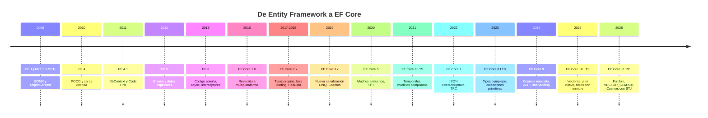
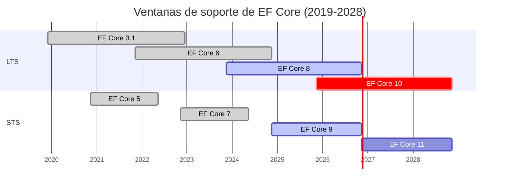
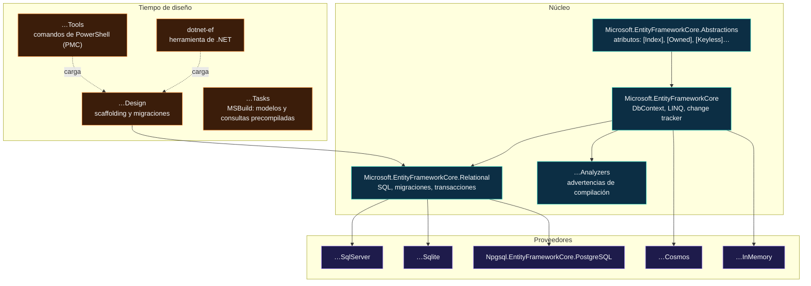
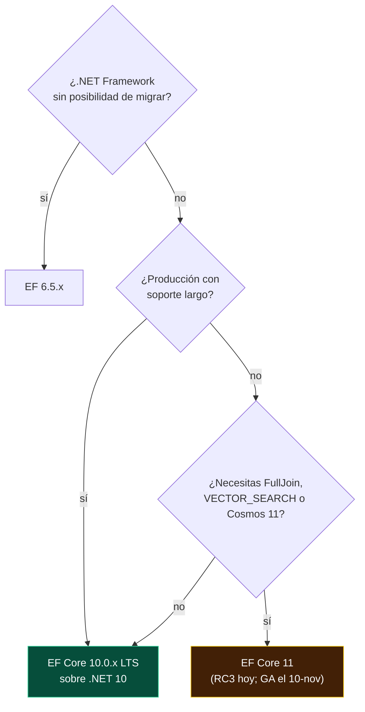

<div align="center">

# 01 · El modelo de versiones

**De Entity Framework 1 a EF Core 11: genealogía, numeración, soporte, paquetes y qué versión usar hoy**

[🏠 Índice](../README.md) · [02 · Anatomía de EF Core ➡](02-anatomia-de-ef-core.md)

</div>

<!-- ef=10 -->

| Ficha | |
|---|---|
| **Versión estable recomendada** | **EF Core 10.0.14** (LTS, soporte hasta el **10-nov-2028**) |
| **Próxima versión** | **EF Core 11.0**, en RC3 (`11.0.0-rc.3.26522.148`); disponibilidad general prevista el **10-nov-2026** |
| **Versiones que caducan esta semana** | **EF Core 8** y **EF Core 9**, el **10-nov-2026** |
| **Requisito de EF Core 10** | SDK y runtime de **.NET 10**; no funciona en .NET Framework |
| **Repositorio oficial** | [`dotnet/efcore`](https://github.com/dotnet/efcore) (licencia MIT) |
| **Documentación oficial** | [learn.microsoft.com/ef/core](https://learn.microsoft.com/ef/core/) |

---

## Contenido

1. [Dos productos con el mismo apellido](#1-dos-productos-con-el-mismo-apellido)
2. [La genealogía completa](#2-la-genealogía-completa)
3. [Por qué no existe EF Core 4](#3-por-qué-no-existe-ef-core-4)
4. [Calendario y ciclo de soporte](#4-calendario-y-ciclo-de-soporte)
5. [Qué framework exige cada versión](#5-qué-framework-exige-cada-versión)
6. [El mapa de paquetes NuGet](#6-el-mapa-de-paquetes-nuget)
7. [Versiones de los proveedores](#7-versiones-de-los-proveedores)
8. [Parches, *previews* y *release candidates*](#8-parches-previews-y-release-candidates)
9. [EF6 frente a EF Core](#9-ef6-frente-a-ef-core)
10. [Qué versión usar en noviembre de 2026](#10-qué-versión-usar-en-noviembre-de-2026)
11. [El caso de este repositorio](#11-el-caso-de-este-repositorio)
12. [Referencias](#12-referencias)

---

## 1. Dos productos con el mismo apellido

Cuando alguien dice "Entity Framework" puede referirse a **dos productos distintos**, con código, arquitectura y ciclo de vida independientes:

| | **Entity Framework 6 (EF6)** | **Entity Framework Core (EF Core)** |
|---|---|---|
| Nacimiento | 2008, como parte de .NET Framework 3.5 SP1 | 2016, reescrito desde cero |
| Última versión | EF 6.5.x (2024), en **mantenimiento** | EF Core 10 (LTS) y EF Core 11 (RC) |
| Plataforma | .NET Framework, y .NET Core 3.1+ desde EF 6.4 | Solo .NET moderno |
| Modelos | EDMX (diseñador visual), Code First | Solo Code First (con ingeniería inversa) |
| Proveedores NoSQL | No | Azure Cosmos DB |
| Evolución | Solo correcciones críticas | Versión mayor cada noviembre |

> [!IMPORTANT]
> **Este atlas trata de EF Core.** EF6 aparece solo como punto de comparación y en la guía de migración del
> [capítulo 23](23-migracion-entre-versiones.md#7-de-ef6-a-ef-core).

---

## 2. La genealogía completa



### La decisión de reescribir

En 2014 el equipo empezó "EF7": una reescritura pensada para ASP.NET 5 (después ASP.NET Core), que debía funcionar en Linux y macOS, en
dispositivos con pocos recursos y con almacenes no relacionales. En enero de 2016 el proyecto pasó a llamarse **Entity Framework Core 1.0**,
para dejar claro que **no era la continuación de EF6** sino un producto nuevo que, en su primera versión, tenía menos funciones.

| Lo que EF Core 1.0 dejó atrás | Por qué |
|---|---|
| EDMX y el diseñador visual | XML difícil de fusionar en control de versiones; Code First lo hacía innecesario |
| `ObjectContext` y Entity SQL | API antigua; `DbContext` era ya la API recomendada desde EF 4.1 |
| Dependencia de `System.Data.Entity` en .NET Framework | Imposible en un runtime multiplataforma |
| Carga diferida automática | Fuente clásica del problema N+1; volvió en 2.1 como opción explícita |
| Muchos a muchos sin entidad de unión | Volvió en EF Core 5.0 |

Lo que ganó a cambio fue una **arquitectura basada en servicios inyectables** ([capítulo 02](02-anatomia-de-ef-core.md)), proveedores enchufables,
un *change tracker* mucho más rápido y la posibilidad de evolucionar cada año sin arrastrar las decisiones de 2008.

---

## 3. Por qué no existe EF Core 4

La numeración salta de **3.1** a **5.0**. En noviembre de 2020 .NET Core pasó a llamarse **.NET 5**, y EF Core adoptó el mismo número para
alinearse con el runtime. Saltarse el 4 evitaba además la confusión con **EF 4** de 2010. Desde entonces:

> **EF Core N se publica junto con .NET N, cada noviembre, y sigue su política de soporte.**

| Si ves… | Significa |
|---|---|
| "EF7" antes de 2016 | El nombre provisional de EF Core 1.0 |
| "EF7" después de 2022 | EF Core 7.0 |
| "EF 6.x" | El producto clásico, no EF Core 6 |
| "EF Core 6" | EF Core 6.0, LTS de 2021 |

---

## 4. Calendario y ciclo de soporte

Desde EF Core 5, las versiones pares son **LTS** (soporte largo, tres años) y las impares **STS** (soporte estándar). Con .NET 9, Microsoft
amplió el STS de 18 a **24 meses**, de modo que una STS y la LTS anterior caducan el mismo día.

| Versión | Publicación | Tipo | Fin de soporte | Estado al 8-nov-2026 |
|---|---|---|---|---|
| [EF Core 1.0](03-ef-core-1-2-cimientos.md) | 27-jun-2016 | — | 27-jun-2019 | ⛔ |
| [EF Core 1.1](03-ef-core-1-2-cimientos.md#3-ef-core-11-noviembre-de-2016) | 16-nov-2016 | — | 27-jun-2019 | ⛔ |
| [EF Core 2.0](03-ef-core-1-2-cimientos.md#4-ef-core-20-agosto-de-2017) | 14-ago-2017 | — | 1-oct-2018 | ⛔ |
| [EF Core 2.1](03-ef-core-1-2-cimientos.md#5-ef-core-21-mayo-de-2018) | 30-may-2018 | LTS | 21-ago-2021¹ | ⛔ |
| [EF Core 2.2](03-ef-core-1-2-cimientos.md#6-ef-core-22-diciembre-de-2018) | 4-dic-2018 | — | 23-dic-2019 | ⛔ |
| [EF Core 3.0](04-ef-core-3-la-gran-ruptura.md) | 23-sep-2019 | — | 3-mar-2020 | ⛔ |
| [EF Core 3.1](04-ef-core-3-la-gran-ruptura.md#9-ef-core-31-la-primera-lts-moderna) | 3-dic-2019 | LTS | 13-dic-2022 | ⛔ |
| [EF Core 5.0](05-ef-core-5-relaciones-y-diagnostico.md) | 10-nov-2020 | STS | 10-may-2022 | ⛔ |
| [EF Core 6.0](06-ef-core-6-rendimiento-y-temporalidad.md) | 8-nov-2021 | LTS | 12-nov-2024 | ⛔ |
| [EF Core 7.0](07-ef-core-7-json-y-operaciones-masivas.md) | 8-nov-2022 | STS | 14-may-2024 | ⛔ |
| [EF Core 8.0](08-ef-core-8-tipos-complejos.md) | 14-nov-2023 | LTS | **10-nov-2026** | 🟠 caduca en 2 días |
| [EF Core 9.0](09-ef-core-9-cosmos-aot-y-siembra.md) | 12-nov-2024 | STS | **10-nov-2026** | 🟠 caduca en 2 días |
| [EF Core 10.0](10-ef-core-10-lts-vectores-y-json.md) | 11-nov-2025 | **LTS** | **10-nov-2028** | 🟢 recomendada |
| [EF Core 11.0](11-ef-core-11-rc.md) | GA prevista 10-nov-2026 | STS | nov-2028 (previsto) | 🟡 RC3 con licencia *go-live* |

¹ EF Core 2.1 siguió recibiendo soporte usado con ASP.NET Core 2.1 sobre .NET Framework.



> [!WARNING]
> **El 10 de noviembre de 2026 terminan a la vez EF Core 8 (LTS) y EF Core 9 (STS)**, junto con .NET 8 y .NET 9. A partir de ese día no recibirán
> parches de seguridad. El destino natural es **EF Core 10 sobre .NET 10**: consulta el
> [capítulo 23](23-migracion-entre-versiones.md) para cruzar los cambios incompatibles.

---

## 5. Qué framework exige cada versión

El destino (*target framework*) de cada paquete determina dónde puede ejecutarse. La regla moderna es sencilla: **EF Core N exige .NET N**, con una
excepción histórica, EF Core 9, que se publicó para .NET 8 para dar a la LTS una versión más de EF.

| Versión | Destino del paquete | Se ejecuta en |
|---|---|---|
| 1.x | `netstandard1.3` | .NET Framework 4.5.1+, .NET Core 1.0+, UWP |
| 2.x | `netstandard2.0` | .NET Framework 4.6.1+, .NET Core 2.0+ |
| 3.0 | `netstandard2.1` | Solo .NET Core 3.0+ (**fin de .NET Framework**) |
| 3.1 | `netstandard2.0` | .NET Framework 4.6.1+ de nuevo, y .NET Core 3.1 |
| 5.0 | `netstandard2.1` | .NET Core 3.1 y .NET 5 |
| 6.0 | `net6.0` | .NET 6 |
| 7.0 | `net6.0` | .NET 6 y .NET 7 |
| 8.0 | `net8.0` | .NET 8 |
| 9.0 | `net8.0` | .NET 8 y .NET 9 |
| **10.0** | **`net10.0`** | **.NET 10** |
| 11.0 | `net11.0` | .NET 11 |

> [!NOTE]
> Por eso **EF Core 3.1 fue durante años la única forma de usar EF Core en .NET Framework**. Si tienes una aplicación de .NET Framework que no puede
> migrar, tu opción con soporte es **EF6**, no EF Core.

---

## 6. El mapa de paquetes NuGet

EF Core no es un paquete, sino una familia. Un proyecto típico solo necesita **un proveedor** (que arrastra el núcleo) y, en desarrollo, **`Design`**.



| Paquete | ¿Cuándo lo necesitas? |
|---|---|
| `Microsoft.EntityFrameworkCore.SqlServer` (o tu proveedor) | Siempre: trae el núcleo y la capa relacional |
| `Microsoft.EntityFrameworkCore.Design` | Para `dotnet ef migrations` y `scaffold`. Márcalo con `PrivateAssets="all"` |
| `dotnet-ef` (herramienta global o local) | Para ejecutar la CLI. Su versión debe coincidir con la de `Design` |
| `Microsoft.EntityFrameworkCore.Tools` | Solo para la consola del administrador de paquetes de Visual Studio |
| `Microsoft.EntityFrameworkCore.Tasks` | Para generar modelos compilados y consultas precompiladas al compilar o publicar |
| `Microsoft.EntityFrameworkCore.Proxies` | Solo si usas carga diferida o seguimiento de cambios con proxies |
| `Microsoft.EntityFrameworkCore.InMemory` | Pruebas muy simples; [capítulo 18](18-pruebas.md) explica por qué casi nunca es buena idea |
| `Microsoft.EntityFrameworkCore.Abstractions` | En una biblioteca de dominio que solo usa atributos y no debe depender de EF entero |

> [!TIP]
> Una herramienta **local** fija la versión de `dotnet-ef` en el repositorio y evita el clásico "funciona en mi máquina":
>
> ```bash
> dotnet new tool-manifest
> dotnet tool install dotnet-ef --version 10.0.14
> dotnet tool restore        # en CI y en cada máquina nueva
> ```

---

## 7. Versiones de los proveedores

Cada proveedor publica su propia versión. **La versión mayor del proveedor debe coincidir con la de EF Core**: un proveedor 9.x no funciona con
EF Core 10.

| Proveedor | Paquete | Última estable (nov-2026) | ¿Soporta EF Core 10? | Mantenedor |
|---|---|---|---|---|
| SQL Server / Azure SQL | `Microsoft.EntityFrameworkCore.SqlServer` | 10.0.14 | ✅ | Microsoft |
| SQLite | `Microsoft.EntityFrameworkCore.Sqlite` | 10.0.14 | ✅ | Microsoft |
| Azure Cosmos DB | `Microsoft.EntityFrameworkCore.Cosmos` | 10.0.14 | ✅ | Microsoft |
| PostgreSQL | `Npgsql.EntityFrameworkCore.PostgreSQL` | 10.0.3 | ✅ | Proyecto Npgsql |
| MySQL (Oracle) | `MySql.EntityFrameworkCore` | 10.0.12 | ✅ | Oracle |
| MySQL / MariaDB (Pomelo) | `Pomelo.EntityFrameworkCore.MySql` | 9.0.0 | ❌ todavía no | Comunidad |
| Oracle Database | `Oracle.EntityFrameworkCore` | 10.23.26400 | ✅ | Oracle |
| InMemory | `Microsoft.EntityFrameworkCore.InMemory` | 10.0.14 | ✅ | Microsoft |

> [!CAUTION]
> **Pomelo** es el proveedor de MySQL más usado, pero a noviembre de 2026 su última versión estable es la **9.0.0**. Si dependes de él, comprueba su
> estado antes de planificar el salto a EF Core 10; la alternativa con soporte inmediato es el proveedor oficial de Oracle, `MySql.EntityFrameworkCore`.
> Más detalles en el [capítulo 16](16-proveedores.md).

---

## 8. Parches, *previews* y *release candidates*

| Tipo | Ejemplo | ¿Producción? | Qué contiene |
|---|---|---|---|
| Versión mayor | `10.0.0` | ✅ | Funciones nuevas y cambios incompatibles documentados |
| Parche | `10.0.14` | ✅ **siempre el último** | Correcciones de seguridad y de errores; sin cambios incompatibles intencionados |
| *Release candidate* | `11.0.0-rc.3.26522.148` | ⚠️ con licencia *go-live* | Funciones congeladas; soporte de Microsoft en producción |
| *Preview* | `11.0.0-preview.7.26381.103` | ❌ | Funciones a medio hacer; pueden cambiar o desaparecer |
| Compilación diaria | feed de `dotnet/efcore` | ❌ | Para probar correcciones |

### Cómo leer un número de compilación

La parte final de una versión preliminar codifica la fecha: `AAMDD` con el mes multiplicado por 50. En `11.0.0-rc.3.26522.148`:

```text
26522 → 26 (año 2026) · 522 = 10 × 50 + 22 → 22 de octubre · compilación 148
```

> [!TIP]
> Para fijar la misma versión en todos los paquetes de EF Core de una solución, usa **Central Package Management** (`Directory.Packages.props`) y
> declara una propiedad `EfCoreVersion`. Así nunca mezclarás `10.0.0-preview.4` con `10.0.14`.

---

## 9. EF6 frente a EF Core

| Característica | EF6 | EF Core 10 |
|---|---|---|
| Multiplataforma | Desde 6.4 sobre .NET Core 3.1+ | ✅ |
| Modelo EDMX / diseñador | ✅ | ❌ (ingeniería inversa a código) |
| Herencia TPH / TPT / TPC | TPH, TPT, TPC | TPH, TPT (5.0), TPC (7.0) |
| Muchos a muchos implícito | ✅ | ✅ desde 5.0 |
| Tipos complejos | ✅ (sin colecciones) | ✅ con colecciones y JSON desde 10 |
| Columnas JSON | ❌ | ✅ |
| Operaciones masivas | ❌ | `ExecuteUpdate` / `ExecuteDelete` |
| Filtros globales | ❌ (bibliotecas externas) | ✅ con nombre desde 10 |
| Proveedores NoSQL | ❌ | Cosmos DB |
| Rendimiento del *change tracker* | Base | Varias veces más rápido |
| Modelos compilados y AOT | ❌ | ✅ |
| Búsqueda vectorial | ❌ | SQL Server, Azure SQL, Cosmos |
| Evolución | Mantenimiento | Activa |

---

## 10. Qué versión usar en noviembre de 2026



| Situación | Recomendación |
|---|---|
| Proyecto nuevo | **EF Core 10.0.x** sobre .NET 10 |
| Proyecto en EF Core 8 o 9 | Migrar a **EF Core 10 antes del 10-nov-2026** |
| Proyecto en EF Core 6 o 7 | Ya sin soporte: saltar directamente a 10 y revisar los cambios de 7, 8, 9 y 10 |
| Proyecto en EF Core 3.1 sobre .NET Framework | Sin soporte desde 2022: migrar a .NET 10 o volver a EF6 |
| Quieres probar EF Core 11 | En una rama, con el SDK de .NET 11 RC3; producción tras la GA |

> [!NOTE]
> EF Core 11 será STS, pero como el STS dura ahora 24 meses, su soporte terminará en **noviembre de 2028**, prácticamente a la vez que EF Core 10. Elegir
> 11 no acorta el soporte; solo implica un salto mayor más (al 12) dentro de ese plazo.

---

## 11. El caso de este repositorio

El proyecto [`EFCore.csproj`](../EFCore.csproj) referencia **versiones preliminares de mayo de 2025**:

```xml
<PackageReference Include="Microsoft.EntityFrameworkCore" Version="10.0.0-preview.4.25258.110" />
<PackageReference Include="Npgsql.EntityFrameworkCore.PostgreSQL" Version="10.0.0-preview.3" />
```

| Problema | Consecuencia | Corrección |
|---|---|---|
| *Preview* 4 de EF Core 10 | Sin soporte, con errores corregidos hace más de un año | `10.0.14` |
| Npgsql *preview* 3 junto a EF *preview* 4 | Versiones mayores iguales pero *previews* desalineadas | `10.0.3`, o quitarlo: el proyecto no usa PostgreSQL |
| `InMemory` referenciado | Solo se usa en una línea comentada | Quitarlo o moverlo a un proyecto de pruebas |
| `System.Security.Cryptography.Pkcs` 9.0.0 transitivo | Advertencias NU1902/NU1903 por vulnerabilidades conocidas | Desaparecen al actualizar a 10.0.14 |

El análisis completo del proyecto, con todas sus correcciones, está en el [capítulo 20 · Caso práctico JobsDB](20-caso-practico-jobsdb.md).

---

## 12. Referencias

- [EF Core releases and planning](https://learn.microsoft.com/ef/core/what-is-new/) — tabla oficial de versiones y soporte.
- [.NET support policy](https://dotnet.microsoft.com/platform/support/policy/dotnet-core) — LTS, STS y fechas.
- [Compare EF Core & EF6](https://learn.microsoft.com/ef/efcore-and-ef6/) — comparación oficial.
- [EF Core NuGet packages](https://learn.microsoft.com/ef/core/what-is-new/nuget-packages) — qué hace cada paquete.
- [Database providers](https://learn.microsoft.com/ef/core/providers/) — lista de proveedores.

<div align="center">

[🏠 Índice](../README.md) · [02 · Anatomía de EF Core ➡](02-anatomia-de-ef-core.md)

</div>
