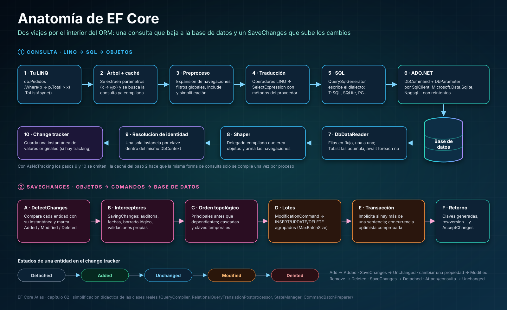
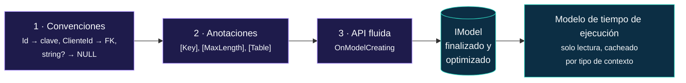
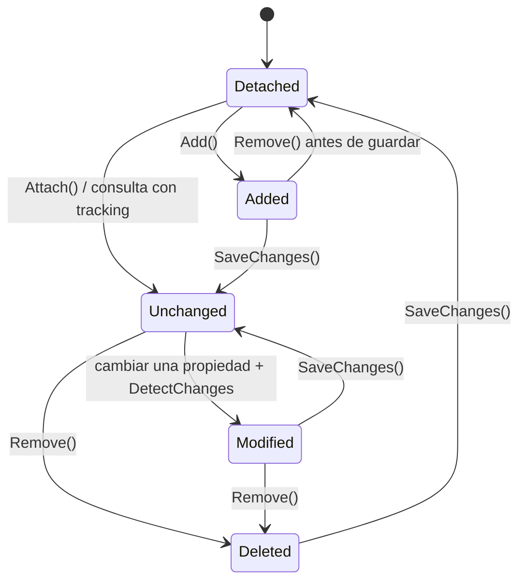
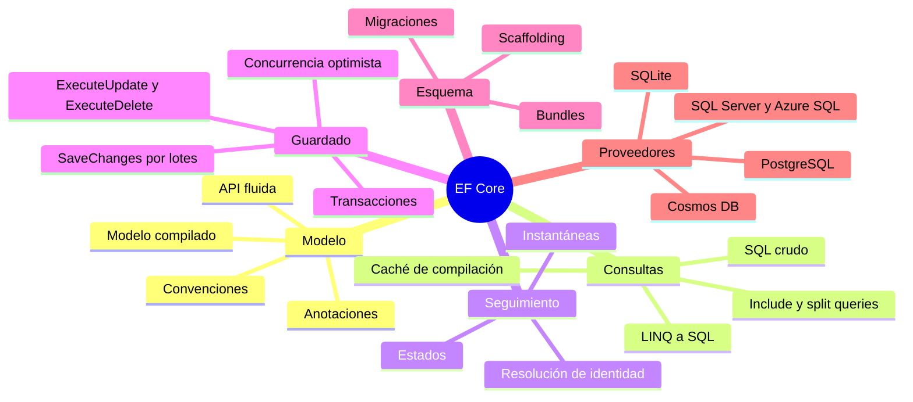

<div align="center">

# 02 · Anatomía de EF Core

**Qué ocurre de verdad entre tu `ToListAsync()` y la base de datos, y entre tu `SaveChangesAsync()` y las filas**

[⬅ 01 · Modelo de versiones](01-modelo-de-versiones.md) · [🏠 Índice](../README.md) · [03 · EF Core 1 y 2 ➡](03-ef-core-1-2-cimientos.md)

</div>

<!-- ef=10 -->

<p align="center">
  <a href="../assets/efcore-atlas-anatomia.svg"></a>
</p>

---

## Contenido

1. [Un ORM en una frase](#1-un-orm-en-una-frase)
2. [El `DbContext`: unidad de trabajo y repositorio](#2-el-dbcontext-unidad-de-trabajo-y-repositorio)
3. [El modelo: la fuente de verdad](#3-el-modelo-la-fuente-de-verdad)
4. [El proveedor interno de servicios](#4-el-proveedor-interno-de-servicios)
5. [La canalización de consultas](#5-la-canalización-de-consultas)
6. [Materialización y resolución de identidad](#6-materialización-y-resolución-de-identidad)
7. [El *change tracker*](#7-el-change-tracker)
8. [`SaveChanges` por dentro](#8-savechanges-por-dentro)
9. [La capa relacional y los proveedores](#9-la-capa-relacional-y-los-proveedores)
10. [Puntos de extensión](#10-puntos-de-extensión)
11. [Mapa mental](#11-mapa-mental)
12. [Referencias](#12-referencias)

---

## 1. Un ORM en una frase

Un **ORM** (*object-relational mapper*) resuelve el **desajuste de impedancia objeto-relacional**: tu código piensa en **grafos de objetos** con
referencias, herencia y colecciones, y la base de datos piensa en **conjuntos de filas** con claves foráneas y `JOIN`. EF Core traduce en los dos sentidos:

| Mundo de objetos | Mundo relacional | Quién traduce en EF Core |
|---|---|---|
| Clase | Tabla (o vista, o columna JSON) | El **modelo** |
| Propiedad | Columna | *Type mapping* del proveedor |
| Referencia `pedido.Cliente` | Clave foránea `ClienteId` | Navegaciones y *fix-up* |
| Colección `cliente.Pedidos` | Filas que apuntan a la clave | Navegaciones de colección |
| Herencia | TPH, TPT o TPC | Estrategia de mapeo |
| `Where`, `Select`, `OrderBy` | `WHERE`, `SELECT`, `ORDER BY` | **Canalización de consultas** |
| Modificar un objeto | `UPDATE` | ***Change tracker*** y `SaveChanges` |
| Identidad (`ReferenceEquals`) | Clave primaria | **Resolución de identidad** |

---

## 2. El `DbContext`: unidad de trabajo y repositorio

`DbContext` combina dos patrones clásicos de Martin Fowler: **Unit of Work** (acumula cambios y los confirma en una transacción) y **Repository**
(`DbSet<T>` es una colección consultable). Una instancia es **ligera, no es segura entre hilos y está pensada para vivir poco**: una petición web, un
mensaje de una cola, una unidad de trabajo.

```csharp run
using var db = new Tienda();
db.Database.EnsureDeleted();
db.Database.EnsureCreated();

db.Productos.Add(new Producto { Nombre = "Teclado", Stock = 10 });
db.Productos.Add(new Producto { Nombre = "Ratón", Stock = 0 });
var filas = db.SaveChanges();

Console.WriteLine($"Filas insertadas: {filas}");                       // → Filas insertadas: 2
Console.WriteLine(db.Productos.Count(p => p.Stock > 0));               // → 1

public class Producto
{
    public int Id { get; set; }
    public required string Nombre { get; set; }
    public int Stock { get; set; }
}

public class Tienda : DbContext
{
    public DbSet<Producto> Productos => Set<Producto>();

    protected override void OnConfiguring(DbContextOptionsBuilder options)
        => options.UseSqlite("Data Source=tienda.db");
}
```

### Qué contiene una instancia

| Miembro | Qué es | Coste |
|---|---|---|
| `Model` | El modelo de metadatos (compartido entre instancias del mismo tipo) | Se construye una vez por proceso |
| `ChangeTracker` | Entidades seguidas y sus instantáneas | Crece con cada entidad seguida |
| `Database` | Fachada: transacciones, migraciones, SQL crudo, conexión | Ligera |
| `DbSet<T>` | Puerta de entrada a las consultas y a `Add`/`Remove` | Ligera |
| Servicios internos | Proveedor de servicios propio de EF (§ 4) | Uno por configuración, cacheado |

> [!WARNING]
> **Un `DbContext` no admite operaciones concurrentes.** Dos `await` simultáneos sobre la misma instancia lanzan
> `InvalidOperationException: A second operation was started on this context instance before a previous operation completed`. Usa una instancia por unidad
> de trabajo o una fábrica (`IDbContextFactory<T>`); ver [capítulo 19](19-arquitectura-de-aplicaciones.md#2-vida-del-dbcontext).

### Formas de configurar un contexto

| Forma | Cuándo | Ejemplo |
|---|---|---|
| `OnConfiguring` | Consolas, pruebas, ejemplos | `options.UseSqlite("...")` |
| Constructor con `DbContextOptions<T>` | Aplicaciones con inyección de dependencias | `AddDbContext<T>(o => o.UseSqlServer(...))` |
| `AddSqlServer<T>(cadena)` y similares | Minimal APIs, una línea | El que usa este repositorio |
| `AddDbContextPool<T>` | Alto rendimiento | Reutiliza instancias ([capítulo 17](17-rendimiento-y-diagnostico.md)) |
| `AddDbContextFactory<T>` | Blazor, trabajos en segundo plano | `factory.CreateDbContext()` |

---

## 3. El modelo: la fuente de verdad

Antes de la primera consulta, EF construye un **modelo** (`IModel`): qué entidades existen, a qué tablas van, qué claves, relaciones, índices, tipos de
columna y conversiones tienen. Lo hace en tres capas, de menor a mayor prioridad:



El modelo se puede **inspeccionar en ejecución**, lo que es la mejor forma de comprobar qué entendió EF de tus clases:

```csharp run
using var db = new Tienda();
var producto = db.Model.FindEntityType(typeof(Producto))!;

Console.WriteLine(producto.GetTableName());                                    // → Productos
foreach (var p in producto.GetProperties())
    Console.WriteLine($"{p.Name}: {p.GetColumnType()}{(p.IsNullable ? "" : " NOT NULL")}");
// → Id: INTEGER NOT NULL
// → Descripcion: TEXT
// → Nombre: TEXT NOT NULL
// → Stock: INTEGER NOT NULL
Console.WriteLine(producto.FindPrimaryKey()!.Properties[0].ValueGenerated);   // → OnAdd

public class Producto
{
    public int Id { get; set; }
    public required string Nombre { get; set; }
    public string? Descripcion { get; set; }
    public int Stock { get; set; }
}

public class Tienda : DbContext
{
    public DbSet<Producto> Productos => Set<Producto>();
    protected override void OnConfiguring(DbContextOptionsBuilder options) => options.UseSqlite("Data Source=tienda.db");
}
```

Observa tres convenciones en acción (y una cuarta de regalo: tras la clave, EF ordena las columnas alfabéticamente): `Id` se convirtió en clave con valor generado al insertar, el nombre de la tabla salió del `DbSet` (`Productos`) y
**la nulabilidad de C#** decidió `NOT NULL`: `string` es obligatoria y `string?` opcional.

> [!TIP]
> `db.Model.ToDebugString()` (o la vista de depuración `Model.DebugView.LongView`) imprime el modelo completo. Es la herramienta número uno para
> diagnosticar "¿por qué EF creó esta columna?".

### El coste de construir el modelo

Construir el modelo cuesta poco en un modelo pequeño, pero en uno de cientos de entidades puede llevar **segundos** en el arranque. Por eso existen los
**modelos compilados** (EF Core 6, automáticos desde EF Core 9): `dotnet ef dbcontext optimize` genera el modelo como código C# y elimina ese coste;
ver [capítulo 17](17-rendimiento-y-diagnostico.md#4-modelos-compilados).

---

## 4. El proveedor interno de servicios

EF Core está construido como **cientos de servicios pequeños** registrados en un contenedor de inyección de dependencias **propio**, separado del de tu
aplicación. Cada proveedor (SQL Server, SQLite, Cosmos…) registra sus implementaciones: su generador de SQL, sus *type mappings*, sus traductores de métodos.

| Servicio (ejemplos) | Responsabilidad |
|---|---|
| `IQueryCompiler` | Orquesta la compilación y ejecución de consultas |
| `IQueryableMethodTranslatingExpressionVisitorFactory` | Traduce operadores LINQ |
| `IMethodCallTranslatorProvider` | Traduce métodos .NET (`string.Contains`, `DateTime.Year`…) a SQL |
| `IRelationalTypeMappingSource` | Decide el tipo de columna de cada tipo .NET |
| `IQuerySqlGeneratorFactory` | Escribe el texto SQL en el dialecto del proveedor |
| `IStateManager` | Corazón del *change tracker* |
| `ICommandBatchPreparer` | Agrupa comandos de `SaveChanges` en lotes |
| `IMigrationsSqlGenerator` | Convierte operaciones de migración en DDL |

Ese contenedor se **cachea por configuración de opciones**. Si cada `DbContext` se configura de forma distinta (por ejemplo, creando un
`ILoggerFactory` nuevo en cada instancia), EF crea un contenedor nuevo cada vez y acaba lanzando la advertencia `ManyServiceProvidersCreatedWarning`.

> [!CAUTION]
> `ReplaceService<TService, TImplementation>()` permite sustituir cualquier servicio interno, pero esos servicios **no forman parte de la API pública
> estable**: pueden cambiar entre versiones mayores sin aviso. Prefiere siempre interceptores, convenciones o conversiones (§ 10).

---

## 5. La canalización de consultas

Una consulta LINQ sobre `IQueryable<T>` **no se ejecuta al escribirla**: construye un **árbol de expresión** (`Expression`). Solo al enumerarla
(`ToList`, `First`, `Count`, `await foreach`…) EF lo procesa en diez pasos, los del carril superior de la lámina:

| Paso | Qué hace | Clase representativa |
|---|---|---|
| 1 | Tu LINQ produce un `Expression` | `IQueryable<T>.Expression` |
| 2 | Se **extraen los parámetros** (variables capturadas) y se busca la consulta en la **caché** | `ExpressionTreeFuncletizer`, `CompiledQueryCache` |
| 3 | Preproceso: expansión de navegaciones, `Include`, filtros globales | `NavigationExpandingExpressionVisitor` |
| 4 | Traducción de operadores a una `SelectExpression` | `QueryableMethodTranslatingExpressionVisitor` |
| 5 | Posproceso y generación del SQL | `QuerySqlGenerator` |
| 6 | Ejecución con ADO.NET | `RelationalCommand` |
| 7 | Lectura en flujo | `DbDataReader` |
| 8 | *Shaper*: delegado compilado que crea objetos | `ShapedQueryCompilingExpressionVisitor` |
| 9 | Resolución de identidad | `IStateManager` |
| 10 | Registro en el *change tracker* | `InternalEntityEntry` |

`ToQueryString()` detiene el viaje en el paso 5 y te enseña el SQL **sin ejecutarlo**:

```csharp run
using var db = new Tienda();
var minimo = 5;

var consulta = db.Productos
    .Where(p => p.Stock >= minimo && p.Nombre.StartsWith("T"))
    .OrderBy(p => p.Nombre)
    .Select(p => new { p.Nombre, p.Stock });

Console.WriteLine(consulta.ToQueryString());
// → .param set @minimo 5
// →
// → SELECT "p"."Nombre", "p"."Stock"
// → FROM "Productos" AS "p"
// → WHERE "p"."Stock" >= @minimo AND "p"."Nombre" LIKE 'T%'
// → ORDER BY "p"."Nombre"

public class Producto
{
    public int Id { get; set; }
    public required string Nombre { get; set; }
    public int Stock { get; set; }
}

public class Tienda : DbContext
{
    public DbSet<Producto> Productos => Set<Producto>();
    protected override void OnConfiguring(DbContextOptionsBuilder options) => options.UseSqlite("Data Source=tienda.db");
}
```

Tres detalles de experto en esa salida:

1. **`minimo` viajó como parámetro** (`@minimo`), no como literal. Por eso la caché de planes de la base de datos reutiliza el plan aunque el valor cambie.
   Desde EF Core 10 el parámetro se llama como la variable; antes se llamaba `@__minimo_0`.
2. **`"T"` es una constante** del código y EF la incrustó como `LIKE 'T%'`, que puede usar un índice.
3. **La proyección anónima** solo pidió dos columnas. Proyectar es la optimización más barata que existe.

### La caché de consultas compiladas

Compilar una consulta (pasos 3 a 8) es caro: decenas o cientos de microsegundos. EF guarda el resultado en una caché indexada por la **forma** del árbol de
expresión, con los valores de los parámetros extraídos. Dos consultas con la misma forma y distintos valores comparten la compilación:

| Código | ¿Reutiliza la compilación? |
|---|---|
| `Where(p => p.Stock > minimo)` con `minimo = 1` y luego `minimo = 7` | ✅ sí: misma forma, otro parámetro |
| `Where(p => p.Stock > 1)` y luego `Where(p => p.Stock > 7)` | ❌ no: constantes distintas, formas distintas |
| Construir el `Where` dinámicamente con condiciones distintas | ❌ una compilación por combinación |

> [!IMPORTANT]
> **Desde EF Core 3.0, una consulta LINQ produce exactamente una sentencia SQL** (salvo `AsSplitQuery`) y lo que no se puede traducir **lanza una
> excepción**, en lugar de evaluarse en memoria en silencio. Solo la **última** proyección `Select` puede contener código .NET arbitrario. Es el cambio más
> importante de la historia de EF Core: [capítulo 04](04-ef-core-3-la-gran-ruptura.md).

---

## 6. Materialización y resolución de identidad

El *shaper* convierte filas en objetos. En una consulta con seguimiento (la opción por defecto), EF garantiza que **una fila es un objeto**: si la misma clave
aparece dos veces, recibes la **misma instancia**.

```csharp run
using var db = new Tienda();
db.Database.EnsureDeleted();
db.Database.EnsureCreated();
db.Productos.Add(new Producto { Nombre = "Monitor", Stock = 3 });
db.SaveChanges();
db.ChangeTracker.Clear();

var a = db.Productos.Single(p => p.Nombre == "Monitor");
var b = db.Productos.Single(p => p.Stock == 3);
Console.WriteLine(ReferenceEquals(a, b));                      // → True

var c = db.Productos.AsNoTracking().Single(p => p.Nombre == "Monitor");
var d = db.Productos.AsNoTracking().Single(p => p.Stock == 3);
Console.WriteLine(ReferenceEquals(c, d));                      // → False

a.Stock = 99;                                                  // cambio solo en memoria
var e = db.Productos.Single(p => p.Nombre == "Monitor");
Console.WriteLine(e.Stock);                                    // → 99

public class Producto
{
    public int Id { get; set; }
    public required string Nombre { get; set; }
    public int Stock { get; set; }
}

public class Tienda : DbContext
{
    public DbSet<Producto> Productos => Set<Producto>();
    protected override void OnConfiguring(DbContextOptionsBuilder options) => options.UseSqlite("Data Source=tienda.db");
}
```

> [!WARNING]
> **El último resultado sorprende a casi todos.** La tercera consulta sí fue a la base de datos, que devolvió `Stock = 3`, pero como la entidad ya estaba
> seguida, EF **conservó la instancia en memoria con sus cambios pendientes** y descartó los valores leídos. Una consulta con seguimiento **no refresca**
> entidades ya cargadas. Para releer, usa `Entry(a).Reload()` o un contexto nuevo.

---

## 7. El *change tracker*

Cada entidad seguida tiene un **estado** y, para detectar cambios por instantánea, una **copia de sus valores originales**.



`ChangeTracker.DebugView` muestra qué sabe EF en cada momento:

```csharp run
using var db = new Tienda();
db.Database.EnsureDeleted();
db.Database.EnsureCreated();

var p = new Producto { Nombre = "Webcam", Stock = 4 };
db.Add(p);
Console.WriteLine(db.Entry(p).State);                          // → Added
db.SaveChanges();
Console.WriteLine(db.Entry(p).State);                          // → Unchanged

p.Stock = 2;
Console.WriteLine(db.Entry(p).State);                          // → Modified
Console.Write(db.ChangeTracker.DebugView.ShortView);
// → Producto {Id: 1} Modified
Console.WriteLine(db.Entry(p).Property(x => x.Stock).OriginalValue);  // → 4

db.Remove(p);
Console.WriteLine(db.Entry(p).State);                          // → Deleted
db.SaveChanges();
Console.WriteLine(db.Entry(p).State);                          // → Detached

public class Producto
{
    public int Id { get; set; }
    public required string Nombre { get; set; }
    public int Stock { get; set; }
}

public class Tienda : DbContext
{
    public DbSet<Producto> Productos => Set<Producto>();
    protected override void OnConfiguring(DbContextOptionsBuilder options) => options.UseSqlite("Data Source=tienda.db");
}
```

### Cómo se detectan los cambios

| Estrategia | Cómo funciona | Cuándo |
|---|---|---|
| **Instantánea** (por defecto) | Al seguir una entidad se copia cada valor; `DetectChanges` compara | Clases POCO normales |
| Notificaciones | La entidad implementa `INotifyPropertyChanged`/`Changing` | Modelos enormes con pocas modificaciones |
| Proxies de seguimiento | `UseChangeTrackingProxies()` genera subclases | Sin tocar las clases, con propiedades `virtual` |

`DetectChanges` se ejecuta **automáticamente** antes de `SaveChanges`, de `Entry`, de `Entries` y de otros métodos. Leer `Entry(p).State` arriba fue
lo que hizo visible el estado `Modified`. En modelos con miles de entidades seguidas ese escaneo cuesta; por eso las consultas de solo lectura deben usar
`AsNoTracking()` ([capítulo 13](13-consultas.md#5-seguimiento-o-no)).

---

## 8. `SaveChanges` por dentro

El carril inferior de la lámina, paso a paso:

| Paso | Qué ocurre | Lo que debes saber |
|---|---|---|
| A · `DetectChanges` | Compara instantáneas | Se puede desactivar con `AutoDetectChangesEnabled = false` en cargas masivas |
| B · Interceptores | `SavingChanges` de cada `ISaveChangesInterceptor` | Lugar ideal para auditoría y borrado lógico |
| C · Orden topológico | Principales antes que dependientes; resuelve claves temporales | Por eso puedes añadir un pedido con su cliente nuevo sin guardar dos veces |
| D · Lotes | Agrupa sentencias en pocos viajes | SQL Server: hasta 42 por defecto con `MERGE`/`OUTPUT`; configurable con `MaxBatchSize` |
| E · Transacción | Si hay más de una sentencia, abre una transacción implícita | Si hay una sola, EF 7+ se la ahorra |
| F · Retorno | Lee claves generadas, `rowversion`, valores por defecto; pasa a `Unchanged` | Si una fila esperada no se actualizó, lanza `DbUpdateConcurrencyException` |

```mermaid
sequenceDiagram
    autonumber
    participant App as Tu código
    participant Ctx as DbContext
    participant CT as Change tracker
    participant DB as Base de datos
    App->>Ctx: SaveChangesAsync()
    Ctx->>CT: DetectChanges()
    CT-->>Ctx: 1 Added · 2 Modified · 1 Deleted
    Ctx->>Ctx: Interceptores SavingChanges
    Ctx->>DB: BEGIN TRANSACTION
    Ctx->>DB: Lote: INSERT … RETURNING Id; UPDATE …; UPDATE …; DELETE …
    DB-->>Ctx: Id generado · filas afectadas = 4
    Ctx->>DB: COMMIT
    Ctx->>CT: AcceptChanges() → todo Unchanged
    Ctx-->>App: 4
```

---

## 9. La capa relacional y los proveedores

`Microsoft.EntityFrameworkCore` no sabe nada de SQL. La capa **relacional** (`Microsoft.EntityFrameworkCore.Relational`) añade tablas, columnas, SQL,
transacciones y migraciones, y cada **proveedor** relacional solo implementa lo específico de su base de datos:

| Aspecto | SQL Server | SQLite | PostgreSQL (Npgsql) |
|---|---|---|---|
| Comillas de identificadores | `[Productos]` | `"Productos"` | `"Productos"` |
| Paginación | `OFFSET … FETCH` / `TOP` | `LIMIT … OFFSET` | `LIMIT … OFFSET` |
| Clave generada | `IDENTITY` / secuencias | `AUTOINCREMENT` | `GENERATED BY DEFAULT AS IDENTITY` |
| Retorno de valores | `OUTPUT INSERTED.*` | `RETURNING` | `RETURNING` |
| `string.Contains` | `LIKE '%x%'` o `CHARINDEX` | `instr()` | `strpos()` / `LIKE` |
| Colecciones parametrizadas | `IN (@p1, @p2…)` u `OPENJSON` | `json_each` | arreglos nativos `= ANY(@p)` |
| JSON | `nvarchar(max)` o `json` (2025) | `TEXT` con `json_*` | `jsonb` |

El proveedor **Cosmos DB** no es relacional: implementa directamente las abstracciones del núcleo y genera SQL de Cosmos (un dialecto propio sobre JSON).
Por eso no tiene migraciones, ni `JOIN` entre documentos, ni `ExecuteUpdate`. Detalles en el [capítulo 16](16-proveedores.md).

---

## 10. Puntos de extensión

De menos a más invasivo:

| Punto | Para qué | Desde | Capítulo |
|---|---|---|---|
| **Conversiones de valores** | Guardar un tipo .NET con otra representación | 2.1 | [12](12-modelado.md#7-conversiones-de-valores) |
| **Configuración previa a convenciones** | Reglas por tipo .NET para todo el modelo | 6.0 | [12](12-modelado.md#3-convenciones-y-configuración-masiva) |
| **Convenciones propias** | Reglas de modelado reutilizables | 7.0 | [12](12-modelado.md#3-convenciones-y-configuración-masiva) |
| **Eventos** (`SavingChanges`, `Tracked`, `StateChanged`) | Reaccionar a cambios | 2.1/5.0 | [14](14-guardado-y-concurrencia.md) |
| **Interceptores** | Comandos, conexiones, transacciones, `SaveChanges`, materialización, consultas | 3.0/5.0/7.0 | [17](17-rendimiento-y-diagnostico.md#8-interceptores) |
| **Funciones mapeadas** | Llamar funciones de la base desde LINQ | 2.0 | [13](13-consultas.md) |
| **`DiagnosticListener` y `EventCounters`** | Telemetría y OpenTelemetry | 3.0 | [17](17-rendimiento-y-diagnostico.md) |
| `ReplaceService` | Sustituir un servicio interno | 1.1 | Último recurso |

---

## 11. Mapa mental



---

## 12. Referencias

- [How queries work](https://learn.microsoft.com/ef/core/querying/how-query-works) — la canalización de consultas.
- [Change tracking](https://learn.microsoft.com/ef/core/change-tracking/) — estados, instantáneas, resolución de identidad.
- [DbContext lifetime, configuration, and initialization](https://learn.microsoft.com/ef/core/dbcontext-configuration/).
- [Internal service provider](https://learn.microsoft.com/ef/core/dbcontext-configuration/#dbcontextoptions) y el código fuente de
  [`dotnet/efcore`](https://github.com/dotnet/efcore/tree/main/src).

<div align="center">

[⬅ 01 · Modelo de versiones](01-modelo-de-versiones.md) · [🏠 Índice](../README.md) · [03 · EF Core 1 y 2 ➡](03-ef-core-1-2-cimientos.md)

</div>
