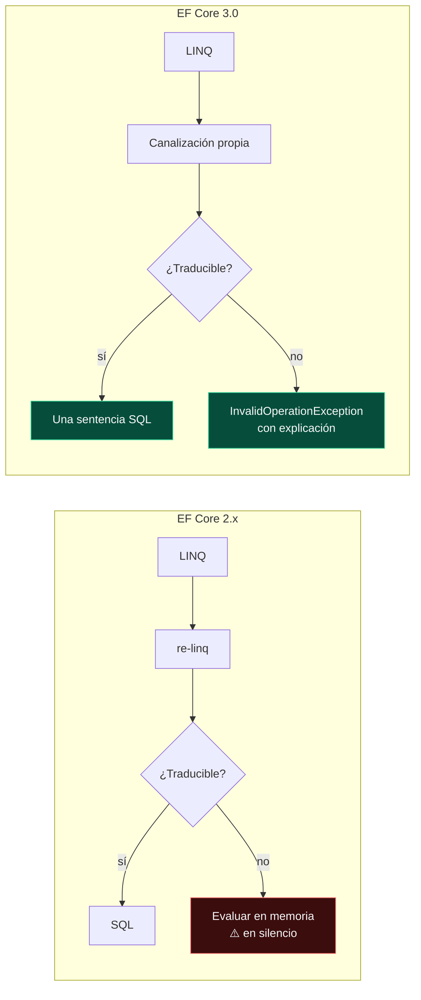

<div align="center">

# 04 · EF Core 3: la gran ruptura

**Nueva canalización LINQ, fin de la evaluación implícita en cliente, Cosmos DB, interceptores y la primera LTS moderna (2019)**

[⬅ 03 · EF Core 1 y 2](03-ef-core-1-2-cimientos.md) · [🏠 Índice](../README.md) · [05 · EF Core 5 ➡](05-ef-core-5-relaciones-y-diagnostico.md)

</div>

<!-- ef=10 -->

| Ficha | EF Core 3.0 | EF Core 3.1 |
|---|---|---|
| **Publicación** | 23-sep-2019 | 3-dic-2019 |
| **Plataforma** | .NET Standard 2.1 (sin .NET Framework) | .NET Standard 2.0 (vuelve .NET Framework 4.6.1+) |
| **Acompañaba a** | .NET Core 3.0, C# 8 | .NET Core 3.1 |
| **Soporte** | ⛔ 3-mar-2020 | ⛔ 13-dic-2022 (**LTS**) |
| **Idea central** | Romper para poder crecer | Estabilizar |

> [!IMPORTANT]
> EF Core 3.0 tiene **la lista de cambios incompatibles más larga de la historia de EF Core**. Fue deliberado: el equipo decidió pagar de una vez la deuda
> de 2016–2018 para que las versiones siguientes pudieran evolucionar sin romper. Si migras código de EF Core 2.x, este capítulo es obligatorio.

---

## Contenido

1. [Por qué hubo que romper](#1-por-qué-hubo-que-romper)
2. [El fin de la evaluación implícita en cliente](#2-el-fin-de-la-evaluación-implícita-en-cliente)
3. [Una consulta LINQ, una sentencia SQL](#3-una-consulta-linq-una-sentencia-sql)
4. [Interceptores](#4-interceptores)
5. [Flujos asíncronos](#5-flujos-asíncronos)
6. [Entidades sin clave](#6-entidades-sin-clave)
7. [Tipos de referencia anulables](#7-tipos-de-referencia-anulables)
8. [El proveedor de Azure Cosmos DB](#8-el-proveedor-de-azure-cosmos-db)
9. [EF Core 3.1: la primera LTS moderna](#9-ef-core-31-la-primera-lts-moderna)
10. [Cambios incompatibles de 3.0](#10-cambios-incompatibles-de-30)
11. [Referencias](#11-referencias)

---

## 1. Por qué hubo que romper

La canalización de consultas de EF Core 1 y 2 se apoyaba en **re-linq**, una biblioteca externa que convertía LINQ en un modelo intermedio. Funcionaba,
pero cada mejora de traducción chocaba con sus límites, y la evaluación en cliente **ocultaba** los fallos de traducción. Una consulta podía parecer correcta
en desarrollo, con diez filas, y descargar un millón en producción.



---

## 2. El fin de la evaluación implícita en cliente

Desde 3.0, si EF no puede traducir una parte de la consulta, **lanza una excepción** que explica qué expresión falló:

```csharp lanza=InvalidOperationException
using var db = new Tienda();
db.Database.EnsureDeleted();
db.Database.EnsureCreated();

// Reglas.EsOferta es código .NET: no existe en la base de datos
var ofertas = db.Productos.Where(p => Reglas.EsOferta(p.Nombre)).ToList();

public static class Reglas
{
    public static bool EsOferta(string nombre) => nombre.EndsWith('!');
}

public class Producto
{
    public int Id { get; set; }
    public required string Nombre { get; set; }
    public int Stock { get; set; }
}

public class Tienda : DbContext
{
    public DbSet<Producto> Productos => Set<Producto>();
    protected override void OnConfiguring(DbContextOptionsBuilder o) => o.UseSqlite("Data Source=tienda.db");
}
```

```text
System.InvalidOperationException: The LINQ expression 'DbSet<Producto>()
    .Where(p => Reglas.EsOferta(p.Nombre))' could not be translated.
Either rewrite the query in a form that can be translated, or switch to client evaluation explicitly
by inserting a call to 'AsEnumerable', 'AsAsyncEnumerable', 'ToList', or 'ToListAsync'.
```

### Las tres salidas correctas

```csharp run
using var db = new Tienda();
db.Database.EnsureDeleted();
db.Database.EnsureCreated();
db.AddRange(new Producto { Nombre = "Cable!", Stock = 3 }, new Producto { Nombre = "Funda", Stock = 0 });
db.SaveChanges();

// 1 · Reescribir con algo traducible (lo mejor: filtra en el servidor)
Console.WriteLine(db.Productos.Count(p => p.Nombre.EndsWith("!")));          // → 1

// 2 · Filtrar en el servidor lo que se pueda y pasar a memoria de forma EXPLÍCITA
var ofertas = db.Productos
    .Where(p => p.Stock > 0)          // SQL
    .AsEnumerable()                   // a partir de aquí, LINQ to Objects
    .Where(p => Reglas.EsOferta(p.Nombre))   // .NET
    .Select(p => p.Nombre)
    .ToList();
Console.WriteLine(string.Join(", ", ofertas));                             // → Cable!

// 3 · Código .NET en la proyección FINAL: está permitido
var etiquetas = db.Productos.OrderBy(p => p.Id).Select(p => Reglas.Etiqueta(p.Nombre, p.Stock)).ToList();
Console.WriteLine(string.Join(" | ", etiquetas));                          // → CABLE! (3) | FUNDA (agotado)

public static class Reglas
{
    public static bool EsOferta(string nombre) => nombre.EndsWith('!');
    public static string Etiqueta(string nombre, int stock) => $"{nombre.ToUpperInvariant()} ({(stock > 0 ? stock : "agotado")})";
}

public class Producto
{
    public int Id { get; set; }
    public required string Nombre { get; set; }
    public int Stock { get; set; }
}

public class Tienda : DbContext
{
    public DbSet<Producto> Productos => Set<Producto>();
    protected override void OnConfiguring(DbContextOptionsBuilder o) => o.UseSqlite("Data Source=tienda.db");
}
```

| Dónde está el código .NET | ¿Permitido desde 3.0? | Por qué |
|---|---|---|
| `Where`, `OrderBy`, `GroupBy`, `Join` | ❌ excepción | Cambiaría qué filas viajan: riesgo de descargar la tabla |
| La **última** `Select` | ✅ | EF trae las columnas necesarias y aplica la función a cada fila |
| Después de `AsEnumerable()` | ✅ | Tú decides explícitamente el corte |

> [!CAUTION]
> `AsEnumerable()` no es una solución mágica: si lo pones **antes** del filtro, vuelves exactamente al problema de EF Core 2: toda la tabla viaja a memoria.

---

## 3. Una consulta LINQ, una sentencia SQL

EF Core 2 podía ejecutar una consulta para los padres y **una más por cada colección incluida**. EF Core 3 garantizó **una única sentencia** usando
`JOIN`. Era más predecible, pero trajo un efecto colateral: la **explosión cartesiana**.

| Consulta | EF Core 2.x | EF Core 3.x |
|---|---|---|
| `Blogs.Include(b => b.Entradas)` | 2 consultas | 1 consulta con `LEFT JOIN` |
| `Blogs.Include(b => b.Entradas).Include(b => b.Etiquetas)` | 3 consultas | 1 consulta: filas = entradas × etiquetas por blog |

Un blog con 100 entradas y 50 etiquetas produce **5 000 filas** para 151 objetos. EF Core 5 añadió `AsSplitQuery()` para elegir; ver
[capítulo 05](05-ef-core-5-relaciones-y-diagnostico.md#4-consultas-divididas).

---

## 4. Interceptores

Los interceptores, heredados de EF6 con otro diseño, permiten **ver y modificar** lo que EF hace con la base de datos. EF Core 3.0 trajo tres
familias, y las versiones siguientes añadieron más:

| Interceptor | Desde | Puede… |
|---|---|---|
| `DbCommandInterceptor` | 3.0 | Ver, modificar o sustituir comandos SQL y sus resultados |
| `DbConnectionInterceptor` | 3.0 | Abrir conexiones con tokens de acceso, cambiar la cadena |
| `DbTransactionInterceptor` | 3.0 | Auditar o envolver transacciones |
| `SaveChangesInterceptor` | 5.0 | Auditoría, borrado lógico, validación |
| `IMaterializationInterceptor` | 7.0 | Inyectar servicios en entidades al crearlas |
| `IQueryExpressionInterceptor` | 7.0 | Reescribir el árbol LINQ antes de compilar |
| `IIdentityResolutionInterceptor` | 7.0 | Resolver conflictos al adjuntar entidades duplicadas |

```csharp run
using System.Data.Common;

var contador = new ContadorDeComandos();
using var db = new Tienda(contador);
db.Database.EnsureDeleted();
db.Database.EnsureCreated();
db.Add(new Producto { Nombre = "Cargador", Stock = 2 });
db.SaveChanges();
_ = db.Productos.Where(p => p.Stock > 0).ToList();
_ = db.Productos.Count();

Console.WriteLine($"Lecturas interceptadas: {contador.Lecturas}");   // → Lecturas interceptadas: 3
Console.WriteLine(contador.Ultimo);                                  // → SELECT COUNT(*)

public class ContadorDeComandos : DbCommandInterceptor
{
    public int Lecturas { get; private set; }
    public string Ultimo { get; private set; } = "";

    public override InterceptionResult<DbDataReader> ReaderExecuting(
        DbCommand command, CommandEventData eventData, InterceptionResult<DbDataReader> result)
    {
        Lecturas++;
        Ultimo = command.CommandText.Split('\n')[0].Trim();
        return result;                       // devolver otro resultado permitiría suprimir el comando
    }
}

public class Producto
{
    public int Id { get; set; }
    public required string Nombre { get; set; }
    public int Stock { get; set; }
}

public class Tienda(ContadorDeComandos contador) : DbContext
{
    public DbSet<Producto> Productos => Set<Producto>();
    protected override void OnConfiguring(DbContextOptionsBuilder o)
        => o.UseSqlite("Data Source=tienda.db").AddInterceptors(contador);
}
```

Las tres lecturas son el `INSERT … RETURNING` del `SaveChanges` (que devuelve el `Id` generado y por eso usa un *reader*), el `SELECT` y el
`COUNT(*)`. Fíjate en que el contexto recibe el interceptor por **constructor primario** (C# 12): los interceptores se registran por instancia, o en la
configuración de `AddDbContext`.

---

## 5. Flujos asíncronos

C# 8 trajo `IAsyncEnumerable<T>` y `await foreach`. EF Core 3 permite **procesar resultados fila a fila** sin cargar la lista entera en memoria:

```csharp run
using var db = new Tienda();
await db.Database.EnsureDeletedAsync();
await db.Database.EnsureCreatedAsync();
db.AddRange(Enumerable.Range(1, 5).Select(i => new Producto { Nombre = $"P{i}", Stock = i }));
await db.SaveChangesAsync();

var total = 0;
await foreach (var p in db.Productos.AsNoTracking().OrderBy(p => p.Id).AsAsyncEnumerable())
{
    total += p.Stock;                    // cada fila se procesa al llegar
}
Console.WriteLine(total);                // → 15

public class Producto
{
    public int Id { get; set; }
    public required string Nombre { get; set; }
    public int Stock { get; set; }
}

public class Tienda : DbContext
{
    public DbSet<Producto> Productos => Set<Producto>();
    protected override void OnConfiguring(DbContextOptionsBuilder o) => o.UseSqlite("Data Source=tienda.db");
}
```

> [!TIP]
> Con `AsNoTracking()` + `await foreach`, la memoria se mantiene constante aunque proceses millones de filas: es la forma correcta de exportar
> datos o alimentar un `Stream`. Con seguimiento, el *change tracker* seguiría creciendo con cada fila.

---

## 6. Entidades sin clave

Los "tipos de consulta" de 2.1 (`DbQuery<T>`) se unificaron con las entidades: una entidad puede declararse **sin clave** con `HasNoKey()` o
`[Keyless]`. Sirven para vistas, funciones, procedimientos y SQL crudo de solo lectura.

```csharp run
using var db = new Tienda();
db.Database.EnsureDeleted();
db.Database.EnsureCreated();
db.Database.ExecuteSql($"CREATE VIEW ResumenStock AS SELECT COUNT(*) AS Productos, SUM(Stock) AS Unidades FROM Productos");
db.AddRange(new Producto { Nombre = "A", Stock = 4 }, new Producto { Nombre = "B", Stock = 6 });
db.SaveChanges();

var r = db.Resumen.Single();
Console.WriteLine($"{r.Productos} productos, {r.Unidades} unidades");     // → 2 productos, 10 unidades

public class Producto
{
    public int Id { get; set; }
    public required string Nombre { get; set; }
    public int Stock { get; set; }
}

[Keyless]
public class ResumenStock
{
    public int Productos { get; set; }
    public int Unidades { get; set; }
}

public class Tienda : DbContext
{
    public DbSet<Producto> Productos => Set<Producto>();
    public DbSet<ResumenStock> Resumen => Set<ResumenStock>();
    protected override void OnConfiguring(DbContextOptionsBuilder o) => o.UseSqlite("Data Source=tienda.db");
    protected override void OnModelCreating(ModelBuilder b) => b.Entity<ResumenStock>().ToView("ResumenStock");
}
```

| Una entidad sin clave… | Consecuencia |
|---|---|
| Nunca se sigue | Se puede consultar, no insertar, actualizar ni borrar |
| No puede ser principal de una relación | Sí puede tener navegaciones de referencia hacia entidades normales |
| Mapeada con `ToView` | `EnsureCreated` y las migraciones **no** crean la vista: es tuya |

---

## 7. Tipos de referencia anulables

Con `<Nullable>enable</Nullable>`, EF Core 3 lee las anotaciones de C# 8 para decidir la nulabilidad de las columnas:

| Declaración | Columna |
|---|---|
| `public string Nombre { get; set; }` | `NOT NULL` |
| `public string? Descripcion { get; set; }` | `NULL` |
| `public required string Nombre { get; set; }` (C# 11) | `NOT NULL`, y el compilador obliga a inicializarla |

> [!WARNING]
> Activar `Nullable` en un proyecto existente **cambia el modelo**: las propiedades `string` sin `?` pasan a ser obligatorias y la siguiente migración
> genera `AlterColumn ... nullable: false`. Es exactamente lo que le ocurrió a este repositorio con `Description` (migración `_05`); ver
> [capítulo 20](20-caso-practico-jobsdb.md).

---

## 8. El proveedor de Azure Cosmos DB

EF Core 3.0 incluyó el primer proveedor **no relacional** oficial: Azure Cosmos DB (API NoSQL). Mapea cada entidad a un documento JSON, los tipos propios a
documentos anidados, y traduce LINQ al SQL de Cosmos.

```csharp
public class Pedido
{
    public Guid Id { get; set; }
    public required string ClienteId { get; set; }
    public List<Linea> Lineas { get; set; } = [];
}

public class Linea
{
    public required string Producto { get; set; }
    public int Cantidad { get; set; }
}

public class Pedidos : DbContext
{
    public DbSet<Pedido> Items => Set<Pedido>();

    protected override void OnConfiguring(DbContextOptionsBuilder o)
        => o.UseCosmos("AccountEndpoint=https://localhost:8081/;AccountKey=…", databaseName: "Tienda");

    protected override void OnModelCreating(ModelBuilder b)
        => b.Entity<Pedido>()
            .ToContainer("Pedidos")
            .HasPartitionKey(p => p.ClienteId)
            .OwnsMany(p => p.Lineas);
}
```

El proveedor fue muy limitado hasta su **reescritura en EF Core 9** ([capítulo 09](09-ef-core-9-cosmos-aot-y-siembra.md#2-el-proveedor-de-cosmos-db-reescrito))
y su modernización en EF Core 11 ([capítulo 11](11-ef-core-11-rc.md#7-azure-cosmos-db)).

---

## 9. EF Core 3.1: la primera LTS moderna

EF Core 3.1 no trajo funciones nuevas importantes. Su valor fue otro:

| Decisión | Efecto |
|---|---|
| Volver a **.NET Standard 2.0** | Funcionaba de nuevo en .NET Framework 4.6.1+: la vía de migración desde EF6 |
| Soporte **LTS** de tres años | La versión de referencia para empresas hasta finales de 2022 |
| Publicada junto con **EF 6.4** | EF6 empezó a funcionar en .NET Core 3.x |

> [!NOTE]
> **EF Core 3.1 fue la última versión de EF Core compatible con .NET Framework.** EF Core 5 volvió a .NET Standard 2.1 y EF Core 6 exigió .NET 6.

---

## 10. Cambios incompatibles de 3.0

Los más relevantes de una lista de más de cuarenta:

| Cambio | Impacto | Antes | Ahora |
|---|---|---|---|
| Sin evaluación implícita en cliente | 🔴 Alto | Advertencia en el registro | Excepción |
| `dotnet ef` fuera del SDK | 🟠 Medio | Venía con el SDK 2.1+ | `dotnet tool install dotnet-ef` |
| `FromSql`/`ExecuteSqlCommand` divididos | 🟠 Medio | Una sobrecarga ambigua | `FromSqlRaw`/`FromSqlInterpolated`, `ExecuteSqlRaw`/`ExecuteSqlInterpolated` |
| `DbQuery<T>` obsoleto | 🟠 Medio | Tipos de consulta | `DbSet<T>` + `HasNoKey()` |
| `Include` en una sola consulta | 🟠 Medio | Varias consultas | Una con `JOIN` (posible explosión cartesiana) |
| Borrados en cascada inmediatos | 🟡 Bajo | Al llamar a `SaveChanges` | Al marcar el principal como `Deleted` (`CascadeTiming.Immediate`) |
| `DeleteBehavior.Restrict` más estricto | 🟡 Bajo | Similar a `ClientSetNull` | No aplica ninguna acción en cliente |
| Un modelo de tipos propios distinto | 🟡 Bajo | `OwnsOne(...).HasOne(...)` | API reorganizada |
| Muchos proveedores internos de servicios = error | 🟡 Bajo | Advertencia | `ManyServiceProvidersCreatedWarning` como error |
| `Microsoft.EntityFrameworkCore.Design` como dependencia de desarrollo | 🟡 Bajo | Se publicaba con la app | `PrivateAssets="all"` |

El método completo para migrar está en el [capítulo 23](23-migracion-entre-versiones.md#3-de-ef-core-2x-a-31).

---

## 11. Referencias

- [Breaking changes in EF Core 3.x](https://learn.microsoft.com/ef/core/what-is-new/ef-core-3.x/breaking-changes)
- [Client vs. server evaluation](https://learn.microsoft.com/ef/core/querying/client-eval)
- [Interceptors](https://learn.microsoft.com/ef/core/logging-events-diagnostics/interceptors)
- [Keyless entity types](https://learn.microsoft.com/ef/core/modeling/keyless-entity-types)
- [Working with nullable reference types](https://learn.microsoft.com/ef/core/miscellaneous/nullable-reference-types)
- [Announcing EF Core 3.1 and EF 6.4](https://devblogs.microsoft.com/dotnet/announcing-entity-framework-core-3-1-and-entity-framework-6-4/)

<div align="center">

[⬅ 03 · EF Core 1 y 2](03-ef-core-1-2-cimientos.md) · [🏠 Índice](../README.md) · [05 · EF Core 5 ➡](05-ef-core-5-relaciones-y-diagnostico.md)

</div>
