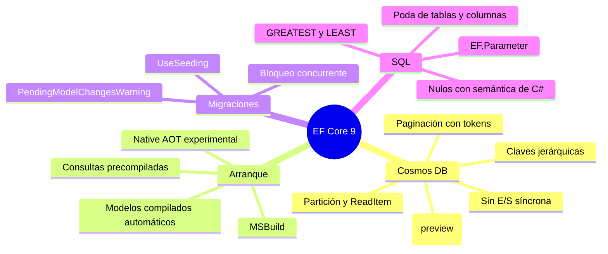

<div align="center">

# 09 · EF Core 9: Cosmos reescrito, AOT y siembra

**El proveedor de Cosmos DB rehecho, consultas precompiladas para Native AOT, `UseSeeding`, bloqueo de migraciones y un SQL más limpio (2024)**

[⬅ 08 · EF Core 8](08-ef-core-8-tipos-complejos.md) · [🏠 Índice](../README.md) · [10 · EF Core 10 ➡](10-ef-core-10-lts-vectores-y-json.md)

</div>

<!-- ef=10 -->

| Ficha | EF Core 9.0 |
|---|---|
| **Publicación** | 12-nov-2024, junto con .NET 9 y C# 13 |
| **Plataforma** | **`net8.0`**: funciona en .NET 8 y .NET 9 |
| **Soporte** | 🟠 STS **hasta el 10-nov-2026** (ampliado de 18 a 24 meses) |
| **Idea central** | Cosmos DB de primera, arranque instantáneo y despliegues seguros |

> [!NOTE]
> EF Core 9 es la **única** versión moderna que no exige el .NET de su mismo número: se publicó para .NET 8 para que las aplicaciones en la LTS pudieran
> usarla. Por eso puede ser una escala intermedia útil al migrar desde EF Core 8, aunque ambas caducan el mismo día.

---

## Contenido

1. [Panorama](#1-panorama)
2. [El proveedor de Cosmos DB reescrito](#2-el-proveedor-de-cosmos-db-reescrito)
3. [Native AOT y consultas precompiladas](#3-native-aot-y-consultas-precompiladas)
4. [Modelos compilados automáticos e integración con MSBuild](#4-modelos-compilados-automáticos-e-integración-con-msbuild)
5. [Siembra con `UseSeeding`](#5-siembra-con-useseeding)
6. [Migraciones más seguras](#6-migraciones-más-seguras)
7. [Traducción de LINQ y SQL](#7-traducción-de-linq-y-sql)
8. [Más novedades de EF Core 9](#8-más-novedades-de-ef-core-9)
9. [Cambios incompatibles](#9-cambios-incompatibles)
10. [Referencias](#10-referencias)

---

## 1. Panorama



---

## 2. El proveedor de Cosmos DB reescrito

El proveedor de Cosmos de EF Core 3–8 tenía un diseño heredado de los proveedores relacionales que no encajaba con Cosmos. EF Core 9 lo **rehízo** alrededor
de los conceptos que más importan en Cosmos: **la clave de partición y el `id`**.

| Mejora | Efecto |
|---|---|
| Consultas por partición | Si el `Where` fija la clave de partición, la consulta va a **una sola partición** (más barata en RU) |
| `ReadItem` automático | `Where(x => x.Id == id && x.Particion == p)` se ejecuta como **lectura puntual**, la operación más barata de Cosmos |
| **Claves de partición jerárquicas** | Hasta tres niveles: `HasPartitionKey(x => new { x.Inquilino, x.Usuario, x.Sesion })` |
| `id` sin discriminador | El `id` del documento es la clave, sin prefijos `Tipo|` |
| Discriminador `$type` | Alineado con `System.Text.Json` |
| Búsqueda vectorial (preview) | `VectorDistance` e índices vectoriales; estable desde EF Core 10 |
| **Paginación** | `ToPageAsync(tamaño, tokenDeContinuación)` en lugar de `Skip`/`Take` |
| `FromSql` | SQL de Cosmos parametrizado |
| Control de acceso por roles | Credenciales de Entra ID en lugar de claves |
| LINQ ampliado | Colecciones primitivas, subconsultas, `Count`, `Sum`, `Any`… |
| **E/S síncrona bloqueada** | `ToList()` y `SaveChanges()` síncronos **lanzan excepción** |

```csharp
public class Sesion
{
    public Guid Id { get; set; }
    public required string Inquilino { get; set; }
    public required string Usuario { get; set; }
    public DateTime Inicio { get; set; }
}

public class Telemetria : DbContext
{
    public DbSet<Sesion> Sesiones => Set<Sesion>();

    protected override void OnConfiguring(DbContextOptionsBuilder o)
        => o.UseCosmos("AccountEndpoint=https://localhost:8081/;AccountKey=…", databaseName: "Telemetria");

    protected override void OnModelCreating(ModelBuilder b)
        => b.Entity<Sesion>()
            .ToContainer("Sesiones")
            .HasPartitionKey(s => new { s.Inquilino, s.Usuario });     // clave jerárquica

    // Lectura puntual: id + partición completa → ReadItem, ~1 RU
    public Task<Sesion?> Buscar(Guid id, string inquilino, string usuario)
        => Sesiones.SingleOrDefaultAsync(s => s.Id == id && s.Inquilino == inquilino && s.Usuario == usuario);

    // Paginación eficiente con token de continuación (API experimental: diagnóstico EF9102)
#pragma warning disable EF9102
    public Task<CosmosPage<Sesion>> Pagina(string inquilino, string? token)
        => Sesiones.Where(s => s.Inquilino == inquilino)
            .OrderByDescending(s => s.Inicio)
            .ToPageAsync(pageSize: 20, continuationToken: token);
#pragma warning restore EF9102
}
```

> [!NOTE]
> `ToPageAsync` y `CosmosPage<T>` siguen marcados como **experimentales** en EF Core 10: el compilador emite el error `EF9102` hasta que lo suprimes
> explícitamente, como en el ejemplo. Es la forma en que .NET señala una API que todavía puede cambiar.

> [!WARNING]
> En EF Core 9 la E/S síncrona en Cosmos podía reactivarse temporalmente con una opción; **EF Core 11 la elimina por completo**. Cualquier
> `SaveChanges()` o `ToList()` síncrono contra Cosmos debe pasar a su versión `Async`.

---

## 3. Native AOT y consultas precompiladas

**Native AOT** compila la aplicación a código máquina sin JIT: arranque en milisegundos y menos memoria, ideal para contenedores y funciones serverless.
El obstáculo para EF era que la canalización de consultas **genera código en tiempo de ejecución** (compila *shapers* con árboles de expresión).

La solución de EF Core 9 es la **precompilación de consultas**: en tiempo de compilación, EF localiza tus consultas LINQ y genera **interceptores de C#**
que contienen ya el SQL y el código de materialización.

```bash
dotnet ef dbcontext optimize --precompile-queries --nativeaot
```

```csharp omitir
// Fragmento del código que genera EF para: context.Blogs.Where(b => b.Name == "foo").ToListAsync()
var relationalCommandTemplate = new RelationalCommand(…,
    "SELECT [b].[Id], [b].[Name]\nFROM [Blogs] AS [b]\nWHERE [b].[Name] = N'foo'", …);
```

| Aspecto | EF Core 9 | EF Core 10 | EF Core 11 |
|---|---|---|---|
| Estado | **Experimental** | Experimental, más consultas soportadas | Generación automática al publicar con `PublishAOT` |
| Consultas dinámicas (construidas en ejecución) | ❌ | ❌ | ❌ |
| Producción | ❌ no recomendado | ⚠️ con pruebas exhaustivas | ⚠️ |

> [!CAUTION]
> Las consultas que se construyen dinámicamente (por ejemplo, un `Where` que se añade o no según un filtro de la interfaz) **no se pueden precompilar**.
> En una aplicación AOT, cada consulta debe tener una forma estática.

---

## 4. Modelos compilados automáticos e integración con MSBuild

| Novedad | Antes | EF Core 9 |
|---|---|---|
| Usar un modelo compilado | `o.UseModel(MiModelo.Instance)` | Se detecta y usa **automáticamente** si existe en el ensamblado |
| Regenerarlo | `dotnet ef dbcontext optimize` a mano tras cada cambio | Paquete `Microsoft.EntityFrameworkCore.Tasks` lo regenera al compilar o publicar |

```xml
<!-- EF Core 9 y 10 -->
<PropertyGroup>
  <EFOptimizeContext>true</EFOptimizeContext>
  <EFScaffoldModelStage>build</EFScaffoldModelStage>   <!-- o publish -->
</PropertyGroup>
```

> [!IMPORTANT]
> **EF Core 11 elimina `EFOptimizeContext`**: la generación se controla solo con `EFScaffoldModelStage` y `EFPrecompileQueriesStage`, y se activa sola con
> `PublishAOT=true` ([capítulo 11](11-ef-core-11-rc.md#9-cambios-incompatibles)).

---

## 5. Siembra con `UseSeeding`

`HasData` ([capítulo 03](03-ef-core-1-2-cimientos.md#siembra-con-hasdata)) es estático: claves fijas, valores deterministas, sin lógica. EF Core 9 añadió
`UseSeeding` y `UseAsyncSeeding`, que ejecutan **código arbitrario** cuando `EnsureCreated` o `Migrate` inicializan la base:

```csharp run
using var db = new Tienda();
db.Database.EnsureDeleted();
db.Database.EnsureCreated();          // ejecuta UseSeeding
Console.WriteLine(db.Productos.Count());                      // → 3

db.Database.EnsureCreated();          // la base ya existe: no vuelve a sembrar
Console.WriteLine(db.Productos.Count());                      // → 3

public class Producto
{
    public int Id { get; set; }
    public required string Nombre { get; set; }
}

public class Tienda : DbContext
{
    public DbSet<Producto> Productos => Set<Producto>();

    protected override void OnConfiguring(DbContextOptionsBuilder o) => o
        .UseSqlite("Data Source=tienda.db")
        .UseSeeding((ctx, _) =>
        {
            if (ctx.Set<Producto>().Any()) return;                 // idempotente: comprobar antes de insertar
            ctx.Set<Producto>().AddRange(Enumerable.Range(1, 3).Select(i => new Producto { Nombre = $"Demo {i}" }));
            ctx.SaveChanges();
        })
        .UseAsyncSeeding(async (ctx, _, ct) =>
        {
            if (await ctx.Set<Producto>().AnyAsync(ct)) return;
            ctx.Set<Producto>().AddRange(Enumerable.Range(1, 3).Select(i => new Producto { Nombre = $"Demo {i}" }));
            await ctx.SaveChangesAsync(ct);
        });
}
```

| | `HasData` | `UseSeeding` |
|---|---|---|
| Dónde vive | En el modelo y en las migraciones | En la configuración del contexto |
| Lógica | No | Sí (consultas, servicios, archivos) |
| Claves | Obligatorias y fijas | Generadas por la base |
| Cuándo se ejecuta | Al aplicar la migración que la contiene | En cada `EnsureCreated`/`Migrate` (debe ser idempotente) |
| Ideal para | Catálogos pequeños e inmutables (países, estados) | Datos de demo, datos dependientes del entorno |

> [!TIP]
> Implementa **siempre las dos** (`UseSeeding` y `UseAsyncSeeding`) con la misma lógica: las herramientas de `dotnet ef` usan la síncrona y tu aplicación
> probablemente la asíncrona.

---

## 6. Migraciones más seguras

| Novedad | Problema que resuelve |
|---|---|
| **Bloqueo de migraciones** | Dos réplicas que llaman a `Migrate()` a la vez ya no corrompen el esquema: la segunda espera |
| **`PendingModelChangesWarning` como error** | `Migrate()` lanza excepción si el modelo tiene cambios sin migración: evita desplegar un esquema desfasado |
| Aviso de operaciones no transaccionales | EF avisa si una migración mezcla operaciones que no admiten transacción |
| `Migrate()` en una sola transacción | Revertido en EF Core 10 por problemas en algunos escenarios |

```text
System.InvalidOperationException: An error was generated for warning
'Microsoft.EntityFrameworkCore.Migrations.PendingModelChangesWarning':
The model for context 'JobsDbContext' has pending changes. Add a new migration before updating the database.
```

> [!WARNING]
> Este error es **el primero que encuentran muchos equipos al actualizar a EF Core 9**, y a veces no por un cambio real del modelo, sino por un
> `HasData` con valores **no deterministas** (`DateTime.Now`, `Guid.NewGuid()`): cada compilación del modelo produce datos distintos y EF detecta una
> diferencia. Este repositorio tiene un caso parecido: `CreationDate` sembrado con `default(DateTime)`. Ver
> [capítulo 20](20-caso-practico-jobsdb.md).

---

## 7. Traducción de LINQ y SQL

| Mejora | Ejemplo |
|---|---|
| **Poda de tablas** | Un `JOIN` que no aporta columnas ni filtros desaparece del SQL |
| **Poda de proyecciones** | Subconsultas que solo devuelven lo necesario |
| `GREATEST`/`LEAST` | `Math.Max(a, b)` en SQL Server 2022, PostgreSQL, SQLite |
| `EF.Parameter(x)` | Fuerza un parámetro donde EF pondría una constante |
| `EF.Constant(x)` | Lo contrario: incrusta el valor (útil para colecciones pequeñas y fijas) |
| Colecciones parametrizadas configurables | `TranslateParameterizedCollectionsToConstants()` |
| Subconsultas no correlacionadas en línea | Menos viajes |
| Agregados sobre subconsultas en SQL Server | `Sum(x => x.Items.Count())` |
| `Count != 0` optimizado | Se traduce a `EXISTS` |
| **Nulos con semántica de C#** | `a != b` cuando `a` es `NULL` devuelve lo mismo que en C# |
| `Order()`/`OrderDescending()` | Operadores de .NET 7 traducidos |
| Negación `!` mejorada | SQL más simple con `bool?` |
| Tipos complejos en `GroupBy` y `ExecuteUpdate` | `GroupBy(c => c.Direccion)` |

```csharp run
using var db = new Tienda();
Console.WriteLine(db.Productos.Select(p => Math.Max(p.StockTienda, p.StockAlmacen)).ToQueryString());
// → SELECT max("p"."StockTienda", "p"."StockAlmacen")
// → FROM "Productos" AS "p"
Console.WriteLine(db.Productos.Select(p => p.Nombre).Order().ToQueryString());
// → SELECT "p"."Nombre"
// → FROM "Productos" AS "p"
// → ORDER BY "p"."Nombre"

public class Producto
{
    public int Id { get; set; }
    public required string Nombre { get; set; }
    public int StockTienda { get; set; }
    public int StockAlmacen { get; set; }
}

public class Tienda : DbContext
{
    public DbSet<Producto> Productos => Set<Producto>();
    protected override void OnConfiguring(DbContextOptionsBuilder o) => o.UseSqlite("Data Source=tienda.db");
}
```

---

## 8. Más novedades de EF Core 9

| Novedad | Descripción |
|---|---|
| Colecciones primitivas de solo lectura | `IReadOnlyList<T>`, `ReadOnlyCollection<T>` |
| `HasFillFactor` | Factor de relleno en claves e índices de SQL Server |
| Convenciones más extensibles | Más puntos para heredar de las convenciones existentes |
| `ApplyConfigurationsFromAssembly` con constructores no públicos | Configuraciones `internal` |
| `HierarchyId` con azúcar | `HierarchyId.Parse` y métodos de generación de rutas |
| Menos recompilaciones de las herramientas | `dotnet ef` no recompila si no hace falta |
| Soporte mejorado de Azure SQL y Azure Synapse | `UseAzureSql()`, `UseAzureSynapse()` |

---

## 9. Cambios incompatibles

| Cambio | Impacto | Mitigación |
|---|---|---|
| **`PendingModelChangesWarning` lanza excepción** | 🔴 Alto | Añadir la migración que falta o revisar `HasData` no deterministas |
| Cosmos: E/S síncrona bloqueada | 🔴 Alto | Pasar a `async` |
| Cosmos: discriminador `$type`, `id` sin prefijo | 🔴 Alto | Configurar los nombres antiguos si hay datos existentes |
| Advertencia por operaciones de migración no transaccionales | 🟡 Bajo | Separar en otra migración |
| `EF.Functions.Unhex()` devuelve `byte[]?` | 🟡 Bajo | — |
| Los métodos de `SqlFunctionExpression` exigen nulabilidad explícita | 🟡 Bajo | Para autores de proveedores |

---

## 10. Referencias

- [What's new in EF Core 9.0](https://learn.microsoft.com/ef/core/what-is-new/ef-core-9.0/whatsnew)
- [Azure Cosmos DB provider](https://learn.microsoft.com/ef/core/providers/cosmos/)
- [NativeAOT and precompiled queries](https://learn.microsoft.com/ef/core/performance/nativeaot-and-precompiled-queries)
- [Data seeding](https://learn.microsoft.com/ef/core/modeling/data-seeding)
- [Breaking changes in EF Core 9.0](https://learn.microsoft.com/ef/core/what-is-new/ef-core-9.0/breaking-changes)

<div align="center">

[⬅ 08 · EF Core 8](08-ef-core-8-tipos-complejos.md) · [🏠 Índice](../README.md) · [10 · EF Core 10 ➡](10-ef-core-10-lts-vectores-y-json.md)

</div>
