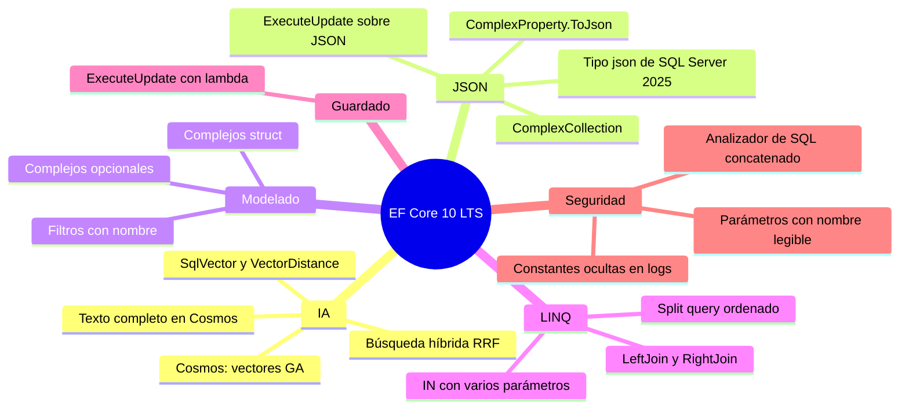
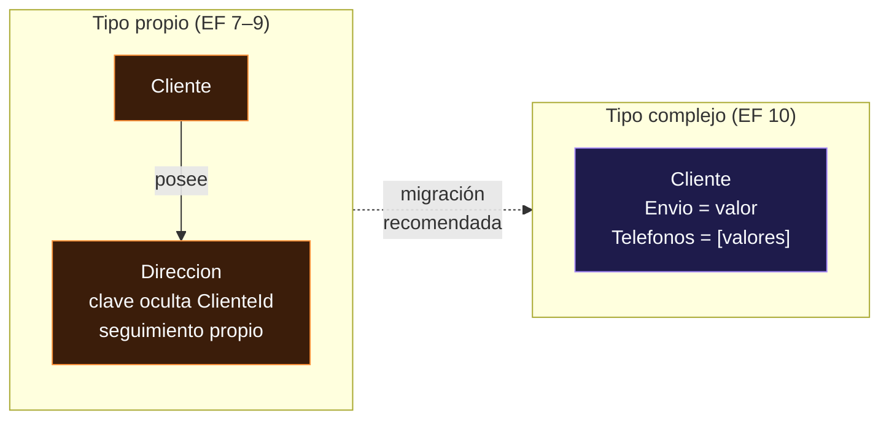

<div align="center">

# 10 · EF Core 10: LTS, vectores y JSON

**Búsqueda vectorial, el tipo `json` nativo, tipos complejos en JSON, filtros con nombre, `LeftJoin`, `ExecuteUpdate` sin árboles de expresión y un SQL más seguro (2025)**

[⬅ 09 · EF Core 9](09-ef-core-9-cosmos-aot-y-siembra.md) · [🏠 Índice](../README.md) · [11 · EF Core 11 ➡](11-ef-core-11-rc.md)

</div>

<!-- ef=10 -->

| Ficha | EF Core 10.0 |
|---|---|
| **Publicación** | 11-nov-2025, junto con .NET 10 y C# 14 |
| **Plataforma** | **`net10.0`**: exige el SDK y el runtime de .NET 10 |
| **Soporte** | 🟢 **LTS hasta el 10-nov-2028** |
| **Último parche (8-nov-2026)** | **10.0.14** |
| **Idea central** | La base de datos como motor de IA, y JSON como ciudadano de primera clase |
| **Versión recomendada** | ✅ Es la versión de producción de este atlas |

> [!IMPORTANT]
> EF Core 10 es **la LTS vigente**. Cuando EF Core 8 y 9 caduquen el 10-nov-2026, será la única versión con soporte hasta que se publique EF Core 11, y
> la única con soporte de tres años. Todos los ejemplos de este atlas se compilan y ejecutan contra **EF Core 10.0.14**.

---

## Contenido

1. [Panorama](#1-panorama)
2. [Búsqueda vectorial en SQL Server](#2-búsqueda-vectorial-en-sql-server)
3. [El tipo `json` nativo](#3-el-tipo-json-nativo)
4. [Tipos complejos mapeados a JSON](#4-tipos-complejos-mapeados-a-json)
5. [Colecciones parametrizadas con varios parámetros](#5-colecciones-parametrizadas-con-varios-parámetros)
6. [Filtros de consulta con nombre](#6-filtros-de-consulta-con-nombre)
7. [`LeftJoin` y `RightJoin`](#7-leftjoin-y-rightjoin)
8. [`ExecuteUpdate` con una lambda normal](#8-executeupdate-con-una-lambda-normal)
9. [Seguridad, registros y SQL crudo](#9-seguridad-registros-y-sql-crudo)
10. [Cosmos DB: texto completo, vectores y búsqueda híbrida](#10-cosmos-db-texto-completo-vectores-y-búsqueda-híbrida)
11. [Más novedades de EF Core 10](#11-más-novedades-de-ef-core-10)
12. [Cambios incompatibles](#12-cambios-incompatibles)
13. [Referencias](#13-referencias)

---

## 1. Panorama



EF Core 10 tiene dos almas. La primera es la **inteligencia artificial**: SQL Server 2025 y Azure SQL incorporan un tipo `vector` y EF Core lo expone
como un tipo .NET más, de modo que una aplicación RAG (*retrieval-augmented generation*) puede guardar sus *embeddings* junto a sus datos de negocio
y consultarlos con LINQ. La segunda es **JSON**: tras tres versiones en las que JSON se modelaba con tipos propios (*owned types*), EF Core 10 lo traslada a
los **tipos complejos**, con semántica de valor, y aprovecha el nuevo tipo `json` binario de SQL Server.

| Área | EF Core 9 | EF Core 10 |
|---|---|---|
| Vectores en SQL Server | ❌ | ✅ `SqlVector<float>` + `VectorDistance` |
| Tipo de columna JSON en SQL Server | `nvarchar(max)` | `json` en Azure SQL y compatibilidad 170 |
| JSON con semántica de valor | ❌ (solo tipos propios) | ✅ `ComplexProperty(...).ToJson()` |
| Colecciones de tipos complejos | ❌ | ✅ `ComplexCollection` |
| Filtros globales por entidad | Uno | **Varios, con nombre** |
| `LEFT JOIN` en LINQ | `GroupJoin` + `SelectMany` + `DefaultIfEmpty` | `LeftJoin(...)` |
| `ExecuteUpdate` condicional | Construir árboles de expresión a mano | `if` dentro de una lambda |
| `Contains` con lista | `OPENJSON(@ids)` / `json_each` | `IN (@ids1, @ids2, …)` con relleno |

---

## 2. Búsqueda vectorial en SQL Server

Un ***embedding*** es un arreglo de números (típicamente 384, 1 536 o 3 072 `float`) que un modelo de lenguaje produce a partir de un texto o una
imagen. Dos *embeddings* cercanos en el espacio significan dos contenidos con significado parecido. La **búsqueda vectorial** responde "dame los diez
documentos más parecidos a esta pregunta", y es la pieza central del patrón RAG.


EF Core 10 mapea el tipo `vector(n)` de SQL Server al tipo `SqlVector<float>` de `Microsoft.Data.SqlClient` y traduce
`EF.Functions.VectorDistance` a la función `VECTOR_DISTANCE`:

```csharp
using Microsoft.Data.SqlTypes;

public class Articulo
{
    public int Id { get; set; }
    public required string Titulo { get; set; }
    public required string Cuerpo { get; set; }

    [Column(TypeName = "vector(1536)")]
    public SqlVector<float> Embedding { get; set; }
}

public class Biblioteca(DbContextOptions<Biblioteca> o) : DbContext(o)
{
    public DbSet<Articulo> Articulos => Set<Articulo>();

    // Los k artículos más parecidos semánticamente a la pregunta
    public Task<List<string>> Parecidos(float[] pregunta, int k = 5)
    {
        var vector = new SqlVector<float>(pregunta);
        return Articulos
            .OrderBy(a => EF.Functions.VectorDistance("cosine", a.Embedding, vector))
            .Take(k)
            .Select(a => a.Titulo)
            .ToListAsync();
    }
}
```

```sql
-- SQL generado (simplificado)
SELECT TOP(@p) [a].[Titulo]
FROM [Articulos] AS [a]
ORDER BY VECTOR_DISTANCE('cosine', [a].[Embedding], @vector)
```

| Métrica | Mide | Úsala cuando… |
|---|---|---|
| `cosine` | Ángulo entre vectores (0 = idénticos) | Casi siempre: es la que recomiendan los proveedores de *embeddings* de texto |
| `euclidean` | Distancia en línea recta | Los vectores no están normalizados y la magnitud importa |
| `dot` | Producto escalar negado | Vectores normalizados: equivale a coseno y es más barato |

> [!WARNING]
> `VECTOR_DISTANCE` es una búsqueda **exacta** (*k-NN*): compara la pregunta con **todas** las filas. Va bien hasta unas decenas de miles de vectores;
> por encima necesitas un índice aproximado (*ANN*) con `VECTOR_SEARCH`, que llega con **EF Core 11** ([capítulo 11](11-ef-core-11-rc.md#6-sql-server-y-azure-sql)).

> [!TIP]
> Genera los *embeddings* fuera de la transacción y **guarda la versión del modelo** que los produjo en otra columna. Si cambias de modelo, los
> vectores antiguos dejan de ser comparables con los nuevos y tendrás que regenerarlos todos.

---

## 3. El tipo `json` nativo

SQL Server 2025 y Azure SQL añadieron un tipo `json` que guarda el documento en un **formato binario** ya analizado: las lecturas con `JSON_VALUE`
no tienen que volver a analizar el texto, la validez del documento se comprueba al escribir y ocupa menos. EF Core 10 lo usa **automáticamente** para
todas las columnas JSON (tipos complejos, tipos propios con `ToJson` y colecciones primitivas) cuando sabe que el servidor lo admite:

```csharp
public class Pedido
{
    public int Id { get; set; }
    public List<string> Etiquetas { get; set; } = [];
}

public class Ventas : DbContext
{
    public DbSet<Pedido> Pedidos => Set<Pedido>();

    protected override void OnConfiguring(DbContextOptionsBuilder o)
        // Opción 1: Azure SQL siempre admite json
        => o.UseAzureSql("Server=tcp:demo.database.windows.net;Database=Ventas;Authentication=Active Directory Default");
        // Opción 2: SQL Server 2025 declarando su nivel de compatibilidad
        // => o.UseSqlServer(cadena, s => s.UseCompatibilityLevel(170));
}
```

| Configuración | Tipo de las columnas JSON |
|---|---|
| `UseSqlServer(...)` (sin nivel) | `nvarchar(max)` |
| `UseSqlServer(..., s => s.UseCompatibilityLevel(170))` | **`json`** |
| `UseAzureSql(...)` | **`json`** |
| Columna concreta | `.HasColumnType("nvarchar(max)")` o `"json"` para forzarlo |

> [!CAUTION]
> Este es **el cambio incompatible de mayor impacto** de EF Core 10. Si tu base existente tiene columnas JSON en `nvarchar(max)` y usas `UseAzureSql`
> o nivel 170, la siguiente migración intentará **convertir esas columnas a `json`**. Revisa la migración antes de aplicarla, o fija
> `HasColumnType("nvarchar(max)")` si todavía no quieres convertirlas.

---

## 4. Tipos complejos mapeados a JSON

En EF Core 7 a 9, JSON se modelaba con **tipos propios** (`OwnsOne(...).ToJson()`). Los tipos propios son, en el fondo, **entidades** con una clave
oculta: tienen identidad y seguimiento propios, no se pueden compartir entre dos propietarios y comparar dos de ellos compara referencias. Eso
encaja mal con lo que es un documento JSON: **un valor**. EF Core 8 introdujo los tipos complejos ([capítulo 08](08-ef-core-8-tipos-complejos.md)),
pero solo para columnas normales. EF Core 10 completa el diseño:

| Capacidad | EF Core 8–9 | EF Core 10 |
|---|---|---|
| `ComplexProperty` en columnas | ✅ | ✅ |
| `ComplexProperty(...).ToJson()` | ❌ | ✅ |
| **Colecciones** de tipos complejos (`ComplexCollection`) | ❌ | ✅ (en JSON) |
| Tipos complejos **opcionales** (`Direccion?`) | ❌ | ✅ |
| Tipos complejos `struct` | Solo en columnas | ✅ también en JSON |
| `ExecuteUpdate` sobre propiedades dentro de JSON | ❌ | ✅ |

```csharp run
using var db = new Crm();
db.Database.EnsureDeleted();
db.Database.EnsureCreated();

db.Clientes.Add(new Cliente
{
    Nombre = "Ana",
    Envio = new Direccion("Calle Mayor 1", "Madrid", "28013"),
    Telefonos = [new Telefono("móvil", "600 000 001"), new Telefono("trabajo", "910 000 002")],
});
db.SaveChanges();

// Las consultas entran en el documento JSON
var madrid = db.Clientes.Where(c => c.Envio.Ciudad == "Madrid").Select(c => c.Nombre).ToList();
Console.WriteLine(string.Join(", ", madrid));                           // → Ana

var conMovil = db.Clientes.Count(c => c.Telefonos.Any(t => t.Tipo == "móvil"));
Console.WriteLine(conMovil);                                           // → 1

// Semántica de valor: se sustituye el valor entero, no se "edita" una entidad hija
var ana = db.Clientes.Single();
ana.Envio = ana.Envio with { CodigoPostal = "28014" };
db.SaveChanges();
Console.WriteLine(db.Clientes.Select(c => c.Envio.CodigoPostal).Single()); // → 28014

public record Direccion(string Calle, string Ciudad, string CodigoPostal);
public record Telefono(string Tipo, string Numero);

public class Cliente
{
    public int Id { get; set; }
    public required string Nombre { get; set; }
    public required Direccion Envio { get; set; }
    public List<Telefono> Telefonos { get; set; } = [];
}

public class Crm : DbContext
{
    public DbSet<Cliente> Clientes => Set<Cliente>();

    protected override void OnConfiguring(DbContextOptionsBuilder o) => o.UseSqlite("Data Source=crm.db");

    protected override void OnModelCreating(ModelBuilder b) => b.Entity<Cliente>(c =>
    {
        c.ComplexProperty(x => x.Envio, x => x.ToJson());
        c.ComplexCollection(x => x.Telefonos, x => x.ToJson());
    });
}
```



> [!TIP]
> **Para JSON nuevo, usa tipos complejos.** Los tipos propios con `ToJson` siguen funcionando, pero el equipo de EF recomienda migrar: el esquema de la
> base no cambia (sigue siendo una columna JSON), solo la configuración en `OnModelCreating`. Los `record` de C# encajan perfectamente, porque ya
> tienen igualdad por valor y `with`.

> [!NOTE]
> Los tipos complejos no tienen clave, así que **no pueden ser el destino de una navegación** ni compartirse por referencia: si dos clientes "comparten"
> dirección, cada uno guarda su copia. Si necesitas identidad, lo que tienes es una entidad, no un valor ([capítulo 12](12-modelado.md)).

---

## 5. Colecciones parametrizadas con varios parámetros

Traducir `ids.Contains(x.Id)` cuando `ids` es una lista de C# es más difícil de lo que parece. Cada versión ha probado una estrategia:

| Versión | SQL generado para `ids = [1, 2, 3]` | Plan reutilizable | Estadísticas del optimizador |
|---|---|---|---|
| EF Core ≤ 7 | `IN (1, 2, 3)` (constantes) | ❌ un plan por lista distinta | ✅ |
| EF Core 8–9 | `IN (SELECT value FROM OPENJSON(@ids))` | ✅ un único plan | ❌ el optimizador no sabe cuántos hay |
| **EF Core 10** | **`IN (@ids1, @ids2, @ids3)`** con relleno | ✅ un plan por **tamaño redondeado** | ✅ |

El truco de EF Core 10 es el **relleno** (*padding*): si la lista tiene 5 elementos, EF genera 8 parámetros y repite el último valor. Así, todas las listas
de 5 a 8 elementos comparten plan, y el optimizador ve parámetros normales cuyo valor conoce.

```csharp run
using var db = new Tienda();
int[] ids = [10, 20, 30];
Console.WriteLine(db.Productos.Where(p => ids.Contains(p.Id)).Select(p => p.Id).ToQueryString());
// → .param set @ids1 10
// → .param set @ids2 20
// → .param set @ids3 30
// → 
// → SELECT "p"."Id"
// → FROM "Productos" AS "p"
// → WHERE "p"."Id" IN (@ids1, @ids2, @ids3)

public class Producto
{
    public int Id { get; set; }
}

public class Tienda : DbContext
{
    public DbSet<Producto> Productos => Set<Producto>();
    protected override void OnConfiguring(DbContextOptionsBuilder o) => o.UseSqlite("Data Source=tienda.db");
}
```

Si una consulta concreta se comporta mejor con otra estrategia, puedes cambiarla para todo el contexto o solo para un valor:

```csharp
public class Producto
{
    public int Id { get; set; }
}

public class Tienda : DbContext
{
    public DbSet<Producto> Productos => Set<Producto>();

    protected override void OnConfiguring(DbContextOptionsBuilder o)
        => o.UseSqlServer("Server=.;Database=Tienda;Trusted_Connection=True;TrustServerCertificate=True",
            s => s.UseParameterizedCollectionMode(ParameterTranslationMode.Parameter));   // vuelve a OPENJSON(@ids)

    public IQueryable<Producto> Destacados(int[] ids)
        => Productos.Where(p => EF.Constant(ids).Contains(p.Id));     // solo aquí: IN (1, 2, 3) con constantes
}
```

| `ParameterTranslationMode` | SQL | Úsalo cuando |
|---|---|---|
| `MultipleParameters` (por defecto) | `IN (@p1, @p2, …)` | Casi siempre |
| `Parameter` | `OPENJSON(@p)` / `json_each(@p)` | Listas muy grandes (miles): evitas el límite de 2 100 parámetros de SQL Server |
| `Constant` | `IN (1, 2, 3)` | Listas pequeñas y casi fijas, donde el plan específico compensa |

---

## 6. Filtros de consulta con nombre

Los **filtros globales** (`HasQueryFilter`, desde EF Core 2.0) añaden un `WHERE` a todas las consultas de una entidad: el ejemplo clásico es el borrado
lógico. Hasta EF Core 9 había **un solo filtro por entidad**: si querías borrado lógico **y** multiinquilino, tenías que combinarlos en una única expresión,
e `IgnoreQueryFilters()` los desactivaba **todos a la vez**. Un administrador que quería ver los registros borrados de su inquilino veía también los de
todos los demás inquilinos: un fallo de seguridad esperando a ocurrir.

EF Core 10 permite **varios filtros con nombre** y desactivarlos de forma selectiva:

```csharp run
using var db = new Saas(inquilino: "acme");
db.Database.EnsureDeleted();
db.Database.EnsureCreated();
db.Documentos.AddRange(
    new Documento { Titulo = "Plan 2026", Inquilino = "acme" },
    new Documento { Titulo = "Borrador", Inquilino = "acme", Borrado = true },
    new Documento { Titulo = "Secreto de otro", Inquilino = "globex" });
db.SaveChanges();

Console.WriteLine(db.Documentos.Count());                                              // → 1
Console.WriteLine(db.Documentos.IgnoreQueryFilters([Saas.BorradoLogico]).Count());     // → 2
Console.WriteLine(db.Documentos.IgnoreQueryFilters().Count());                         // → 3

public class Documento
{
    public int Id { get; set; }
    public required string Titulo { get; set; }
    public required string Inquilino { get; set; }
    public bool Borrado { get; set; }
}

public class Saas(string inquilino) : DbContext
{
    public const string BorradoLogico = nameof(BorradoLogico);
    public const string Multiinquilino = nameof(Multiinquilino);

    public DbSet<Documento> Documentos => Set<Documento>();

    protected override void OnConfiguring(DbContextOptionsBuilder o) => o.UseSqlite("Data Source=saas.db");

    protected override void OnModelCreating(ModelBuilder b) => b.Entity<Documento>()
        .HasQueryFilter(BorradoLogico, d => !d.Borrado)
        .HasQueryFilter(Multiinquilino, d => d.Inquilino == inquilino);   // se evalúa por instancia del contexto
}
```

> [!IMPORTANT]
> El filtro de inquilino referencia el **campo del contexto** (`inquilino`), no una constante: EF lo convierte en parámetro y lo lee **de cada instancia**.
> Si capturaras una variable local de `OnModelCreating`, su valor quedaría congelado en el modelo, que se construye una sola vez y se comparte entre
> todas las instancias. Es uno de los errores de seguridad más comunes con filtros globales ([capítulo 19](19-arquitectura-de-aplicaciones.md)).

---

## 7. `LeftJoin` y `RightJoin`

.NET 10 añadió por fin los operadores `LeftJoin` y `RightJoin` a LINQ. Antes, un *left join* exigía una de las construcciones más crípticas del lenguaje:

```csharp run
using var db = new Escuela();
db.Database.EnsureDeleted();
db.Database.EnsureCreated();
var mates = new Departamento { Nombre = "Matemáticas" };
db.AddRange(new Alumno { Nombre = "Ana", Departamento = mates }, new Alumno { Nombre = "Luis" });
db.SaveChanges();

// Antes de EF Core 10: GroupJoin + SelectMany + DefaultIfEmpty
var antes =
    from a in db.Alumnos
    join d in db.Departamentos on a.DepartamentoId equals d.Id into g
    from d in g.DefaultIfEmpty()
    orderby a.Nombre
    select new { a.Nombre, Depto = d == null ? "(ninguno)" : d.Nombre };

// EF Core 10: un operador con nombre propio
var ahora = db.Alumnos
    .LeftJoin(db.Departamentos, a => a.DepartamentoId, d => d.Id,
              (a, d) => new { a.Nombre, Depto = d == null ? "(ninguno)" : d.Nombre })
    .OrderBy(x => x.Nombre);

foreach (var x in ahora) Console.WriteLine($"{x.Nombre}: {x.Depto}");
// → Ana: Matemáticas
// → Luis: (ninguno)
Console.WriteLine(antes.ToQueryString() == ahora.ToQueryString());          // → True

public class Departamento
{
    public int Id { get; set; }
    public required string Nombre { get; set; }
}

public class Alumno
{
    public int Id { get; set; }
    public required string Nombre { get; set; }
    public int? DepartamentoId { get; set; }
    public Departamento? Departamento { get; set; }
}

public class Escuela : DbContext
{
    public DbSet<Alumno> Alumnos => Set<Alumno>();
    public DbSet<Departamento> Departamentos => Set<Departamento>();
    protected override void OnConfiguring(DbContextOptionsBuilder o) => o.UseSqlite("Data Source=escuela.db");
}
```

> [!NOTE]
> Los dos estilos generan **exactamente el mismo SQL** (la última línea lo comprueba). `LeftJoin` es una mejora de legibilidad, no de rendimiento. Si ya
> tienes una navegación (`a.Departamento`), no necesitas ningún *join*: `a.Departamento!.Nombre` produce el `LEFT JOIN` por ti.

---

## 8. `ExecuteUpdate` con una lambda normal

`ExecuteUpdate` ([capítulo 07](07-ef-core-7-json-y-operaciones-masivas.md)) recibía un **árbol de expresión**, así que no podías escribir un `if` dentro.
Para actualizar columnas de forma condicional había que componer `Expression<Func<…>>` a mano, con decenas de líneas de código frágil. En EF Core 10 el
parámetro es una lambda **normal** (`Action<UpdateSettersBuilder<T>>`) que se ejecuta para *registrar* los cambios:

```csharp run
using var db = new Blog();
db.Database.EnsureDeleted();
db.Database.EnsureCreated();
db.Entradas.AddRange(new Entrada { Titulo = "Hola", Visitas = 3 }, new Entrada { Titulo = "Adiós", Visitas = 7 });
db.SaveChanges();

bool renombrar = true, reiniciar = false;

var filas = db.Entradas.ExecuteUpdate(s =>
{
    s.SetProperty(e => e.Actualizada, true);
    if (renombrar) s.SetProperty(e => e.Titulo, e => e.Titulo + " (editado)");
    if (reiniciar) s.SetProperty(e => e.Visitas, 0);            // no se incluye en el SQL
});
Console.WriteLine(filas);                                                          // → 2
Console.WriteLine(string.Join(" | ", db.Entradas.OrderBy(e => e.Id).Select(e => $"{e.Titulo}:{e.Visitas}")));
// → Hola (editado):3 | Adiós (editado):7

public class Entrada
{
    public int Id { get; set; }
    public required string Titulo { get; set; }
    public int Visitas { get; set; }
    public bool Actualizada { get; set; }
}

public class Blog : DbContext
{
    public DbSet<Entrada> Entradas => Set<Entrada>();
    protected override void OnConfiguring(DbContextOptionsBuilder o) => o.UseSqlite("Data Source=blog.db");
}
```

> [!WARNING]
> Es un **cambio incompatible en código fuente** para quien construía el árbol de expresión a mano (`Expression<Func<SetPropertyCalls<T>, …>>`): esos
> tipos ya no existen. Para el resto (`ExecuteUpdate(s => s.SetProperty(...))`) el cambio es transparente: el código compila igual.

---

## 9. Seguridad, registros y SQL crudo

EF Core 10 endureció varios puntos donde los datos sensibles o la inyección de SQL podían colarse:

| Cambio | Antes | EF Core 10 |
|---|---|---|
| **Constantes en los registros** | Un valor incrustado como constante (`EF.Constant`, colecciones en modo `Constant`) aparecía en los logs | Se registra como `?` salvo que actives `EnableSensitiveDataLogging()` |
| **Analizador de concatenación** | `FromSqlRaw("… WHERE x = '" + valor + "'")` compilaba en silencio | Advertencia **EF1002**: usa `FromSql($"…{valor}")`, que parametriza |
| **Nombres de parámetros** | `@__ciudad_0` | `@ciudad` (más legible en los planes y en Query Store) |
| `Application Name` | No se añadía | El proveedor de SQL Server añade información de EF a la cadena de conexión para diagnóstico |

```csharp
public class Usuario
{
    public int Id { get; set; }
    public required string Email { get; set; }
}

public class App : DbContext
{
    public DbSet<Usuario> Usuarios => Set<Usuario>();
    protected override void OnConfiguring(DbContextOptionsBuilder o) => o.UseSqlite("Data Source=app.db");

    // ✅ Interpolación con ExecuteSql (o FromSql): cada {valor} se convierte en un DbParameter
    public int Baja(string email)
        => Database.ExecuteSql($"DELETE FROM Usuarios WHERE Email = {email}");

#pragma warning disable EF1002
    // ❌ Concatenación: inyección de SQL. EF Core 10 emite la advertencia EF1002
    public int BajaInsegura(string email)
        => Database.ExecuteSqlRaw("DELETE FROM Usuarios WHERE Email = '" + email + "'");
#pragma warning restore EF1002
}
```

> [!CAUTION]
> La diferencia entre `FromSql($"…")` y `FromSqlRaw($"…")` es **una palabra y un agujero de seguridad**. `FromSql` y `FromSqlInterpolated` reciben un
> `FormattableString` y parametrizan; `FromSqlRaw` recibe un `string` ya construido. Si ves `FromSqlRaw` con `$`, es un error.

---

## 10. Cosmos DB: texto completo, vectores y búsqueda híbrida

El proveedor de Cosmos DB ([capítulo 09](09-ef-core-9-cosmos-aot-y-siembra.md#2-el-proveedor-de-cosmos-db-reescrito)) da en EF Core 10 el salto a
plataforma de búsqueda:

| Capacidad | API | Estado |
|---|---|---|
| Búsqueda vectorial | `IsVectorProperty`, `IsVectorIndex`, `EF.Functions.VectorDistance` | 🟢 estable (era *preview* en 9) |
| Texto completo | `EnableFullTextSearch`, `IsFullTextIndex`, `EF.Functions.FullTextContains`, `FullTextScore` | 🟢 nuevo |
| **Híbrida** | `EF.Functions.Rrf(...)` (*Reciprocal Rank Fusion*) combina puntuaciones | 🟢 nuevo |
| Propiedades sin valor | Una propiedad que falta en el documento se materializa con su valor por defecto | 🟢 |

```csharp
using Microsoft.Azure.Cosmos;

public class Receta
{
    public Guid Id { get; set; }
    public required string Cocina { get; set; }
    public required string Texto { get; set; }
    public required float[] Vector { get; set; }
}

public class Recetario : DbContext
{
    public DbSet<Receta> Recetas => Set<Receta>();

    protected override void OnConfiguring(DbContextOptionsBuilder o)
        => o.UseCosmos("AccountEndpoint=https://localhost:8081/;AccountKey=…", "Recetario");

    protected override void OnModelCreating(ModelBuilder b) => b.Entity<Receta>(r =>
    {
        r.HasPartitionKey(x => x.Cocina);
        r.Property(x => x.Texto).EnableFullTextSearch();
        r.HasIndex(x => x.Texto).IsFullTextIndex();
        r.Property(x => x.Vector).IsVectorProperty(DistanceFunction.Cosine, dimensions: 1536);
        r.HasIndex(x => x.Vector).IsVectorIndex(VectorIndexType.DiskANN);
    });

    // Combina "contiene estas palabras" con "significa algo parecido"
    public Task<List<Receta>> Buscar(string palabras, float[] pregunta)
        => Recetas
            .OrderBy(x => EF.Functions.Rrf(
                EF.Functions.FullTextScore(x.Texto, palabras),
                EF.Functions.VectorDistance(x.Vector, pregunta)))
            .Take(10)
            .ToListAsync();
}
```

> [!TIP]
> La búsqueda **híbrida** suele dar mejores resultados que la vectorial pura: el texto completo acierta con nombres propios y términos exactos ("SKU-4471",
> "paella") donde los *embeddings* fallan, y los vectores capturan sinónimos y paráfrasis donde el texto completo falla. RRF fusiona los dos rankings sin
> tener que calibrar sus escalas.

---

## 11. Más novedades de EF Core 10

| Novedad | Descripción |
|---|---|
| **Orden coherente en consultas divididas** | Cada subconsulta de `AsSplitQuery()` repite el `ORDER BY` completo, evitando resultados mezclados cuando la ordenación no era única |
| **Restricciones por defecto con nombre** | `HasDefaultValueSql("GETDATE()", "DF_Pedido_Fecha")` y `UseNamedDefaultConstraints()` para todo el modelo |
| `AUTOINCREMENT` opcional en SQLite | Se puede desactivar y funciona con conversiones de valor sobre la clave |
| Traducciones nuevas | `DateOnly.ToDateTime`, `DateOnly.DayNumber`, `string.Join` en más proveedores, `Contains` sobre colecciones JSON |
| Complejos en `GroupBy` y `ExecuteUpdate` | Asignar un tipo complejo completo en un `ExecuteUpdate` |
| `Migrate()` sin transacción única | Se revirtió el cambio de EF Core 9 que envolvía todas las migraciones en una sola transacción |
| Mejores mensajes para `PendingModelChangesWarning` | Indica qué parte del modelo cambió |
| Herramientas | `dotnet ef` exige `--framework` en proyectos con varios destinos |

```csharp
public class Pedido
{
    public int Id { get; set; }
    public DateTime Fecha { get; set; }
}

public class Ventas : DbContext
{
    public DbSet<Pedido> Pedidos => Set<Pedido>();
    protected override void OnConfiguring(DbContextOptionsBuilder o)
        => o.UseSqlServer("Server=.;Database=Ventas;Trusted_Connection=True;TrustServerCertificate=True");

    protected override void OnModelCreating(ModelBuilder b)
    {
        b.UseNamedDefaultConstraints();                                // DF_<tabla>_<columna> en todo el modelo
        b.Entity<Pedido>().Property(p => p.Fecha).HasDefaultValueSql("SYSUTCDATETIME()", "DF_Pedido_Alta");
    }
}
```

> [!TIP]
> Las restricciones con nombre parecen un detalle, pero ahorran dolores reales: SQL Server **no deja borrar ni alterar una columna con un `DEFAULT`
> anónimo** sin buscar antes el nombre aleatorio (`DF__Pedido__Fecha__3A81B327`) que le asignó, y ese nombre es distinto en cada entorno.

---

## 12. Cambios incompatibles

| Cambio | Impacto | Mitigación |
|---|---|---|
| **Tipo `json` por defecto** con `UseAzureSql` o compatibilidad 170 | 🔴 Alto | Revisar la migración generada; `HasColumnType("nvarchar(max)")` para mantener el tipo antiguo |
| **Colecciones parametrizadas** con varios parámetros | 🟠 Medio | Planes distintos; `UseParameterizedCollectionMode(ParameterTranslationMode.Parameter)` para volver a `OPENJSON` |
| `ExecuteUpdate` recibe `Action<…>` en lugar de un árbol | 🟠 Medio | Solo afecta a quien construía `Expression` a mano: reescribir con `if` |
| `dotnet ef` exige `--framework` en proyectos multidestino | 🟡 Bajo | Añadir `--framework net10.0` |
| Nombres de columnas de tipos complejos anidados usan la ruta completa | 🟡 Bajo | Revisar migraciones; fijar `HasColumnName` |
| Analizador EF1002 sobre SQL concatenado | 🟡 Bajo | Pasar a `FromSql` con interpolación |
| `Microsoft.Data.Sqlite`: lectura de `DateTimeOffset` sin desplazamiento asume UTC | 🟡 Bajo | Guardar siempre con desplazamiento |
| Requiere .NET 10 | 🔴 Alto | Actualizar el `TargetFramework` a `net10.0` |

> [!TIP]
> El orden de trabajo para migrar a EF Core 10 desde 8 o 9, con un checklist completo, está en
> [23 · Migración entre versiones](23-migracion-entre-versiones.md#2-de-ef-core-8-o-9-a-ef-core-10).

---

## 13. Referencias

- [What's new in EF Core 10](https://learn.microsoft.com/ef/core/what-is-new/ef-core-10.0/whatsnew)
- [Breaking changes in EF Core 10](https://learn.microsoft.com/ef/core/what-is-new/ef-core-10.0/breaking-changes)
- [Vector search in SQL Server](https://learn.microsoft.com/ef/core/providers/sql-server/vector-search)
- [Complex types](https://learn.microsoft.com/ef/core/modeling/complex-types)
- [Global query filters](https://learn.microsoft.com/ef/core/querying/filters)
- [Cosmos DB full-text and hybrid search](https://learn.microsoft.com/ef/core/providers/cosmos/full-text-search)

<div align="center">

[⬅ 09 · EF Core 9](09-ef-core-9-cosmos-aot-y-siembra.md) · [🏠 Índice](../README.md) · [11 · EF Core 11 ➡](11-ef-core-11-rc.md)

</div>
