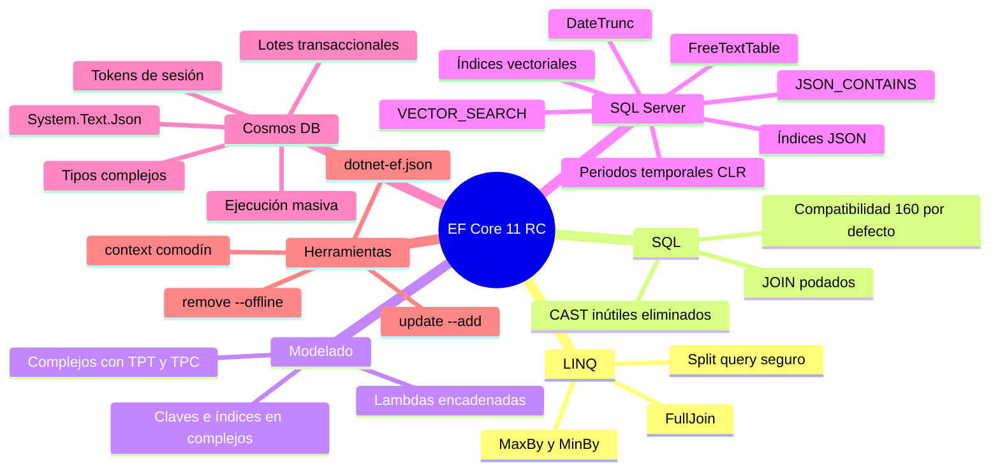
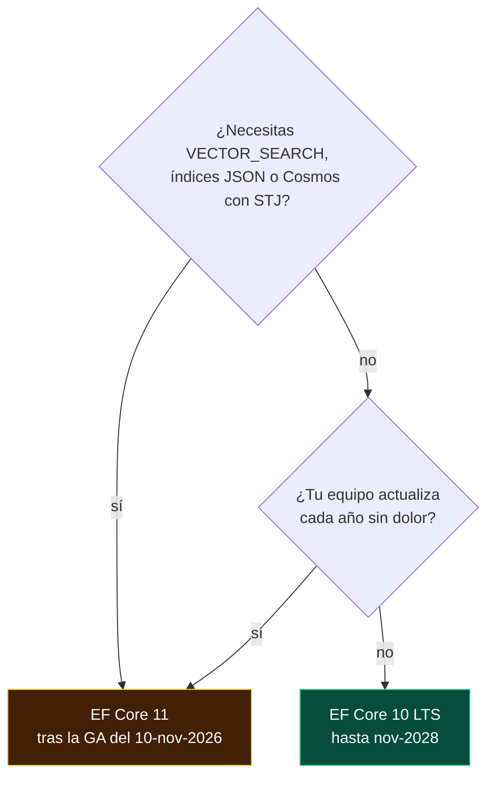

<div align="center">

# 11 · EF Core 11: la versión que llega

**`FullJoin`, `VECTOR_SEARCH`, índices JSON, tipos complejos en todas partes, Cosmos DB sin Newtonsoft y una CLI configurable (RC, noviembre de 2026)**

[⬅ 10 · EF Core 10](10-ef-core-10-lts-vectores-y-json.md) · [🏠 Índice](../README.md) · [12 · Modelado ➡](12-modelado.md)

</div>

<!-- ef=11 -->

| Ficha | EF Core 11.0 |
|---|---|
| **Estado al 8-nov-2026** | 🟡 **Release candidate 3** (`11.0.0-rc.3.26522.148`) con licencia *go-live* |
| **Disponibilidad general** | Prevista el **10-nov-2026**, en la .NET Conf, junto con .NET 11 y C# 15 |
| **Plataforma** | `net11.0`: exige el SDK de .NET 11 |
| **Soporte** | STS de 24 meses: hasta **noviembre de 2028** (previsto) |
| **Idea central** | Madurar lo que EF Core 10 abrió: IA a escala, JSON indexado, tipos complejos sin límites |

> [!WARNING]
> **Este capítulo describe un *release candidate*.** Las funciones están congeladas y Microsoft admite su uso en producción (*go-live*), pero los nombres
> de algunas API todavía pueden ajustarse antes de la GA. Por eso sus ejemplos llevan la marca `ef11` y **no se compilan** con
> [`verificar_ejemplos.py`](../tools/verificar_ejemplos.py) hasta que exista un SDK estable de .NET 11. Comprueba la documentación oficial antes de
> adoptarlas.

---

## Contenido

1. [Panorama](#1-panorama)
2. [Cómo probar EF Core 11 hoy](#2-cómo-probar-ef-core-11-hoy)
3. [LINQ: `FullJoin`, `MaxBy` y `MinBy`](#3-linq-fulljoin-maxby-y-minby)
4. [Un SQL más limpio](#4-un-sql-más-limpio)
5. [Tipos complejos sin límites](#5-tipos-complejos-sin-límites)
6. [SQL Server y Azure SQL](#6-sql-server-y-azure-sql)
7. [Azure Cosmos DB](#7-azure-cosmos-db)
8. [Migraciones y herramientas](#8-migraciones-y-herramientas)
9. [Cambios incompatibles](#9-cambios-incompatibles)
10. [¿Adoptar EF Core 11 o quedarse en 10?](#10-adoptar-ef-core-11-o-quedarse-en-10)
11. [Referencias](#11-referencias)

---

## 1. Panorama



| Pregunta | EF Core 10 | EF Core 11 |
|---|---|---|
| ¿Cuántos vectores puedo buscar con fluidez? | Decenas de miles (*k-NN* exacto) | Millones (*ANN* con índice `DiskANN`) |
| ¿Puedo indexar una ruta dentro de JSON? | ❌ | ✅ `CREATE JSON INDEX` |
| ¿Tipos complejos en jerarquías TPT/TPC? | Solo TPH | TPH, TPT y TPC |
| ¿Cosmos usa Newtonsoft.Json? | Sí | ❌ `System.Text.Json` |
| ¿La CLI recuerda mis opciones? | No | `.config/dotnet-ef.json` |

---

## 2. Cómo probar EF Core 11 hoy

```bash
# SDK de .NET 11 RC3 junto al de .NET 10 (no lo sustituye)
dotnet --list-sdks                 # debe aparecer 11.0.100-rc.3.*

# En una rama: global.json para fijar el SDK y los paquetes del RC
dotnet new globaljson --sdk-version 11.0.100-rc.3.26522.148 --roll-forward latestFeature
dotnet add package Microsoft.EntityFrameworkCore.SqlServer --version 11.0.0-rc.3.26522.148
dotnet tool update dotnet-ef --version 11.0.0-rc.3.26522.148
```

```xml
<!-- Directory.Packages.props: una sola línea para cambiar todo EF a la vez -->
<PropertyGroup>
  <EfCoreVersion>11.0.0-rc.3.26522.148</EfCoreVersion>
</PropertyGroup>
<ItemGroup>
  <PackageVersion Include="Microsoft.EntityFrameworkCore.SqlServer" Version="$(EfCoreVersion)" />
  <PackageVersion Include="Microsoft.EntityFrameworkCore.Design" Version="$(EfCoreVersion)" />
</ItemGroup>
```

> [!TIP]
> Ejecuta tu batería de pruebas de integración contra el RC **antes** de la GA: los errores que encuentres ahora todavía pueden corregirse en el
> primer parche. Las pruebas contra una base real (Testcontainers) son las que detectan cambios de SQL; ver [capítulo 18](18-pruebas.md).

---

## 3. LINQ: `FullJoin`, `MaxBy` y `MinBy`

.NET 11 completa la familia de operadores de *join* que .NET 10 empezó. `FullJoin` devuelve **todas** las filas de ambos lados, emparejadas cuando
coinciden: es la forma natural de **reconciliar** dos fuentes (inventario contable frente a inventario físico, facturas frente a pagos).

```csharp
// Qué productos sobran o faltan entre el sistema y el recuento del almacén
var diferencias = await db.StockSistema
    .FullJoin(db.RecuentoAlmacen,
              s => s.Sku, r => r.Sku,
              (s, r) => new
              {
                  Sku = s != null ? s.Sku : r!.Sku,
                  Sistema = s != null ? s.Unidades : 0,
                  Fisico = r != null ? r.Unidades : 0,
              })
    .Where(x => x.Sistema != x.Fisico)
    .ToListAsync();
```

```sql
SELECT COALESCE([s].[Sku], [r].[Sku]) AS [Sku], …
FROM [StockSistema] AS [s]
FULL JOIN [RecuentoAlmacen] AS [r] ON [s].[Sku] = [r].[Sku]
WHERE …
```

`MaxBy` y `MinBy` (en LINQ to Objects desde .NET 6) por fin se traducen. Antes había que escribir `OrderByDescending(...).First()`:

```csharp
// El pedido más caro de cada cliente, en una sola consulta
var top = await db.Clientes
    .Select(c => new { c.Nombre, Mayor = c.Pedidos.MaxBy(p => p.Total) })
    .ToListAsync();
```

| Operador | Disponible en LINQ | Traducido por EF Core |
|---|---|---|
| `Join` | .NET Framework 3.5 | 1.0 |
| `GroupJoin` + `DefaultIfEmpty` | .NET Framework 3.5 | 1.0 (*left join*) |
| `LeftJoin` / `RightJoin` | .NET 10 | **10** |
| `FullJoin` | .NET 11 | **11** 🟡 |
| `MaxBy` / `MinBy` | .NET 6 | **11** 🟡 |

---

## 4. Un SQL más limpio

EF Core 11 sigue el trabajo de "poda" que empezó en EF Core 9 ([capítulo 09](09-ef-core-9-cosmos-aot-y-siembra.md#7-traducción-de-linq-y-sql)). No
cambia lo que tu código hace, sino lo rápido que lo hace:

| Mejora | Antes | EF Core 11 |
|---|---|---|
| Navegaciones a uno en consultas divididas | `JOIN` repetido en cada subconsulta | Solo en la consulta principal |
| Claves redundantes en `ORDER BY` | `ORDER BY [b].[Id], [p].[BlogId], [p].[Id]` | `ORDER BY [b].[Id], [p].[Id]` |
| `CAST` a su propio tipo | `WHERE CAST([x].[Codigo] AS nvarchar(20)) = @p` | `WHERE [x].[Codigo] = @p` → **usa el índice** |
| Vectores en el `SELECT` | Se leían los 6 KB de cada `vector(1536)` | Se omiten salvo que los pidas |
| Consultas divididas inconsistentes | Colecciones vacías en silencio si otra transacción cambiaba los datos | **`DbQueryConcurrencyException`** |

> [!IMPORTANT]
> El `CAST` eliminado parece un detalle cosmético, pero un `CAST` sobre una columna hace la condición **no *sargable***: SQL Server no puede buscar en el
> índice y recorre la tabla entera. En tablas grandes, este cambio puede convertir una consulta de segundos en una de milisegundos sin tocar tu código.

> [!WARNING]
> La nueva excepción en consultas divididas es un **cambio de comportamiento deliberado**: antes, si una fila desaparecía entre la primera y la segunda
> subconsulta, obtenías datos incompletos sin aviso. Ahora EF lo detecta. Si la ves, ejecuta la consulta dentro de una transacción con aislamiento
> `Snapshot` o `RepeatableRead`, o usa una consulta única ([capítulo 13](13-consultas.md#4-estrategias-de-carga-de-datos-relacionados)).

---

## 5. Tipos complejos sin límites

Los tipos complejos, nacidos en EF Core 8 y llevados a JSON en EF Core 10, pierden en EF Core 11 sus últimas restricciones:

| Capacidad | 8 | 9 | 10 | 11 |
|---|---|---|---|---|
| En columnas | ✅ | ✅ | ✅ | ✅ |
| En JSON (`ToJson`) | — | — | ✅ | ✅ |
| Colecciones | — | — | ✅ | ✅ |
| Opcionales y `struct` | — | — | ✅ | ✅ |
| En jerarquías **TPT y TPC** | — | — | — | ✅ |
| **Claves e índices** sobre sus propiedades | — | — | — | ✅ |
| Configuración con lambdas encadenadas | — | — | — | ✅ |
| En **Cosmos DB** | — | — | — | ✅ |

```csharp
public readonly record struct ClienteId(Guid Value);
public record Direccion(string Calle, string Ciudad, string CodigoPostal);

public class Cliente
{
    public ClienteId Id { get; set; }               // un tipo complejo como clave
    public required string Nombre { get; set; }
    public required Direccion Facturacion { get; set; }
}

protected override void OnModelCreating(ModelBuilder b) => b.Entity<Cliente>(c =>
{
    c.ComplexProperty(x => x.Id);
    c.HasKey(x => x.Id.Value);                              // nuevo: clave sobre una propiedad de un complejo
    c.HasIndex(x => x.Facturacion.CodigoPostal);            // nuevo: índice sobre un complejo
    c.Property(x => x.Facturacion.Ciudad).HasMaxLength(80); // nuevo: sin ComplexProperty(...) intermedio
});
```

> [!TIP]
> Las **claves fuertemente tipadas** (`ClienteId` en lugar de `Guid`) evitan pasar el `Id` de un pedido donde se esperaba el de un cliente. Hasta EF
> Core 10 se implementaban con conversiones de valor ([capítulo 12](12-modelado.md#7-conversiones-de-valores)); EF Core 11 permite hacerlo con un tipo
> complejo, con mejor soporte en consultas.

---

## 6. SQL Server y Azure SQL

### Búsqueda vectorial aproximada: `VECTOR_SEARCH`

EF Core 10 hacía búsqueda **exacta** con `VECTOR_DISTANCE`, que compara la pregunta con cada fila. EF Core 11 añade **índices vectoriales** (algoritmo
*DiskANN*) y la función `VECTOR_SEARCH`, que encuentra los vecinos aproximados **sin recorrer la tabla**:

```csharp
protected override void OnModelCreating(ModelBuilder b)
    => b.Entity<Articulo>().HasVectorIndex(a => a.Embedding, "cosine");

// Top-10 aproximado: el índice evita el recorrido completo
var resultados = await db.Articulos
    .VectorSearch(a => a.Embedding, pregunta, "cosine", topN: 10)
    .WithApproximate()
    .Select(r => new { r.Value.Titulo, r.Distance })
    .ToListAsync();
```

| | `VECTOR_DISTANCE` (EF 10) | `VECTOR_SEARCH` (EF 11) |
|---|---|---|
| Algoritmo | Exacto (*k-NN*) | Aproximado (*ANN*, DiskANN) |
| Recall | 100 % | ~95–99 %, configurable |
| Coste | Lineal en filas | Sublineal |
| Índice | No | `HasVectorIndex` gestionado por migraciones |
| Úsalo | < 50 000 vectores, o cuando necesitas exactitud | Corpus grandes, RAG en producción |

### JSON indexado y `JSON_CONTAINS`

| Novedad | SQL Server | Ejemplo LINQ |
|---|---|---|
| **Índices JSON** | `CREATE JSON INDEX` (SQL Server 2025) | `HasJsonIndex(c => c.Perfil.Pais)` |
| `Contains` sobre colecciones JSON | `JSON_CONTAINS` | `c.Etiquetas.Contains("vip")` |
| Existencia de una ruta | `JSON_PATH_EXISTS` | `EF.Functions.JsonPathExists(c.Datos, "$.envio")` |

### Texto completo gestionado por migraciones

```csharp
b.HasFullTextCatalog("catalogo_docs");
b.Entity<Documento>().HasFullTextIndex(d => new { d.Titulo, d.Cuerpo }, "catalogo_docs");

// Funciones de tabla con puntuación de relevancia
var ranking = db.Documentos.FreeTextTable(d => d.Cuerpo, "migración de base de datos")
    .OrderByDescending(r => r.Rank)
    .Take(20);
```

### Otras mejoras de SQL Server

| Novedad | Detalle |
|---|---|
| **Periodos temporales como propiedades** | `PeriodStart` y `PeriodEnd` pueden ser propiedades normales de la entidad en lugar de propiedades sombra |
| `EF.Functions.DateTrunc` | Traduce a `DATETRUNC` (SQL Server 2022) |
| `DateTimeOffset` | `ToOffset`, `UtcDateTime`, `LocalDateTime` traducidos |
| **Nivel de compatibilidad 160 por defecto** | `UseSqlServer` asume SQL Server 2022: usa `GREATEST`, `LEAST`, `JSON_OBJECT`… |
| `group_concat` ordenado en SQLite | `string.Join(", ", x.Items.OrderBy(i => i.Nombre).Select(i => i.Nombre))` |

> [!CAUTION]
> Si todavía ejecutas **SQL Server 2019 o anterior**, el nivel 160 por defecto generará SQL que tu servidor no entiende. Declara el nivel real:
> `UseSqlServer(cadena, s => s.UseCompatibilityLevel(150))`.

---

## 7. Azure Cosmos DB

| Novedad | Por qué importa |
|---|---|
| **`System.Text.Json`** en lugar de Newtonsoft.Json | Una sola biblioteca JSON en toda la aplicación; AOT posible; desaparece la propiedad sombra `__jObject` |
| **Tipos complejos** | Objetos y arreglos anidados con semántica de valor, en lugar de tipos propios |
| **Lotes transaccionales** | `SaveChanges` agrupa las escrituras de una misma partición en un *transactional batch* atómico |
| **Ejecución masiva** | `BulkExecutionEnabled()` para ingestas de alto volumen |
| **Tokens de sesión** | `GetSessionToken()` / `UseSessionToken()`: lee tus propias escrituras entre instancias con consistencia de sesión |
| **E/S síncrona eliminada** | Ya no existe la opción para reactivarla |

```csharp
protected override void OnConfiguring(DbContextOptionsBuilder o)
    => o.UseCosmos(endpoint, credencial, "Pedidos", c => c.BulkExecutionEnabled());

// Escritura en una instancia, lectura garantizada en otra (p. ej. tras un redirect)
await db.SaveChangesAsync();
var token = db.Database.GetSessionToken();
// … se envía a la otra instancia …
otroDb.Database.UseSessionToken(token);
var pedido = await otroDb.Pedidos.SingleAsync(p => p.Id == id && p.Cliente == cliente);
```

> [!WARNING]
> El cambio a `System.Text.Json` puede alterar **cómo se serializan** tipos con convertidores de Newtonsoft (`[JsonProperty]`, `JsonConverter` propios).
> Prueba la lectura de documentos existentes antes de desplegar.

---

## 8. Migraciones y herramientas

| Novedad | Uso |
|---|---|
| **`.config/dotnet-ef.json`** | Opciones por defecto para la CLI: proyecto, proyecto de inicio, contexto, carpeta de salida |
| **`database update --add`** | Crea la migración, la compila en memoria con Roslyn y la aplica: ideal en desarrollo |
| **`migrations remove --offline`** | Quita la última migración sin conectarse a la base |
| **`--context "*"`** | `list`, `script`, `update` y `drop` sobre **todos** los contextos del proyecto |
| **Última migración en la instantánea** | `ModelSnapshot` guarda el ID de la última migración: dos ramas que añaden migraciones a la vez **chocan en la fusión** de Git, en lugar de producir una instantánea incoherente |
| **`ExcludeForeignKeyFromMigrations`** | La relación existe en el modelo, pero la migración no crea la restricción `FOREIGN KEY` (útil entre bases o esquemas gestionados por otros) |

```json
// .config/dotnet-ef.json
{
  "project": "src/Infraestructura",
  "startupProject": "src/Api",
  "context": "JobsDbContext",
  "outputDir": "Migraciones"
}
```

```bash
# Con dotnet-ef.json, esto basta en lugar de cuatro opciones
dotnet ef migrations add AgregarPrioridad

# Desarrollo: crear y aplicar en un paso
dotnet ef database update --add AgregarPrioridad

# Generar el script de todos los contextos para la revisión del DBA
dotnet ef migrations script --context "*" --idempotent -o despliegue.sql
```

> [!TIP]
> El conflicto de fusión forzado en la instantánea es una **ventaja**: antes, dos desarrolladores podían crear migraciones en paralelo, Git fusionaba
> la instantánea sin quejarse, y la siguiente migración salía con operaciones fantasma. Ahora el conflicto te obliga a regenerar la segunda migración
> sobre la primera ([capítulo 15](15-migraciones-y-despliegue.md)).

---

## 9. Cambios incompatibles

| Cambio | Impacto | Mitigación |
|---|---|---|
| Requiere .NET 11 | 🔴 Alto | `TargetFramework` → `net11.0` |
| **Cosmos: `System.Text.Json`** y fin de `__jObject` | 🔴 Alto | Revisar convertidores de Newtonsoft; probar datos existentes |
| Cosmos: E/S síncrona eliminada definitivamente | 🔴 Alto | Pasar a `async` |
| **Nivel de compatibilidad 160 por defecto** | 🟠 Medio | `UseCompatibilityLevel(…)` con tu versión real |
| **Se elimina `EFOptimizeContext`** | 🟠 Medio | Usar `EFScaffoldModelStage` y `EFPrecompileQueriesStage`; con `PublishAOT=true` se activa solo |
| `DbQueryConcurrencyException` en consultas divididas | 🟡 Bajo | Transacción con aislamiento adecuado o consulta única |
| Columnas vectoriales fuera del `SELECT` por defecto | 🟡 Bajo | Proyectarlas explícitamente si las necesitas |
| La instantánea incluye el ID de la última migración | 🟡 Bajo | Regenerar la instantánea al actualizar |

---

## 10. ¿Adoptar EF Core 11 o quedarse en 10?



| Argumento | A favor de 10 | A favor de 11 |
|---|---|---|
| Soporte | Hasta 10-nov-2028 | Hasta nov-2028 (prácticamente igual) |
| Madurez | Un año de parches (10.0.14) | Recién publicado |
| Funciones | Suficientes para la mayoría | IA a escala, JSON indexado |
| Proveedores | Todos los principales | Algunos tardarán semanas o meses (Npgsql, Oracle, Pomelo) |
| Siguiente salto obligatorio | A EF Core 12 LTS (nov-2027) o 14 | A EF Core 12 antes de nov-2028 |

> [!NOTE]
> La regla práctica: **espera al primer parche** (11.0.1, habitualmente en diciembre) y a que tu proveedor publique su versión 11, salvo que una función
> concreta lo justifique antes.

---

## 11. Referencias

- [What's new in EF Core 11](https://learn.microsoft.com/ef/core/what-is-new/ef-core-11.0/whatsnew)
- [Breaking changes in EF Core 11](https://learn.microsoft.com/ef/core/what-is-new/ef-core-11.0/breaking-changes)
- [EF Core plan for 11.0](https://learn.microsoft.com/ef/core/what-is-new/ef-core-11.0/plan)
- [`dotnet/efcore` releases](https://github.com/dotnet/efcore/releases)
- [.NET 11 RC 3 announcement](https://devblogs.microsoft.com/dotnet/)

<div align="center">

[⬅ 10 · EF Core 10](10-ef-core-10-lts-vectores-y-json.md) · [🏠 Índice](../README.md) · [12 · Modelado ➡](12-modelado.md)

</div>
