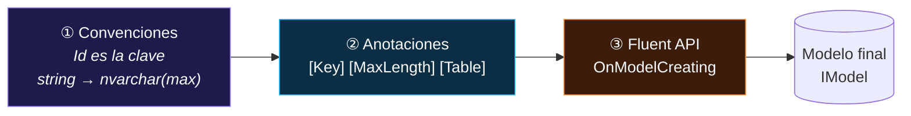
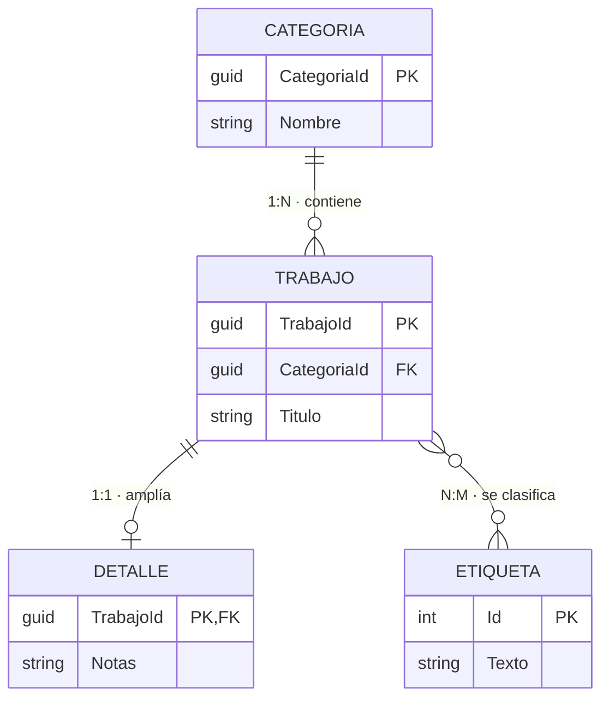
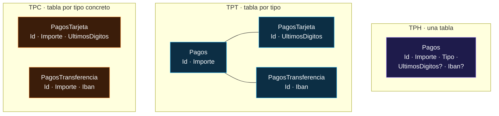
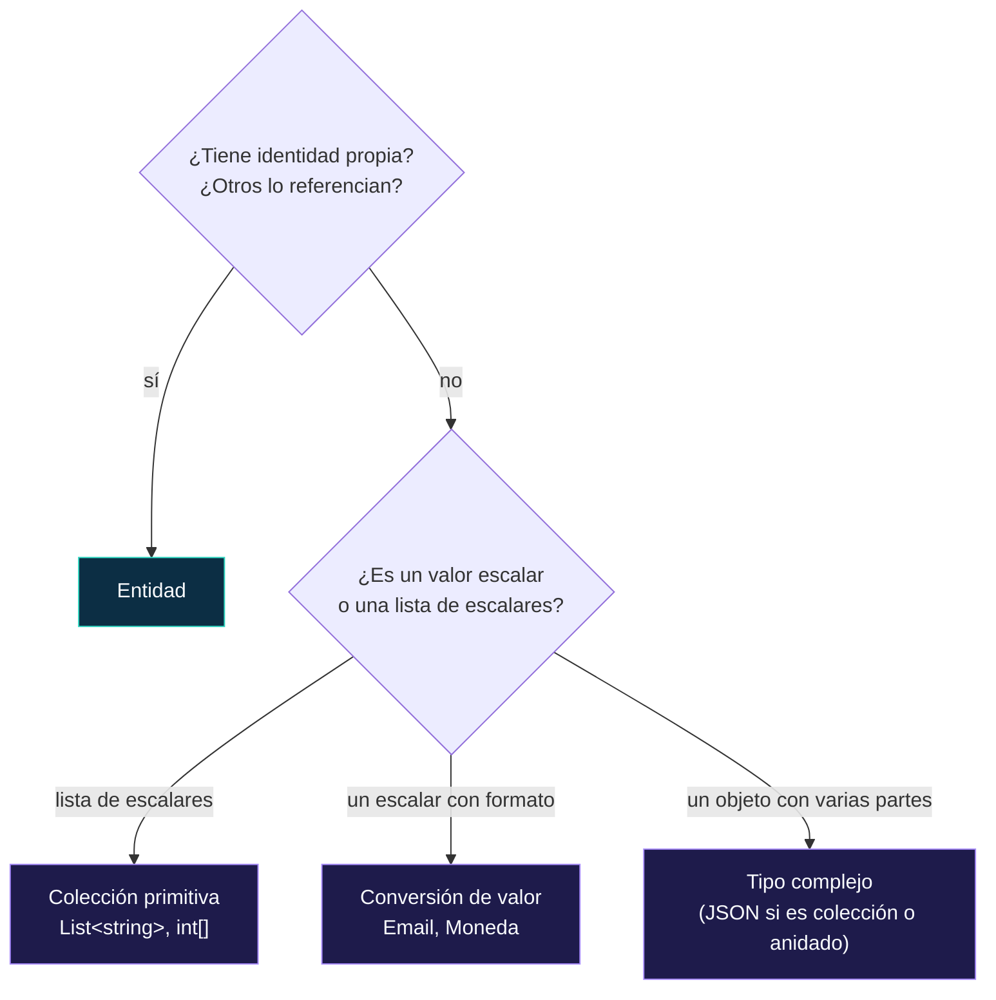

<div align="center">

# 12 · Modelado

**Del objeto a la tabla: convenciones, anotaciones, Fluent API, claves, relaciones, conversiones, herencia y los tres sabores de "valor"**

[⬅ 11 · EF Core 11](11-ef-core-11-rc.md) · [🏠 Índice](../README.md) · [13 · Consultas ➡](13-consultas.md)

</div>

<!-- ef=10 -->

> [!NOTE]
> Los capítulos 03 a 11 cuentan **cuándo** apareció cada pieza. Los capítulos 12 a 21 son **temáticos**: explican cómo usar EF Core 10 hoy, con
> todas las piezas juntas. Cada ejemplo marcado con salida (`// →`) se ha ejecutado sobre SQLite con EF Core 10.0.14.

---

## Contenido

1. [Tres capas de configuración](#1-tres-capas-de-configuración)
2. [Entidades, claves y propiedades](#2-entidades-claves-y-propiedades)
3. [Convenciones y configuración masiva](#3-convenciones-y-configuración-masiva)
4. [Relaciones](#4-relaciones)
5. [Índices y restricciones](#5-índices-y-restricciones)
6. [Propiedades sombra y campos de respaldo](#6-propiedades-sombra-y-campos-de-respaldo)
7. [Conversiones de valores](#7-conversiones-de-valores)
8. [Herencia TPH, TPT y TPC](#8-herencia-tph-tpt-y-tpc)
9. [Entidad, tipo propio, tipo complejo o colección primitiva](#9-entidad-tipo-propio-tipo-complejo-o-colección-primitiva)
10. [Tablas, vistas, funciones y división](#10-tablas-vistas-funciones-y-división)
11. [Errores frecuentes de modelado](#11-errores-frecuentes-de-modelado)
12. [Referencias](#12-referencias)

---

## 1. Tres capas de configuración

EF Core construye el modelo ([capítulo 02](02-anatomia-de-ef-core.md#3-el-modelo-la-fuente-de-verdad)) aplicando tres capas en orden. **Cada capa
puede sobrescribir a la anterior**:



| Capa | Dónde | Ventaja | Límite |
|---|---|---|---|
| **Convenciones** | Dentro de EF (y las tuyas en `ConfigureConventions`) | Cero código para el caso común | Solo cubren lo predecible |
| **Anotaciones** | Atributos sobre la clase | Visibles junto a la propiedad; las usa también la validación de ASP.NET Core | Acoplan el dominio a EF; no todo se puede expresar |
| **Fluent API** | `OnModelCreating` o `IEntityTypeConfiguration<T>` | **Todo** es configurable; el dominio queda limpio | Alejada de la clase |

> [!TIP]
> Elige **una** estrategia por proyecto y sé coherente. La combinación más habitual en equipos grandes: **convenciones + Fluent API en clases
> `IEntityTypeConfiguration<T>`**, sin atributos de EF en el dominio. El proyecto de este repositorio mezcla las dos (`[Key]` en `Category` y
> `HasKey` en `JobContext.cs`); el [capítulo 20](20-caso-practico-jobsdb.md) lo corrige.

---

## 2. Entidades, claves y propiedades

### Qué decide la convención

| Elemento en C# | Convención de EF Core | Columna en SQL Server |
|---|---|---|
| `int Id` o `int ProductoId` | Clave primaria, generada por la base | `int IDENTITY(1,1)` |
| `Guid Id` | Clave primaria, generada **en el cliente** (GUID secuencial en SQL Server) | `uniqueidentifier` |
| `string Nombre` con `<Nullable>enable` | Obligatoria | `nvarchar(max) NOT NULL` |
| `string? Nota` | Opcional | `nvarchar(max) NULL` |
| `decimal Precio` | Precisión por defecto (aviso en el log) | `decimal(18,2)` |
| `DateTime Fecha` | Obligatoria | `datetime2` |
| `bool Activo` | Obligatoria | `bit` |
| `enum Prioridad` | Se guarda como **entero** | `int` |
| `byte[] Foto` | Opcional | `varbinary(max)` |
| Propiedad sin `set` | Ignorada (salvo que tenga campo de respaldo) | — |

> [!IMPORTANT]
> Con los **tipos de referencia anulables** de C# 8 activados (`<Nullable>enable</Nullable>`, el valor por defecto en plantillas modernas), EF Core lee
> la anotación: `string` es `NOT NULL` y `string?` es `NULL`. En este repositorio `Job.Description` es `string` (no anulable) pero se configuró
> `IsRequired(false)`: la Fluent API gana, la columna admite `NULL`, y el compilador cree que nunca será `null`. Es una mentira que termina en
> `NullReferenceException`.

### Configuración explícita

```csharp run
using var db = new Tienda();
var e = db.Model.FindEntityType(typeof(Producto))!;
foreach (var p in e.GetProperties())
    Console.WriteLine($"{p.Name,-10} {p.GetColumnType(),-14} {(p.IsNullable ? "NULL" : "NOT NULL")}");
// → Id         INTEGER        NOT NULL
// → Codigo     TEXT           NOT NULL
// → Nombre     TEXT           NOT NULL
// → Nota       TEXT           NULL
// → Precio     TEXT           NOT NULL
Console.WriteLine(e.FindPrimaryKey()!.Properties[0].Name);    // → Id

public class Producto
{
    public int Id { get; set; }
    public required string Codigo { get; set; }
    public required string Nombre { get; set; }
    public string? Nota { get; set; }
    public decimal Precio { get; set; }
}

public class Tienda : DbContext
{
    public DbSet<Producto> Productos => Set<Producto>();
    protected override void OnConfiguring(DbContextOptionsBuilder o) => o.UseSqlite("Data Source=tienda.db");

    protected override void OnModelCreating(ModelBuilder b) => b.Entity<Producto>(p =>
    {
        p.ToTable("Productos");
        p.HasKey(x => x.Id);
        p.Property(x => x.Codigo).HasMaxLength(20).IsUnicode(false);
        p.Property(x => x.Nombre).HasMaxLength(200);
        p.Property(x => x.Precio).HasPrecision(12, 2);
        p.HasAlternateKey(x => x.Codigo);                // clave alternativa: UNIQUE y destino posible de FK
    });
}
```

> [!NOTE]
> SQLite no tiene tipos de longitud fija: `HasMaxLength(20)` produce `TEXT` y `decimal` se guarda como `TEXT` para no perder precisión. En SQL Server, el
> mismo modelo produce `varchar(20)`, `nvarchar(200)` y `decimal(12,2)`. **El modelo es el mismo; el proveedor decide el tipo físico**
> ([capítulo 16](16-proveedores.md)).

### Valores generados

| Configuración | Significado | Ejemplo |
|---|---|---|
| `ValueGeneratedOnAdd()` | La base (o EF) genera el valor al insertar | `IDENTITY`, `Guid` secuencial |
| `HasDefaultValue(0)` | `DEFAULT 0` en la columna | Contadores |
| `HasDefaultValueSql("SYSUTCDATETIME()")` | `DEFAULT` con expresión SQL | Fecha de alta |
| `HasComputedColumnSql("[Precio] * [Unidades]", stored: true)` | Columna calculada | Totales |
| `ValueGeneratedOnAddOrUpdate()` + `IsRowVersion()` | Versión de fila | Concurrencia ([capítulo 14](14-guardado-y-concurrencia.md)) |
| `UseHiLo()` (SQL Server) | Bloques de claves reservados con una secuencia | Inserciones masivas sin ida y vuelta |
| `HasSequence<int>("Facturas")` | Secuencias de base de datos | Numeración de facturas |

> [!WARNING]
> **El valor centinela.** Si una propiedad `bool` tiene `HasDefaultValue(true)`, EF no puede distinguir "el usuario puso `false`" de "no lo puso", porque
> `false` es el valor por defecto de C#: omite la columna del `INSERT` y la base escribe `true`. La solución es usar `bool?`, o un campo de respaldo
> anulable, o `HasSentinel(...)` ([capítulo 08](08-ef-core-8-tipos-complejos.md#valores-centinela-un-error-sutil-corregido)).

---

## 3. Convenciones y configuración masiva

Cuando la misma regla se repite en decenas de entidades (todas las cadenas con longitud máxima, todos los `decimal` con la misma precisión, todos los
`DateTime` en UTC), configurarla propiedad a propiedad es frágil. EF Core ofrece tres herramientas, de menor a mayor potencia:

| Herramienta | Desde | Úsala para |
|---|---|---|
| `ConfigureConventions` (*pre-convention configuration*) | 6.0 | Reglas **por tipo CLR**: "todo `string` mide 256", "todo `decimal` es (18,4)", conversiones globales |
| `IEntityTypeConfiguration<T>` + `ApplyConfigurationsFromAssembly` | 2.0 | Una clase de configuración por entidad, descubiertas automáticamente |
| Convenciones propias (`IModelFinalizingConvention`…) | 7.0 | Reglas que dependen del **modelo**: nombres en `snake_case`, índices en todas las FK, prefijos de tabla |

```csharp run
using System.Reflection;

using var db = new Erp();
var e = db.Model.FindEntityType(typeof(Factura))!;
Console.WriteLine(e.FindProperty(nameof(Factura.Cliente))!.GetMaxLength());   // → 256
Console.WriteLine(e.FindProperty(nameof(Factura.Total))!.GetPrecision());     // → 18
Console.WriteLine(e.FindProperty(nameof(Factura.Total))!.GetScale());         // → 4
Console.WriteLine(e.FindProperty(nameof(Factura.Estado))!.GetProviderClrType()!.Name); // → String
Console.WriteLine(e.GetTableName());                                          // → facturas

public enum EstadoFactura { Borrador, Emitida, Pagada }

public class Factura
{
    public int Id { get; set; }
    public required string Cliente { get; set; }
    public decimal Total { get; set; }
    public EstadoFactura Estado { get; set; }
}

public class FacturaConfig : IEntityTypeConfiguration<Factura>
{
    public void Configure(EntityTypeBuilder<Factura> b) => b.ToTable("facturas");
}

public class Erp : DbContext
{
    public DbSet<Factura> Facturas => Set<Factura>();
    protected override void OnConfiguring(DbContextOptionsBuilder o) => o.UseSqlite("Data Source=erp.db");

    protected override void ConfigureConventions(ModelConfigurationBuilder c)
    {
        c.Properties<string>().HaveMaxLength(256);
        c.Properties<decimal>().HavePrecision(18, 4);
        c.Properties<Enum>().HaveConversion<string>();      // todos los enum como texto
    }

    protected override void OnModelCreating(ModelBuilder b)
        => b.ApplyConfigurationsFromAssembly(Assembly.GetExecutingAssembly());
}
```

> [!TIP]
> `ConfigureConventions` se aplica **antes** que las convenciones, así que cualquier configuración explícita posterior (`HasMaxLength(20)` en una propiedad
> concreta) la sobrescribe. Es la herramienta perfecta para fijar "valores por defecto del proyecto" sin perder flexibilidad.

---

## 4. Relaciones

Una relación tiene siempre un **principal** (el lado referenciado, "uno") y un **dependiente** (el que tiene la clave foránea).



| Relación | Fluent API | Clave foránea en |
|---|---|---|
| Uno a muchos | `HasOne(t => t.Categoria).WithMany(c => c.Trabajos).HasForeignKey(t => t.CategoriaId)` | El lado "muchos" |
| Uno a uno | `HasOne(t => t.Detalle).WithOne(d => d.Trabajo).HasForeignKey<Detalle>(d => d.TrabajoId)` | El dependiente (hay que indicarlo) |
| Muchos a muchos | `HasMany(t => t.Etiquetas).WithMany(e => e.Trabajos)` | Tabla de unión implícita (EF Core 5+) |
| Muchos a muchos con datos | `.UsingEntity<TrabajoEtiqueta>(…)` | Entidad de unión explícita |
| Sin navegación inversa | `HasOne(t => t.Categoria).WithMany()` | — |
| Autorreferencia | `HasOne(e => e.Jefe).WithMany(e => e.Equipo)` | Misma tabla |

```csharp run
using var db = new Proyecto();
db.Database.EnsureDeleted();
db.Database.EnsureCreated();

var urgente = new Etiqueta { Texto = "urgente" };
var casa = new Categoria { Nombre = "Casa" };
db.Add(new Trabajo { Titulo = "Pagar luz", Categoria = casa, Etiquetas = [urgente], Detalle = new() { Notas = "antes del 15" } });
db.Add(new Trabajo { Titulo = "Regar", Categoria = casa });
db.SaveChanges();
db.ChangeTracker.Clear();

var c = db.Categorias.Include(x => x.Trabajos).ThenInclude(t => t.Etiquetas).Single();
Console.WriteLine($"{c.Nombre}: {c.Trabajos.Count} trabajos");                      // → Casa: 2 trabajos
Console.WriteLine(db.Trabajos.Count(t => t.Etiquetas.Any(e => e.Texto == "urgente")));  // → 1
Console.WriteLine(db.Model.FindEntityType("EtiquetaTrabajo")!.GetTableName());    // → EtiquetaTrabajo

public class Categoria
{
    public int Id { get; set; }
    public required string Nombre { get; set; }
    public List<Trabajo> Trabajos { get; set; } = [];
}

public class Trabajo
{
    public int Id { get; set; }
    public required string Titulo { get; set; }
    public int CategoriaId { get; set; }
    public Categoria Categoria { get; set; } = null!;
    public Detalle? Detalle { get; set; }
    public List<Etiqueta> Etiquetas { get; set; } = [];
}

public class Detalle
{
    public int Id { get; set; }
    public int TrabajoId { get; set; }
    public string? Notas { get; set; }
    public Trabajo Trabajo { get; set; } = null!;
}

public class Etiqueta
{
    public int Id { get; set; }
    public required string Texto { get; set; }
    public List<Trabajo> Trabajos { get; set; } = [];
}

public class Proyecto : DbContext
{
    public DbSet<Categoria> Categorias => Set<Categoria>();
    public DbSet<Trabajo> Trabajos => Set<Trabajo>();
    protected override void OnConfiguring(DbContextOptionsBuilder o) => o.UseSqlite("Data Source=proyecto.db");
}
```

### Qué ocurre al borrar el principal

| `OnDelete(DeleteBehavior.…)` | Entidades seguidas en memoria | Restricción en la base | Por defecto para |
|---|---|---|---|
| `Cascade` | Se borran los dependientes | `ON DELETE CASCADE` | Relaciones **obligatorias** |
| `ClientSetNull` | La FK pasa a `null` | `NO ACTION` | Relaciones **opcionales** |
| `SetNull` | La FK pasa a `null` | `ON DELETE SET NULL` | — |
| `Restrict` / `NoAction` | Excepción si hay dependientes cargados | `NO ACTION` / `RESTRICT` | — |
| `ClientCascade` | Se borran en memoria | `NO ACTION` | Bases que no admiten cascada múltiple |

> [!CAUTION]
> SQL Server rechaza un esquema con **varias rutas de cascada** hacia la misma tabla ("*may cause cycles or multiple cascade paths*"). La solución
> es poner `Restrict` o `ClientCascade` en una de las rutas. La migración generará el error al aplicarse, no al crearse: revísala antes.

---

## 5. Índices y restricciones

```csharp
public class Usuario
{
    public int Id { get; set; }
    public required string Email { get; set; }
    public required string Pais { get; set; }
    public DateTime? BajaUtc { get; set; }
    public int Edad { get; set; }
}

public class Cuentas : DbContext
{
    public DbSet<Usuario> Usuarios => Set<Usuario>();
    protected override void OnConfiguring(DbContextOptionsBuilder o)
        => o.UseSqlServer("Server=.;Database=Cuentas;Trusted_Connection=True;TrustServerCertificate=True");

    protected override void OnModelCreating(ModelBuilder b) => b.Entity<Usuario>(u =>
    {
        u.HasIndex(x => x.Email).IsUnique().HasFilter("[BajaUtc] IS NULL");   // único solo entre activos
        u.HasIndex(x => new { x.Pais, x.BajaUtc }).HasDatabaseName("IX_Usuarios_Pais_Baja");
        u.HasIndex(x => x.Edad).IsDescending();                               // orden descendente (EF Core 7+)
        u.ToTable(t => t.HasCheckConstraint("CK_Usuarios_Edad", "[Edad] >= 18"));
    });
}
```

| Configuración | Efecto |
|---|---|
| `HasIndex(x => x.A)` | Índice simple; EF crea uno automáticamente en cada FK |
| `.IsUnique()` | `UNIQUE` |
| `.HasFilter("…")` | Índice filtrado: unicidad condicional, índices más pequeños |
| `.IsDescending()` | Orden descendente por columna (EF Core 7+) |
| `.IncludeProperties(…)` | `INCLUDE (…)` en SQL Server |
| `HasCheckConstraint` | Regla de negocio que la base garantiza aunque escriba otro sistema |
| `[Index(nameof(Email), IsUnique = true)]` | Lo mismo, como atributo de clase |

---

## 6. Propiedades sombra y campos de respaldo

Una **propiedad sombra** existe en el modelo y en la tabla, pero **no en la clase**. Es ideal para datos técnicos que el dominio no debe ver: auditoría,
inquilino, la propia FK de una navegación.

```csharp run
using var db = new Auditado();
db.Database.EnsureDeleted();
db.Database.EnsureCreated();
db.Notas.Add(new Nota { Texto = "hola" });
db.SaveChanges();

var nota = db.Notas.Single();
Console.WriteLine(db.Entry(nota).Property<string>("CreadoPor").CurrentValue);        // → sistema
Console.WriteLine(db.Notas.Count(n => EF.Property<string>(n, "CreadoPor") == "sistema")); // → 1
nota.Renombrar("  adiós  ");
Console.WriteLine(nota.Texto);                                                       // → adiós

public class Nota
{
    private string _texto = "";
    public int Id { get; private set; }
    public string Texto { get => _texto; set => _texto = value.Trim(); }
    public void Renombrar(string t) => Texto = t;
}

public class Auditado : DbContext
{
    public DbSet<Nota> Notas => Set<Nota>();
    protected override void OnConfiguring(DbContextOptionsBuilder o) => o.UseSqlite("Data Source=auditado.db");

    protected override void OnModelCreating(ModelBuilder b) => b.Entity<Nota>(n =>
    {
        n.Property<string>("CreadoPor").HasMaxLength(50);                       // sombra
        n.Property(x => x.Texto).HasField("_texto");                            // EF lee y escribe el campo directamente
    });

    public override int SaveChanges(bool acceptAllChangesOnSuccess)
    {
        foreach (var e in ChangeTracker.Entries<Nota>().Where(e => e.State == EntityState.Added))
            e.Property("CreadoPor").CurrentValue = "sistema";
        return base.SaveChanges(acceptAllChangesOnSuccess);
    }
}
```

> [!NOTE]
> Por convención, EF usa el **campo de respaldo** (`_texto`, `m_texto`, `<Texto>k__BackingField`) al **materializar** y la propiedad al leer desde tu código.
> Así, la lógica del `set` (aquí, el `Trim()`) **no** se ejecuta al cargar de la base: los datos ya guardados no se "corrigen" en silencio.

---

## 7. Conversiones de valores

Una **conversión de valor** transforma una propiedad entre su tipo .NET y el tipo que se guarda: un `enum` como texto, un objeto de valor como una
cadena, un `DateTime` forzado a UTC, un dato cifrado.

```csharp run
using var db = new Pedidos();
db.Database.EnsureDeleted();
db.Database.EnsureCreated();
db.Add(new Pedido { Id = new PedidoId(Guid.Parse("11111111-2222-3333-4444-555555555555")), Moneda = new Moneda("eur"), Estado = Estado.Enviado });
db.SaveChanges();

using var cmd = db.Database.GetDbConnection().CreateCommand();
cmd.CommandText = "SELECT Id, Moneda, Estado FROM Pedidos";
db.Database.OpenConnection();
using var r = cmd.ExecuteReader();
r.Read();
Console.WriteLine($"{r.GetString(0)} | {r.GetString(1)} | {r.GetString(2)}");
// → 11111111-2222-3333-4444-555555555555 | EUR | Enviado

public enum Estado { Nuevo, Enviado, Entregado }
public readonly record struct PedidoId(Guid Valor);
public record Moneda
{
    public Moneda(string codigo) => Codigo = codigo.ToUpperInvariant();
    public string Codigo { get; }
}

public class Pedido
{
    public PedidoId Id { get; set; }
    public required Moneda Moneda { get; set; }
    public Estado Estado { get; set; }
}

public class Pedidos : DbContext
{
    protected override void OnConfiguring(DbContextOptionsBuilder o) => o.UseSqlite("Data Source=pedidos.db");

    protected override void OnModelCreating(ModelBuilder b) => b.Entity<Pedido>(p =>
    {
        p.ToTable("Pedidos");
        p.Property(x => x.Id).HasConversion(id => id.Valor.ToString(), s => new PedidoId(Guid.Parse(s)));
        p.Property(x => x.Moneda).HasConversion(m => m.Codigo, s => new Moneda(s)).HasMaxLength(3);
        p.Property(x => x.Estado).HasConversion<string>();
    });
}
```

| Conversión integrada | Ejemplo |
|---|---|
| `HasConversion<string>()` sobre un `enum` | `Estado.Enviado` ↔ `'Enviado'` |
| `HasConversion<int>()` sobre un `bool` | `true` ↔ `1` |
| `HasConversion<string>()` sobre `Guid`, `DateTime`, `TimeSpan`… | Texto ISO |
| `HasConversion<long>()` sobre `DateTime` | *Ticks* binarios |
| `HasConversion<byte[]>()` | Serialización binaria |
| `ValueConverter<TModel, TProvider>` propio | Cualquier transformación |

> [!WARNING]
> **Las conversiones no son transparentes para las consultas.** `Where(p => p.Moneda.Codigo == "EUR")` no se puede traducir: EF solo conoce la columna
> convertida, no las propiedades internas del objeto. Debes comparar valores completos: `Where(p => p.Moneda == new Moneda("EUR"))`. Si necesitas
> consultar por partes, usa un **tipo complejo** en lugar de una conversión.

> [!TIP]
> **Fechas UTC.** SQL Server y SQLite no guardan `DateTimeKind`: un `DateTime` UTC vuelve como `Unspecified`. La solución clásica es una conversión global
> en `ConfigureConventions` que marque todas las fechas como UTC al leer. Mejor aún: usa `DateTimeOffset`, que conserva el desplazamiento.

---

## 8. Herencia TPH, TPT y TPC

Cuando las entidades forman una jerarquía (`Pago` → `PagoTarjeta`, `PagoTransferencia`), hay tres formas de guardarla:



| | **TPH** (por defecto) | **TPT** (EF Core 5) | **TPC** (EF Core 7) |
|---|---|---|---|
| Tablas | 1 | 1 + 1 por subtipo | 1 por tipo concreto |
| Columnas de subtipos | Anulables | En su tabla, `NOT NULL` posibles | En su tabla, `NOT NULL` posibles |
| Consultar el tipo base | 1 tabla, sin `JOIN` | `LEFT JOIN` a todas las tablas | `UNION ALL` de todas las tablas |
| Consultar un subtipo | `WHERE Tipo = …` | `INNER JOIN` | 1 tabla |
| Insertar | 1 `INSERT` | 2 `INSERT` | 1 `INSERT` |
| Claves | `IDENTITY` normal | `IDENTITY` normal | Secuencia compartida (no `IDENTITY`) |
| **Rendimiento** | 🥇 casi siempre el mejor | 🥉 el peor en consultas polimórficas | 🥈 muy bueno si casi nunca consultas el tipo base |
| Normalización | Baja | Alta | Media |

```csharp run
using var db = new Caja();
db.Database.EnsureDeleted();
db.Database.EnsureCreated();
db.AddRange(new PagoTarjeta { Importe = 10, UltimosDigitos = "4242" }, new PagoTransferencia { Importe = 25, Iban = "ES00…" });
db.SaveChanges();

Console.WriteLine(db.Pagos.Sum(p => p.Importe).ToString("0"));               // → 35
Console.WriteLine(db.Pagos.OfType<PagoTarjeta>().Single().UltimosDigitos);   // → 4242
Console.WriteLine(string.Join(", ", db.Model.GetEntityTypes().Select(e => e.GetTableName()).OfType<string>().Order()));
// → PagoTarjeta, PagoTransferencia
// (el tipo abstracto Pago no tiene tabla en TPC)

public abstract class Pago
{
    public Guid Id { get; set; }               // TPC: claves únicas entre tablas (Guid o secuencia)
    public decimal Importe { get; set; }
}
public class PagoTarjeta : Pago { public required string UltimosDigitos { get; set; } }
public class PagoTransferencia : Pago { public required string Iban { get; set; } }

public class Caja : DbContext
{
    public DbSet<Pago> Pagos => Set<Pago>();
    protected override void OnConfiguring(DbContextOptionsBuilder o) => o.UseSqlite("Data Source=caja.db");

    protected override void OnModelCreating(ModelBuilder b)
    {
        b.Entity<Pago>().UseTpcMappingStrategy();     // o UseTphMappingStrategy() / UseTptMappingStrategy()
        b.Entity<PagoTarjeta>();
        b.Entity<PagoTransferencia>();
    }
}
```

> [!IMPORTANT]
> En TPC, la clave debe ser única **entre todas las tablas** de la jerarquía: un `PagoTarjeta` y un `PagoTransferencia` no pueden tener el mismo `Id`.
> Por eso no sirve `IDENTITY`: en SQL Server EF usa una **secuencia compartida**, y en SQLite, que no tiene secuencias, conviene usar `Guid`.

> [!TIP]
> **Empieza con TPH.** Solo cambia a TPC si casi siempre consultas un subtipo concreto y los subtipos tienen muchas columnas propias, y evita TPT salvo que
> otra aplicación exija ese esquema normalizado. El equipo de EF lo dice explícitamente en la documentación de rendimiento.

---

## 9. Entidad, tipo propio, tipo complejo o colección primitiva

| | **Entidad** | **Tipo propio** (`OwnsOne`) | **Tipo complejo** (`ComplexProperty`) | **Colección primitiva** |
|---|---|---|---|---|
| Desde | 1.0 | 2.0 | 8.0 (JSON en 10) | 8.0 |
| Identidad | ✅ clave | Clave oculta | ❌ valor | ❌ valor |
| Compartible entre dueños | ✅ | ❌ | ✅ (se copia) | ✅ (se copia) |
| Igualdad | Por clave | Por referencia | **Por valor** | Por valor |
| Navegaciones hacia él | ✅ | Solo desde el dueño | ❌ | ❌ |
| Almacenamiento | Tabla propia | Columnas, tabla o JSON | Columnas o JSON | JSON |
| Ejemplo | `Cliente`, `Pedido` | (heredado) | `Direccion`, `Dinero`, `Rango` | `List<string> Etiquetas` |



---

## 10. Tablas, vistas, funciones y división

| Mapeo | API | Para qué |
|---|---|---|
| Esquema | `ToTable("Pedidos", "ventas")` o `HasDefaultSchema("ventas")` | Organizar por módulos |
| **Vista** | `ToView("vw_Resumen")` | Leer desde una vista existente (no se crea en migraciones) |
| **Sin clave** | `HasNoKey()` o `[Keyless]` | Resultados de vistas, informes, `SqlQuery` |
| **SQL como origen** | `ToSqlQuery("SELECT …")` | Una "vista" definida en el modelo |
| **Función de tabla** | `HasDbFunction(...)` + `FromExpression` | Funciones TVF de SQL Server |
| **División de tabla** | Dos entidades en una tabla con `ToTable` y relación 1:1 | Cargar las columnas pesadas solo cuando hacen falta |
| **División de entidad** | `SplitToTable("Detalles", …)` (EF Core 7) | Una entidad repartida en varias tablas |
| Tabla temporal | `ToTable(t => t.IsTemporal())` (SQL Server) | Historial automático ([capítulo 06](06-ef-core-6-rendimiento-y-temporalidad.md)) |
| Comentarios | `HasComment("…")` | Documentar el esquema en la propia base |

---

## 11. Errores frecuentes de modelado

| Síntoma | Causa | Solución |
|---|---|---|
| `decimal` con aviso "*No store type was specified*" | Falta precisión | `HasPrecision(18, 2)` o `ConfigureConventions` |
| `nvarchar(max)` en todas las cadenas | Convención por defecto | `HasMaxLength` o convención global; los índices no admiten `max` |
| `The entity type 'X' requires a primary key` | Ninguna propiedad se llama `Id` o `XId` | `HasKey` o `HasNoKey` |
| Migración que borra y recrea una columna al renombrarla | EF no distingue renombrar de borrar + crear | Editar la migración y usar `RenameColumn` ([capítulo 15](15-migraciones-y-despliegue.md)) |
| `Unable to determine the relationship` | Dos navegaciones al mismo tipo | Configurar cada una con `HasOne(...).WithMany(...)` |
| Ciclos de cascada en SQL Server | Varias rutas `ON DELETE CASCADE` | `OnDelete(DeleteBehavior.Restrict)` en una |
| `HasData` genera cambios en cada migración | Valores no deterministas (`DateTime.Now`, `Guid.NewGuid()`) | Valores fijos o `UseSeeding` ([capítulo 09](09-ef-core-9-cosmos-aot-y-siembra.md#5-siembra-con-useseeding)) |
| Navegaciones `virtual` sin proxies | Copiado de EF6 | Quitar `virtual` si no usas carga diferida |

---

## 12. Referencias

- [Creating and configuring a model](https://learn.microsoft.com/ef/core/modeling/)
- [Relationships](https://learn.microsoft.com/ef/core/modeling/relationships)
- [Model bulk configuration](https://learn.microsoft.com/ef/core/modeling/bulk-configuration)
- [Value conversions](https://learn.microsoft.com/ef/core/modeling/value-conversions)
- [Inheritance](https://learn.microsoft.com/ef/core/modeling/inheritance)
- [Shadow and indexer properties](https://learn.microsoft.com/ef/core/modeling/shadow-properties)

<div align="center">

[⬅ 11 · EF Core 11](11-ef-core-11-rc.md) · [🏠 Índice](../README.md) · [13 · Consultas ➡](13-consultas.md)

</div>
