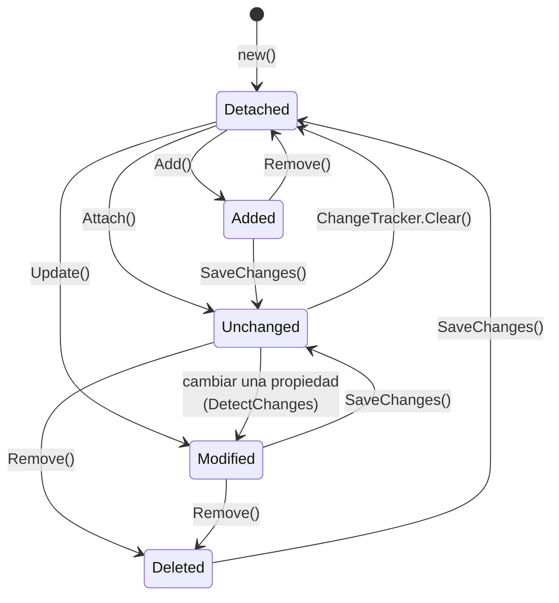
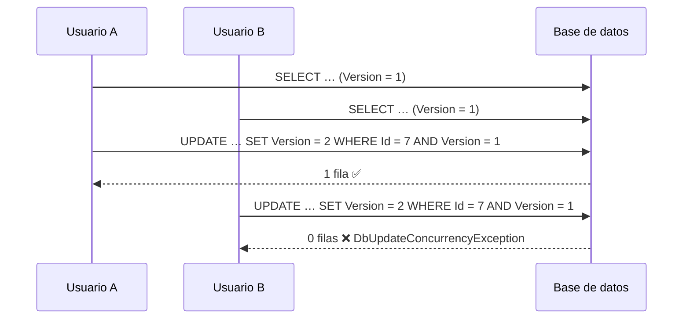

<div align="center">

# 14 · Guardado y concurrencia

**Estados de entidad, `SaveChanges` por lotes, grafos desconectados, transacciones, concurrencia optimista, operaciones masivas y auditoría**

[⬅ 13 · Consultas](13-consultas.md) · [🏠 Índice](../README.md) · [15 · Migraciones y despliegue ➡](15-migraciones-y-despliegue.md)

</div>

<!-- ef=10 -->

---

## Contenido

1. [Los cinco estados de una entidad](#1-los-cinco-estados-de-una-entidad)
2. [`SaveChanges`: lotes, orden y valores generados](#2-savechanges-lotes-orden-y-valores-generados)
3. [Entidades desconectadas](#3-entidades-desconectadas)
4. [Transacciones](#4-transacciones)
5. [Concurrencia optimista](#5-concurrencia-optimista)
6. [Operaciones masivas](#6-operaciones-masivas)
7. [Auditoría y lógica transversal](#7-auditoría-y-lógica-transversal)
8. [Resiliencia: reintentos y estrategias de ejecución](#8-resiliencia-reintentos-y-estrategias-de-ejecución)
9. [Errores frecuentes](#9-errores-frecuentes)
10. [Referencias](#10-referencias)

---

## 1. Los cinco estados de una entidad



| Estado | Qué hará `SaveChanges` |
|---|---|
| `Detached` | Nada: EF no conoce la entidad |
| `Unchanged` | Nada: coincide con la base |
| `Added` | `INSERT` |
| `Modified` | `UPDATE` **solo de las columnas modificadas** |
| `Deleted` | `DELETE` |

```csharp run
using var db = new Tienda();
db.Database.EnsureDeleted();
db.Database.EnsureCreated();

var p = new Producto { Nombre = "Té", Precio = 3 };
Console.WriteLine(db.Entry(p).State);          // → Detached
db.Add(p);
Console.WriteLine(db.Entry(p).State);          // → Added
db.SaveChanges();
Console.WriteLine(db.Entry(p).State);          // → Unchanged
p.Precio = 4;
Console.WriteLine(db.Entry(p).State);          // → Modified
Console.WriteLine(string.Join(",", db.Entry(p).Properties.Where(x => x.IsModified).Select(x => x.Metadata.Name))); // → Precio
db.Remove(p);
Console.WriteLine(db.Entry(p).State);          // → Deleted
db.SaveChanges();
Console.WriteLine(db.Entry(p).State);          // → Detached

public class Producto
{
    public int Id { get; set; }
    public required string Nombre { get; set; }
    public int Precio { get; set; }
}

public class Tienda : DbContext
{
    public DbSet<Producto> Productos => Set<Producto>();
    protected override void OnConfiguring(DbContextOptionsBuilder o) => o.UseSqlite("Data Source=tienda.db");
}
```

> [!TIP]
> `db.ChangeTracker.DebugView.LongView` imprime todas las entidades seguidas con su estado y sus valores originales y actuales. Es la primera herramienta
> a la que recurrir cuando `SaveChanges` hace algo inesperado.

---

## 2. `SaveChanges`: lotes, orden y valores generados

Una llamada a `SaveChanges` hace, en este orden ([capítulo 02](02-anatomia-de-ef-core.md#8-savechanges-por-dentro)):

1. `DetectChanges()`: compara cada entidad seguida con su instantánea.
2. Ordena las operaciones por **dependencias** (el principal se inserta antes que el dependiente; los dependientes se borran antes que el principal).
3. Abre una **transacción** si no hay una ya activa.
4. Agrupa los comandos en **lotes** (por defecto hasta 42 comandos por viaje en SQL Server) y los envía.
5. Lee los **valores generados** (`IDENTITY`, `DEFAULT`, `rowversion`) y los escribe en tus objetos.
6. Confirma la transacción y pasa todo a `Unchanged`.

| Opción | Efecto |
|---|---|
| `MaxBatchSize(n)` | Comandos por viaje (`UseSqlServer(c, s => s.MaxBatchSize(100))`) |
| `MinBatchSize(n)` | Por debajo de este número, no agrupar |
| `ChangeTracker.AutoDetectChangesEnabled = false` | Desactiva `DetectChanges` automático en importaciones masivas (llámalo tú al final) |
| `SaveChanges(acceptAllChangesOnSuccess: false)` | No marca las entidades como guardadas: útil al coordinar con otra transacción |

> [!NOTE]
> Desde EF Core 7 ([capítulo 07](07-ef-core-7-json-y-operaciones-masivas.md#4-savechanges-más-rápido)), un `SaveChanges` con **un solo comando** no abre
> transacción explícita y los `INSERT` en SQL Server usan `OUTPUT` en lugar de un `SELECT` posterior: menos viajes y menos bloqueos.

---

## 3. Entidades desconectadas

En una API web, la entidad llega **deserializada desde JSON**: el contexto que la cargó ya no existe. Hay tres formas de guardarla:

| Técnica | SQL generado | Ventaja | Riesgo |
|---|---|---|---|
| **Cargar y copiar** (`Find` + asignar) | `SELECT` + `UPDATE` de lo que cambió | Solo columnas modificadas; validas que existe | Un viaje más |
| `Update(entidad)` | `UPDATE` de **todas** las columnas | Un solo viaje | Sobrescribe columnas que el cliente no envió (*over-posting*) |
| `Attach` + marcar propiedades | `UPDATE` de las marcadas | Preciso | Más código |
| `ExecuteUpdate` | `UPDATE … WHERE` directo | Sin cargar ni seguir | No dispara la lógica de `SaveChanges` |

```csharp run
using var db = new Agenda();
db.Database.EnsureDeleted();
db.Database.EnsureCreated();
db.Add(new Tarea { Titulo = "Pagar luz", Notas = "importante" });
db.SaveChanges();
db.ChangeTracker.Clear();

// Lo que llega de un PUT: el cliente no envió Notas
var dto = new TareaDto(1, "Pagar la luz");

// ✅ Cargar y copiar solo lo que el contrato permite cambiar
var tarea = db.Tareas.Find(dto.Id)!;
tarea.Titulo = dto.Titulo;
db.SaveChanges();
db.ChangeTracker.Clear();
Console.WriteLine(db.Tareas.AsNoTracking().Single().Notas);   // → importante

// ❌ Update con una entidad construida desde el DTO: Notas se pierde
db.Update(new Tarea { Id = dto.Id, Titulo = dto.Titulo });
db.SaveChanges();
Console.WriteLine(db.Tareas.AsNoTracking().Single().Notas ?? "(null)");  // → (null)

public record TareaDto(int Id, string Titulo);

public class Tarea
{
    public int Id { get; set; }
    public required string Titulo { get; set; }
    public string? Notas { get; set; }
}

public class Agenda : DbContext
{
    public DbSet<Tarea> Tareas => Set<Tarea>();
    protected override void OnConfiguring(DbContextOptionsBuilder o) => o.UseSqlite("Data Source=tareas.db");
}
```

> [!CAUTION]
> **Nunca enlaces una entidad de EF directamente al cuerpo de una petición.** El `MapPost` de este repositorio recibe un `Job` completo desde JSON: un
> cliente puede enviar `CategoryId`, `CreationDate` o cualquier columna. Usa un DTO con solo los campos editables ([capítulo 20](20-caso-practico-jobsdb.md)).

---

## 4. Transacciones

| Situación | Qué hacer |
|---|---|
| Un solo `SaveChanges` | Nada: ya es atómico |
| Varios `SaveChanges` que deben confirmarse juntos | `BeginTransaction()` + `Commit()` |
| `SaveChanges` + `ExecuteUpdate`/`ExecuteSql` juntos | Transacción explícita (los `Execute*` no participan del *change tracker*) |
| Dos contextos sobre la **misma** conexión | `UseTransaction(transaccion.GetDbTransaction())` |
| Volver a un punto intermedio | `CreateSavepoint("antes")` / `RollbackToSavepoint` (EF Core 5+) |
| Con reintentos activados | Envolver en `CreateExecutionStrategy().Execute(...)` ([sección 8](#8-resiliencia-reintentos-y-estrategias-de-ejecución)) |

```csharp run
using var db = new Banco();
db.Database.EnsureDeleted();
db.Database.EnsureCreated();
db.Cuentas.AddRange(new Cuenta { Titular = "Ana", Saldo = 100 }, new Cuenta { Titular = "Luis", Saldo = 0 });
db.SaveChanges();

using (var tx = db.Database.BeginTransaction())
{
    db.Cuentas.Where(c => c.Titular == "Ana").ExecuteUpdate(s => s.SetProperty(c => c.Saldo, c => c.Saldo - 30));
    db.Cuentas.Where(c => c.Titular == "Luis").ExecuteUpdate(s => s.SetProperty(c => c.Saldo, c => c.Saldo + 30));
    db.Movimientos.Add(new Movimiento { Concepto = "Ana → Luis", Importe = 30 });
    db.SaveChanges();
    tx.Commit();                                       // todo o nada
}

Console.WriteLine(string.Join(", ", db.Cuentas.AsNoTracking().OrderBy(c => c.Id).Select(c => $"{c.Titular}={c.Saldo}")));
// → Ana=70, Luis=30

public class Cuenta
{
    public int Id { get; set; }
    public required string Titular { get; set; }
    public int Saldo { get; set; }
}

public class Movimiento
{
    public int Id { get; set; }
    public required string Concepto { get; set; }
    public int Importe { get; set; }
}

public class Banco : DbContext
{
    public DbSet<Cuenta> Cuentas => Set<Cuenta>();
    public DbSet<Movimiento> Movimientos => Set<Movimiento>();
    protected override void OnConfiguring(DbContextOptionsBuilder o) => o.UseSqlite("Data Source=banco.db");
}
```

> [!WARNING]
> `TransactionScope` (System.Transactions) funciona con EF Core, pero **en ASP.NET Core necesita `TransactionScopeAsyncFlowOption.Enabled`** para cruzar
> `await`, y si abre dos conexiones distintas puede escalar a una transacción distribuida, que en .NET moderno solo admite Windows. Prefiere
> `BeginTransaction`.

---

## 5. Concurrencia optimista

Dos usuarios abren el mismo pedido, cada uno lo modifica y guarda. Sin protección, **gana el último** y el primero pierde su cambio sin enterarse. La
**concurrencia optimista** añade al `UPDATE` una condición sobre un **token**: si otro lo cambió entretanto, el `UPDATE` afecta a 0 filas y EF lanza
`DbUpdateConcurrencyException`.



| Token | Configuración | Lo genera |
|---|---|---|
| **`rowversion`** (SQL Server) | `[Timestamp] byte[] Version` o `IsRowVersion()` | La base, automáticamente en cada `UPDATE` |
| `xmin` (PostgreSQL) | `IsRowVersion()` sobre `uint` | La base |
| Columna propia | `[ConcurrencyCheck]` o `IsConcurrencyToken()` | **Tu código** (p. ej. un `Guid` nuevo en cada guardado) |
| `_etag` (Cosmos DB) | `UseETagConcurrency()` | Cosmos |

```csharp run
using (var setup = new Inventario())
{
    setup.Database.EnsureDeleted();
    setup.Database.EnsureCreated();
    setup.Add(new Articulo { Nombre = "Silla", Stock = 10 });
    setup.SaveChanges();
}

using var a = new Inventario();
using var b = new Inventario();
var enA = a.Articulos.Single();
var enB = b.Articulos.Single();

enA.Stock -= 3; a.SaveChanges();                           // A gana la carrera
enB.Stock -= 5;
try
{
    b.SaveChanges();
}
catch (DbUpdateConcurrencyException ex)
{
    var entrada = ex.Entries.Single();
    var actuales = entrada.GetDatabaseValues()!;
    Console.WriteLine($"Conflicto: en la base hay {actuales[nameof(Articulo.Stock)]}");   // → Conflicto: en la base hay 7
    // Estrategia "reaplicar mi operación sobre el valor actual"
    var stock = (int)actuales[nameof(Articulo.Stock)]! - 5;
    entrada.OriginalValues.SetValues(actuales);
    enB.Stock = stock;
    b.SaveChanges();
}
Console.WriteLine(new Inventario().Articulos.Single().Stock);                              // → 2

public class Articulo
{
    public int Id { get; set; }
    public required string Nombre { get; set; }
    public int Stock { get; set; }
    public Guid Version { get; set; }
}

public class Inventario : DbContext
{
    public DbSet<Articulo> Articulos => Set<Articulo>();
    protected override void OnConfiguring(DbContextOptionsBuilder o) => o.UseSqlite("Data Source=inventario.db");
    protected override void OnModelCreating(ModelBuilder b) => b.Entity<Articulo>().Property(x => x.Version).IsConcurrencyToken();

    public override int SaveChanges(bool acceptAll)
    {
        foreach (var e in ChangeTracker.Entries<Articulo>().Where(e => e.State is EntityState.Added or EntityState.Modified))
            e.Entity.Version = Guid.NewGuid();                  // SQLite no tiene rowversion: lo generamos nosotros
        return base.SaveChanges(acceptAll);
    }
}
```

| Estrategia ante el conflicto | Implementación |
|---|---|
| **El cliente gana** | `entrada.OriginalValues.SetValues(GetDatabaseValues())` y reintentar |
| **La base gana** | `entrada.Reload()` y descartar el cambio |
| **Fusionar** | Comparar propiedad a propiedad y decidir (como en el ejemplo) |
| **Preguntar al usuario** | Devolver `409 Conflict` con los valores actuales |

> [!TIP]
> En una API REST, envía el token al cliente (por ejemplo en la cabecera `ETag`) y exígelo de vuelta en `If-Match`. Así el conflicto se detecta aunque
> entre la lectura y la escritura pasen minutos y dos contextos distintos.

---

## 6. Operaciones masivas

`ExecuteUpdate` y `ExecuteDelete` ([capítulo 07](07-ef-core-7-json-y-operaciones-masivas.md)) actualizan o borran **en la base, sin cargar nada**:

| | `SaveChanges` | `ExecuteUpdate` / `ExecuteDelete` |
|---|---|---|
| Filas cargadas en memoria | Todas | Ninguna |
| SQL | Un comando por fila (en lotes) | **Uno** en total |
| *Change tracker* | Actualizado | **No se entera**: las entidades seguidas quedan obsoletas |
| Concurrencia optimista | Automática | Manual (`Where(x => x.Version == v)`) |
| Interceptores de `SaveChanges`, auditoría | ✅ | ❌ |
| Cascadas en memoria | ✅ | ❌ (solo las de la base) |

```csharp
public class Sesion
{
    public int Id { get; set; }
    public DateTime UltimoAcceso { get; set; }
    public bool Activa { get; set; }
}

public class Seguridad : DbContext
{
    public DbSet<Sesion> Sesiones => Set<Sesion>();
    protected override void OnConfiguring(DbContextOptionsBuilder o) => o.UseSqlite("Data Source=seg.db");

    public async Task<int> Limpiar(CancellationToken ct)
    {
        var limite = DateTime.UtcNow.AddDays(-30);
        await Sesiones.Where(s => s.UltimoAcceso < limite && s.Activa)
                      .ExecuteUpdateAsync(s => s.SetProperty(x => x.Activa, false), ct);
        return await Sesiones.Where(s => !s.Activa && s.UltimoAcceso < limite.AddDays(-60))
                             .ExecuteDeleteAsync(ct);
    }
}
```

> [!NOTE]
> Para **inserciones** masivas (cientos de miles de filas), ni `SaveChanges` ni `ExecuteUpdate` son la herramienta: usa `SqlBulkCopy` (SQL Server),
> `COPY` binario de Npgsql o bibliotecas como *EFCore.BulkExtensions*. Con `SaveChanges`, desactiva `AutoDetectChangesEnabled` y guarda en bloques
> de 1 000–5 000 entidades con `ChangeTracker.Clear()` entre bloques.

---

## 7. Auditoría y lógica transversal

| Mecanismo | Alcance | Ideal para |
|---|---|---|
| Sobrescribir `SaveChanges`/`SaveChangesAsync` | Un contexto | Fechas de alta/modificación, autor |
| Eventos `SavingChanges`/`SavedChanges`/`SaveChangesFailed` | Un contexto, desde fuera | Suscribirse sin heredar |
| **`ISaveChangesInterceptor`** | Reutilizable entre contextos, registrable con DI | Auditoría, *outbox*, eventos de dominio |
| Eventos `ChangeTracker.Tracked`/`StateChanged` | Por entidad | Reaccionar a cambios de estado |
| Tablas temporales | Toda la historia, en la base | Auditoría legal ([capítulo 06](06-ef-core-6-rendimiento-y-temporalidad.md)) |

```csharp run
using var db = new Crm(new AuditoriaInterceptor(TimeProvider.System));
db.Database.EnsureDeleted();
db.Database.EnsureCreated();
var c = new Cliente { Nombre = "Ana" };
db.Add(c);
db.SaveChanges();
Console.WriteLine(c.CreadoUtc != default && c.ModificadoUtc == c.CreadoUtc);   // → True

public interface IAuditable
{
    DateTime CreadoUtc { get; set; }
    DateTime ModificadoUtc { get; set; }
}

public class Cliente : IAuditable
{
    public int Id { get; set; }
    public required string Nombre { get; set; }
    public DateTime CreadoUtc { get; set; }
    public DateTime ModificadoUtc { get; set; }
}

public sealed class AuditoriaInterceptor(TimeProvider reloj) : SaveChangesInterceptor
{
    public override InterceptionResult<int> SavingChanges(DbContextEventData e, InterceptionResult<int> r)
    {
        Sellar(e.Context!);
        return r;
    }

    public override ValueTask<InterceptionResult<int>> SavingChangesAsync(DbContextEventData e, InterceptionResult<int> r, CancellationToken ct = default)
    {
        Sellar(e.Context!);
        return ValueTask.FromResult(r);
    }

    private void Sellar(DbContext db)
    {
        var ahora = reloj.GetUtcNow().UtcDateTime;
        foreach (var x in db.ChangeTracker.Entries<IAuditable>())
        {
            if (x.State == EntityState.Added) x.Entity.CreadoUtc = ahora;
            if (x.State is EntityState.Added or EntityState.Modified) x.Entity.ModificadoUtc = ahora;
        }
    }
}

public class Crm(AuditoriaInterceptor auditoria) : DbContext
{
    public DbSet<Cliente> Clientes => Set<Cliente>();
    protected override void OnConfiguring(DbContextOptionsBuilder o)
        => o.UseSqlite("Data Source=crm.db").AddInterceptors(auditoria);
}
```

> [!TIP]
> Inyectar `TimeProvider` en lugar de llamar a `DateTime.UtcNow` hace la auditoría **comprobable**: en las pruebas usas `FakeTimeProvider` y fijas la hora
> ([capítulo 18](18-pruebas.md)).

---

## 8. Resiliencia: reintentos y estrategias de ejecución

Las bases en la nube (Azure SQL, Cosmos, PostgreSQL gestionado) sufren **errores transitorios**: conmutaciones por error, límites de conexiones,
*throttling*. EF Core puede reintentar automáticamente:

```csharp
public class Pedido { public int Id { get; set; } }

public class Ventas : DbContext
{
    public DbSet<Pedido> Pedidos => Set<Pedido>();
    protected override void OnConfiguring(DbContextOptionsBuilder o)
        => o.UseSqlServer("Server=tcp:demo.database.windows.net;Database=Ventas",
            s => s.EnableRetryOnFailure(maxRetryCount: 5, maxRetryDelay: TimeSpan.FromSeconds(10), errorNumbersToAdd: null));

    // Con reintentos activos, una transacción manual debe ir dentro de la estrategia,
    // para que si falla se repita el bloque COMPLETO y no solo el último comando
    public Task Transferir() => Database.CreateExecutionStrategy().ExecuteAsync(async () =>
    {
        await using var tx = await Database.BeginTransactionAsync();
        // … varias operaciones …
        await SaveChangesAsync();
        await tx.CommitAsync();
    });
}
```

| Proveedor | Estrategia | Activación |
|---|---|---|
| SQL Server | `SqlServerRetryingExecutionStrategy` | `EnableRetryOnFailure()`; `UseAzureSql` la activa por defecto |
| PostgreSQL | `NpgsqlRetryingExecutionStrategy` | `EnableRetryOnFailure()` |
| Cosmos DB | El SDK reintenta | Automático |
| SQLite | — | No aplica |

> [!WARNING]
> Si activas reintentos y abres una transacción **fuera** de `CreateExecutionStrategy().Execute(...)`, EF lanza
> `InvalidOperationException: The configured execution strategy … does not support user-initiated transactions`. Es intencionado: un reintento parcial
> podría duplicar operaciones.

---

## 9. Errores frecuentes

| Excepción o síntoma | Causa | Solución |
|---|---|---|
| `The instance of entity type 'X' cannot be tracked because another instance with the same key…` | Dos objetos con la misma clave en el mismo contexto | `AsNoTracking` al leer, o `Entry(existente).CurrentValues.SetValues(nuevo)` |
| `DbUpdateConcurrencyException` sin token de concurrencia | El `UPDATE`/`DELETE` afectó a 0 filas: la fila ya no existe | Comprobar existencia; tratar como 404 |
| `DbUpdateException` con `SqlException` 2627/2601 | Violación de `UNIQUE` | Validar antes, o capturar y traducir a 409 |
| `A second operation was started on this context instance…` | Dos operaciones concurrentes en el mismo `DbContext` | Un contexto por operación concurrente; `await` siempre ([capítulo 19](19-arquitectura-de-aplicaciones.md#2-vida-del-dbcontext)) |
| `SaveChanges` lento con miles de entidades | `DetectChanges` repetido, contexto inflado | Bloques + `ChangeTracker.Clear()` |
| `Cannot insert explicit value for identity column` | Asignaste una clave `IDENTITY` | Dejar la clave en su valor por defecto |

---

## 10. Referencias

- [Saving data](https://learn.microsoft.com/ef/core/saving/)
- [Disconnected entities](https://learn.microsoft.com/ef/core/saving/disconnected-entities)
- [Transactions](https://learn.microsoft.com/ef/core/saving/transactions)
- [Handling concurrency conflicts](https://learn.microsoft.com/ef/core/saving/concurrency)
- [ExecuteUpdate and ExecuteDelete](https://learn.microsoft.com/ef/core/saving/execute-insert-update-delete)
- [Connection resiliency](https://learn.microsoft.com/ef/core/miscellaneous/connection-resiliency)

<div align="center">

[⬅ 13 · Consultas](13-consultas.md) · [🏠 Índice](../README.md) · [15 · Migraciones y despliegue ➡](15-migraciones-y-despliegue.md)

</div>
