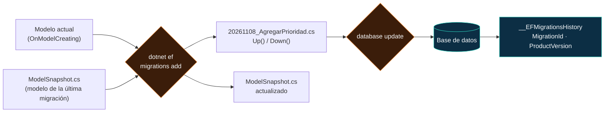
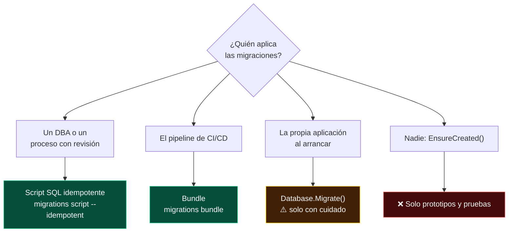

<div align="center">

# 15 · Migraciones y despliegue

**El esquema como código: la CLI `dotnet ef`, anatomía de una migración, renombrados seguros, trabajo en equipo, despliegue a producción e ingeniería inversa**

[⬅ 14 · Guardado y concurrencia](14-guardado-y-concurrencia.md) · [🏠 Índice](../README.md) · [16 · Proveedores ➡](16-proveedores.md)

</div>

<!-- ef=10 -->

---

## Contenido

1. [Qué es una migración](#1-qué-es-una-migración)
2. [Instalar las herramientas](#2-instalar-las-herramientas)
3. [Referencia de comandos: CLI y PMC](#3-referencia-de-comandos-cli-y-pmc)
4. [Anatomía de una migración](#4-anatomía-de-una-migración)
5. [Editar migraciones: renombrados, datos y SQL](#5-editar-migraciones-renombrados-datos-y-sql)
6. [Trabajo en equipo](#6-trabajo-en-equipo)
7. [Estrategias de despliegue](#7-estrategias-de-despliegue)
8. [Ingeniería inversa: *scaffold* de una base existente](#8-ingeniería-inversa-scaffold-de-una-base-existente)
9. [Varios contextos, varios proveedores](#9-varios-contextos-varios-proveedores)
10. [Errores frecuentes](#10-errores-frecuentes)
11. [Referencias](#11-referencias)

---

## 1. Qué es una migración

Una **migración** es una clase C# que describe cómo pasar el esquema de la base de una versión del modelo a la siguiente (`Up`) y cómo deshacerlo
(`Down`). EF Core las genera **comparando el modelo actual con una instantánea** (*snapshot*) del modelo en la migración anterior:



| Archivo | Contenido | ¿Se edita? |
|---|---|---|
| `AAAAMMDDhhmmss_Nombre.cs` | `Up()` y `Down()` con operaciones de `MigrationBuilder` | ✅ Sí, cuando hace falta |
| `AAAAMMDDhhmmss_Nombre.Designer.cs` | El modelo completo **en el momento** de esa migración | ❌ Nunca |
| `<Contexto>ModelSnapshot.cs` | El modelo de la última migración: la base de la siguiente comparación | ❌ Nunca a mano |
| Tabla `__EFMigrationsHistory` | Qué migraciones están aplicadas en **esa** base | ❌ |

> [!IMPORTANT]
> **La base de datos no participa en `migrations add`.** EF compara código con código (modelo frente a instantánea). Por eso puedes crear migraciones
> sin conexión, y por eso un cambio hecho a mano en la base **no** aparece en la siguiente migración: EF no lo conoce.

---

## 2. Instalar las herramientas

```bash
# Herramienta local fijada al repositorio (recomendado)
dotnet new tool-manifest
dotnet tool install dotnet-ef --version 10.0.14

# O global, una vez por máquina
dotnet tool install --global dotnet-ef --version 10.0.14
dotnet tool update  --global dotnet-ef

# El proyecto de inicio necesita el paquete Design (solo en tiempo de diseño)
dotnet add package Microsoft.EntityFrameworkCore.Design --version 10.0.14

dotnet ef --version          # Entity Framework Core .NET Command-line Tools 10.0.14
```

| Requisito | Por qué |
|---|---|
| `dotnet-ef` y `Microsoft.EntityFrameworkCore.Design` **en la misma versión** | La CLI carga el ensamblado `Design` de tu proyecto |
| El proyecto **compila** | La CLI compila y carga tu ensamblado para obtener el modelo |
| EF puede **crear el contexto** | Desde el *host* (`Program.cs` con `AddDbContext`), un constructor sin parámetros o una `IDesignTimeDbContextFactory<T>` |

> [!TIP]
> Si tu contexto vive en una biblioteca y tu `Program.cs` en otra, usa `--project` (dónde están las migraciones) y `--startup-project` (dónde se
> configura el contexto). En EF Core 11 puedes fijarlos en `.config/dotnet-ef.json` ([capítulo 11](11-ef-core-11-rc.md#8-migraciones-y-herramientas)).

---

## 3. Referencia de comandos: CLI y PMC

### Migraciones

| Propósito | CLI (`dotnet ef`) | Consola del administrador de paquetes (VS) |
|---|---|---|
| Crear la primera migración | `dotnet ef migrations add InitialCreate` | `Add-Migration InitialCreate` |
| Carpeta propia | `… --output-dir Infraestructura/Migraciones` | `… -OutputDir Infraestructura\Migraciones` |
| Espacio de nombres propio | `… --namespace Facturacion.Migraciones` | `… -Namespace Facturacion.Migraciones` |
| Elegir contexto | `… --context FacturacionContext` | `… -Context FacturacionContext` |
| Listar (y ver cuáles faltan) | `dotnet ef migrations list` | `Get-Migration` |
| Quitar la última (no aplicada) | `dotnet ef migrations remove` | `Remove-Migration` |
| ¿Hay cambios sin migración? | `dotnet ef migrations has-pending-model-changes` (8.0+) | — |
| Script SQL de todas | `dotnet ef migrations script -o esquema.sql` | `Script-Migration` |
| Script idempotente | `dotnet ef migrations script --idempotent -o despliegue.sql` | `Script-Migration -Idempotent` |
| Script entre dos migraciones | `dotnet ef migrations script De A` | `Script-Migration -From De -To A` |
| **Ejecutable de migración** | `dotnet ef migrations bundle --self-contained -r linux-x64` | `Bundle-Migration` |

### Base de datos y contexto

| Propósito | CLI | PMC |
|---|---|---|
| Aplicar todas las pendientes | `dotnet ef database update` | `Update-Database` |
| Ir a una migración concreta (avanzar o **revertir**) | `dotnet ef database update 20250607224713_07062016_03` | `Update-Database 20250607224713_07062016_03` |
| Revertir **todas** | `dotnet ef database update 0` | `Update-Database 0` |
| Otra cadena de conexión | `… --connection "Server=…"` | `… -Connection "Server=…"` |
| Borrar la base | `dotnet ef database drop --force` | `Drop-Database` |
| SQL del modelo completo (sin migraciones) | `dotnet ef dbcontext script` | `Script-DbContext` |
| Información del contexto | `dotnet ef dbcontext info` | `Get-DbContext` |
| Listar contextos | `dotnet ef dbcontext list` | `Get-DbContext` |
| Modelo compilado | `dotnet ef dbcontext optimize` | `Optimize-DbContext` |
| Ingeniería inversa | `dotnet ef dbcontext scaffold "<cadena>" <proveedor>` | `Scaffold-DbContext` |

### Opciones comunes

| Opción | Uso |
|---|---|
| `--project` / `-p` | Proyecto que contiene el contexto y las migraciones |
| `--startup-project` / `-s` | Proyecto que se ejecuta para obtener la configuración |
| `--context` / `-c` | Contexto, si hay varios |
| `--framework` | Destino, obligatorio en proyectos multidestino desde EF Core 10 |
| `--configuration` | `Debug` o `Release` |
| `--no-build` | No recompilar (útil en CI tras un `dotnet build`) |
| `--verbose` / `-v` | Diagnóstico detallado: lo primero que activar cuando algo falla |
| `-- <args>` | Todo lo que va después de `--` se pasa a tu aplicación (p. ej. `-- --environment Production`) |

> [!WARNING]
> **Corrección al README original.** La versión anterior de este repositorio mostraba
> `dotnet ef migrations add RenameCustomerToClient -- --operations "RenameTable:OldName=Customers,NewName=Clients"`. **Esa opción no existe**: lo que va
> después de `--` se entrega a tu aplicación, no a EF. Un renombrado se hace cambiando el modelo y revisando la migración generada
> ([sección 5](#5-editar-migraciones-renombrados-datos-y-sql)).

---

## 4. Anatomía de una migración

```csharp
using Microsoft.EntityFrameworkCore.Migrations;

public partial class AgregarPrioridad : Migration
{
    protected override void Up(MigrationBuilder mb)
    {
        mb.AddColumn<int>(
            name: "Prioridad",
            table: "Job",
            type: "int",
            nullable: false,
            defaultValue: 1);

        mb.CreateIndex(
            name: "IX_Job_Prioridad",
            table: "Job",
            column: "Prioridad");
    }

    protected override void Down(MigrationBuilder mb)
    {
        mb.DropIndex(name: "IX_Job_Prioridad", table: "Job");
        mb.DropColumn(name: "Prioridad", table: "Job");
    }
}
```

| Operación de `MigrationBuilder` | SQL |
|---|---|
| `CreateTable` / `DropTable` / `RenameTable` | `CREATE TABLE` / `DROP TABLE` / `sp_rename` o `ALTER TABLE … RENAME` |
| `AddColumn` / `DropColumn` / `RenameColumn` / `AlterColumn` | `ALTER TABLE …` |
| `CreateIndex` / `DropIndex` / `RenameIndex` | Índices |
| `AddForeignKey` / `AddPrimaryKey` / `AddUniqueConstraint` / `AddCheckConstraint` | Restricciones |
| `InsertData` / `UpdateData` / `DeleteData` | Datos de `HasData` |
| `EnsureSchema`, `CreateSequence` | Esquemas y secuencias |
| `Sql("…")` | **Cualquier SQL**: vistas, procedimientos, migraciones de datos |

> [!NOTE]
> Varias migraciones de este repositorio tienen `Up()` **vacío** (`07062016_02`, `07062016_04` e incluso `InitialCreate`). Una migración vacía aparece
> cuando se ejecuta `migrations add` sin cambios en el modelo, o cuando la base ya existía (creada con `EnsureCreated`) y se añadió una migración a
> posteriori. No hacen daño, pero ensucian el historial: el [capítulo 20](20-caso-practico-jobsdb.md) explica cómo consolidarlas.

---

## 5. Editar migraciones: renombrados, datos y SQL

**Revisa siempre la migración generada antes de aplicarla.** EF no puede leer tu intención, solo la diferencia entre dos modelos.

### Renombrar sin perder datos

Si renombras `Customer.Name` a `Customer.FullName`, EF puede ver **dos cambios** (borrar `Name`, crear `FullName`) y generar un `DropColumn` que destruye los
datos. EF intenta detectar renombrados simples y genera `RenameColumn`, pero en casos ambiguos se equivoca. Corrígelo a mano:

```csharp
using Microsoft.EntityFrameworkCore.Migrations;

public partial class RenombrarCliente : Migration
{
    protected override void Up(MigrationBuilder mb)
    {
        // ❌ Lo que EF generó:  mb.DropColumn("Name", "Customers");  mb.AddColumn<string>("FullName", "Customers", …);
        // ✅ Lo correcto:
        mb.RenameColumn(name: "Name", table: "Customers", newName: "FullName");
        mb.RenameTable(name: "Customers", newName: "Clients");
    }

    protected override void Down(MigrationBuilder mb)
    {
        mb.RenameTable(name: "Clients", newName: "Customers");
        mb.RenameColumn(name: "FullName", table: "Customers", newName: "Name");
    }
}
```

### Cambios en dos fases (*expand / contract*)

Para cambios que rompen el código en ejecución (renombrar una columna que la versión anterior de la aplicación todavía lee), despliega en **dos pasos**:

| Fase | Migración | Aplicación |
|---|---|---|
| **1 · Expandir** | Añadir `FullName` (anulable) y copiar: `mb.Sql("UPDATE Customers SET FullName = Name")` | Escribe en ambas columnas, lee de la nueva |
| **2 · Contraer** (siguiente versión) | `AlterColumn` a `NOT NULL` y `DropColumn("Name")` | Solo usa la nueva |

### Datos en migraciones

| Necesidad | Herramienta |
|---|---|
| Catálogos fijos (estados, países) | `HasData` → `InsertData` en la migración |
| Transformar datos existentes | `mb.Sql("UPDATE …")` dentro de la migración |
| Datos que dependen del entorno o tienen lógica | `UseSeeding` ([capítulo 09](09-ef-core-9-cosmos-aot-y-siembra.md#5-siembra-con-useseeding)) |
| Vistas, procedimientos, funciones | `mb.Sql(…)` en `Up` y su `DROP` en `Down` |

---

## 6. Trabajo en equipo

| Problema | Solución |
|---|---|
| Dos ramas añaden migraciones a la vez | Tras fusionar: `migrations remove` de la tuya, `git pull`, y volver a crearla sobre la otra. EF Core 11 fuerza el conflicto en la instantánea |
| Conflicto de fusión en `ModelSnapshot.cs` | **No lo resuelvas a mano**: acepta la versión de la rama principal y regenera tu migración |
| Muchas migraciones antiguas ralentizan la compilación | **Consolidar** (*squash*): borrar las migraciones, crear una `Inicial` nueva y, en bases existentes, insertar su ID en `__EFMigrationsHistory` |
| ¿El modelo y las migraciones están sincronizados? | En CI: `dotnet ef migrations has-pending-model-changes` (falla si falta una migración) |
| Nombres sin significado (`07062016_01`) | Nombra por intención: `AgregarPrioridadATrabajo`, `IndiceUnicoEmail` |

```yaml
# Paso de CI: falla si alguien cambió el modelo y olvidó la migración
- run: dotnet tool restore
- run: dotnet build --configuration Release
- run: dotnet ef migrations has-pending-model-changes --no-build --configuration Release
```

---

## 7. Estrategias de despliegue

Hay cuatro formas de llevar las migraciones a producción. **Solo dos son recomendables** para entornos serios:



| Estrategia | Revisión previa | Permisos de la app | Varias réplicas | Recomendación |
|---|---|---|---|---|
| **Script SQL idempotente** | ✅ Total: el DBA lee el SQL | Mínimos (DML) | ✅ | 🥇 Entornos regulados |
| **Bundle** (`efbundle`) | Parcial (se puede generar el script aparte) | Mínimos | ✅ | 🥇 CI/CD automatizado |
| `Database.Migrate()` al arrancar | ❌ | **DDL** (crear y alterar tablas) | Bloqueo desde EF Core 9 | ⚠️ Apps pequeñas, una réplica |
| `EnsureCreated()` | ❌ | DDL | ❌ | ❌ No es compatible con migraciones |

### Script idempotente

```bash
dotnet ef migrations script --idempotent --output artefactos/despliegue.sql
```

```sql
-- Cada migración va envuelta en una comprobación del historial
IF NOT EXISTS (SELECT * FROM [__EFMigrationsHistory] WHERE [MigrationId] = N'20261108_AgregarPrioridad')
BEGIN
    ALTER TABLE [Job] ADD [Prioridad] int NOT NULL DEFAULT 1;
END;
```

### Bundle de migraciones (EF Core 6+)

Un **bundle** es un ejecutable autónomo que contiene tus migraciones y las aplica. No necesita el SDK ni el código fuente en el servidor de despliegue:

```bash
# En CI
dotnet ef migrations bundle --self-contained -r linux-x64 --output artefactos/efbundle --force

# En el despliegue (con la cadena de un secreto, nunca en el repositorio)
./efbundle --connection "$CADENA_PRODUCCION"
```

### `Migrate()` al arrancar, si no hay más remedio

```csharp omitir
var app = builder.Build();

if (app.Configuration.GetValue<bool>("MigrarAlArrancar"))
{
    using var scope = app.Services.CreateScope();
    var db = scope.ServiceProvider.GetRequiredService<JobsDbContext>();
    await db.Database.MigrateAsync();          // EF Core 9+: bloqueo entre réplicas
}
```

> [!CAUTION]
> `Migrate()` al arrancar exige que la cuenta de la aplicación tenga permisos **DDL** en producción (una superficie de ataque enorme), convierte cada
> arranque en un posible despliegue de esquema y, si la migración falla a mitad, deja la aplicación caída sin un punto de control humano. El
> `Program.cs` de este repositorio tiene este patrón comentado, y un endpoint `/dbconextion` que llama a `EnsureCreated()` desde una petición HTTP.

### Despliegue sin tiempo de inactividad

| Regla | Por qué |
|---|---|
| Cada migración debe ser compatible con la versión **anterior** de la aplicación | Durante el despliegue conviven las dos |
| Añadir columnas como anulables o con `DEFAULT` | Una columna `NOT NULL` sin valor rompe los `INSERT` de la versión antigua |
| Nunca renombrar ni borrar en el mismo despliegue que deja de usarse | Usa *expand / contract* ([sección 5](#5-editar-migraciones-renombrados-datos-y-sql)) |
| Índices grandes con `ONLINE = ON` (SQL Server Enterprise) | `mb.Sql("CREATE INDEX … WITH (ONLINE = ON)")` |
| Separar migraciones de datos lentas | Un `UPDATE` de millones de filas en lotes, fuera de la transacción de esquema |

---

## 8. Ingeniería inversa: *scaffold* de una base existente

```bash
dotnet ef dbcontext scaffold \
  "Host=localhost;Database=crm;Username=app;Password=$PGPASSWORD" \
  Npgsql.EntityFrameworkCore.PostgreSQL \
  --schema public --schema facturacion \
  --table clientes --table facturas \
  --context CrmContext \
  --context-dir Infraestructura \
  --output-dir Infraestructura/Modelos \
  --use-database-names \
  --no-onconfiguring \
  --data-annotations
```

| Opción | Efecto |
|---|---|
| `--schema` / `--table` | Limitar a esquemas o tablas (se repite la opción por cada valor) |
| `--context`, `--context-dir`, `--output-dir` | Nombre y ubicación del contexto y las entidades |
| `--use-database-names` | No convertir `nombre_cliente` a `NombreCliente` |
| `--data-annotations` | Atributos en lugar de Fluent API (lo que el README original dejó en blanco) |
| `--no-onconfiguring` | No incrustar la cadena de conexión en el código generado |
| `--no-pluralize` | No pluralizar nombres de `DbSet` |
| `--force` | Sobrescribir archivos existentes |
| `Name=ConnectionStrings:Crm` como cadena | Leerla de la configuración en lugar de escribirla en la línea de comandos |

> [!TIP]
> Desde EF Core 7 puedes **personalizar las plantillas** de generación (T4): `dotnet new install Microsoft.EntityFrameworkCore.Templates` y
> `dotnet new ef-templates`. Así el código generado sigue las convenciones de tu equipo y puedes volver a generarlo sin perder cambios.

> [!WARNING]
> Nunca pongas la contraseña en la línea de comandos de un servidor compartido (queda en el historial de la *shell*). Usa
> `Name=ConnectionStrings:Crm` con *user secrets* o variables de entorno.

---

## 9. Varios contextos, varios proveedores

| Escenario | Solución |
|---|---|
| Dos contextos en un proyecto | `--context` en cada comando y `--output-dir` distinto para cada uno |
| Cada módulo en su esquema | `HasDefaultSchema("facturacion")` y `MigrationsHistoryTable("__Historial", "facturacion")` |
| Mismo modelo en SQL Server y PostgreSQL | Un proyecto de migraciones **por proveedor** (`MigrationsAssembly("Migraciones.Postgres")`) |
| Migraciones en otro ensamblado | `UseSqlServer(c, s => s.MigrationsAssembly("Infraestructura.Migraciones"))` |

---

## 10. Errores frecuentes

| Error | Causa | Solución |
|---|---|---|
| `Unable to create a 'DbContext' of type…` | La CLI no sabe construir el contexto | `--startup-project` correcto o `IDesignTimeDbContextFactory<T>` |
| `The Entity Framework tools version '9.0.x' is older than that of the runtime '10.0.x'` | `dotnet-ef` desactualizado | `dotnet tool update dotnet-ef` |
| `Your startup project doesn't reference Microsoft.EntityFrameworkCore.Design` | Falta el paquete | `dotnet add package Microsoft.EntityFrameworkCore.Design` |
| `There is already an object named 'X' in the database` | La base se creó con `EnsureCreated` o a mano | Marcar las migraciones como aplicadas o recrear la base |
| `PendingModelChangesWarning` al migrar (EF Core 9+) | Falta una migración, o `HasData` no determinista | `migrations add`, o fijar los valores |
| `The migration 'X' has already been applied` al hacer `remove` | La migración ya está en la base | `database update <anterior>` y luego `remove` |
| `Build failed` sin más detalle | Errores de compilación ocultos | `dotnet build` primero, o `--verbose` |

---

## 11. Referencias

- [Migrations overview](https://learn.microsoft.com/ef/core/managing-schemas/migrations/)
- [Applying migrations](https://learn.microsoft.com/ef/core/managing-schemas/migrations/applying)
- [Managing migrations](https://learn.microsoft.com/ef/core/managing-schemas/migrations/managing)
- [Team environments](https://learn.microsoft.com/ef/core/managing-schemas/migrations/teams)
- [EF Core tools reference (.NET CLI)](https://learn.microsoft.com/ef/core/cli/dotnet)
- [Reverse engineering](https://learn.microsoft.com/ef/core/managing-schemas/scaffolding/)

<div align="center">

[⬅ 14 · Guardado y concurrencia](14-guardado-y-concurrencia.md) · [🏠 Índice](../README.md) · [16 · Proveedores ➡](16-proveedores.md)

</div>
