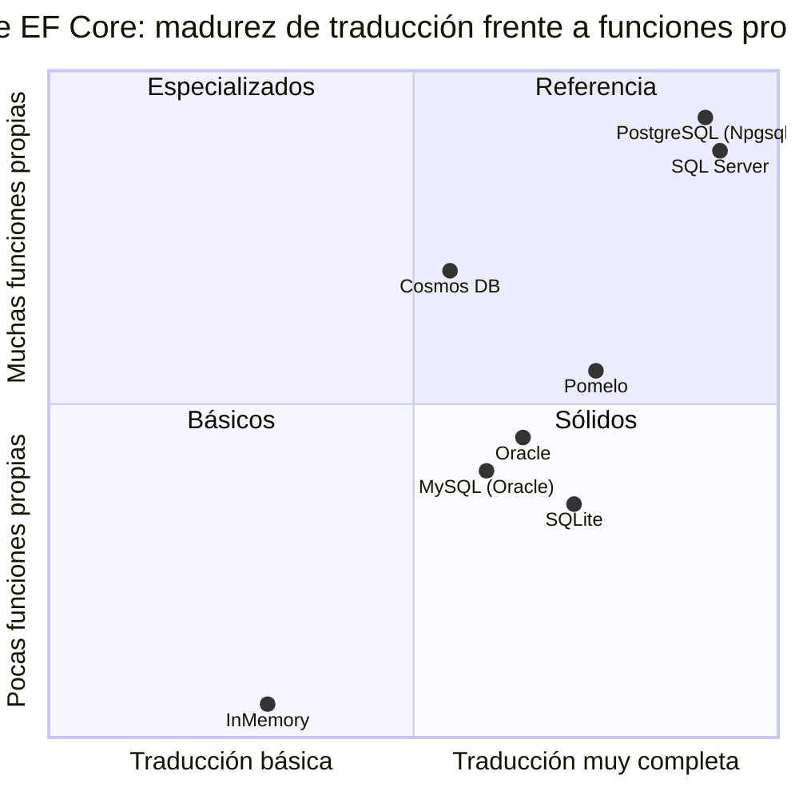

<div align="center">

# 16 · Proveedores

**Un modelo, muchas bases: SQL Server, Azure SQL, PostgreSQL, SQLite, MySQL, Oracle, Cosmos DB e InMemory, y las diferencias que muerden**

[⬅ 15 · Migraciones y despliegue](15-migraciones-y-despliegue.md) · [🏠 Índice](../README.md) · [17 · Rendimiento y diagnóstico ➡](17-rendimiento-y-diagnostico.md)

</div>

<!-- ef=10 -->

---

## Contenido

1. [Qué hace un proveedor](#1-qué-hace-un-proveedor)
2. [Catálogo de proveedores](#2-catálogo-de-proveedores)
3. [SQL Server y Azure SQL](#3-sql-server-y-azure-sql)
4. [PostgreSQL con Npgsql](#4-postgresql-con-npgsql)
5. [SQLite](#5-sqlite)
6. [MySQL y MariaDB](#6-mysql-y-mariadb)
7. [Oracle](#7-oracle)
8. [Azure Cosmos DB](#8-azure-cosmos-db)
9. [InMemory: por qué casi nunca](#9-inmemory-por-qué-casi-nunca)
10. [Diferencias que muerden](#10-diferencias-que-muerden)
11. [Cadenas de conexión y secretos](#11-cadenas-de-conexión-y-secretos)
12. [Referencias](#12-referencias)

---

## 1. Qué hace un proveedor

EF Core no sabe hablar con ninguna base de datos. Un **proveedor** es un conjunto de servicios ([capítulo 02](02-anatomia-de-ef-core.md#9-la-capa-relacional-y-los-proveedores))
que sustituyen a los genéricos:

| Servicio | Responsabilidad | Ejemplo de diferencia |
|---|---|---|
| *Type mapping* | Tipo .NET ↔ tipo de la base | `string` → `nvarchar` (SQL Server), `text` (PostgreSQL), `TEXT` (SQLite) |
| Generador de SQL | Sintaxis propia | `TOP(n)` frente a `LIMIT n`; `[x]` frente a `"x"` |
| Traductores de métodos | `string.Contains`, `DateTime.AddDays`… | `CHARINDEX` frente a `strpos` frente a `instr` |
| Generador de migraciones | DDL | `IDENTITY` frente a `GENERATED ALWAYS AS IDENTITY` |
| Estrategia de ejecución | Reintentos | Números de error transitorios distintos |
| *Scaffolding* | Leer el esquema existente | Consultas al catálogo del sistema |

> [!IMPORTANT]
> **Tu LINQ es portable; tu SQL no.** La misma consulta puede funcionar en SQL Server y fallar en SQLite (porque no traduce una función), o devolver
> resultados distintos (por intercalación, por precisión decimal o por zona horaria). Prueba siempre contra **el mismo motor que usas en producción**
> ([capítulo 18](18-pruebas.md)).

---

## 2. Catálogo de proveedores

| Base de datos | Paquete NuGet | Mantenedor | Versión para EF 10 | Método |
|---|---|---|---|---|
| **SQL Server** 2016+ | `Microsoft.EntityFrameworkCore.SqlServer` | Microsoft | 10.0.14 | `UseSqlServer` |
| **Azure SQL** | `Microsoft.EntityFrameworkCore.SqlServer` | Microsoft | 10.0.14 | `UseAzureSql` (9.0+) |
| **Azure Synapse** | `Microsoft.EntityFrameworkCore.SqlServer` | Microsoft | 10.0.14 | `UseAzureSynapse` |
| **SQLite** 3.x | `Microsoft.EntityFrameworkCore.Sqlite` | Microsoft | 10.0.14 | `UseSqlite` |
| **Azure Cosmos DB** (NoSQL) | `Microsoft.EntityFrameworkCore.Cosmos` | Microsoft | 10.0.14 | `UseCosmos` |
| **InMemory** | `Microsoft.EntityFrameworkCore.InMemory` | Microsoft | 10.0.14 | `UseInMemoryDatabase` |
| **PostgreSQL** | `Npgsql.EntityFrameworkCore.PostgreSQL` | Proyecto Npgsql | 10.0.3 | `UseNpgsql` |
| **MySQL** | `MySql.EntityFrameworkCore` | Oracle | 10.0.12 | `UseMySQL` |
| **MySQL / MariaDB** | `Pomelo.EntityFrameworkCore.MySql` | Comunidad | ❌ (última: 9.0.0) | `UseMySql` |
| **Oracle Database** | `Oracle.EntityFrameworkCore` | Oracle | 10.23.26400 | `UseOracle` |
| **Firebird** | `FirebirdSql.EntityFrameworkCore.Firebird` | Comunidad | Consultar | `UseFirebird` |
| **Db2 / Informix** | `IBM.EntityFrameworkCore` | IBM | Consultar | `UseDb2` |
| **MongoDB** | `MongoDB.EntityFrameworkCore` | MongoDB Inc. | Consultar | `UseMongoDB` |



> [!NOTE]
> El cuadrante es una **valoración cualitativa** de este atlas, no una medición: resume cuánto LINQ traduce cada proveedor y cuántas funciones
> propias de su motor expone (JSON, texto completo, tipos espaciales, arreglos…).

---

## 3. SQL Server y Azure SQL

El proveedor de referencia: el equipo de EF lo desarrolla junto al núcleo, y casi todas las funciones nuevas aparecen primero aquí.

| Función | API |
|---|---|
| Tablas temporales | `ToTable(t => t.IsTemporal())`, `TemporalAsOf(fecha)` |
| `HierarchyId` | Paquete `…SqlServer.HierarchyId` |
| Datos espaciales | Paquete `…SqlServer.NetTopologySuite` |
| JSON (`OPENJSON`, `JSON_VALUE`, tipo `json`) | `ToJson()`, colecciones primitivas, `UseCompatibilityLevel(170)` |
| Vectores | `SqlVector<float>`, `VectorDistance` ([capítulo 10](10-ef-core-10-lts-vectores-y-json.md#2-búsqueda-vectorial-en-sql-server)) |
| Texto completo | `EF.Functions.Contains`, `FreeText` |
| Tablas optimizadas para memoria | `IsMemoryOptimized()` |
| Índices: filtrados, `INCLUDE`, *fill factor*, `ONLINE` | `HasFilter`, `IncludeProperties`, `HasFillFactor`, `IsCreatedOnline` |
| Secuencias, HiLo | `HasSequence`, `UseHiLo` |
| Nivel de compatibilidad | `UseCompatibilityLevel(160)` |

```csharp
public class Pedido
{
    public int Id { get; set; }
    public DateTime Fecha { get; set; }
}

public class Ventas : DbContext
{
    public DbSet<Pedido> Pedidos => Set<Pedido>();

    protected override void OnConfiguring(DbContextOptionsBuilder o) => o.UseSqlServer(
        "Server=localhost;Database=Ventas;Trusted_Connection=True;TrustServerCertificate=True",
        s => s
            .UseCompatibilityLevel(160)          // SQL Server 2022: GREATEST, LEAST, JSON_OBJECT…
            .EnableRetryOnFailure()               // errores transitorios
            .CommandTimeout(30)
            .MaxBatchSize(100));

    protected override void OnModelCreating(ModelBuilder b)
        => b.Entity<Pedido>().ToTable(t => t.IsTemporal());   // historial automático
}
```

> [!TIP]
> **`UseAzureSql` en lugar de `UseSqlServer`** cuando tu base está en Azure: activa la estrategia de reintentos adecuada, asume las funciones de la
> última versión del motor (incluido el tipo `json`) y deja claro en el código dónde vive la base.

> [!WARNING]
> `TrustServerCertificate=True` **desactiva la validación del certificado TLS**. Desde Microsoft.Data.SqlClient 4, `Encrypt=True` es el valor por defecto
> y sin un certificado válido la conexión falla; añadir `TrustServerCertificate=True` (como en el `appsettings.json` de este repositorio) es aceptable
> en desarrollo local, nunca en producción.

---

## 4. PostgreSQL con Npgsql

El proveedor de la comunidad más completo, y en muchos aspectos **por delante** del de SQL Server:

| Función de PostgreSQL | Cómo se usa en EF Core |
|---|---|
| **Arreglos** nativos | `int[]` / `List<string>` → `integer[]`, con `Contains`, `Any`, `Length` traducidos |
| `jsonb` | Tipos complejos y propios con `ToJson`, o `JsonDocument` |
| **Rangos** | `NpgsqlRange<DateTime>` → `tstzrange` |
| Enumeraciones nativas | `HasPostgresEnum<Estado>()` |
| Texto completo | `NpgsqlTsVector`, `EF.Functions.ToTsVector`, `Matches` |
| **pgvector** | Paquete `Pgvector.EntityFrameworkCore`, `CosineDistance` |
| `xmin` como token de concurrencia | `IsRowVersion()` sobre `uint` |
| `citext` (texto sin distinción de mayúsculas) | `HasColumnType("citext")` |
| Fechas | `DateTime` UTC ↔ `timestamptz`, NodaTime opcional |

```csharp
public class Evento
{
    public int Id { get; set; }
    public required string[] Etiquetas { get; set; }
    public DateTime InicioUtc { get; set; }
}

public class Agenda : DbContext
{
    public DbSet<Evento> Eventos => Set<Evento>();

    protected override void OnConfiguring(DbContextOptionsBuilder o)
        => o.UseNpgsql("Host=localhost;Database=agenda;Username=app;Password=secreto",
                       n => n.EnableRetryOnFailure());

    // Etiquetas es un text[] nativo: Contains se traduce a  @e = ANY(e."Etiquetas")
    public IQueryable<Evento> ConEtiqueta(string e) => Eventos.Where(x => x.Etiquetas.Contains(e));
}
```

> [!IMPORTANT]
> **Zonas horarias en Npgsql 6+**: un `DateTime` con `Kind = Utc` se guarda en `timestamp with time zone`; uno con `Kind = Local` o `Unspecified`
> **lanza excepción** al escribirse en esa columna. Es intencionado: obliga a ser explícito. Usa siempre UTC (o `DateTimeOffset`) y convierte en la
> capa de presentación.

> [!TIP]
> En PostgreSQL, la convención es `snake_case` (`nombre_cliente`), y los identificadores en mayúsculas exigen comillas (`"NombreCliente"`). El paquete
> **EFCore.NamingConventions** (`UseSnakeCaseNamingConvention()`) transforma tablas, columnas e índices automáticamente.

---

## 5. SQLite

Una base **embebida en un archivo**: sin servidor, ideal para aplicaciones de escritorio y móviles (MAUI), herramientas, cachés locales y pruebas
rápidas. Sus particularidades:

| Particularidad | Consecuencia |
|---|---|
| Tipado dinámico (*type affinity*) | `HasMaxLength` no limita nada; `decimal` se guarda como `TEXT` |
| `ALTER TABLE` muy limitado | EF **reconstruye la tabla** (crear nueva, copiar, borrar, renombrar) en migraciones que alteran columnas |
| Sin esquemas | `ToTable("x", "esquema")` se ignora |
| Sin `decimal` nativo | Comparaciones y `ORDER BY` sobre `decimal` pueden no traducirse; EF Core las evalúa como `TEXT` o falla |
| `DateTimeOffset` | Ordenar o comparar no se traduce en todos los casos |
| Escrituras concurrentes | Un solo escritor; activa `WAL` (`PRAGMA journal_mode=WAL`, por defecto desde EF Core 6 al crear la base) |
| Comparación de texto | `=` distingue mayúsculas; `LIKE` no (solo ASCII) |

```csharp run
using var db = new Contactos();
db.Database.EnsureDeleted();
db.Database.EnsureCreated();
db.Personas.Add(new Persona { Nombre = "Ana" });
db.SaveChanges();

Console.WriteLine(db.Personas.Count(p => p.Nombre == "ana"));                    // → 0
Console.WriteLine(db.Personas.Count(p => EF.Functions.Like(p.Nombre, "ana")));   // → 1
Console.WriteLine(db.Personas.Count(p => EF.Functions.Collate(p.Nombre, "NOCASE") == "ana")); // → 1

public class Persona
{
    public int Id { get; set; }
    public required string Nombre { get; set; }
}

public class Contactos : DbContext
{
    public DbSet<Persona> Personas => Set<Persona>();
    protected override void OnConfiguring(DbContextOptionsBuilder o) => o.UseSqlite("Data Source=contactos.db");
}
```

> [!NOTE]
> En SQL Server, con la intercalación por defecto (`SQL_Latin1_General_CP1_CI_AS`), la primera consulta devolvería **1**: `CI` significa
> *case-insensitive*. Este es exactamente el tipo de diferencia que hace que una prueba pase en SQLite y el código falle en producción.

---

## 6. MySQL y MariaDB

| | `MySql.EntityFrameworkCore` (Oracle) | `Pomelo.EntityFrameworkCore.MySql` |
|---|---|---|
| Mantenedor | Oracle | Comunidad |
| Soporte de EF Core 10 | ✅ 10.0.x | ❌ todavía no (última estable: 9.0.0) |
| MariaDB | Limitado | ✅ completo |
| Popularidad | Menor | Mucho mayor |
| JSON, espaciales | Básico | Completo |
| Licencia | GPLv2 con excepción FOSS | MIT |

> [!CAUTION]
> Si tu aplicación usa Pomelo, **no puedes actualizar a EF Core 10** hasta que publique una versión compatible, y EF Core 9 caduca el 10-nov-2026. Las
> opciones son: esperar (sin soporte de Microsoft entretanto), cambiar al proveedor de Oracle (revisando diferencias de traducción), o usar una
> versión preliminar de Pomelo bajo tu propio riesgo.

---

## 7. Oracle

`Oracle.EntityFrameworkCore` sigue la numeración de ODP.NET (`10.23.x` para EF Core 10 y Oracle Database 23ai). Puntos a vigilar:

| Tema | Detalle |
|---|---|
| Identificadores | Mayúsculas y límite histórico de 30 caracteres (128 desde 12.2): nombres largos de índices y FK se truncan |
| `bool` | Tipo `BOOLEAN` nativo solo desde 23ai; antes `NUMBER(1)` |
| Cadenas vacías | Oracle trata `''` como `NULL` |
| Secuencias | Claves con secuencias o `IDENTITY` (12c+) |
| Versión del servidor | `UseOracle(c, o => o.UseOracleSQLCompatibility(OracleSQLCompatibility.DatabaseVersion19))` |

---

## 8. Azure Cosmos DB

Cosmos DB es **una base de documentos**, no relacional. EF Core la trata con el mismo `DbContext`, pero el modelo mental cambia por completo:

| Concepto relacional | En Cosmos con EF Core |
|---|---|
| Tabla | **Contenedor** (`ToContainer`), por defecto uno por contexto |
| Fila | **Documento** JSON, con discriminador `$type` |
| `JOIN` entre entidades | ❌ No existe: **modela agregados embebidos** (tipos propios o complejos) |
| Clave primaria | `id` + **clave de partición** |
| Transacción | Solo dentro de una partición (lotes transaccionales en EF Core 11) |
| Migraciones | ❌ No hay esquema; `EnsureCreated` crea contenedores |
| Coste | **RU** (unidades de solicitud) por operación |

> [!TIP]
> La decisión más importante en Cosmos es la **clave de partición**: debe repartir la carga uniformemente y aparecer en el `Where` de tus consultas más
> frecuentes. Una consulta sin clave de partición es una consulta **entre particiones**: lenta y cara. EF Core 9 rehízo el proveedor alrededor de esta
> idea ([capítulo 09](09-ef-core-9-cosmos-aot-y-siembra.md#2-el-proveedor-de-cosmos-db-reescrito)).

---

## 9. InMemory: por qué casi nunca

El proveedor `InMemory` guarda los datos en diccionarios en memoria. **No es una base de datos relacional** y el equipo de EF desaconseja usarlo para
pruebas:

| Lo que InMemory no hace | Consecuencia en tus pruebas |
|---|---|
| Transacciones | `BeginTransaction` se ignora (o lanza advertencia) |
| Restricciones `UNIQUE`, `CHECK`, longitud | Datos inválidos se guardan sin error |
| Integridad referencial en la base | FK huérfanas aceptadas |
| SQL crudo (`FromSql`, `ExecuteSql`) | No funciona |
| `ExecuteUpdate` / `ExecuteDelete` | No soportado |
| Semántica de nulos y comparación de texto de SQL | Resultados distintos a producción |
| Concurrencia (`rowversion`) | No se genera |

Usa **SQLite en memoria** si necesitas algo rápido y relacional, y **Testcontainers** con tu motor real para las pruebas de integración
([capítulo 18](18-pruebas.md)). El `Program.cs` de este repositorio tiene InMemory comentado y el paquete referenciado: puede eliminarse.

---

## 10. Diferencias que muerden

| Tema | SQL Server | PostgreSQL | SQLite |
|---|---|---|---|
| Mayúsculas en `=` | No distingue (intercalación `CI`) | **Distingue** | **Distingue** |
| Acentos en `=` | Distingue (`AS`) | Distingue | Distingue |
| `string.Contains` | `CHARINDEX` / `LIKE` | `strpos` / `LIKE` | `instr` |
| `decimal` | `decimal(18,2)` exacto | `numeric` exacto | `TEXT` (comparaciones limitadas) |
| `DateTime` | `datetime2`, sin zona | `timestamptz` exige UTC | `TEXT` ISO 8601 |
| `Guid` | `uniqueidentifier`, secuencial en cliente | `uuid` | `TEXT` |
| `bool` | `bit` | `boolean` | `INTEGER` |
| Límite de parámetros | 2 100 | 65 535 | 32 766 |
| Nivel de aislamiento por defecto | `READ COMMITTED` (bloqueos) | `READ COMMITTED` (MVCC) | Serializable |
| Paginación | `OFFSET … FETCH` | `LIMIT … OFFSET` | `LIMIT … OFFSET` |

> [!TIP]
> En SQL Server, activa **`READ_COMMITTED_SNAPSHOT`** en la base (`ALTER DATABASE … SET READ_COMMITTED_SNAPSHOT ON`): las lecturas dejan de bloquearse
> con las escrituras, como en PostgreSQL. Es el ajuste de mayor impacto en aplicaciones web con EF Core, y Azure SQL lo tiene activo por defecto.

---

## 11. Cadenas de conexión y secretos

```csharp omitir
var builder = WebApplication.CreateBuilder(args);

// La cadena viene de la configuración: appsettings.json < appsettings.{Entorno}.json < user-secrets < variables de entorno < Key Vault
builder.Services.AddDbContext<JobsDbContext>(o => o.UseSqlServer(builder.Configuration.GetConnectionString("Jobs")));
```

| Entorno | Dónde vive la cadena |
|---|---|
| Desarrollo | `dotnet user-secrets set "ConnectionStrings:Jobs" "…"` (fuera del repositorio) |
| CI | Variables secretas del pipeline: `ConnectionStrings__Jobs` |
| Producción en Azure | **Identidad administrada** (`Authentication=Active Directory Default`), sin contraseña |
| Producción en general | Key Vault, AWS Secrets Manager, HashiCorp Vault |

> [!CAUTION]
> Este repositorio guarda la cadena en `appsettings.json` **y** en `appsettings.Development.json`, con `Trusted_Connection=True` (sin contraseña, así
> que no hay secreto expuesto), pero el patrón invita a añadir una contraseña algún día. Deja la cadena real fuera del control de versiones.

---

## 12. Referencias

- [Database providers](https://learn.microsoft.com/ef/core/providers/)
- [SQL Server provider](https://learn.microsoft.com/ef/core/providers/sql-server/)
- [Npgsql EF Core provider](https://www.npgsql.org/efcore/)
- [SQLite provider limitations](https://learn.microsoft.com/ef/core/providers/sqlite/limitations)
- [Azure Cosmos DB provider](https://learn.microsoft.com/ef/core/providers/cosmos/)
- [Choosing a testing strategy](https://learn.microsoft.com/ef/core/testing/choosing-a-testing-strategy)

<div align="center">

[⬅ 15 · Migraciones y despliegue](15-migraciones-y-despliegue.md) · [🏠 Índice](../README.md) · [17 · Rendimiento y diagnóstico ➡](17-rendimiento-y-diagnostico.md)

</div>
