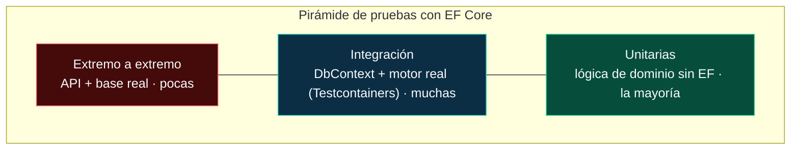
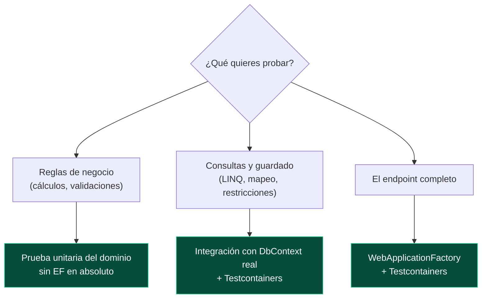

<div align="center">

# 18 · Pruebas

**Probar código que habla con una base de datos: estrategias, SQLite en memoria, Testcontainers, aislamiento, SQL generado, migraciones y APIs**

[⬅ 17 · Rendimiento y diagnóstico](17-rendimiento-y-diagnostico.md) · [🏠 Índice](../README.md) · [19 · Arquitectura de aplicaciones ➡](19-arquitectura-de-aplicaciones.md)

</div>

<!-- ef=10 -->

---

## Contenido

1. [El problema](#1-el-problema)
2. [Comparativa de estrategias](#2-comparativa-de-estrategias)
3. [SQLite en memoria](#3-sqlite-en-memoria)
4. [Testcontainers: el motor real](#4-testcontainers-el-motor-real)
5. [Aislamiento entre pruebas](#5-aislamiento-entre-pruebas)
6. [Probar el SQL generado](#6-probar-el-sql-generado)
7. [Probar las migraciones](#7-probar-las-migraciones)
8. [Dobles de prueba: qué sustituir y qué no](#8-dobles-de-prueba-qué-sustituir-y-qué-no)
9. [Pruebas de API con `WebApplicationFactory`](#9-pruebas-de-api-con-webapplicationfactory)
10. [Lista de comprobación](#10-lista-de-comprobación)
11. [Referencias](#11-referencias)

---

## 1. El problema

El código con EF Core tiene una propiedad incómoda para las pruebas: **su comportamiento lo decide en parte la base de datos**. La misma consulta LINQ
puede traducirse, o no; devolver un resultado con un motor y otro distinto con otro; violar una restricción `UNIQUE` que solo existe en el esquema real.



> [!IMPORTANT]
> **La recomendación oficial del equipo de EF** es probar contra el **mismo motor de producción** siempre que sea posible, y mantener la lógica de dominio
> fuera de EF para poder probarla sin base de datos. Los sustitutos (InMemory, *mocks* de `DbSet`) dan una falsa sensación de seguridad.

---

## 2. Comparativa de estrategias

| Estrategia | Fidelidad | Velocidad | Coste de preparación | Úsala para |
|---|---|---|---|---|
| **Motor real con Testcontainers** | 🟢🟢🟢 | 🟠 segundos al arrancar, ms por prueba | Docker | Pruebas de integración: **la opción por defecto** |
| Motor real compartido (LocalDB, servidor de CI) | 🟢🟢🟢 | 🟢 | Infraestructura | Equipos sin Docker |
| **SQLite en memoria** | 🟠 relacional, pero otro motor | 🟢🟢🟢 | Ninguno | Pruebas rápidas de lógica que no depende del motor |
| Proveedor InMemory | 🔴 no relacional | 🟢🟢🟢 | Ninguno | Casi nada ([capítulo 16](16-proveedores.md#9-inmemory-por-qué-casi-nunca)) |
| *Mock* de `DbSet`/`DbContext` | 🔴 LINQ to Objects | 🟢🟢🟢 | Alto y frágil | Nada: prueba otra cosa distinta de la real |
| Repositorio falso | 🟠 (no prueba EF) | 🟢🟢🟢 | Medio | Pruebas unitarias de servicios que usan un repositorio |

---

## 3. SQLite en memoria

Una base SQLite `:memory:` vive mientras **su conexión esté abierta**. El truco es abrir la conexión tú y pasársela al contexto, para que sobreviva entre
instancias del contexto:

```csharp run
using var conexion = new SqliteConnection("Data Source=:memory:");
conexion.Open();                                       // la base vive mientras la conexión esté abierta

var opciones = new DbContextOptionsBuilder<Tareas>().UseSqlite(conexion).Options;

using (var preparar = new Tareas(opciones))
{
    preparar.Database.EnsureCreated();
    preparar.Items.AddRange(new Tarea { Titulo = "A", Hecha = true }, new Tarea { Titulo = "B" });
    preparar.SaveChanges();
}

using (var actuar = new Tareas(opciones))             // contexto nuevo: nada en el change tracker
{
    var servicio = new ServicioTareas(actuar);
    Console.WriteLine(servicio.Pendientes());          // → 1
    Console.WriteLine(servicio.Completar("B"));        // → True
}

using (var comprobar = new Tareas(opciones))
    Console.WriteLine(comprobar.Items.Count(t => t.Hecha));   // → 2

// Una restricción real: SQLite sí la aplica (InMemory no lo haría)
using (var violar = new Tareas(opciones))
{
    violar.Items.Add(new Tarea { Titulo = "A" });
    try { violar.SaveChanges(); }
    catch (DbUpdateException) { Console.WriteLine("UNIQUE violada"); }   // → UNIQUE violada
}

public class Tarea
{
    public int Id { get; set; }
    public required string Titulo { get; set; }
    public bool Hecha { get; set; }
}

public class Tareas(DbContextOptions<Tareas> o) : DbContext(o)
{
    public DbSet<Tarea> Items => Set<Tarea>();
    protected override void OnModelCreating(ModelBuilder b) => b.Entity<Tarea>().HasIndex(t => t.Titulo).IsUnique();
}

public class ServicioTareas(Tareas db)
{
    public int Pendientes() => db.Items.Count(t => !t.Hecha);

    public bool Completar(string titulo)
    {
        var t = db.Items.SingleOrDefault(x => x.Titulo == titulo);
        if (t is null) return false;
        t.Hecha = true;
        db.SaveChanges();
        return true;
    }
}
```

> [!TIP]
> El patrón **preparar / actuar / comprobar con tres contextos distintos** es importante: si usas el mismo contexto, el *change tracker* puede devolverte
> la entidad desde memoria y la prueba pasa aunque `SaveChanges` no haya guardado nada.

> [!WARNING]
> SQLite no es SQL Server: distinguirá mayúsculas donde SQL Server no ([capítulo 16](16-proveedores.md#10-diferencias-que-muerden)), no traducirá
> funciones propias (`EF.Functions.DateDiffDay`, JSON de SQL Server, tablas temporales) y sus migraciones son distintas. Úsalo para la lógica, no para
> validar el SQL de producción.

---

## 4. Testcontainers: el motor real

[Testcontainers](https://dotnet.testcontainers.org/) arranca un contenedor Docker con la base real al empezar las pruebas y lo destruye al terminar:

```csharp omitir
// Paquetes: Testcontainers.MsSql, xunit.v3, Microsoft.EntityFrameworkCore.SqlServer
public sealed class BaseDeDatos : IAsyncLifetime
{
    private readonly MsSqlContainer _sql = new MsSqlBuilder()
        .WithImage("mcr.microsoft.com/mssql/server:2025-latest")
        .Build();

    public string Cadena => _sql.GetConnectionString();

    public async ValueTask InitializeAsync()
    {
        await _sql.StartAsync();
        await using var db = CrearContexto();
        await db.Database.MigrateAsync();          // ✅ prueba también las migraciones reales
    }

    public JobsDbContext CrearContexto()
        => new(new DbContextOptionsBuilder<JobsDbContext>().UseSqlServer(Cadena).Options);

    public ValueTask DisposeAsync() => _sql.DisposeAsync();
}

[CollectionDefinition(nameof(BaseDeDatos))]
public class ColeccionBase : ICollectionFixture<BaseDeDatos>;

[Collection(nameof(BaseDeDatos))]
public class PruebasDeTrabajos(BaseDeDatos bd)
{
    [Fact]
    public async Task Buscar_por_titulo_no_distingue_mayusculas_en_SQL_Server()
    {
        await using var db = bd.CrearContexto();
        await using var tx = await db.Database.BeginTransactionAsync();   // se revierte al terminar

        db.jobs.Add(new Job { JobId = Guid.NewGuid(), CategoryId = IdCategoriaSembrada, Title = "Pagar LUZ" });
        await db.SaveChangesAsync();

        Assert.Equal(1, await db.jobs.CountAsync(j => j.Title == "pagar luz"));   // CI_AS: pasa en SQL Server, fallaría en SQLite
    }
}
```

| Imagen | Paquete |
|---|---|
| SQL Server 2025 / 2022 | `Testcontainers.MsSql` |
| PostgreSQL (+ pgvector) | `Testcontainers.PostgreSql` |
| MySQL / MariaDB | `Testcontainers.MySql` / `Testcontainers.MariaDb` |
| Cosmos DB (emulador) | `Testcontainers.CosmosDb` |
| Oracle | `Testcontainers.Oracle` |

> [!TIP]
> Arranca **un contenedor por ejecución de pruebas** (un *fixture* de colección), no uno por prueba: el arranque cuesta segundos; una prueba sobre un
> contenedor ya caliente, milisegundos.

---

## 5. Aislamiento entre pruebas

Las pruebas que comparten base deben dejarla como la encontraron. Tres técnicas:

| Técnica | Cómo | Ventaja | Límite |
|---|---|---|---|
| **Transacción revertida** | Cada prueba abre una transacción y no la confirma | Rapidísima | El código bajo prueba no puede abrir su propia transacción (salvo con *savepoints*) |
| **Limpieza con Respawn** | `await respawner.ResetAsync(cadena)` antes de cada prueba | Funciona con cualquier código | Algo más lenta |
| **Base por prueba o por clase** | Nombre de base único | Aislamiento total, paralelismo | Lenta en motores pesados |

```csharp omitir
// Respawn: borra los datos de todas las tablas respetando el orden de las FK
_respawner = await Respawner.CreateAsync(cadena, new RespawnerOptions
{
    TablesToIgnore = ["__EFMigrationsHistory"],
    DbAdapter = DbAdapter.SqlServer,
});
await _respawner.ResetAsync(cadena);
```

---

## 6. Probar el SQL generado

Cuando una consulta es crítica para el rendimiento, conviene **fijar su SQL** para detectar si una actualización de EF Core o un cambio del modelo lo
altera:

```csharp run
using var db = new Tienda();
var sql = Consultas.Caros(db).ToQueryString();

// Una prueba de "instantánea" mínima: el SQL no debe traer columnas que no usamos
Console.WriteLine(sql.Contains("\"Descripcion\""));     // → False
Console.WriteLine(sql.Contains("ORDER BY"));            // → True

public static class Consultas
{
    public static IQueryable<string> Caros(Tienda db)
        => db.Productos.Where(p => p.Precio > 100).OrderBy(p => p.Nombre).Select(p => p.Nombre);
}

public class Producto
{
    public int Id { get; set; }
    public required string Nombre { get; set; }
    public string? Descripcion { get; set; }
    public int Precio { get; set; }
}

public class Tienda : DbContext
{
    public DbSet<Producto> Productos => Set<Producto>();
    protected override void OnConfiguring(DbContextOptionsBuilder o) => o.UseSqlite("Data Source=tienda.db");
}
```

> [!TIP]
> La biblioteca **Verify** (`Verify.EntityFramework`) lleva esta idea al extremo: guarda en un archivo el SQL de cada consulta ejecutada durante la prueba
> y falla si cambia, mostrándote la diferencia. Es la red de seguridad ideal para actualizar de EF Core 10 a 11.

---

## 7. Probar las migraciones

| Prueba | Cómo | Qué detecta |
|---|---|---|
| **El modelo y las migraciones coinciden** | `dotnet ef migrations has-pending-model-changes` en CI | Una migración olvidada |
| Todas las migraciones se aplican desde cero | `Database.MigrateAsync()` sobre una base vacía (Testcontainers) | SQL inválido, orden incorrecto |
| `Down` funciona | `GetService<IMigrator>().MigrateAsync("0")` tras aplicar todas | Migraciones irreversibles sin querer |
| El script idempotente se ejecuta dos veces | Ejecutar `despliegue.sql` dos veces | Scripts no idempotentes (SQL manual) |
| Datos existentes sobreviven | Sembrar con la versión N, migrar a N+1, comprobar | Pérdida de datos en renombrados |

```csharp
public class Pedido { public int Id { get; set; } }

public class Ventas(DbContextOptions<Ventas> o) : DbContext(o)
{
    public DbSet<Pedido> Pedidos => Set<Pedido>();
}

public static class PruebaDeModelo
{
    // EF Core 8+: la misma comprobación que el comando de la CLI, desde una prueba
    public static bool HayCambiosSinMigrar(Ventas db) => db.Database.HasPendingModelChanges();
}
```

---

## 8. Dobles de prueba: qué sustituir y qué no



> [!CAUTION]
> **No hagas *mocks* de `DbSet<T>`.** Un `DbSet` simulado ejecuta tu LINQ como **LINQ to Objects**: `Where(p => p.Nombre == "ana")` distinguirá
> mayúsculas aunque SQL Server no lo haga, las navegaciones serán `null` sin `Include`, y una expresión intraducible pasará la prueba y fallará en
> producción. Estás probando un programa diferente al que se ejecuta.

| Si tu arquitectura… | Sustituye |
|---|---|
| Usa el `DbContext` directamente en los servicios | Nada: prueba de integración con la base real |
| Tiene repositorios con métodos específicos (`ObtenerPendientes()`) | El repositorio, con una implementación en memoria, para probar el **servicio**; y el repositorio real, con la base, en sus propias pruebas |
| Separa dominio puro (entidades con lógica, sin EF) | Nada: prueba el dominio directamente |

---

## 9. Pruebas de API con `WebApplicationFactory`

```csharp omitir
public class ApiDeTrabajos(BaseDeDatos bd) : IClassFixture<BaseDeDatos>
{
    private HttpClient Cliente() => new WebApplicationFactory<Program>()
        .WithWebHostBuilder(w => w.ConfigureServices(s =>
        {
            s.RemoveAll<DbContextOptions<JobsDbContext>>();
            s.AddDbContext<JobsDbContext>(o => o.UseSqlServer(bd.Cadena));
        }))
        .CreateClient();

    [Fact]
    public async Task Post_crea_y_Get_devuelve()
    {
        var http = Cliente();
        var r = await http.PostAsJsonAsync("/api/jobs", new { title = "Regar", categoryId = IdCategoriaSembrada });
        Assert.Equal(HttpStatusCode.Created, r.StatusCode);

        var lista = await http.GetFromJsonAsync<List<TrabajoDto>>("/api/jobs");
        Assert.Contains(lista!, t => t.Titulo == "Regar");
    }
}
```

> [!NOTE]
> Para que `WebApplicationFactory<Program>` encuentre la clase `Program` de una aplicación con instrucciones de nivel superior, añade al final de
> `Program.cs`: `public partial class Program;`.

---

## 10. Lista de comprobación

| # | Comprobación |
|---|---|
| 1 | La lógica de dominio se prueba sin base de datos |
| 2 | Las pruebas de integración usan el **mismo motor** que producción (Testcontainers) |
| 3 | Cada prueba usa contextos distintos para preparar, actuar y comprobar |
| 4 | Las pruebas son independientes del orden (transacción revertida o Respawn) |
| 5 | CI ejecuta `migrations has-pending-model-changes` |
| 6 | Las migraciones se aplican desde cero en CI |
| 7 | Las consultas críticas tienen su SQL fijado (Verify o `ToQueryString`) |
| 8 | Hay al menos una prueba que detecta N+1 (interceptor contador, [capítulo 17](17-rendimiento-y-diagnostico.md#8-interceptores)) |
| 9 | El tiempo se inyecta (`TimeProvider`) y se fija en las pruebas |
| 10 | Ninguna prueba depende de InMemory para validar consultas |

---

## 11. Referencias

- [Testing EF Core applications](https://learn.microsoft.com/ef/core/testing/)
- [Choosing a testing strategy](https://learn.microsoft.com/ef/core/testing/choosing-a-testing-strategy)
- [Testing against your production database system](https://learn.microsoft.com/ef/core/testing/testing-with-the-database)
- [Testcontainers for .NET](https://dotnet.testcontainers.org/)
- [Respawn](https://github.com/jbogard/Respawn)
- [Integration tests in ASP.NET Core](https://learn.microsoft.com/aspnet/core/test/integration-tests)

<div align="center">

[⬅ 17 · Rendimiento y diagnóstico](17-rendimiento-y-diagnostico.md) · [🏠 Índice](../README.md) · [19 · Arquitectura de aplicaciones ➡](19-arquitectura-de-aplicaciones.md)

</div>
