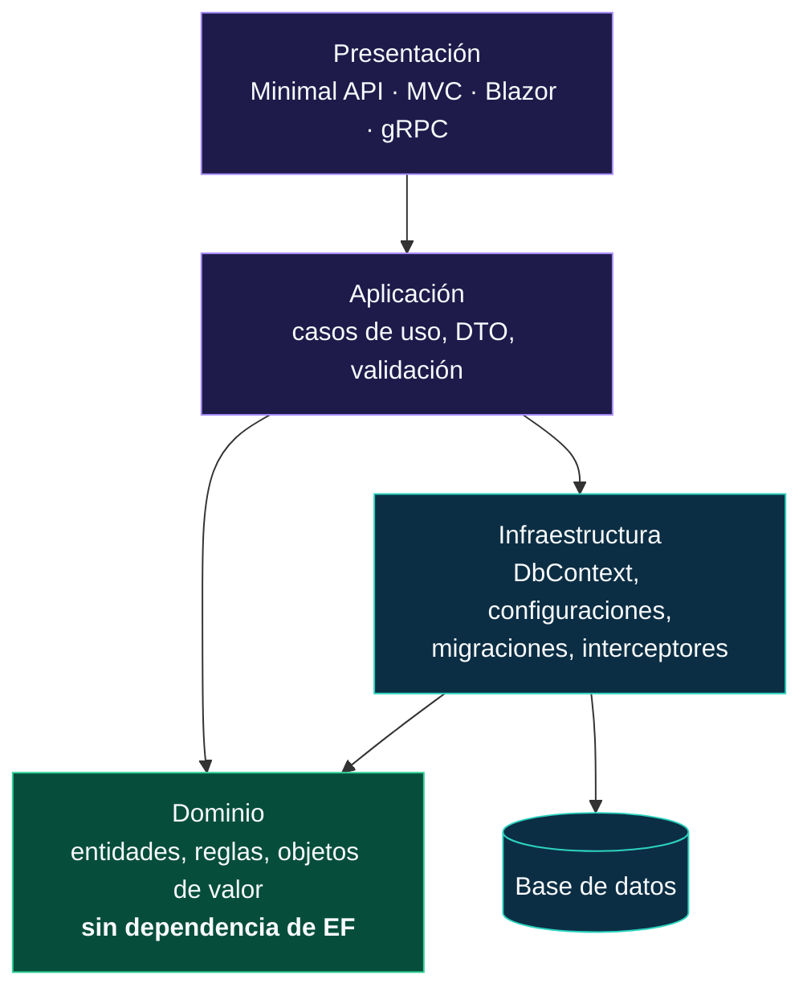
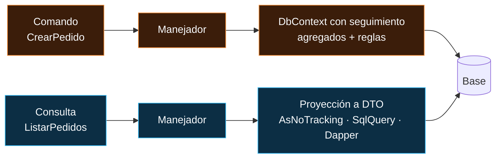
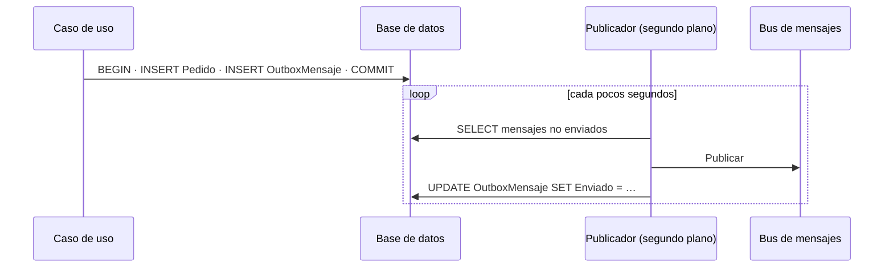

<div align="center">

# 19 · Arquitectura de aplicaciones

**El `DbContext` en una aplicación real: vida e inyección, repositorios sí o no, DDD, CQRS, multiinquilino, Minimal APIs, tareas en segundo plano y *outbox***

[⬅ 18 · Pruebas](18-pruebas.md) · [🏠 Índice](../README.md) · [20 · Caso práctico JobsDB ➡](20-caso-practico-jobsdb.md)

</div>

<!-- ef=10 -->

---

## Contenido

1. [Dónde encaja EF Core](#1-dónde-encaja-ef-core)
2. [Vida del `DbContext`](#2-vida-del-dbcontext)
3. [Registro en el contenedor de dependencias](#3-registro-en-el-contenedor-de-dependencias)
4. [¿Repositorio y unidad de trabajo encima de EF Core?](#4-repositorio-y-unidad-de-trabajo-encima-de-ef-core)
5. [Diseño guiado por el dominio con EF Core](#5-diseño-guiado-por-el-dominio-con-ef-core)
6. [CQRS: separar lecturas y escrituras](#6-cqrs-separar-lecturas-y-escrituras)
7. [Multiinquilino](#7-multiinquilino)
8. [Minimal APIs con EF Core](#8-minimal-apis-con-ef-core)
9. [Tareas en segundo plano, Blazor y concurrencia](#9-tareas-en-segundo-plano-blazor-y-concurrencia)
10. [El patrón *outbox*](#10-el-patrón-outbox)
11. [Referencias](#11-referencias)

---

## 1. Dónde encaja EF Core



| Proyecto | Contiene | Referencia a EF |
|---|---|---|
| `Dominio` | Entidades, objetos de valor, interfaces de dominio | ❌ (como mucho `…Abstractions` para atributos) |
| `Aplicacion` | Casos de uso, DTO | Opcional: muchos equipos usan el `DbContext` aquí directamente |
| `Infraestructura` | `DbContext`, `IEntityTypeConfiguration<T>`, migraciones | ✅ |
| `Api` | Endpoints, `Program.cs` | ✅ (registro en DI) y `…Design` para la CLI |

> [!TIP]
> Para una aplicación pequeña como la de este repositorio, **un solo proyecto con carpetas** es perfectamente válido. La separación en proyectos merece la
> pena cuando varios equipos trabajan en paralelo o el dominio tiene reglas complejas. No pagues el coste de la arquitectura antes de tener el problema.

---

## 2. Vida del `DbContext`

Un `DbContext` es una **unidad de trabajo**: se crea, se usa para una operación de negocio y se desecha. Tres reglas lo resumen:

| Regla | Por qué |
|---|---|
| **Vida corta**: una petición, un mensaje, un caso de uso | El *change tracker* crece con cada entidad cargada y `DetectChanges` se vuelve lento; los datos seguidos se quedan obsoletos |
| **No es seguro entre hilos** | Dos operaciones simultáneas sobre la misma instancia lanzan `InvalidOperationException: A second operation was started…` |
| **Siempre `await`** | Un `ToListAsync()` sin `await` seguido de otra consulta es una operación concurrente sobre la misma instancia |

| Tipo de aplicación | Vida recomendada | Registro |
|---|---|---|
| ASP.NET Core (API, MVC, Razor Pages) | Una por petición (*scoped*) | `AddDbContext` / `AddDbContextPool` |
| **Blazor Server** / Blazor interactivo | Una por **operación** (el circuito vive horas) | `AddDbContextFactory` |
| `BackgroundService` / `IHostedService` | Una por iteración o mensaje | `IServiceScopeFactory` o `IDbContextFactory<T>` |
| Escritorio (WPF, WinForms, MAUI) | Una por formulario o por operación | `IDbContextFactory<T>` |
| Consola / script | Una por lote | `new` o factoría |
| Funciones *serverless* | Una por invocación | DI de la función |

```csharp run
var servicios = new ServiceCollection()
    .AddDbContextFactory<Tienda>(o => o.UseSqlite("Data Source=tienda.db"))
    .BuildServiceProvider();
var factoria = servicios.GetRequiredService<IDbContextFactory<Tienda>>();

using (var db = factoria.CreateDbContext())
{
    db.Database.EnsureDeleted();
    db.Database.EnsureCreated();
    db.Productos.AddRange(Enumerable.Range(1, 3).Select(i => new Producto { Nombre = $"P{i}" }));
    db.SaveChanges();
}

// ✅ Tres consultas en paralelo: cada tarea con SU contexto
var tareas = Enumerable.Range(1, 3).Select(async id =>
{
    await using var db = await factoria.CreateDbContextAsync();
    return (await db.Productos.FindAsync(id))!.Nombre;
});
Console.WriteLine(string.Join(", ", await Task.WhenAll(tareas)));      // → P1, P2, P3

public class Producto
{
    public int Id { get; set; }
    public required string Nombre { get; set; }
}

public class Tienda(DbContextOptions<Tienda> o) : DbContext(o)
{
    public DbSet<Producto> Productos => Set<Producto>();
}
```

> [!CAUTION]
> **Nunca registres el `DbContext` como *singleton*** ni lo guardes en un campo estático, y nunca inyectes un contexto *scoped* en un servicio
> *singleton* (ASP.NET Core lo detecta en desarrollo con `ValidateScopes`). El resultado son datos obsoletos, memoria que crece sin límite y excepciones
> de concurrencia aleatorias en producción.

---

## 3. Registro en el contenedor de dependencias

| Método | Registra | Úsalo cuando |
|---|---|---|
| `AddDbContext<T>(o => …)` | `T` *scoped* + `DbContextOptions<T>` | El caso general |
| `AddDbContextPool<T>(o => …, poolSize)` | `T` reutilizado desde un *pool* | Alto rendimiento y contexto sin estado ([capítulo 17](17-rendimiento-y-diagnostico.md#3-agrupación-de-contextos)) |
| `AddDbContextFactory<T>(o => …)` | `IDbContextFactory<T>` *singleton* (y `T` *scoped*) | Blazor, segundo plano, paralelismo |
| `AddPooledDbContextFactory<T>(…)` | Factoría con *pool* | Lo anterior con alto rendimiento |
| `AddSqlServer<T>(cadena)` / `AddNpgsql<T>(…)` / `AddSqlite<T>(…)` | Atajo de `AddDbContext` + proveedor (EF Core 6+) | Configuración mínima |

```csharp omitir
// Program.cs de este repositorio (simplificado):
builder.Services.AddSqlServer<JobsDbContext>(builder.Configuration.GetConnectionString("sql"));

// Equivalente explícito, con las opciones habituales de producción:
builder.Services.AddDbContext<JobsDbContext>(o => o
    .UseSqlServer(builder.Configuration.GetConnectionString("sql"), s => s.EnableRetryOnFailure())
    .UseQueryTrackingBehavior(QueryTrackingBehavior.NoTracking)
    .EnableDetailedErrors(builder.Environment.IsDevelopment()));
```

> [!NOTE]
> `AddSqlServer<T>` acepta un segundo parámetro para configurar el proveedor y un tercero para las opciones generales de EF; para algo más elaborado
> (interceptores resueltos desde DI, por ejemplo) usa la sobrecarga `AddDbContext<T>((servicios, o) => …)`.

---

## 4. ¿Repositorio y unidad de trabajo encima de EF Core?

Es el debate más antiguo del ecosistema. Los hechos: **`DbSet<T>` ya es un repositorio y `DbContext` ya es una unidad de trabajo**. Envolverlos en un
`IRepository<T>` genérico con `GetAll`, `GetById`, `Add`, `Update`, `Delete` suele **restar** capacidad (proyecciones, `Include`, `AsNoTracking`, consultas
compuestas) sin aportar aislamiento real.

| Enfoque | Ventajas | Inconvenientes | Veredicto |
|---|---|---|---|
| `DbContext` directamente en los casos de uso | Toda la potencia de LINQ; menos código | El caso de uso conoce EF | ✅ Por defecto |
| **Repositorio genérico** `IRepository<T>` | "Abstrae" EF | Pierde proyecciones y composición; filtra `IQueryable` o fuerza a traer todo | ❌ Evítalo |
| **Repositorio específico por agregado** (`IPedidos.ObtenerConLineas(id)`) | Lenguaje del dominio; consultas centralizadas | Más código | ✅ En DDD |
| Especificaciones (*Specification pattern*) | Consultas reutilizables y comprobables | Indirección | 🟠 Si hay muchas consultas repetidas |
| *Query objects* / CQRS | Cada lectura es una clase con su proyección | Más archivos | ✅ Lecturas complejas |

> [!TIP]
> Si la razón para un repositorio es "poder cambiar de ORM", pregúntate cuántas veces ha ocurrido. Si es "poder probar sin base de datos", el
> [capítulo 18](18-pruebas.md#8-dobles-de-prueba-qué-sustituir-y-qué-no) explica por qué esas pruebas no prueban lo importante.

---

## 5. Diseño guiado por el dominio con EF Core

EF Core moderno permite modelar un dominio rico **sin contaminarlo**:

| Concepto de DDD | Implementación con EF Core |
|---|---|
| **Entidad** con invariantes | Setters privados, constructor con parámetros, métodos de negocio; EF usa campos de respaldo |
| **Objeto de valor** | Tipo complejo (EF Core 8+) o `record` con conversión de valor |
| **Agregado** | La raíz expone colecciones de solo lectura (`IReadOnlyList<T>`) sobre un campo `List<T>` |
| **Identificador fuertemente tipado** | `readonly record struct PedidoId(Guid Value)` con conversión, o tipo complejo como clave (EF Core 11) |
| **Eventos de dominio** | Lista en la entidad, publicada por un `ISaveChangesInterceptor` tras guardar |
| Repositorio por agregado | Interfaz en el dominio, implementación con `DbContext` en infraestructura |

```csharp run
using var db = new Ventas();
db.Database.EnsureDeleted();
db.Database.EnsureCreated();

var pedido = Pedido.Crear("Ana");
pedido.AgregarLinea("Té", 2, 3.5m);
pedido.AgregarLinea("Té", 1, 3.5m);            // regla: misma referencia → suma unidades
db.Add(pedido);
db.SaveChanges();
db.ChangeTracker.Clear();

var leido = db.Set<Pedido>().Include("_lineas").Single();
Console.WriteLine($"{leido.Cliente}: {leido.Lineas.Count} línea, {leido.Lineas[0].Unidades} uds, total {leido.Total:0.00}");
// → Ana: 1 línea, 3 uds, total 10.50

public class Pedido
{
    private readonly List<Linea> _lineas = [];
    private Pedido() { }                                         // para EF
    public int Id { get; private set; }
    public string Cliente { get; private set; } = "";
    public IReadOnlyList<Linea> Lineas => _lineas;
    public decimal Total => _lineas.Sum(l => l.Unidades * l.Precio);

    public static Pedido Crear(string cliente)
        => string.IsNullOrWhiteSpace(cliente) ? throw new ArgumentException("Cliente obligatorio") : new() { Cliente = cliente };

    public void AgregarLinea(string referencia, int unidades, decimal precio)
    {
        if (unidades <= 0) throw new ArgumentOutOfRangeException(nameof(unidades));
        var existente = _lineas.FirstOrDefault(l => l.Referencia == referencia);
        if (existente is null) _lineas.Add(new Linea(referencia, unidades, precio));
        else existente.Sumar(unidades);
    }
}

public class Linea
{
    private Linea() { }
    internal Linea(string referencia, int unidades, decimal precio) => (Referencia, Unidades, Precio) = (referencia, unidades, precio);
    public int Id { get; private set; }
    public string Referencia { get; private set; } = "";
    public int Unidades { get; private set; }
    public decimal Precio { get; private set; }
    internal void Sumar(int n) => Unidades += n;
}

public class Ventas : DbContext
{
    protected override void OnConfiguring(DbContextOptionsBuilder o) => o.UseSqlite("Data Source=ventas.db");

    protected override void OnModelCreating(ModelBuilder b) => b.Entity<Pedido>(p =>
    {
        p.Ignore(x => x.Total);
        p.Ignore(x => x.Lineas);
        p.HasMany<Linea>("_lineas").WithOne().HasForeignKey("PedidoId");   // EF trabaja con el campo privado
    });
}
```

> [!NOTE]
> El dominio no tiene **ni un atributo de EF** ni un `using Microsoft.EntityFrameworkCore`. Toda la traducción a tablas vive en `OnModelCreating`. Los
> constructores privados sin parámetros existen solo para que EF pueda materializar (EF también puede usar constructores con parámetros cuyos nombres
> coincidan con propiedades).

---

## 6. CQRS: separar lecturas y escrituras



| | Lado de escritura | Lado de lectura |
|---|---|---|
| Modelo | Agregados con reglas | DTO planos para cada pantalla |
| EF Core | Entidades seguidas, `SaveChanges` | Proyecciones `Select`, sin seguimiento |
| Alternativas | — | `Database.SqlQuery<T>`, vistas, Dapper, réplica de lectura |
| Optimización | Concurrencia, transacciones | Índices de cobertura, caché |

> [!TIP]
> No necesitas MediatR ni dos bases de datos para aplicar CQRS. El 80 % del beneficio está en una regla sencilla: **las lecturas proyectan a DTO; las
> escrituras cargan agregados**.

---

## 7. Multiinquilino

| Modelo | Aislamiento | Coste | Con EF Core |
|---|---|---|---|
| **Columna `TenantId`** en cada tabla | Lógico | 🟢 Bajo | Filtro global con nombre ([capítulo 10](10-ef-core-10-lts-vectores-y-json.md#6-filtros-de-consulta-con-nombre)) + interceptor que asigna el inquilino al guardar |
| **Esquema por inquilino** | Medio | 🟠 Medio | `HasDefaultSchema(inquilino)` + `IModelCacheKeyFactory` propio (un modelo por esquema) |
| **Base por inquilino** | Físico | 🔴 Alto | Cadena de conexión elegida por petición en `OnConfiguring` o factoría |

> [!CAUTION]
> Con la columna `TenantId`, **un filtro olvidado es una fuga de datos entre clientes**. Defensa en profundidad: filtro global, interceptor que impide
> guardar entidades de otro inquilino, pruebas que verifican el aislamiento y, en SQL Server, *row-level security* como última barrera.

---

## 8. Minimal APIs con EF Core

```csharp
using Microsoft.AspNetCore.Http.HttpResults;

var builder = WebApplication.CreateBuilder(args);
builder.Services.AddDbContext<Jobs>(o => o.UseSqlite("Data Source=jobs.db"));
var app = builder.Build();

var api = app.MapGroup("/api/trabajos");

api.MapGet("/", async (Jobs db, int pagina = 1, int tamaño = 20, CancellationToken ct = default) =>
    TypedResults.Ok(await db.Trabajos
        .OrderBy(t => t.Id)
        .Skip((pagina - 1) * tamaño).Take(Math.Clamp(tamaño, 1, 100))
        .Select(t => new TrabajoDto(t.Id, t.Titulo, t.Categoria.Nombre))
        .ToListAsync(ct)));

api.MapGet("/{id:guid}", async Task<Results<Ok<TrabajoDto>, NotFound>> (Guid id, Jobs db, CancellationToken ct) =>
    await db.Trabajos.Where(t => t.Id == id)
        .Select(t => new TrabajoDto(t.Id, t.Titulo, t.Categoria.Nombre))
        .SingleOrDefaultAsync(ct) is { } dto ? TypedResults.Ok(dto) : TypedResults.NotFound());

api.MapPost("/", async (CrearTrabajo cmd, Jobs db, TimeProvider reloj, CancellationToken ct) =>
{
    var t = new Trabajo { Id = Guid.CreateVersion7(), Titulo = cmd.Titulo, CategoriaId = cmd.CategoriaId, CreadoUtc = reloj.GetUtcNow().UtcDateTime };
    db.Trabajos.Add(t);
    await db.SaveChangesAsync(ct);
    return TypedResults.Created($"/api/trabajos/{t.Id}", new { t.Id });
});

api.MapDelete("/{id:guid}", async Task<Results<NoContent, NotFound>> (Guid id, Jobs db, CancellationToken ct) =>
    await db.Trabajos.Where(t => t.Id == id).ExecuteDeleteAsync(ct) == 1 ? TypedResults.NoContent() : TypedResults.NotFound());

app.Run();

public record TrabajoDto(Guid Id, string Titulo, string Categoria);
public record CrearTrabajo(string Titulo, Guid CategoriaId);

public class Categoria
{
    public Guid Id { get; set; }
    public required string Nombre { get; set; }
}

public class Trabajo
{
    public Guid Id { get; set; }
    public required string Titulo { get; set; }
    public Guid CategoriaId { get; set; }
    public Categoria Categoria { get; set; } = null!;
    public DateTime CreadoUtc { get; set; }
}

public class Jobs(DbContextOptions<Jobs> o) : DbContext(o)
{
    public DbSet<Trabajo> Trabajos => Set<Trabajo>();
}
```

| Práctica | En el ejemplo |
|---|---|
| DTO de entrada y salida, nunca entidades | `CrearTrabajo`, `TrabajoDto` |
| Proyección en la consulta | `Select(t => new TrabajoDto(...))` |
| Paginación con límite | `Math.Clamp(tamaño, 1, 100)` |
| `CancellationToken` en todo | Una petición cancelada detiene la consulta |
| Resultados tipados | `Results<Ok<…>, NotFound>` documenta OpenAPI automáticamente |
| Códigos HTTP correctos | `201 Created` con `Location`, `204 No Content`, `404` |
| Borrado sin cargar | `ExecuteDeleteAsync` |
| Claves ordenables | `Guid.CreateVersion7()` (.NET 9+): índices menos fragmentados que `Guid.NewGuid()` |

---

## 9. Tareas en segundo plano, Blazor y concurrencia

```csharp omitir
public sealed class LimpiezaNocturna(IDbContextFactory<JobsDbContext> factoria, ILogger<LimpiezaNocturna> log) : BackgroundService
{
    protected override async Task ExecuteAsync(CancellationToken ct)
    {
        using var temporizador = new PeriodicTimer(TimeSpan.FromHours(24));
        while (await temporizador.WaitForNextTickAsync(ct))
        {
            await using var db = await factoria.CreateDbContextAsync(ct);   // un contexto por iteración
            var borrados = await db.jobs.Where(j => j.CreationDate < DateTime.UtcNow.AddYears(-1)).ExecuteDeleteAsync(ct);
            log.LogInformation("Limpieza: {Borrados} trabajos antiguos", borrados);
        }
    }
}
```

| Entorno | Trampa | Solución |
|---|---|---|
| `BackgroundService` (*singleton*) | Inyectar `JobsDbContext` directamente | `IDbContextFactory<T>` o `IServiceScopeFactory` |
| Blazor Server | Un contexto *scoped* vive todo el circuito (horas) | `IDbContextFactory<T>`; un contexto por operación |
| `Parallel.ForEach` / `Task.WhenAll` | Compartir el contexto | Un contexto por tarea |
| Eventos de UI que se solapan | Dos clics → dos consultas simultáneas | Deshabilitar el botón o contexto por operación |

---

## 10. El patrón *outbox*

Guardar en la base **y** publicar un mensaje en un bus (RabbitMQ, Azure Service Bus, Kafka) no puede hacerse de forma atómica: si el proceso cae entre las dos
operaciones, quedan desincronizadas. El ***outbox*** guarda el mensaje **en la misma transacción** que los datos, y un proceso aparte lo publica:



> [!TIP]
> Un `ISaveChangesInterceptor` ([capítulo 14](14-guardado-y-concurrencia.md#7-auditoría-y-lógica-transversal)) es el lugar natural para convertir los
> eventos de dominio de las entidades en filas del *outbox* justo antes de guardar. Bibliotecas como MassTransit y Wolverine traen un *outbox* listo para
> EF Core.

---

## 11. Referencias

- [DbContext lifetime, configuration, and initialization](https://learn.microsoft.com/ef/core/dbcontext-configuration/)
- [Using a DbContext factory](https://learn.microsoft.com/ef/core/dbcontext-configuration/#use-a-dbcontext-factory)
- [ASP.NET Core Blazor with EF Core](https://learn.microsoft.com/aspnet/core/blazor/blazor-ef-core)
- [Multi-tenancy](https://learn.microsoft.com/ef/core/miscellaneous/multitenancy)
- [Designing the infrastructure persistence layer (.NET microservices)](https://learn.microsoft.com/dotnet/architecture/microservices/microservice-ddd-cqrs-patterns/infrastructure-persistence-layer-design)
- [Minimal APIs](https://learn.microsoft.com/aspnet/core/fundamentals/minimal-apis)

<div align="center">

[⬅ 18 · Pruebas](18-pruebas.md) · [🏠 Índice](../README.md) · [20 · Caso práctico JobsDB ➡](20-caso-practico-jobsdb.md)

</div>
