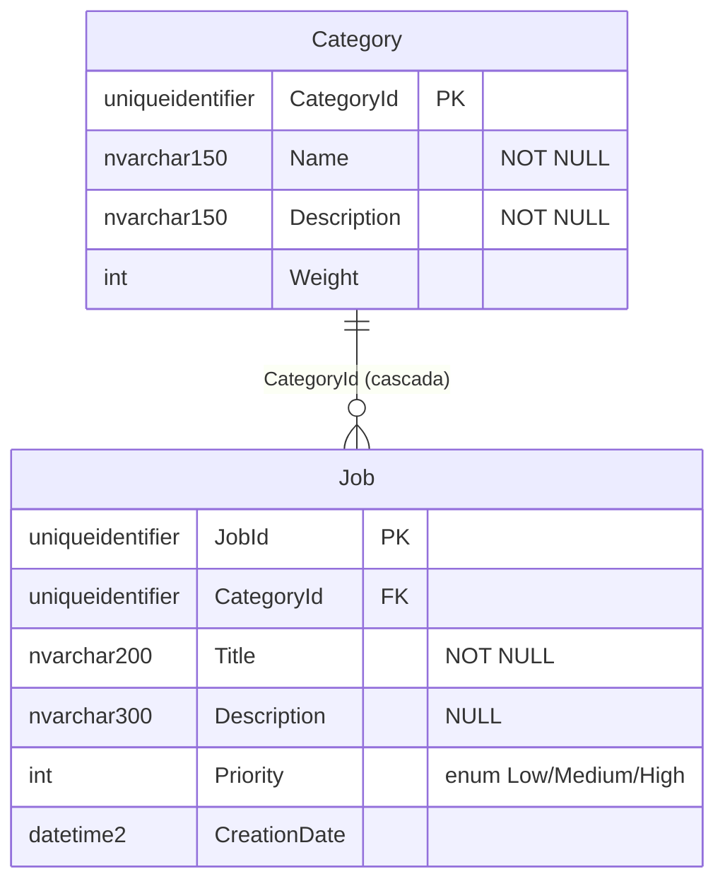
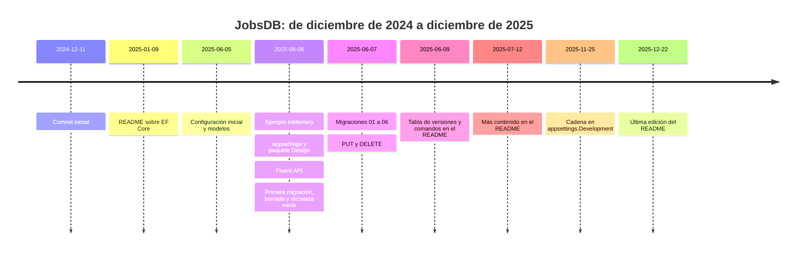

<div align="center">

# 20 · Caso práctico: JobsDB

**Auditoría completa del proyecto de este repositorio: modelo, migraciones, API y configuración, con un diagnóstico por gravedad y la versión corregida paso a paso**

[⬅ 19 · Arquitectura de aplicaciones](19-arquitectura-de-aplicaciones.md) · [🏠 Índice](../README.md) · [21 · Guías de decisión ➡](21-guias-de-decision.md)

</div>

<!-- ef=10 -->

> [!NOTE]
> Este capítulo analiza el código **tal como está** en la rama `main` (commit `367f871`). No modifica los archivos del proyecto: propone los cambios para
> que puedas aplicarlos y entender cada uno. Todo el código corregido se ha compilado con EF Core 10.0.14.

---

## Contenido

1. [El proyecto en una mirada](#1-el-proyecto-en-una-mirada)
2. [La historia en commits](#2-la-historia-en-commits)
3. [El modelo que EF Core construye](#3-el-modelo-que-ef-core-construye)
4. [Diagnóstico: 24 hallazgos por gravedad](#4-diagnóstico-24-hallazgos-por-gravedad)
5. [Los dos fallos críticos de las migraciones](#5-los-dos-fallos-críticos-de-las-migraciones)
6. [La versión corregida](#6-la-versión-corregida)
7. [Plan de migración paso a paso](#7-plan-de-migración-paso-a-paso)
8. [Antes y después](#8-antes-y-después)
9. [Ejercicios propuestos](#9-ejercicios-propuestos)

---

## 1. El proyecto en una mirada

**JobsDB** es una API mínima de ASP.NET Core para gestionar **trabajos** (tareas) agrupados en **categorías**, con SQL Server como base de datos.

```text
EFCore/
├── EFCore.csproj                  ← net10.0, EF Core 10.0.0-preview.4, SqlServer, InMemory, Npgsql
├── Program.cs                     ← 6 endpoints Minimal API
├── JobContext.cs                  ← JobsDbContext: Fluent API + HasData
├── Models/
│   ├── Category.cs                ← CategoryId, Name, Description, Weight, Jobs
│   └── Job.cs                     ← JobId, CategoryId, Title, Description, Priority, CreationDate, Resume
├── Migrations/                    ← 7 migraciones + instantánea (junio de 2025)
├── appsettings.json               ← cadena "sql" → localhost\SQLEXPRESS
└── appsettings.Development.json   ← la misma cadena, duplicada
```



| Endpoint | Hace |
|---|---|
| `GET /` | "Hello World!" |
| `GET /dbconextion` | Llama a `EnsureCreated()` y devuelve si la base es InMemory |
| `GET /api/jobs` | Todos los trabajos con su categoría |
| `POST /api/jobs` | Crea un trabajo a partir del JSON recibido |
| `PUT /api/jobs{id}` | Actualiza título, descripción y categoría |
| `DELETE /api/jobs{id}` | Borra un trabajo |

---

## 2. La historia en commits



La secuencia cuenta una historia de aprendizaje muy reconocible: empezar con **InMemory**, pasar a **SQL Server**, crear la base con `EnsureCreated`,
descubrir las **migraciones**, y experimentar con columnas que se añaden y se quitan (`Field`, `OtherField`, `OtherField2`, `Secuencial`). Justo ahí, en
el commit `0bcc865`, se borró la primera migración (que creaba las tablas) y se generó otra `InitialCreate` **vacía**. Ese paso es la raíz del fallo más
grave del proyecto ([sección 5](#5-los-dos-fallos-críticos-de-las-migraciones)).

---

## 3. El modelo que EF Core construye

| Propiedad | Declaración en C# | Configuración | Columna resultante | Observación |
|---|---|---|---|---|
| `Category.CategoryId` | `Guid` + `[Key]` | `HasKey` (otra vez) | `uniqueidentifier` PK | Clave configurada dos veces |
| `Category.Name` | `string` (no anulable) | `HasMaxLength(150)` | `nvarchar(150) NOT NULL` | Advertencia CS8618: sin `required` ni inicializador |
| `Category.Description` | `string` | `HasMaxLength(150)` | `nvarchar(150) NOT NULL` | Igual |
| `Category.Weight` | `int` | `Property<int>(c => c.Weight)` | `int NOT NULL` | Configuración redundante |
| `Category.Jobs` | `virtual ICollection<Job>` + `[JsonIgnore]` | — | — | `virtual` sin proxies; nunca inicializada |
| `Job.Title` | `string` | `IsRequired(true).HasMaxLength(200)` | `nvarchar(200) NOT NULL` | Correcto |
| `Job.Description` | `string` (no anulable) | `IsRequired(false).HasMaxLength(300)` | `nvarchar(300) NULL` | **Contradicción**: C# dice nunca `null`, la base dice que puede serlo |
| `Job.Priority` | `virtual Priority` | `Property(c => c.Priority)` | `int NOT NULL` | `virtual` en un `enum`: no tiene sentido |
| `Job.CreationDate` | `DateTime` | `Property(...)` | `datetime2 NOT NULL` | Se asigna con `DateTime.Now` (hora local) |
| `Job.Resume` | `string` | `Ignore` | — | Debería ser una propiedad calculada de solo lectura |
| `Job.Category` | `virtual Category` | `HasOne(...).WithMany(...)` | FK con `ON DELETE CASCADE` | Borrar una categoría borra sus trabajos |

---

## 4. Diagnóstico: 24 hallazgos por gravedad

### 🔴 Críticos: rompen la aplicación o los datos

| # | Hallazgo | Dónde | Consecuencia | Capítulo |
|---|---|---|---|---|
| C1 | **`InitialCreate` tiene `Up()` vacío** | `Migrations/20250607024254_InitialCreate.cs` | `database update` sobre una base nueva **no crea las tablas** y falla en la migración siguiente | [15](15-migraciones-y-despliegue.md) |
| C2 | **La semilla y la instantánea no coinciden**: el código siembra `Priority.High`, la instantánea guarda `Priority = 0` | `JobContext.cs` / `ModelSnapshot` | Hay cambios del modelo sin migración: con EF Core 9+ `Migrate()` lanza `PendingModelChangesWarning` | [09](09-ef-core-9-cosmos-aot-y-siembra.md#6-migraciones-más-seguras) |
| C3 | Paquetes ***preview*** de mayo de 2025 | `EFCore.csproj` | Sin soporte, con errores corregidos y vulnerabilidades transitivas (NU1902/NU1903) | [01](01-modelo-de-versiones.md#11-el-caso-de-este-repositorio) |
| C4 | **Sobrepublicación** (*over-posting*): `POST` enlaza la entidad `Job` completa | `Program.cs` | El cliente controla `JobId`, `CreationDate`, `Priority`… | [14](14-guardado-y-concurrencia.md#3-entidades-desconectadas) |
| C5 | `EnsureCreated()` desde un endpoint HTTP | `GET /dbconextion` | Cualquiera puede crear el esquema; es incompatible con migraciones | [15](15-migraciones-y-despliegue.md#7-estrategias-de-despliegue) |

### 🟠 Importantes: errores de diseño con impacto real

| # | Hallazgo | Dónde | Consecuencia |
|---|---|---|---|
| I1 | Rutas `"/api/jobs{id}"` sin barra | `MapPut`, `MapDelete` | La ruta real es `/api/jobs3fa85f64-…`: `/api/jobs/3fa85f64-…` devuelve 404 |
| I2 | `GET /api/jobs` devuelve un `IQueryable` **seguido**, sin paginar | `Program.cs` | El serializador enumera de forma síncrona toda la tabla y sigue cada entidad |
| I3 | Se devuelven **entidades**, no DTO | Todos los endpoints | Exponen el esquema; ciclos de serialización resueltos con `[JsonIgnore]` en el dominio |
| I4 | `SaveChanges()` síncrono dentro de una lambda `async` | `POST` | Bloquea un hilo del *pool* durante la E/S |
| I5 | `HasData` con `CreationDate = default` | `JobContext.cs` | El trabajo sembrado tiene fecha `0001-01-01` |
| I6 | `DateTime.Now` (hora local del servidor) | `POST` | Fechas ambiguas con horario de verano y en servidores de otra zona |
| I7 | `Description` no anulable en C# pero `NULL` en la base | `Job.cs` | `NullReferenceException` al leer trabajos sin descripción |
| I8 | Mezcla de anotaciones y Fluent API | `[Key]` + `HasKey` | Dos fuentes de verdad; el propio comentario del código lo reconoce como "mala práctica" |
| I9 | `Results.Ok()` al crear | `POST` | Debería ser `201 Created` con la ubicación del recurso |
| I10 | Sin `CancellationToken` | Todos | Las consultas siguen ejecutándose aunque el cliente cancele |

### 🟡 Menores: limpieza y estilo

| # | Hallazgo | Corrección |
|---|---|---|
| M1 | Paquetes `InMemory` y `Npgsql` sin uso | Quitarlos |
| M2 | Navegaciones `virtual` sin proxies | Quitar `virtual` |
| M3 | `DbSet` en minúscula (`jobs`, `categories`) | `Jobs`, `Categories` (convención de .NET) |
| M4 | Archivo `JobContext.cs` con la clase `JobsDbContext` | Renombrar el archivo |
| M5 | Migraciones `07062016_01…06`: nombres sin significado, fecha errónea (2016 por 2025) y dos vacías | Consolidar ([sección 7](#7-plan-de-migración-paso-a-paso)) |
| M6 | Cadena de conexión duplicada en dos `appsettings` | Solo en `appsettings.Development.json` o en *user secrets* |
| M7 | `Trusted_Connection` con `SQLEXPRESS`: solo funciona en Windows | Contenedor de SQL Server para desarrollo multiplataforma |
| M8 | Lambdas `async` sin `await` (CS1998) | Quitar `async` o usar la API asíncrona |
| M9 | `Resume` ignorado con `Ignore` | Propiedad calculada `=> $"{Title}: {Description}"`, que EF ignora sola |

---

## 5. Los dos fallos críticos de las migraciones

### C1 · Una cadena de migraciones que no puede crear la base

```text
20250607024254_InitialCreate   Up() { }                            ← vacío
20250607224119_07062016_01     DropColumn("Field", "Job")          ← ¡la tabla Job no existe!
20250607224618_07062016_02     Up() { }
20250607224713_07062016_03     InsertData("Category", …)
20250607230729_07062016_04     Up() { }
20250607231131_07062016_05     AlterColumn("Description", "Job", nvarchar(300))
20250607231501_07062016_06     InsertData("Job", …)
```

La base de datos del autor funciona porque **ya tenía las tablas** (creadas por `EnsureCreated` o por la primera migración, luego borrada). Pero en cualquier
otro equipo, en CI o en producción, `dotnet ef database update` aplicará `InitialCreate` sin crear nada y fallará en la siguiente:

```text
Microsoft.Data.SqlClient.SqlException: Cannot find the object "Job" because it does not exist or you do not have permissions.
```

> [!IMPORTANT]
> **La prueba de que una cadena de migraciones es correcta es aplicarla sobre una base vacía.** Por eso el [capítulo 18](18-pruebas.md#7-probar-las-migraciones)
> recomienda hacerlo en cada ejecución de CI.

### C2 · Cambios del modelo sin migración

```csharp omitir
// JobContext.cs (código actual)
_jobs.Add(new Job { …, Priority = Priority.High });           // High = 2

// Migrations/JobsDbContextModelSnapshot.cs (última migración)
b.HasData(new { …, Priority = 0 });                           // Low = 0
```

El valor de la semilla cambió **después** de generar la última migración y nadie creó otra. Con EF Core 8 eso pasaba desapercibido; desde **EF Core 9**,
`Migrate()` y `database update` comparan el modelo con la instantánea y lanzan:

```text
An error was generated for warning 'Microsoft.EntityFrameworkCore.Migrations.PendingModelChangesWarning':
The model for context 'JobsDbContext' has pending changes. Add a new migration before updating the database.
```

Se detecta en un segundo con `dotnet ef migrations has-pending-model-changes`.

---

## 6. La versión corregida

Un solo archivo para leerlo de corrido; en el proyecto real, cada clase va en su archivo. Mantiene el comportamiento y la base de datos (mismas
tablas, columnas y semillas), y corrige los 24 hallazgos.

```csharp
using Microsoft.AspNetCore.Http.HttpResults;

var builder = WebApplication.CreateBuilder(args);

builder.Services.AddDbContext<JobsDbContext>(o => o
    .UseSqlServer(builder.Configuration.GetConnectionString("Jobs"), s => s.EnableRetryOnFailure())
    .UseQueryTrackingBehavior(QueryTrackingBehavior.NoTracking));          // lecturas sin seguimiento por defecto
builder.Services.AddSingleton(TimeProvider.System);
builder.Services.AddProblemDetails();

var app = builder.Build();
app.UseExceptionHandler();

var jobs = app.MapGroup("/api/jobs").WithTags("Jobs");

jobs.MapGet("/", async (JobsDbContext db, int page = 1, int size = 20, CancellationToken ct = default) =>
    TypedResults.Ok(await db.Jobs
        .OrderByDescending(j => j.CreationDate).ThenBy(j => j.JobId)
        .Skip((Math.Max(page, 1) - 1) * Math.Clamp(size, 1, 100))
        .Take(Math.Clamp(size, 1, 100))
        .Select(j => new JobDto(j.JobId, j.Title, j.Description, j.Priority, j.CreationDate, j.Category.Name))
        .ToListAsync(ct)));

jobs.MapGet("/{id:guid}", async Task<Results<Ok<JobDto>, NotFound>> (Guid id, JobsDbContext db, CancellationToken ct) =>
    await db.Jobs.Where(j => j.JobId == id)
        .Select(j => new JobDto(j.JobId, j.Title, j.Description, j.Priority, j.CreationDate, j.Category.Name))
        .SingleOrDefaultAsync(ct) is { } dto ? TypedResults.Ok(dto) : TypedResults.NotFound());

jobs.MapPost("/", async Task<Results<Created<JobDto>, ValidationProblem>> (
    CreateJob cmd, JobsDbContext db, TimeProvider clock, CancellationToken ct) =>
{
    if (!await db.Categories.AnyAsync(c => c.CategoryId == cmd.CategoryId, ct))
        return TypedResults.ValidationProblem(new Dictionary<string, string[]> { ["categoryId"] = ["La categoría no existe."] });

    var job = new Job
    {
        JobId = Guid.CreateVersion7(),
        CategoryId = cmd.CategoryId,
        Title = cmd.Title,
        Description = cmd.Description,
        Priority = cmd.Priority,
        CreationDate = clock.GetUtcNow().UtcDateTime,
    };
    db.Jobs.Add(job);
    await db.SaveChangesAsync(ct);
    var categoria = await db.Categories.Where(c => c.CategoryId == job.CategoryId).Select(c => c.Name).SingleAsync(ct);
    return TypedResults.Created($"/api/jobs/{job.JobId}",
        new JobDto(job.JobId, job.Title, job.Description, job.Priority, job.CreationDate, categoria));
});

jobs.MapPut("/{id:guid}", async Task<Results<NoContent, NotFound>> (Guid id, UpdateJob cmd, JobsDbContext db, CancellationToken ct) =>
{
    var filas = await db.Jobs.Where(j => j.JobId == id).ExecuteUpdateAsync(s => s
        .SetProperty(j => j.Title, cmd.Title)
        .SetProperty(j => j.Description, cmd.Description)
        .SetProperty(j => j.Priority, cmd.Priority)
        .SetProperty(j => j.CategoryId, cmd.CategoryId), ct);
    return filas == 1 ? TypedResults.NoContent() : TypedResults.NotFound();
});

jobs.MapDelete("/{id:guid}", async Task<Results<NoContent, NotFound>> (Guid id, JobsDbContext db, CancellationToken ct) =>
    await db.Jobs.Where(j => j.JobId == id).ExecuteDeleteAsync(ct) == 1 ? TypedResults.NoContent() : TypedResults.NotFound());

app.Run();

// ---------- Contratos de la API ----------
public record JobDto(Guid Id, string Title, string? Description, Priority Priority, DateTime CreatedUtc, string Category);
public record CreateJob([property: MaxLength(200)] string Title, [property: MaxLength(300)] string? Description, Priority Priority, Guid CategoryId);
public record UpdateJob([property: MaxLength(200)] string Title, [property: MaxLength(300)] string? Description, Priority Priority, Guid CategoryId);

// ---------- Dominio (sin atributos de EF) ----------
public enum Priority { Low, Medium, High }

public class Category
{
    public Guid CategoryId { get; set; }
    public required string Name { get; set; }
    public required string Description { get; set; }
    public int Weight { get; set; }
    public List<Job> Jobs { get; set; } = [];
}

public class Job
{
    public Guid JobId { get; set; }
    public Guid CategoryId { get; set; }
    public required string Title { get; set; }
    public string? Description { get; set; }                     // anulable en C# y en la base
    public Priority Priority { get; set; }
    public DateTime CreationDate { get; set; }                   // siempre UTC
    public Category Category { get; set; } = null!;
    public string Resume => $"{Title}: {Description}";           // calculada: EF la ignora sola
}

// ---------- Infraestructura ----------
public class JobsDbContext(DbContextOptions<JobsDbContext> options) : DbContext(options)
{
    public static readonly Guid Pending = Guid.Parse("9b2ee223-763a-486a-b04d-2d0203e1e714");
    public static readonly Guid Personal = Guid.Parse("f15d905a-ffd8-4f44-b63c-22234605f353");

    public DbSet<Category> Categories => Set<Category>();
    public DbSet<Job> Jobs => Set<Job>();

    protected override void OnModelCreating(ModelBuilder b)
    {
        b.Entity<Category>(c =>
        {
            c.ToTable("Category");
            c.HasKey(x => x.CategoryId);
            c.Property(x => x.Name).HasMaxLength(150);
            c.Property(x => x.Description).HasMaxLength(150);
            c.HasData(
                new Category { CategoryId = Pending, Name = "Pending", Description = "Description 1", Weight = 20 },
                new Category { CategoryId = Personal, Name = "Personal", Description = "Description 2", Weight = 20 });
        });

        b.Entity<Job>(j =>
        {
            j.ToTable("Job");
            j.HasKey(x => x.JobId);
            j.Property(x => x.Title).HasMaxLength(200);
            j.Property(x => x.Description).HasMaxLength(300);
            j.HasOne(x => x.Category).WithMany(c => c.Jobs).HasForeignKey(x => x.CategoryId).OnDelete(DeleteBehavior.Restrict);
            j.HasIndex(x => x.CreationDate);
            j.HasData(new Job
            {
                JobId = Guid.Parse("aff00f04-bc5f-4078-b7e0-f84d2e409f11"),
                CategoryId = Pending,
                Title = "Public Services Payment",
                Priority = Priority.High,
                CreationDate = new DateTime(2025, 6, 7, 0, 0, 0, DateTimeKind.Utc),   // determinista
            });
        });
    }
}
```

| Hallazgo | Corrección en el código |
|---|---|
| C4 sobrepublicación | `CreateJob` / `UpdateJob` con solo los campos editables |
| C5 `EnsureCreated` | Endpoint eliminado; el esquema lo gestionan las migraciones |
| I1 rutas | `"/{id:guid}"` dentro de `MapGroup("/api/jobs")` |
| I2, I3 lectura | Proyección a `JobDto`, paginación limitada, `ToListAsync` |
| I4 síncrono | Todo `async` con `CancellationToken` |
| I5, C2 semilla | Fecha fija en UTC y `Priority.High` (nueva migración) |
| I6 hora local | `TimeProvider` + UTC |
| I7 nulabilidad | `string? Description` |
| I8 mezcla | Solo Fluent API; dominio sin atributos |
| I9 códigos HTTP | `201`, `204`, `404`, `400` con `ProblemDetails` |
| Cascada | `Restrict`: borrar una categoría con trabajos es un error de negocio, no un borrado silencioso |
| M2, M3, M9 | Sin `virtual`, `DbSet` en PascalCase, `Resume` calculada |

> [!NOTE]
> Cambiar la cascada a `Restrict` y añadir el índice sobre `CreationDate` **sí** modifica el esquema: la migración del paso 5 los incluirá. Si prefieres
> conservar exactamente el esquema actual, omite esas dos líneas.

---

## 7. Plan de migración paso a paso


**1 · Preparar**

```bash
git switch -c mejora/ef-core-10
dotnet new tool-manifest && dotnet tool install dotnet-ef --version 10.0.14
```

**2 · Actualizar y limpiar paquetes**

```bash
dotnet remove package Microsoft.EntityFrameworkCore.InMemory
dotnet remove package Npgsql.EntityFrameworkCore.PostgreSQL
dotnet remove package Microsoft.EntityFrameworkCore          # ya lo trae el proveedor
dotnet add package Microsoft.EntityFrameworkCore.SqlServer --version 10.0.14
dotnet add package Microsoft.EntityFrameworkCore.Design   --version 10.0.14
```

**3 · Aplicar el código corregido** de la [sección 6](#6-la-versión-corregida) y renombrar `JobContext.cs` a `JobsDbContext.cs`.

**4 · Consolidar las migraciones** (las siete actuales no pueden crear la base, así que no merece la pena conservarlas):

```bash
rm -r Migrations
dotnet ef migrations add InitialCreate --output-dir Data/Migrations
```

**5 · Probar la cadena sobre una base vacía** (SQL Server en contenedor, válido en macOS y Linux):

```bash
docker run -d --name jobsdb -e ACCEPT_EULA=Y -e MSSQL_SA_PASSWORD='Str0ng!Passw0rd' -p 1433:1433 mcr.microsoft.com/mssql/server:2025-latest
dotnet user-secrets set "ConnectionStrings:Jobs" "Server=localhost;Database=JobsDB;User Id=sa;Password=Str0ng!Passw0rd;TrustServerCertificate=True"
dotnet ef database update
dotnet ef migrations has-pending-model-changes        # debe decir que no hay cambios
```

**6 · En la base existente del desarrollador** (que ya tiene las tablas), alinear el esquema con un script revisado, borrar el historial antiguo y
marcar la nueva `InitialCreate` como aplicada:

```sql
-- Revisar primero: dotnet ef migrations script 0 InitialCreate --idempotent
DELETE FROM [__EFMigrationsHistory];
INSERT INTO [__EFMigrationsHistory] (MigrationId, ProductVersion) VALUES (N'<id de InitialCreate>', N'10.0.14');
UPDATE [Job] SET [Priority] = 2, [CreationDate] = '2025-06-07' WHERE [JobId] = 'aff00f04-bc5f-4078-b7e0-f84d2e409f11';
```

---

## 8. Antes y después

| Aspecto | Antes | Después |
|---|---|---|
| Versión de EF Core | `10.0.0-preview.4` (sin soporte) | `10.0.14` LTS |
| Paquetes | 5 (2 sin uso) | 2 |
| Crear la base desde cero | ❌ falla | ✅ |
| `has-pending-model-changes` | ❌ hay cambios | ✅ sin cambios |
| Consultas por `GET /api/jobs` | 1, con todas las filas y columnas | 1, con 20 filas y 6 columnas |
| Entidades seguidas por `GET` | Todas | 0 |
| Viajes por `PUT` | 2 (`SELECT` + `UPDATE`) | 1 (`UPDATE`) |
| Viajes por `DELETE` | 2 | 1 |
| Campos controlables por el cliente en `POST` | Todos | 4 |
| Advertencias del compilador | Varias (CS8618, CS1998) | 0 |
| Funciona en macOS/Linux | ❌ (`SQLEXPRESS` + autenticación de Windows) | ✅ (contenedor) |

---

## 9. Ejercicios propuestos

| # | Ejercicio | Practica | Capítulo |
|---|---|---|---|
| 1 | Añadir **borrado lógico** a `Job` con un filtro con nombre y un endpoint de "papelera" | Filtros con nombre | [10](10-ef-core-10-lts-vectores-y-json.md#6-filtros-de-consulta-con-nombre) |
| 2 | Añadir **concurrencia optimista** con `rowversion` y devolver `409` | `DbUpdateConcurrencyException` | [14](14-guardado-y-concurrencia.md#5-concurrencia-optimista) |
| 3 | Guardar **etiquetas** como colección primitiva y filtrar por ellas | Colecciones primitivas | [08](08-ef-core-8-tipos-complejos.md#3-colecciones-primitivas) |
| 4 | Convertir `Priority` en texto en la base | Conversiones de valor | [12](12-modelado.md#7-conversiones-de-valores) |
| 5 | Escribir pruebas de integración con Testcontainers | Pruebas | [18](18-pruebas.md#4-testcontainers-el-motor-real) |
| 6 | Hacer la tabla `Job` **temporal** y exponer `GET /api/jobs/{id}/history` | Tablas temporales | [06](06-ef-core-6-rendimiento-y-temporalidad.md) |
| 7 | Añadir búsqueda semántica sobre el título con `SqlVector<float>` | Vectores | [10](10-ef-core-10-lts-vectores-y-json.md#2-búsqueda-vectorial-en-sql-server) |
| 8 | Medir `GET /api/jobs` antes y después con BenchmarkDotNet | Rendimiento | [17](17-rendimiento-y-diagnostico.md#9-benchmarks-con-benchmarkdotnet) |

<div align="center">

[⬅ 19 · Arquitectura de aplicaciones](19-arquitectura-de-aplicaciones.md) · [🏠 Índice](../README.md) · [21 · Guías de decisión ➡](21-guias-de-decision.md)

</div>
