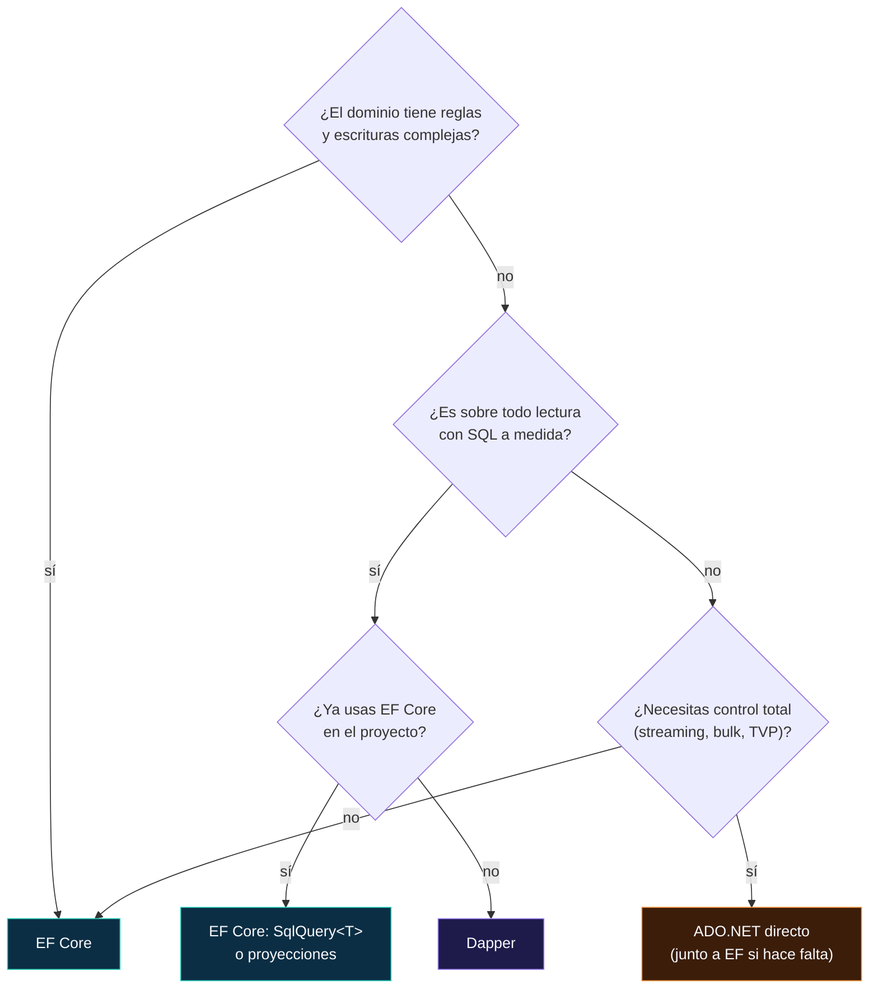
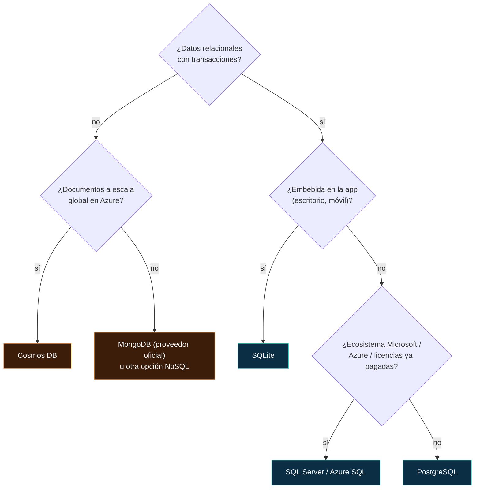
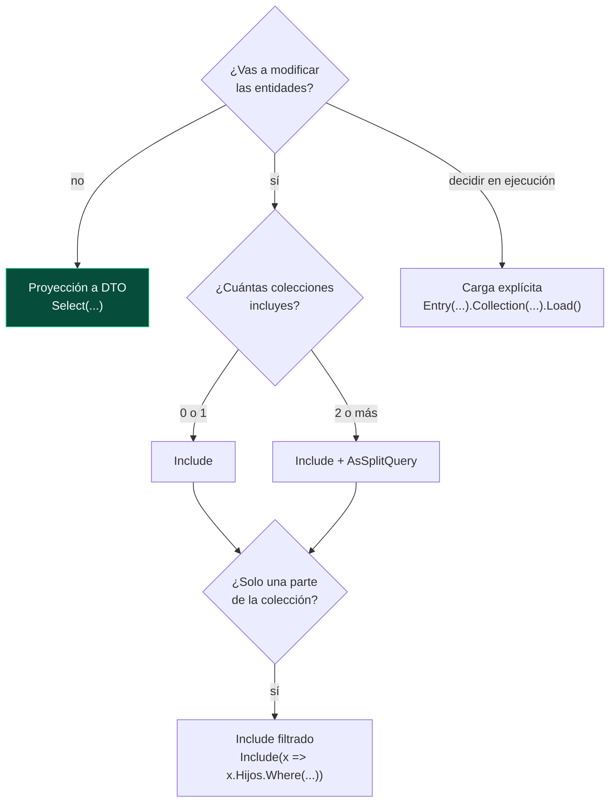
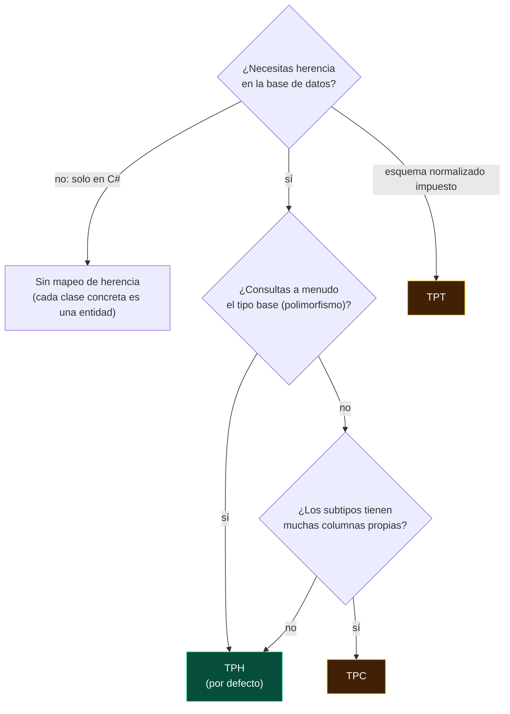

# 21 · Guías de decisión

**Árboles para elegir bien: ORM, versión, proveedor, enfoque, modelado, carga, actualización, herencia, despliegue, pruebas y vida del contexto**

[⬅ 20 · Caso práctico JobsDB](20-caso-practico-jobsdb.md) · [🏠 Índice](../README.md) · [22 · Catálogo A–Z ➡](22-catalogo-a-z.md)

> [!TIP]
> Los árboles son puntos de partida razonables para EF Core 10. La decisión final depende de tu equipo, tus datos y, sobre todo, de **mediciones reales**.

---

## Contenido

1. [¿EF Core, Dapper o ADO.NET?](#1-ef-core-dapper-o-adonet)
2. [¿Qué versión de EF Core?](#2-qué-versión-de-ef-core)
3. [¿Qué base de datos y proveedor?](#3-qué-base-de-datos-y-proveedor)
4. [¿Código primero o base primero?](#4-código-primero-o-base-primero)
5. [¿Cómo modelo este concepto?](#5-cómo-modelo-este-concepto)
6. [¿Cómo cargo los datos relacionados?](#6-cómo-cargo-los-datos-relacionados)
7. [¿Cómo modifico datos?](#7-cómo-modifico-datos)
8. [¿Qué estrategia de herencia?](#8-qué-estrategia-de-herencia)
9. [¿Cómo despliego el esquema?](#9-cómo-despliego-el-esquema)
10. [¿Cómo pruebo?](#10-cómo-pruebo)
11. [¿Cómo registro el contexto?](#11-cómo-registro-el-contexto)
12. [Decisiones que conviene evitar](#12-decisiones-que-conviene-evitar)

---

## 1. ¿EF Core, Dapper o ADO.NET?

| | **EF Core** | **Dapper** | **ADO.NET** |
|---|---|---|---|
| Escribes SQL | Rara vez | Siempre | Siempre |
| Seguimiento de cambios | ✅ | ❌ | ❌ |
| Migraciones | ✅ | ❌ (herramientas aparte) | ❌ |
| Consultas tipadas y refactorizables | ✅ LINQ | ❌ cadenas | ❌ cadenas |
| Rendimiento en lectura | Muy cercano con proyecciones y sin seguimiento | Excelente | Máximo |
| Portabilidad entre motores | Alta | Baja | Baja |
| Curva de aprendizaje | Media-alta | Baja | Baja (pero mucho código) |

> [!NOTE]
> No es una elección exclusiva: **EF Core para escrituras y la mayoría de lecturas, y SQL a mano (con `SqlQuery<T>` o Dapper sobre la misma conexión)
> para el 5 % de consultas críticas** es una arquitectura habitual y sana.

---

## 2. ¿Qué versión de EF Core?

| Situación (noviembre de 2026) | Versión |
|---|---|
| Proyecto nuevo en producción | **EF Core 10.0.x LTS** |
| En EF Core 8 o 9 | Migrar a 10 **ya**: caducan el 10-nov-2026 ([capítulo 23](23-migracion-entre-versiones.md)) |
| Necesitas `VECTOR_SEARCH`, índices JSON o Cosmos con `System.Text.Json` | EF Core 11 tras su GA ([capítulo 11](11-ef-core-11-rc.md#10-adoptar-ef-core-11-o-quedarse-en-10)) |
| Atado a .NET Framework | EF 6.5 (no EF Core) |
| Dependes de Pomelo (MySQL/MariaDB) | Comprobar su compatibilidad antes de planificar ([capítulo 16](16-proveedores.md#6-mysql-y-mariadb)) |

---

## 3. ¿Qué base de datos y proveedor?

---

## 4. ¿Código primero o base primero?

| | **Code First** (migraciones) | **Database First** (*scaffold*) |
|---|---|---|
| Fuente de verdad | El modelo en C# | El esquema de la base |
| Cambios de esquema | `migrations add` | El DBA cambia la base; se vuelve a generar el código |
| Ideal para | Aplicaciones nuevas cuyo equipo controla la base | Bases existentes, compartidas o gobernadas por un DBA |
| Personalización del código | Total | Plantillas T4 (EF Core 7+) y clases `partial` |
| Riesgo | Esquemas "a la manera de EF" si no se cuida | Regenerar y perder cambios si se editan los archivos generados |

> [!TIP]
> Una vía intermedia muy práctica: ***scaffold* una sola vez** para arrancar desde una base existente y, a partir de ahí, pasar a Code First con una
> migración inicial vacía marcada como aplicada.

---

## 5. ¿Cómo modelo este concepto?

| El concepto… | Elige | Capítulo |
|---|---|---|
| Tiene identidad y ciclo de vida propios | **Entidad** | [12](12-modelado.md#2-entidades-claves-y-propiedades) |
| Es un valor con varias partes (dirección, dinero, rango) | **Tipo complejo** | [08](08-ef-core-8-tipos-complejos.md), [10](10-ef-core-10-lts-vectores-y-json.md#4-tipos-complejos-mapeados-a-json) |
| Es una lista de valores con estructura (líneas de un JSON, teléfonos) | **Colección de tipos complejos en JSON** | [10](10-ef-core-10-lts-vectores-y-json.md#4-tipos-complejos-mapeados-a-json) |
| Es una lista de escalares (etiquetas, ids) | **Colección primitiva** | [08](08-ef-core-8-tipos-complejos.md#3-colecciones-primitivas) |
| Es un escalar con formato o reglas (email, código ISO) | **Conversión de valor** | [12](12-modelado.md#7-conversiones-de-valores) |
| Es un identificador que no quieres confundir con otro | Id fuertemente tipado (conversión, o tipo complejo en EF 11) | [11](11-ef-core-11-rc.md#5-tipos-complejos-sin-límites) |
| Es técnico y el dominio no debe verlo (auditoría, inquilino) | **Propiedad sombra** | [12](12-modelado.md#6-propiedades-sombra-y-campos-de-respaldo) |
| Es un resultado de solo lectura (informe, vista) | **Entidad sin clave** o `SqlQuery<T>` | [12](12-modelado.md#10-tablas-vistas-funciones-y-división) |
| Es un *embedding* | `SqlVector<float>` / `float[]` en Cosmos | [10](10-ef-core-10-lts-vectores-y-json.md#2-búsqueda-vectorial-en-sql-server) |

---

## 6. ¿Cómo cargo los datos relacionados?

> [!CAUTION]
> La carga diferida (*lazy loading*) no aparece en el árbol a propósito: en aplicaciones web y APIs es la fuente principal de N+1. Resérvala para
> aplicaciones de escritorio con grafos pequeños, y aun así con cautela ([capítulo 13](13-consultas.md#4-estrategias-de-carga-de-datos-relacionados)).

---

## 7. ¿Cómo modifico datos?

| Escenario | Herramienta |
|---|---|
| Una entidad, con reglas de dominio | Cargar → método de dominio → `SaveChangesAsync` |
| Muchas filas con la misma regla simple (`UPDATE … WHERE`) | `ExecuteUpdateAsync` / `ExecuteDeleteAsync` |
| Actualizar desde un DTO de una API | Cargar + copiar campos permitidos, o `ExecuteUpdate` si no hay reglas |
| Insertar decenas de miles de filas | `SqlBulkCopy` / `COPY` / biblioteca de *bulk* |
| Lógica de conjunto compleja | Procedimiento almacenado o `ExecuteSql` |
| Cambios que deben ser auditados por interceptores | `SaveChanges` (los `Execute*` no los disparan) |

---

## 8. ¿Qué estrategia de herencia?

---

## 9. ¿Cómo despliego el esquema?

| Entorno | Estrategia | Capítulo |
|---|---|---|
| Desarrollo local | `dotnet ef database update` (o `update --add` en EF 11) | [15](15-migraciones-y-despliegue.md#3-referencia-de-comandos-cli-y-pmc) |
| Pruebas automáticas | `MigrateAsync()` sobre Testcontainers | [18](18-pruebas.md#4-testcontainers-el-motor-real) |
| CI/CD sin DBA | **Bundle** (`efbundle`) como paso del pipeline | [15](15-migraciones-y-despliegue.md#7-estrategias-de-despliegue) |
| Con DBA o entorno regulado | **Script idempotente** revisado | [15](15-migraciones-y-despliegue.md#7-estrategias-de-despliegue) |
| App pequeña, una instancia | `MigrateAsync()` al arrancar, detrás de un *flag* | [15](15-migraciones-y-despliegue.md#7-estrategias-de-despliegue) |
| Prototipo desechable | `EnsureCreated()` | — |

---

## 10. ¿Cómo pruebo?

| Qué pruebas | Con qué |
|---|---|
| Reglas de dominio | Pruebas unitarias sin EF |
| Consultas, mapeo, restricciones | **Testcontainers** con el motor real |
| Lógica rápida que no depende del motor | SQLite en memoria |
| Endpoints completos | `WebApplicationFactory` + Testcontainers |
| SQL de consultas críticas | Verify o `ToQueryString` |
| Migraciones | Aplicar desde cero en CI + `has-pending-model-changes` |
| ❌ Nunca | InMemory o *mocks* de `DbSet` para validar consultas |

---

## 11. ¿Cómo registro el contexto?

| Aplicación | Registro | Capítulo |
|---|---|---|
| API / MVC / Razor Pages | `AddDbContext` | [19](19-arquitectura-de-aplicaciones.md#3-registro-en-el-contenedor-de-dependencias) |
| API de muy alto rendimiento, contexto sin estado | `AddDbContextPool` | [17](17-rendimiento-y-diagnostico.md#3-agrupación-de-contextos) |
| Blazor Server / interactivo | `AddDbContextFactory` | [19](19-arquitectura-de-aplicaciones.md#9-tareas-en-segundo-plano-blazor-y-concurrencia) |
| `BackgroundService` | `AddDbContextFactory` o `IServiceScopeFactory` | [19](19-arquitectura-de-aplicaciones.md#9-tareas-en-segundo-plano-blazor-y-concurrencia) |
| Multiinquilino con base por inquilino | Factoría propia que elige la cadena | [19](19-arquitectura-de-aplicaciones.md#7-multiinquilino) |
| .NET Aspire | `AddSqlServerDbContext<T>("nombre")` | [17](17-rendimiento-y-diagnostico.md#7-métricas-y-trazas) |

---

## 12. Decisiones que conviene evitar

| Decisión | Por qué no | Alternativa |
|---|---|---|
| Repositorio genérico `IRepository<T>` sobre EF | Pierde LINQ, proyecciones y composición | `DbContext` directo o repositorio por agregado |
| `DbContext` *singleton* o estático | Datos obsoletos, memoria, concurrencia | *Scoped* o factoría |
| Devolver entidades en la API | Sobrepublicación, ciclos, esquema expuesto | DTO |
| Carga diferida en la web | N+1 | Proyecciones e `Include` |
| `EnsureCreated` en producción | Incompatible con migraciones | Migraciones |
| InMemory para pruebas | No es relacional | Testcontainers / SQLite |
| `Migrate()` al arrancar en clústeres | Permisos DDL, arranques frágiles | Bundle o script |
| `FromSqlRaw` con interpolación o concatenación | Inyección de SQL | `FromSql($"…")` |
| `HasData` con valores no deterministas | Migraciones fantasma, `PendingModelChangesWarning` | Valores fijos o `UseSeeding` |
| Quedarse en una versión sin soporte | Sin parches de seguridad | Actualizar a la LTS vigente |

[⬅ 20 · Caso práctico JobsDB](20-caso-practico-jobsdb.md) · [🏠 Índice](../README.md) · [22 · Catálogo A–Z ➡](22-catalogo-a-z.md)

