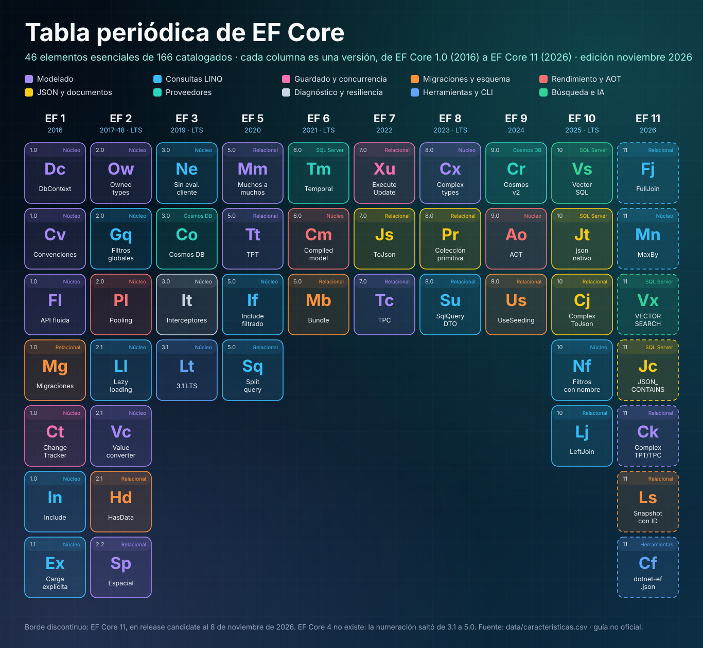

# 22 · Catálogo A–Z de características de EF Core

**166 características con su versión, familia, ámbito y capítulo · edición noviembre 2026**

[⬅ 21 · Guías de decisión](21-guias-de-decision.md) · [🏠 Índice](../README.md) · [23 · Migración entre versiones ➡](23-migracion-entre-versiones.md)

> [!NOTE]
> Este archivo se **genera automáticamente** desde [`data/caracteristicas.csv`](../data/caracteristicas.csv) con
> `python3 tools/generar_atlas.py`. Para corregir o añadir una característica, edita el CSV y ejecuta el script.

## Resumen por versión

| Versión | Año | Características | Núcleo | Relacional | SQL Server | SQLite | Cosmos DB | Herramientas |
|---|---|---:|---:|---:|---:|---:|---:|---:|
| [EF Core 1.0](03-ef-core-1-2-cimientos.md) | 2016 | 22 | 11 | 8 | 2 | 1 | 0 | 0 |
| [EF Core 1.1](03-ef-core-1-2-cimientos.md) | 2016 | 6 | 4 | 1 | 1 | 0 | 0 | 0 |
| [EF Core 2.0](03-ef-core-1-2-cimientos.md) | 2017 | 9 | 5 | 4 | 0 | 0 | 0 | 0 |
| [EF Core 2.1](03-ef-core-1-2-cimientos.md) | 2018 | 8 | 5 | 3 | 0 | 0 | 0 | 0 |
| [EF Core 2.2](03-ef-core-1-2-cimientos.md) | 2018 | 3 | 1 | 2 | 0 | 0 | 0 | 0 |
| [EF Core 3.0](04-ef-core-3-la-gran-ruptura.md) | 2019 | 8 | 6 | 0 | 0 | 0 | 1 | 1 |
| [EF Core 3.1](04-ef-core-3-la-gran-ruptura.md) | 2019 | 1 | 1 | 0 | 0 | 0 | 0 | 0 |
| [EF Core 5.0](05-ef-core-5-relaciones-y-diagnostico.md) | 2020 | 15 | 8 | 7 | 0 | 0 | 0 | 0 |
| [EF Core 6.0](06-ef-core-6-rendimiento-y-temporalidad.md) | 2021 | 9 | 6 | 1 | 2 | 0 | 0 | 0 |
| [EF Core 7.0](07-ef-core-7-json-y-operaciones-masivas.md) | 2022 | 11 | 2 | 8 | 1 | 0 | 0 | 0 |
| [EF Core 8.0](08-ef-core-8-tipos-complejos.md) | 2023 | 10 | 3 | 4 | 2 | 1 | 0 | 0 |
| [EF Core 9.0](09-ef-core-9-cosmos-aot-y-siembra.md) | 2024 | 18 | 4 | 8 | 1 | 0 | 4 | 1 |
| [EF Core 10](10-ef-core-10-lts-vectores-y-json.md) | 2025 | 17 | 3 | 8 | 3 | 1 | 2 | 0 |
| [EF Core 11](11-ef-core-11-rc.md) | 2026 | 29 | 3 | 7 | 9 | 1 | 5 | 4 |
| **Total** | | **166** | **62** | **61** | **21** | **4** | **12** | **6** |

## Resumen por familia

| Familia | Características | Primera | Última |
|---|---:|---|---|
| Modelado | 36 | 1.0 | 11 |
| Consultas LINQ | 34 | 1.0 | 11 |
| Guardado y concurrencia | 10 | 1.0 | 11 |
| Migraciones y esquema | 9 | 1.0 | 11 |
| Rendimiento y AOT | 14 | 1.0 | 11 |
| JSON y documentos | 9 | 7.0 | 11 |
| Proveedores | 24 | 1.0 | 11 |
| Diagnóstico y resiliencia | 12 | 1.1 | 10 |
| Herramientas y CLI | 11 | 1.0 | 11 |
| Búsqueda e IA | 7 | 9.0 | 11 |

**Leyenda.** Estado: 🟢 estable · 🟡 RC *release candidate* (EF Core 11, a la espera de su lanzamiento). Ámbito: **Núcleo** funciona con cualquier proveedor · **Relacional** exige un proveedor relacional · **SQL Server**, **SQLite** y **Cosmos DB** son específicas de ese proveedor · **Herramientas** pertenece a `dotnet ef` o MSBuild.

## Catálogo

### A

| Característica | EF Core | Familia | Ámbito | Estado | Descripción |
|---|---|---|---|---|---|
| AddDbContextFactory | [5.0](05-ef-core-5-relaciones-y-diagnostico.md) | Herramientas y CLI | Núcleo | 🟢 | IDbContextFactory para Blazor y vida corta controlada |
| AddSqlServer y similares | [6.0](06-ef-core-6-rendimiento-y-temporalidad.md) | Herramientas y CLI | Núcleo | 🟢 | Registro en una línea para Minimal APIs: AddSqlServer<TContext>(cadena) |
| Advertencia de cambios pendientes | [9.0](09-ef-core-9-cosmos-aot-y-siembra.md) | Migraciones y esquema | Relacional | 🟢 | PendingModelChangesWarning lanza si el modelo no coincide con la última migración |
| Agrupación de DbContext | [2.0](03-ef-core-1-2-cimientos.md) | Rendimiento y AOT | Núcleo | 🟢 | AddDbContextPool reutiliza instancias y evita el costo de inicialización |
| Analizador de SQL concatenado | [10](10-ef-core-10-lts-vectores-y-json.md) | Diagnóstico y resiliencia | Relacional | 🟢 | Advertencia al concatenar texto dentro de FromSqlRaw y similares |
| Anotaciones de datos | [1.0](03-ef-core-1-2-cimientos.md) | Modelado | Núcleo | 🟢 | [Key], [Required], [MaxLength], [Table]... sobre las propias clases |
| API fluida (ModelBuilder) | [1.0](03-ef-core-1-2-cimientos.md) | Modelado | Núcleo | 🟢 | Configuración del modelo en OnModelCreating con prioridad sobre las anotaciones |
| Archivo dotnet-ef.json | [11](11-ef-core-11-rc.md) | Herramientas y CLI | Herramientas | 🟡 RC | .config/dotnet-ef.json con opciones por defecto para la CLI |
| AsNoTracking | [1.0](03-ef-core-1-2-cimientos.md) | Consultas LINQ | Núcleo | 🟢 | Consultas de solo lectura sin registrar entidades en el change tracker |
| Atributo DeleteBehavior | [8.0](08-ef-core-8-tipos-complejos.md) | Modelado | Relacional | 🟢 | [DeleteBehavior] declara el comportamiento en cascada en la clase |
| Atributo Index | [5.0](05-ef-core-5-relaciones-y-diagnostico.md) | Modelado | Relacional | 🟢 | [Index(nameof(...))] declara índices sobre la clase |
| Atributos Unicode, Precision y EntityTypeConfiguration | [6.0](06-ef-core-6-rendimiento-y-temporalidad.md) | Modelado | Núcleo | 🟢 | Más configuración disponible como atributos |
| AUTOINCREMENT opcional en SQLite | [10](10-ef-core-10-lts-vectores-y-json.md) | Proveedores | SQLite | 🟢 | Se puede desactivar y funciona con conversiones |

### B

| Característica | EF Core | Familia | Ámbito | Estado | Descripción |
|---|---|---|---|---|---|
| Bloqueo de E/S síncrona en Cosmos | [9.0](09-ef-core-9-cosmos-aot-y-siembra.md) | Proveedores | Cosmos DB | 🟢 | ToList y SaveChanges síncronos lanzan excepción con Cosmos |
| Bloqueo de migraciones concurrentes | [9.0](09-ef-core-9-cosmos-aot-y-siembra.md) | Migraciones y esquema | Relacional | 🟢 | Migrate adquiere un bloqueo para que dos instancias no migren a la vez |
| Búsqueda de texto completo en Cosmos | [10](10-ef-core-10-lts-vectores-y-json.md) | Búsqueda e IA | Cosmos DB | 🟢 | FullTextContains / FullTextScore e índices de texto |
| Búsqueda híbrida en Cosmos | [10](10-ef-core-10-lts-vectores-y-json.md) | Búsqueda e IA | Cosmos DB | 🟢 | EF.Functions.Rrf combina texto completo y vectores |
| Búsqueda vectorial en Cosmos (preview) | [9.0](09-ef-core-9-cosmos-aot-y-siembra.md) | Búsqueda e IA | Cosmos DB | 🟢 | VectorDistance e índices vectoriales experimentales |
| Búsqueda vectorial en SQL Server | [10](10-ef-core-10-lts-vectores-y-json.md) | Búsqueda e IA | SQL Server | 🟢 | SqlVector<float> y EF.Functions.VectorDistance sobre el tipo vector |

### C

| Característica | EF Core | Familia | Ámbito | Estado | Descripción |
|---|---|---|---|---|---|
| Campos de respaldo | [1.1](03-ef-core-1-2-cimientos.md) | Modelado | Núcleo | 🟢 | EF lee y escribe campos privados en lugar de propiedades (encapsulación DDD) |
| Carga diferida | [2.1](03-ef-core-1-2-cimientos.md) | Consultas LINQ | Núcleo | 🟢 | Proxies o ILazyLoader cargan una navegación al tocarla por primera vez |
| Carga diferida sin seguimiento | [8.0](08-ef-core-8-tipos-complejos.md) | Consultas LINQ | Núcleo | 🟢 | Lazy loading también en consultas AsNoTracking |
| Carga explícita | [1.1](03-ef-core-1-2-cimientos.md) | Consultas LINQ | Núcleo | 🟢 | Entry(e).Reference(...).Load() y Collection(...).Load() bajo demanda |
| ChangeTracker.Clear | [5.0](05-ef-core-5-relaciones-y-diagnostico.md) | Guardado y concurrencia | Núcleo | 🟢 | Desconecta todas las entidades de golpe |
| Claves alternativas | [1.0](03-ef-core-1-2-cimientos.md) | Modelado | Relacional | 🟢 | HasAlternateKey: restricción UNIQUE que puede ser destino de una FK |
| Claves de partición jerárquicas | [9.0](09-ef-core-9-cosmos-aot-y-siembra.md) | Proveedores | Cosmos DB | 🟢 | Hasta tres niveles de clave de partición en Cosmos DB |
| Claves e índices en tipos complejos | [11](11-ef-core-11-rc.md) | Modelado | Núcleo | 🟡 RC | HasKey(c => c.Id.Value) y HasIndex(c => c.Address.PostalCode) |
| Colaciones | [5.0](05-ef-core-5-relaciones-y-diagnostico.md) | Modelado | Relacional | 🟢 | UseCollation y EF.Functions.Collate |
| Colecciones de tipos propios | [2.2](03-ef-core-1-2-cimientos.md) | Modelado | Núcleo | 🟢 | OwnsMany para colecciones de objetos de valor |
| Colecciones parametrizadas con JSON | [8.0](08-ef-core-8-tipos-complejos.md) | Consultas LINQ | Relacional | 🟢 | ids.Contains(x) como un único parámetro JSON con OPENJSON |
| Colecciones parametrizadas por parámetros múltiples | [10](10-ef-core-10-lts-vectores-y-json.md) | Consultas LINQ | Relacional | 🟢 | IN (@ids1, @ids2...) con relleno; modo configurable |
| Colecciones primitivas | [8.0](08-ef-core-8-tipos-complejos.md) | JSON y documentos | Relacional | 🟢 | List<int>, string[] guardadas como JSON y consultables |
| Colecciones primitivas de solo lectura | [9.0](09-ef-core-9-cosmos-aot-y-siembra.md) | JSON y documentos | Relacional | 🟢 | IReadOnlyList<T> y ReadOnlyCollection<T> mapeadas |
| Columnas dispersas | [6.0](06-ef-core-6-rendimiento-y-temporalidad.md) | Proveedores | SQL Server | 🟢 | IsSparse para columnas SPARSE de SQL Server |
| Columnas JSON | [7.0](07-ef-core-7-json-y-operaciones-masivas.md) | JSON y documentos | Relacional | 🟢 | ToJson sobre tipos propios: un agregado completo en una columna |
| Compatibilidad 160 por defecto | [11](11-ef-core-11-rc.md) | Proveedores | SQL Server | 🟡 RC | UseSqlServer asume SQL Server 2022 (LEAST/GREATEST) |
| Concurrencia optimista | [1.0](03-ef-core-1-2-cimientos.md) | Guardado y concurrencia | Relacional | 🟢 | [ConcurrencyCheck] y [Timestamp]/rowversion con DbUpdateConcurrencyException |
| Configuración encadenada de tipos complejos | [11](11-ef-core-11-rc.md) | Modelado | Núcleo | 🟡 RC | Property(e => e.Details.Description) sin ComplexProperty intermedio |
| Configuración previa a convenciones | [6.0](06-ef-core-6-rendimiento-y-temporalidad.md) | Modelado | Núcleo | 🟢 | ConfigureConventions: reglas por tipo .NET para todo el modelo |
| Constantes ocultas en los registros | [10](10-ef-core-10-lts-vectores-y-json.md) | Diagnóstico y resiliencia | Núcleo | 🟢 | Los valores insertados como constantes se registran como ? |
| Constructores con parámetros | [2.1](03-ef-core-1-2-cimientos.md) | Modelado | Núcleo | 🟢 | EF materializa entidades usando constructores con parámetros |
| Consultas compiladas | [2.0](03-ef-core-1-2-cimientos.md) | Rendimiento y AOT | Núcleo | 🟢 | EF.CompileQuery/CompileAsyncQuery evitan recompilar el árbol de expresión |
| Consultas divididas | [5.0](05-ef-core-5-relaciones-y-diagnostico.md) | Consultas LINQ | Relacional | 🟢 | AsSplitQuery evita la explosión cartesiana con varias colecciones |
| Consultas precompiladas y NativeAOT | [9.0](09-ef-core-9-cosmos-aot-y-siembra.md) | Rendimiento y AOT | Núcleo | 🟢 | Interceptores de C# generan el código de la consulta en compilación (experimental) |
| Contexto comodín en la CLI | [11](11-ef-core-11-rc.md) | Herramientas y CLI | Herramientas | 🟡 RC | --context "*" para list, script, update y drop |
| Convenciones de modelado | [1.0](03-ef-core-1-2-cimientos.md) | Modelado | Núcleo | 🟢 | Claves, relaciones, columnas y nulabilidad descubiertas a partir de las clases |
| Convenciones personalizadas | [7.0](07-ef-core-7-json-y-operaciones-masivas.md) | Modelado | Núcleo | 🟢 | Añadir/quitar convenciones con ConfigureConventions |
| Conversiones de valores | [2.1](03-ef-core-1-2-cimientos.md) | Modelado | Núcleo | 🟢 | HasConversion: enums como texto, IDs fuertemente tipados, cifrado... |
| Cosmos con System.Text.Json | [11](11-ef-core-11-rc.md) | Proveedores | Cosmos DB | 🟡 RC | Adiós a Newtonsoft.Json y a __jObject |

### D

| Característica | EF Core | Familia | Ámbito | Estado | Descripción |
|---|---|---|---|---|---|
| database update --add | [11](11-ef-core-11-rc.md) | Migraciones y esquema | Herramientas | 🟡 RC | Crea, compila con Roslyn y aplica una migración en un paso |
| DateOnly y TimeOnly | [8.0](08-ef-core-8-tipos-complejos.md) | Proveedores | SQL Server | 🟢 | Mapeo nativo a date y time en SQL Server |
| DateTrunc y DateTimeOffset | [11](11-ef-core-11-rc.md) | Proveedores | SQL Server | 🟡 RC | EF.Functions.DateTrunc, ToOffset, UtcDateTime traducidos |
| Datos espaciales | [2.2](03-ef-core-1-2-cimientos.md) | Modelado | Relacional | 🟢 | Geometrías NetTopologySuite traducidas a geography/geometry y PostGIS |
| DbContext y DbSet | [1.0](03-ef-core-1-2-cimientos.md) | Modelado | Núcleo | 🟢 | Unidad de trabajo y repositorio en una sola clase; punto de entrada de todo EF Core |
| DbSet.Find | [1.1](03-ef-core-1-2-cimientos.md) | Consultas LINQ | Núcleo | 🟢 | Busca por clave primero en el change tracker y solo después en la base |
| Disparadores en SQL Server | [7.0](07-ef-core-7-json-y-operaciones-masivas.md) | Proveedores | SQL Server | 🟢 | HasTrigger para que EF evite OUTPUT incompatible con triggers |
| División de entidades | [7.0](07-ef-core-7-json-y-operaciones-masivas.md) | Modelado | Relacional | 🟢 | SplitToTable: una entidad repartida en varias tablas |
| División de tablas | [2.0](03-ef-core-1-2-cimientos.md) | Modelado | Relacional | 🟢 | Varias entidades comparten una misma tabla (table splitting) |
| dotnet-ef como herramienta global | [3.0](04-ef-core-3-la-gran-ruptura.md) | Herramientas y CLI | Herramientas | 🟢 | La CLI sale del SDK y se instala con dotnet tool install |

### E

| Característica | EF Core | Familia | Ámbito | Estado | Descripción |
|---|---|---|---|---|---|
| EF.Functions.Like | [2.0](03-ef-core-1-2-cimientos.md) | Consultas LINQ | Relacional | 🟢 | Primera función de EF.Functions: LIKE traducido literalmente |
| EF.Parameter | [9.0](09-ef-core-9-cosmos-aot-y-siembra.md) | Consultas LINQ | Núcleo | 🟢 | Fuerza que un valor se envíe como parámetro y no como constante |
| Ejecución masiva en Cosmos | [11](11-ef-core-11-rc.md) | Rendimiento y AOT | Cosmos DB | 🟡 RC | BulkExecutionEnabled para alto rendimiento de escritura |
| Eliminación de CAST inútiles | [11](11-ef-core-11-rc.md) | Rendimiento y AOT | Relacional | 🟡 RC | CAST a su propio tipo eliminado para que se usen los índices |
| Entidades sin clave | [3.0](04-ef-core-3-la-gran-ruptura.md) | Modelado | Núcleo | 🟢 | HasNoKey para vistas, funciones y SQL crudo de solo lectura |
| Evaluación mixta cliente/servidor | [1.0](03-ef-core-1-2-cimientos.md) | Consultas LINQ | Núcleo | 🟢 | Lo no traducible se evaluaba en memoria en silencio; eliminado en 3.0 |
| Eventos Tracked y StateChanged | [2.1](03-ef-core-1-2-cimientos.md) | Diagnóstico y resiliencia | Núcleo | 🟢 | ChangeTracker.Tracked y StateChanged para auditoría y lógica de dominio |
| Excepción en consultas divididas inconsistentes | [11](11-ef-core-11-rc.md) | Consultas LINQ | Relacional | 🟡 RC | DbQueryConcurrencyException en lugar de colecciones vacías silenciosas |
| Excluir FK de migraciones | [11](11-ef-core-11-rc.md) | Migraciones y esquema | Relacional | 🟡 RC | ExcludeForeignKeyFromMigrations mantiene la relación sin restricción |
| ExecuteUpdate con lambda normal | [10](10-ef-core-10-lts-vectores-y-json.md) | Guardado y concurrencia | Relacional | 🟢 | Setters condicionales sin construir árboles de expresión |
| ExecuteUpdate sobre JSON | [10](10-ef-core-10-lts-vectores-y-json.md) | JSON y documentos | Relacional | 🟢 | Actualización masiva de propiedades dentro de columnas JSON |
| ExecuteUpdate y ExecuteDelete | [7.0](07-ef-core-7-json-y-operaciones-masivas.md) | Guardado y concurrencia | Relacional | 🟢 | UPDATE y DELETE masivos traducidos desde LINQ sin cargar entidades |

### F

| Característica | EF Core | Familia | Ámbito | Estado | Descripción |
|---|---|---|---|---|---|
| Fábrica de contextos agrupados | [6.0](06-ef-core-6-rendimiento-y-temporalidad.md) | Rendimiento y AOT | Núcleo | 🟢 | AddPooledDbContextFactory combina fábrica y pooling |
| Factor de relleno | [9.0](09-ef-core-9-cosmos-aot-y-siembra.md) | Proveedores | SQL Server | 🟢 | HasFillFactor en claves e índices de SQL Server |
| Filtros de consulta con nombre | [10](10-ef-core-10-lts-vectores-y-json.md) | Consultas LINQ | Núcleo | 🟢 | Varios HasQueryFilter por entidad e IgnoreQueryFilters selectivo |
| Filtros de consulta globales | [2.0](03-ef-core-1-2-cimientos.md) | Consultas LINQ | Núcleo | 🟢 | HasQueryFilter: borrado lógico y multitenencia aplicados a todas las consultas |
| Fin de la evaluación implícita en cliente | [3.0](04-ef-core-3-la-gran-ruptura.md) | Consultas LINQ | Núcleo | 🟢 | Lo que no se traduce lanza excepción en lugar de ejecutarse en memoria |
| Flujos asíncronos | [3.0](04-ef-core-3-la-gran-ruptura.md) | Consultas LINQ | Núcleo | 🟢 | AsAsyncEnumerable y await foreach sobre resultados |
| FreeTextTable y ContainsTable | [11](11-ef-core-11-rc.md) | Búsqueda e IA | SQL Server | 🟡 RC | Funciones de tabla con puntuación de relevancia |
| FromSql (SQL crudo) | [1.0](03-ef-core-1-2-cimientos.md) | Consultas LINQ | Relacional | 🟢 | Consultas SQL propias materializadas como entidades y componibles con LINQ |
| FullJoin | [11](11-ef-core-11-rc.md) | Consultas LINQ | Relacional | 🟡 RC | Operador de .NET 11 traducido a FULL JOIN |
| Funciones con valores de tabla | [5.0](05-ef-core-5-relaciones-y-diagnostico.md) | Consultas LINQ | Relacional | 🟢 | TVF mapeadas y componibles con LINQ |
| Funciones escalares mapeadas | [2.0](03-ef-core-1-2-cimientos.md) | Consultas LINQ | Relacional | 🟢 | HasDbFunction: un método .NET se traduce a una función de la base |

### G

| Característica | EF Core | Familia | Ámbito | Estado | Descripción |
|---|---|---|---|---|---|
| GREATEST y LEAST | [9.0](09-ef-core-9-cosmos-aot-y-siembra.md) | Consultas LINQ | Relacional | 🟢 | Math.Max/Min traducidos a funciones del servidor |
| group_concat ordenado en SQLite | [11](11-ef-core-11-rc.md) | Proveedores | SQLite | 🟡 RC | string.Join con OrderBy dentro del agregado |
| GroupBy traducido a SQL | [2.1](03-ef-core-1-2-cimientos.md) | Consultas LINQ | Relacional | 🟢 | GroupBy con agregados traducido a GROUP BY en el servidor |

### H

| Característica | EF Core | Familia | Ámbito | Estado | Descripción |
|---|---|---|---|---|---|
| Herencia TPC | [7.0](07-ef-core-7-json-y-operaciones-masivas.md) | Modelado | Relacional | 🟢 | Tabla por tipo concreto sin tabla base |
| Herencia TPH | [1.0](03-ef-core-1-2-cimientos.md) | Modelado | Relacional | 🟢 | Tabla por jerarquía con columna discriminadora; estrategia por defecto |
| Herencia TPT | [5.0](05-ef-core-5-relaciones-y-diagnostico.md) | Modelado | Relacional | 🟢 | Tabla por tipo con JOIN entre tabla base y tablas derivadas |
| HierarchyId | [8.0](08-ef-core-8-tipos-complejos.md) | Proveedores | SQL Server | 🟢 | Tipo hierarchyid de SQL Server para árboles |

### I

| Característica | EF Core | Familia | Ámbito | Estado | Descripción |
|---|---|---|---|---|---|
| IEntityTypeConfiguration | [2.0](03-ef-core-1-2-cimientos.md) | Modelado | Núcleo | 🟢 | Configuración por entidad en clases separadas y ApplyConfigurationsFromAssembly |
| Include filtrado | [5.0](05-ef-core-5-relaciones-y-diagnostico.md) | Consultas LINQ | Núcleo | 🟢 | Include(b => b.Posts.Where(...).OrderBy(...).Take(n)) |
| Include y ThenInclude | [1.0](03-ef-core-1-2-cimientos.md) | Consultas LINQ | Núcleo | 🟢 | Carga ansiosa de navegaciones con JOIN |
| Índices JSON | [11](11-ef-core-11-rc.md) | JSON y documentos | SQL Server | 🟡 RC | CREATE JSON INDEX sobre rutas dentro de tipos complejos |
| Ingeniería inversa (scaffold) | [1.0](03-ef-core-1-2-cimientos.md) | Herramientas y CLI | Relacional | 🟢 | dotnet ef dbcontext scaffold genera contexto y entidades desde una base existente |
| Integración con MSBuild | [9.0](09-ef-core-9-cosmos-aot-y-siembra.md) | Herramientas y CLI | Herramientas | 🟢 | EFOptimizeContext genera modelo y consultas al compilar o publicar |
| Interceptores | [3.0](04-ef-core-3-la-gran-ruptura.md) | Diagnóstico y resiliencia | Núcleo | 🟢 | DbCommandInterceptor, DbConnectionInterceptor y DbTransactionInterceptor |
| Interceptores de materialización | [7.0](07-ef-core-7-json-y-operaciones-masivas.md) | Diagnóstico y resiliencia | Núcleo | 🟢 | IMaterializationInterceptor e IQueryExpressionInterceptor |
| Interceptores de SaveChanges | [5.0](05-ef-core-5-relaciones-y-diagnostico.md) | Diagnóstico y resiliencia | Núcleo | 🟢 | ISaveChangesInterceptor para auditoría y lógica transversal |
| Interpolación segura en FromSql | [2.0](03-ef-core-1-2-cimientos.md) | Consultas LINQ | Relacional | 🟢 | FromSql($"...{x}") convierte cada hueco en un DbParameter |
| Inyección de dependencias | [1.0](03-ef-core-1-2-cimientos.md) | Herramientas y CLI | Núcleo | 🟢 | AddDbContext registra el contexto con vida Scoped en el contenedor de .NET |

### J

| Característica | EF Core | Familia | Ámbito | Estado | Descripción |
|---|---|---|---|---|---|
| JSON en SQLite | [8.0](08-ef-core-8-tipos-complejos.md) | JSON y documentos | SQLite | 🟢 | Columnas JSON y colecciones primitivas sobre json_each |
| JSON_CONTAINS y JsonPathExists | [11](11-ef-core-11-rc.md) | JSON y documentos | SQL Server | 🟡 RC | Contains sobre colecciones JSON y funciones JSON de SQL Server 2025 |

### L

| Característica | EF Core | Familia | Ámbito | Estado | Descripción |
|---|---|---|---|---|---|
| LeftJoin y RightJoin | [10](10-ef-core-10-lts-vectores-y-json.md) | Consultas LINQ | Relacional | 🟢 | Operadores de .NET 10 traducidos a LEFT JOIN y RIGHT JOIN |
| LogTo | [5.0](05-ef-core-5-relaciones-y-diagnostico.md) | Diagnóstico y resiliencia | Núcleo | 🟢 | Registro simple a consola o a cualquier Action<string> |
| Lotes transaccionales en Cosmos | [11](11-ef-core-11-rc.md) | Guardado y concurrencia | Cosmos DB | 🟡 RC | SaveChanges agrupa por partición en lotes atómicos |
| LTS con .NET Standard 2.0 | [3.1](04-ef-core-3-la-gran-ruptura.md) | Herramientas y CLI | Núcleo | 🟢 | EF Core 3.1 vuelve a .NET Standard 2.0 y es la primera versión LTS |

### M

| Característica | EF Core | Familia | Ámbito | Estado | Descripción |
|---|---|---|---|---|---|
| MaxBy y MinBy | [11](11-ef-core-11-rc.md) | Consultas LINQ | Núcleo | 🟡 RC | Devuelven el elemento con el valor máximo o mínimo de una clave |
| Mejoras de rendimiento TechEmpower | [6.0](06-ef-core-6-rendimiento-y-temporalidad.md) | Rendimiento y AOT | Núcleo | 🟢 | Consultas hasta un 70 % más rápidas en el benchmark Fortunes |
| Migraciones con código | [1.0](03-ef-core-1-2-cimientos.md) | Migraciones y esquema | Relacional | 🟢 | Up/Down en C# generados al comparar el modelo con la instantánea |
| migrations remove --offline | [11](11-ef-core-11-rc.md) | Herramientas y CLI | Herramientas | 🟡 RC | Quitar una migración sin conectarse a la base |
| Modelos compilados | [6.0](06-ef-core-6-rendimiento-y-temporalidad.md) | Rendimiento y AOT | Núcleo | 🟢 | dotnet ef dbcontext optimize genera el modelo en código y reduce el arranque |
| Modelos compilados automáticos | [9.0](09-ef-core-9-cosmos-aot-y-siembra.md) | Rendimiento y AOT | Núcleo | 🟢 | Si existe el modelo compilado se usa sin UseModel |
| Muchos a muchos sin entidad de unión | [5.0](05-ef-core-5-relaciones-y-diagnostico.md) | Modelado | Relacional | 🟢 | Navegaciones de colección en ambos lados y tabla de unión implícita |

### N

| Característica | EF Core | Familia | Ámbito | Estado | Descripción |
|---|---|---|---|---|---|
| Nombres de parámetros simplificados | [10](10-ef-core-10-lts-vectores-y-json.md) | Diagnóstico y resiliencia | Relacional | 🟢 | @city en lugar de @__city_0 |
| NoTrackingWithIdentityResolution | [5.0](05-ef-core-5-relaciones-y-diagnostico.md) | Consultas LINQ | Núcleo | 🟢 | Sin seguimiento pero con una sola instancia por clave |
| Nueva canalización LINQ | [3.0](04-ef-core-3-la-gran-ruptura.md) | Consultas LINQ | Núcleo | 🟢 | Una consulta LINQ produce exactamente una sentencia SQL |

### O

| Característica | EF Core | Familia | Ámbito | Estado | Descripción |
|---|---|---|---|---|---|
| Orden coherente en consultas divididas | [10](10-ef-core-10-lts-vectores-y-json.md) | Consultas LINQ | Relacional | 🟢 | Las subconsultas de split query repiten el ORDER BY completo |
| Order y OrderDescending | [9.0](09-ef-core-9-cosmos-aot-y-siembra.md) | Consultas LINQ | Núcleo | 🟢 | Traducción de los operadores de .NET 7 |

### P

| Característica | EF Core | Familia | Ámbito | Estado | Descripción |
|---|---|---|---|---|---|
| Paquetes de migración | [6.0](06-ef-core-6-rendimiento-y-temporalidad.md) | Migraciones y esquema | Relacional | 🟢 | dotnet ef migrations bundle: ejecutable autónomo para CI/CD |
| Periodos temporales como propiedades CLR | [11](11-ef-core-11-rc.md) | Proveedores | SQL Server | 🟡 RC | PeriodStart y PeriodEnd como propiedades normales |
| Plantillas T4 para scaffolding | [7.0](07-ef-core-7-json-y-operaciones-masivas.md) | Herramientas y CLI | Relacional | 🟢 | dotnet new ef-templates personaliza el código generado |
| Poda de tablas y proyecciones | [9.0](09-ef-core-9-cosmos-aot-y-siembra.md) | Rendimiento y AOT | Relacional | 🟢 | El SQL generado omite JOIN y columnas innecesarias |
| Procedimientos almacenados para CUD | [7.0](07-ef-core-7-json-y-operaciones-masivas.md) | Guardado y concurrencia | Relacional | 🟢 | InsertUsingStoredProcedure / Update... / Delete... |
| Propiedades de sombra | [1.0](03-ef-core-1-2-cimientos.md) | Modelado | Núcleo | 🟢 | Propiedades que existen en el modelo y en la tabla pero no en la clase .NET |
| Proveedor Azure Cosmos DB | [3.0](04-ef-core-3-la-gran-ruptura.md) | Proveedores | Cosmos DB | 🟢 | Primer proveedor NoSQL oficial: documentos JSON con particiones |
| Proveedor Cosmos reescrito | [9.0](09-ef-core-9-cosmos-aot-y-siembra.md) | Proveedores | Cosmos DB | 🟢 | Consultas por partición, ReadItem automático y LINQ mucho más completo |
| Proveedor InMemory | [1.0](03-ef-core-1-2-cimientos.md) | Proveedores | Núcleo | 🟢 | Base de datos en memoria para pruebas; no es relacional y hoy se desaconseja |
| Proveedor SQL Server | [1.0](03-ef-core-1-2-cimientos.md) | Proveedores | SQL Server | 🟢 | Microsoft.EntityFrameworkCore.SqlServer sobre Microsoft.Data.SqlClient |
| Proveedor SQLite | [1.0](03-ef-core-1-2-cimientos.md) | Proveedores | SQLite | 🟢 | Microsoft.EntityFrameworkCore.Sqlite sobre Microsoft.Data.Sqlite |

### R

| Característica | EF Core | Familia | Ámbito | Estado | Descripción |
|---|---|---|---|---|---|
| Reload y GetDatabaseValues | [1.1](03-ef-core-1-2-cimientos.md) | Guardado y concurrencia | Núcleo | 🟢 | Releer una entidad o sus valores originales desde la base |
| Resiliencia de conexión | [1.1](03-ef-core-1-2-cimientos.md) | Diagnóstico y resiliencia | Relacional | 🟢 | EnableRetryOnFailure y estrategias de ejecución para errores transitorios |
| Restricciones por defecto con nombre | [10](10-ef-core-10-lts-vectores-y-json.md) | Proveedores | SQL Server | 🟢 | HasDefaultValueSql(sql nombre) y UseNamedDefaultConstraints |

### S

| Característica | EF Core | Familia | Ámbito | Estado | Descripción |
|---|---|---|---|---|---|
| SaveChanges más eficiente | [7.0](07-ef-core-7-json-y-operaciones-masivas.md) | Rendimiento y AOT | Relacional | 🟢 | Menos viajes y sin transacción para una sola sentencia |
| SaveChanges por lotes | [1.0](03-ef-core-1-2-cimientos.md) | Rendimiento y AOT | Relacional | 🟢 | Varias sentencias INSERT/UPDATE/DELETE en un solo viaje a la base de datos |
| Secuencias y HiLo | [1.0](03-ef-core-1-2-cimientos.md) | Proveedores | SQL Server | 🟢 | HasSequence y UseHiLo para generar claves en bloque desde una secuencia |
| Seguimiento de cambios | [1.0](03-ef-core-1-2-cimientos.md) | Guardado y concurrencia | Núcleo | 🟢 | ChangeTracker con estados Added/Modified/Deleted/Unchanged/Detached |
| Semántica C# en comparaciones anulables | [9.0](09-ef-core-9-cosmos-aot-y-siembra.md) | Consultas LINQ | Relacional | 🟢 | a != b con NULL se comporta como en C# |
| Siembra con HasData | [2.1](03-ef-core-1-2-cimientos.md) | Migraciones y esquema | Relacional | 🟢 | Datos de referencia que viajan con las migraciones |
| SQL más limpio para navegaciones a uno | [11](11-ef-core-11-rc.md) | Rendimiento y AOT | Relacional | 🟡 RC | Sin JOIN innecesarios en split queries ni claves redundantes en ORDER BY |
| SqlQuery con tipos no mapeados | [8.0](08-ef-core-8-tipos-complejos.md) | Consultas LINQ | Relacional | 🟢 | Database.SqlQuery<T> materializa DTO que no están en el modelo |
| SqlQuery de escalares | [7.0](07-ef-core-7-json-y-operaciones-masivas.md) | Consultas LINQ | Relacional | 🟢 | Database.SqlQuery<int>($"...") devuelve tipos primitivos |
| System.Transactions | [2.1](03-ef-core-1-2-cimientos.md) | Guardado y concurrencia | Relacional | 🟢 | TransactionScope y transacciones ambientales con los proveedores que las soportan |

### T

| Característica | EF Core | Familia | Ámbito | Estado | Descripción |
|---|---|---|---|---|---|
| Tablas optimizadas en memoria | [1.1](03-ef-core-1-2-cimientos.md) | Proveedores | SQL Server | 🟢 | IsMemoryOptimized para tablas In-Memory OLTP de SQL Server |
| Tablas temporales | [6.0](06-ef-core-6-rendimiento-y-temporalidad.md) | Proveedores | SQL Server | 🟢 | IsTemporal y TemporalAsOf/All/Between para historial de SQL Server |
| TagWith | [2.2](03-ef-core-1-2-cimientos.md) | Diagnóstico y resiliencia | Relacional | 🟢 | Comentarios en el SQL generado para rastrear su origen en el código |
| Texto completo en migraciones | [11](11-ef-core-11-rc.md) | Búsqueda e IA | SQL Server | 🟡 RC | HasFullTextCatalog y HasFullTextIndex gestionados por migraciones |
| Tipo json de SQL Server 2025 | [10](10-ef-core-10-lts-vectores-y-json.md) | JSON y documentos | SQL Server | 🟢 | Columnas json nativas con UseAzureSql o nivel de compatibilidad 170 |
| Tipos complejos | [8.0](08-ef-core-8-tipos-complejos.md) | Modelado | Núcleo | 🟢 | ComplexProperty: objetos de valor con semántica de valor y sin identidad |
| Tipos complejos con TPT y TPC | [11](11-ef-core-11-rc.md) | Modelado | Relacional | 🟡 RC | Tipos complejos y columnas JSON en jerarquías TPT/TPC |
| Tipos complejos en Cosmos | [11](11-ef-core-11-rc.md) | Proveedores | Cosmos DB | 🟡 RC | Objetos y arreglos anidados con semántica de valor |
| Tipos complejos en GroupBy y ExecuteUpdate | [9.0](09-ef-core-9-cosmos-aot-y-siembra.md) | Modelado | Relacional | 🟢 | Los tipos complejos participan en agrupación y actualización masiva |
| Tipos complejos en JSON | [10](10-ef-core-10-lts-vectores-y-json.md) | JSON y documentos | Relacional | 🟢 | ComplexProperty(...).ToJson() y ComplexCollection reemplazan a OwnsOne/OwnsMany con ToJson |
| Tipos complejos opcionales y struct | [10](10-ef-core-10-lts-vectores-y-json.md) | Modelado | Núcleo | 🟢 | Address? y struct como tipos complejos |
| Tipos de consulta | [2.1](03-ef-core-1-2-cimientos.md) | Modelado | Núcleo | 🟢 | Query types para vistas y resultados sin clave; desde 3.0 son entidades sin clave |
| Tipos de entidad compartidos | [5.0](05-ef-core-5-relaciones-y-diagnostico.md) | Modelado | Núcleo | 🟢 | Property bags: Dictionary<string, object> como entidad |
| Tipos de referencia anulables | [3.0](04-ef-core-3-la-gran-ruptura.md) | Modelado | Núcleo | 🟢 | string? y string determinan si la columna admite NULL |
| Tipos propios | [2.0](03-ef-core-1-2-cimientos.md) | Modelado | Núcleo | 🟢 | OwnsOne: tipos sin identidad propia guardados en la tabla del dueño |
| Tokens de sesión en Cosmos | [11](11-ef-core-11-rc.md) | Proveedores | Cosmos DB | 🟡 RC | GetSessionToken/UseSessionToken para lectura de las propias escrituras |
| ToQueryString | [5.0](05-ef-core-5-relaciones-y-diagnostico.md) | Diagnóstico y resiliencia | Relacional | 🟢 | Obtiene el SQL de un IQueryable sin ejecutarlo |
| Transacciones explícitas | [1.0](03-ef-core-1-2-cimientos.md) | Guardado y concurrencia | Relacional | 🟢 | BeginTransaction/Commit/Rollback sobre la conexión del contexto |

### U

| Característica | EF Core | Familia | Ámbito | Estado | Descripción |
|---|---|---|---|---|---|
| Última migración en la instantánea | [11](11-ef-core-11-rc.md) | Migraciones y esquema | Relacional | 🟡 RC | El snapshot registra el ID para provocar conflictos de fusión útiles |
| UseSeeding y UseAsyncSeeding | [9.0](09-ef-core-9-cosmos-aot-y-siembra.md) | Migraciones y esquema | Relacional | 🟢 | Siembra con lógica arbitraria ejecutada por EnsureCreated y Migrate |

### V

| Característica | EF Core | Familia | Ámbito | Estado | Descripción |
|---|---|---|---|---|---|
| Valores centinela | [8.0](08-ef-core-8-tipos-complejos.md) | Modelado | Núcleo | 🟢 | HasSentinel: qué valor CLR significa no establecido |
| VECTOR_SEARCH e índices vectoriales | [11](11-ef-core-11-rc.md) | Búsqueda e IA | SQL Server | 🟡 RC | HasVectorIndex y VectorSearch().WithApproximate() para ANN |
| Vectores no cargados por defecto | [11](11-ef-core-11-rc.md) | Rendimiento y AOT | SQL Server | 🟡 RC | Las columnas SqlVector se omiten del SELECT de entidades |
| Vistas de depuración | [5.0](05-ef-core-5-relaciones-y-diagnostico.md) | Diagnóstico y resiliencia | Núcleo | 🟢 | ChangeTracker.DebugView y Model.DebugView para inspeccionar el estado |
