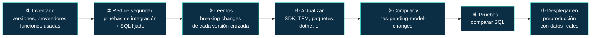
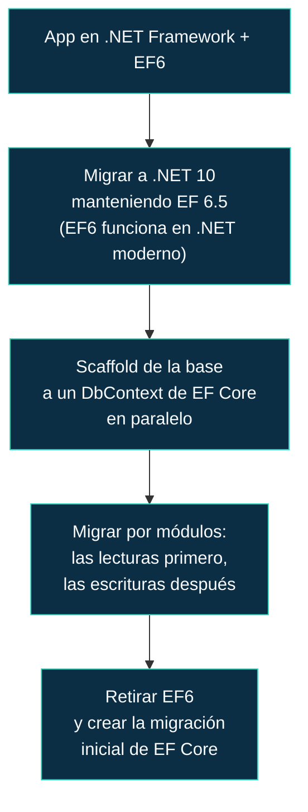
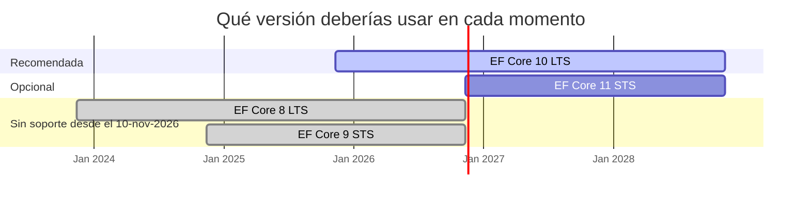

<div align="center">

# 23 · Migración entre versiones

**Cómo actualizar EF Core sin sustos: método, rutas versión a versión, de EF6 a EF Core, tabla maestra de cambios incompatibles y calendario**

[⬅ 22 · Catálogo A–Z](22-catalogo-a-z.md) · [🏠 Índice](../README.md) · [24 · Referencia rápida y glosario ➡](24-referencia-rapida-y-glosario.md)

</div>

<!-- ef=10 -->

> [!WARNING]
> **El 10 de noviembre de 2026 terminan EF Core 8 y EF Core 9**, junto con .NET 8 y .NET 9. Si estás en cualquiera de las dos, la [sección 2](#2-de-ef-core-8-o-9-a-ef-core-10)
> es tu prioridad de esta semana.

---

## Contenido

1. [El método](#1-el-método)
2. [De EF Core 8 o 9 a EF Core 10](#2-de-ef-core-8-o-9-a-ef-core-10)
3. [De EF Core 2.x a 3.1](#3-de-ef-core-2x-a-31)
4. [De EF Core 3.1 a 6](#4-de-ef-core-31-a-6)
5. [De EF Core 6 o 7 a 8](#5-de-ef-core-6-o-7-a-8)
6. [De EF Core 10 a 11](#6-de-ef-core-10-a-11)
7. [De EF6 a EF Core](#7-de-ef6-a-ef-core)
8. [Tabla maestra de cambios incompatibles](#8-tabla-maestra-de-cambios-incompatibles)
9. [Calendario](#9-calendario)
10. [Referencias](#10-referencias)

---

## 1. El método



| Regla | Por qué |
|---|---|
| **Se puede saltar versiones**, pero hay que leer los cambios incompatibles de **todas** las intermedias | De 6 a 10 cruzas los cambios de 7, 8, 9 y 10 |
| Actualiza **todos** los paquetes de EF y el proveedor a la misma versión mayor | Mezclar mayores no está soportado |
| Actualiza `dotnet-ef` a la misma versión | La CLI carga el paquete `Design` del proyecto |
| Fija el SQL de las consultas críticas **antes** de actualizar | Los cambios de traducción no dan errores de compilación ([capítulo 18](18-pruebas.md#6-probar-el-sql-generado)) |
| Genera una migración vacía tras actualizar | Si no sale vacía, la nueva versión interpreta tu modelo de otra forma: revísala |
| Despliega primero en un entorno con **datos reales** | Los cambios de semántica (nulos, conversión, JSON) aparecen con datos reales |

---

## 2. De EF Core 8 o 9 a EF Core 10

### Paso a paso

```bash
# 1. SDK y destino
dotnet --list-sdks                                     # 10.0.1xx o posterior
# <TargetFramework>net10.0</TargetFramework>

# 2. Paquetes (con Central Package Management: una línea)
dotnet add package Microsoft.EntityFrameworkCore.SqlServer --version 10.0.14
dotnet add package Microsoft.EntityFrameworkCore.Design   --version 10.0.14
dotnet tool update dotnet-ef --version 10.0.14

# 3. ¿El modelo se interpreta igual?
dotnet build
dotnet ef migrations has-pending-model-changes
dotnet ef migrations add ActualizacionEfCore10          # revisar; si está vacía, se puede quitar
```

### Lista de comprobación

| # | Comprobación | Si estás en 8 | Si estás en 9 |
|---|---|---|---|
| 1 | **`PendingModelChangesWarning`** al migrar: añadir la migración que falta o fijar `HasData` no deterministas | ✅ te afecta (llega en 9) | Ya resuelto |
| 2 | **Columnas JSON → tipo `json`** si usas `UseAzureSql` o compatibilidad 170: revisar la migración | ✅ | ✅ |
| 3 | `Contains` con listas: de `OPENJSON` a `IN (@p1, @p2…)`. Revisar planes de consultas críticas | ✅ | ✅ |
| 4 | Código que construía `Expression<Func<SetPropertyCalls…>>` para `ExecuteUpdate`: reescribir con lambda | ✅ | ✅ |
| 5 | Cosmos: E/S síncrona prohibida, `id` sin discriminador, `$type` | ✅ (cambios de 9) | Ya resuelto |
| 6 | `Migrate()` sin transacción única (revertido) | — | Revisar si dependías de ello |
| 7 | Proyectos multidestino: `--framework` en `dotnet ef` | ✅ | ✅ |
| 8 | Advertencias EF1002 de SQL concatenado | ✅ | ✅ |
| 9 | Proveedor de terceros con versión 10 disponible (Npgsql 10.0.x, Oracle 10.23.x; **Pomelo no**) | ✅ | ✅ |
| 10 | Valorar migrar tipos propios `ToJson` → tipos complejos `ToJson` (opcional, sin cambiar el esquema) | Opcional | Opcional |

> [!TIP]
> Desde EF Core 8, una escala intermedia en 9 **no aporta nada**: ambas caducan el mismo día. Ve directamente de 8 a 10 y aplica la lista completa.

---

## 3. De EF Core 2.x a 3.1

EF Core 3.0 fue **la gran ruptura** ([capítulo 04](04-ef-core-3-la-gran-ruptura.md)): una canalización LINQ reescrita. Es el salto más costoso de la
historia del producto, y todavía hay aplicaciones atrapadas en 2.x.

| # | Cambio | Qué hacer |
|---|---|---|
| 1 | **Fin de la evaluación implícita en cliente** | Ejecutar todas las consultas en pruebas; cada `InvalidOperationException: could not be translated` es un punto a reescribir o a marcar con `AsEnumerable()` consciente |
| 2 | `dotnet ef` deja de venir con el SDK | `dotnet tool install dotnet-ef` |
| 3 | `FromSql` / `ExecuteSqlCommand` divididos | `FromSqlRaw`/`FromSqlInterpolated`, `ExecuteSqlRaw`/`ExecuteSqlInterpolated` |
| 4 | `DbQuery<T>` obsoleto | `DbSet<T>` + `HasNoKey()` |
| 5 | `Include` en una sola consulta | Vigilar la explosión cartesiana; `AsSplitQuery()` llegó en 5.0 |
| 6 | Cascada inmediata (`CascadeTiming.Immediate`) | Revisar código que borraba y volvía a añadir |
| 7 | EF Core 3.0 solo en .NET Core; **3.1 vuelve a .NET Framework** | Si vienes de .NET Framework, ve a 3.1, no a 3.0 |

> [!IMPORTANT]
> **No te quedes en 3.1**: lleva sin soporte desde diciembre de 2022. Usa 3.1 como escala para estabilizar las consultas, y continúa hasta 10.

---

## 4. De EF Core 3.1 a 6

| Versión cruzada | Cambio principal | Capítulo |
|---|---|---|
| 5.0 | `netstandard2.1`: **adiós a .NET Framework** definitivo | [05](05-ef-core-5-relaciones-y-diagnostico.md) |
| 5.0 | Muchos a muchos implícito: puedes eliminar entidades de unión triviales (opcional) | [05](05-ef-core-5-relaciones-y-diagnostico.md) |
| 5.0 | Semántica de `Required` en navegaciones de dependientes | [05](05-ef-core-5-relaciones-y-diagnostico.md) |
| 6.0 | Dependientes opcionales en tablas compartidas sin propiedades obligatorias: no admitidos | [06](06-ef-core-6-rendimiento-y-temporalidad.md) |
| 6.0 | Cosmos: colecciones propias dentro del documento padre | [06](06-ef-core-6-rendimiento-y-temporalidad.md) |
| 6.0 | Destino `net6.0` | — |

---

## 5. De EF Core 6 o 7 a 8

| Versión cruzada | Cambio principal | Impacto | Capítulo |
|---|---|---|---|
| 7.0 | **`Encrypt=True` por defecto** (Microsoft.Data.SqlClient 4) | 🔴 Las conexiones sin certificado válido fallan | [07](07-ef-core-7-json-y-operaciones-masivas.md) |
| 7.0 | **Tablas con disparadores** fallan por `OUTPUT` | 🔴 `HasTrigger("nombre")` | [07](07-ef-core-7-json-y-operaciones-masivas.md) |
| 7.0 | Huérfanos de relaciones opcionales no se borran | 🟠 | [07](07-ef-core-7-json-y-operaciones-masivas.md) |
| 8.0 | **`Contains` con `OPENJSON`**: falla en SQL Server < 2016 o compatibilidad < 130 | 🔴 `UseCompatibilityLevel(120)` | [08](08-ef-core-8-tipos-complejos.md) |
| 8.0 | Enums dentro de JSON como enteros | 🟠 | [08](08-ef-core-8-tipos-complejos.md) |
| 8.0 | `DateOnly`/`TimeOnly` nativos en SQL Server | 🟡 | [08](08-ef-core-8-tipos-complejos.md) |

> [!NOTE]
> Hoy no tiene sentido detenerse en 8: si estás en 6 o 7, aplica esta tabla **y** la de la [sección 2](#2-de-ef-core-8-o-9-a-ef-core-10), y aterriza en 10.

---

## 6. De EF Core 10 a 11

| # | Comprobación | Capítulo |
|---|---|---|
| 1 | SDK de .NET 11 y `net11.0` | [11](11-ef-core-11-rc.md#2-cómo-probar-ef-core-11-hoy) |
| 2 | **Nivel de compatibilidad 160 por defecto**: declara el tuyo si usas SQL Server 2019 o anterior | [11](11-ef-core-11-rc.md#6-sql-server-y-azure-sql) |
| 3 | Cosmos con `System.Text.Json`: revisar convertidores de Newtonsoft y documentos existentes | [11](11-ef-core-11-rc.md#7-azure-cosmos-db) |
| 4 | `EFOptimizeContext` eliminado: `EFScaffoldModelStage` / `EFPrecompileQueriesStage` | [11](11-ef-core-11-rc.md#9-cambios-incompatibles) |
| 5 | Regenerar la instantánea (ahora incluye el ID de la última migración) | [11](11-ef-core-11-rc.md#8-migraciones-y-herramientas) |
| 6 | Consultas divididas: tratar `DbQueryConcurrencyException` | [11](11-ef-core-11-rc.md#4-un-sql-más-limpio) |
| 7 | Proveedores de terceros con versión 11 | [16](16-proveedores.md) |

---

## 7. De EF6 a EF Core

Pasar de EF6 a EF Core **no es una actualización, es un cambio de producto**. No hay herramienta automática; el trabajo depende de cuánto uses las
partes de EF6 que no existen en EF Core.

| Área | EF6 | EF Core | Esfuerzo |
|---|---|---|---|
| Plataforma | .NET Framework (o .NET con 6.4+) | .NET moderno | 🔴 si la app sigue en .NET Framework |
| **EDMX / diseñador** | Modelo en XML | Solo código: `dbcontext scaffold` desde la base | 🔴 |
| `ObjectContext`, Entity SQL | ✅ | ❌ | 🔴 |
| `DbContext` / `DbSet` / LINQ | ✅ | ✅ (casi igual) | 🟢 |
| Configuración | `DbModelBuilder`, `EntityTypeConfiguration<T>` | `ModelBuilder`, `IEntityTypeConfiguration<T>` | 🟠 sintaxis distinta |
| Carga diferida | Por defecto con `virtual` | Opcional (`UseLazyLoadingProxies()`) | 🟠 detectar N+1 |
| Evaluación en cliente | Excepción | Excepción (desde 3.0) | 🟢 |
| Migraciones | Historial propio (`__MigrationHistory`) | Incompatible: **empezar de cero** | 🟠 |
| Muchos a muchos | ✅ | ✅ (5.0+) | 🟢 |
| TPH / TPT / TPC | ✅ | ✅ (TPT 5.0, TPC 7.0) | 🟢 |
| Tipos complejos | ✅ | ✅ (8.0+) | 🟢 |
| Procedimientos para CUD | ✅ | ✅ (7.0+) | 🟢 |
| `Database.SqlQuery<T>` | ✅ | ✅ (7.0/8.0+) | 🟢 |
| Interceptores (`IDbCommandInterceptor`) | ✅ | ✅ (otra interfaz) | 🟠 |
| Datos espaciales | `DbGeography` | NetTopologySuite | 🟠 |

### Estrategia recomendada



> [!TIP]
> **EF6 y EF Core pueden convivir en el mismo proceso** (espacios de nombres distintos: `System.Data.Entity` frente a `Microsoft.EntityFrameworkCore`).
> Eso permite una migración gradual, módulo a módulo, en lugar de un "big bang".

---

## 8. Tabla maestra de cambios incompatibles

Los cambios de **mayor impacto** de cada versión; la lista completa está en el capítulo correspondiente.

| Versión | Cambio | Impacto | Síntoma | Capítulo |
|---|---|---|---|---|
| 3.0 | Sin evaluación en cliente | 🔴 | `could not be translated` | [04](04-ef-core-3-la-gran-ruptura.md) |
| 3.0 | `dotnet ef` como herramienta aparte | 🟠 | `dotnet ef` no se encuentra | [04](04-ef-core-3-la-gran-ruptura.md) |
| 3.0 | `FromSql` dividido | 🟠 | Error de compilación | [04](04-ef-core-3-la-gran-ruptura.md) |
| 5.0 | Solo `netstandard2.1` | 🔴 | No instala en .NET Framework | [05](05-ef-core-5-relaciones-y-diagnostico.md) |
| 6.0 | Dependientes opcionales en tablas compartidas | 🔴 | Excepción al construir el modelo | [06](06-ef-core-6-rendimiento-y-temporalidad.md) |
| 7.0 | `Encrypt=True` | 🔴 | Error de certificado TLS | [07](07-ef-core-7-json-y-operaciones-masivas.md) |
| 7.0 | Disparadores y `OUTPUT` | 🔴 | Error de SQL Server 334 | [07](07-ef-core-7-json-y-operaciones-masivas.md) |
| 8.0 | `Contains` con `OPENJSON` | 🔴 | Error de sintaxis en SQL Server antiguo | [08](08-ef-core-8-tipos-complejos.md) |
| 9.0 | `PendingModelChangesWarning` como error | 🔴 | `Migrate()` lanza excepción | [09](09-ef-core-9-cosmos-aot-y-siembra.md) |
| 9.0 | Cosmos sin E/S síncrona | 🔴 | Excepción en `SaveChanges()` | [09](09-ef-core-9-cosmos-aot-y-siembra.md) |
| 10 | Tipo `json` por defecto | 🔴 | Migración que altera columnas | [10](10-ef-core-10-lts-vectores-y-json.md) |
| 10 | Colecciones parametrizadas con varios parámetros | 🟠 | Planes distintos | [10](10-ef-core-10-lts-vectores-y-json.md) |
| 10 | `ExecuteUpdate` con `Action` | 🟠 | Error de compilación si construías árboles | [10](10-ef-core-10-lts-vectores-y-json.md) |
| 11 🟡 | Cosmos con `System.Text.Json` | 🔴 | Serialización distinta | [11](11-ef-core-11-rc.md) |
| 11 🟡 | Compatibilidad 160 por defecto | 🟠 | SQL no válido en SQL Server 2019 | [11](11-ef-core-11-rc.md) |
| 11 🟡 | `EFOptimizeContext` eliminado | 🟠 | El modelo compilado deja de regenerarse | [11](11-ef-core-11-rc.md) |

---

## 9. Calendario

| Fecha | Qué ocurre | Acción |
|---|---|---|
| **10-nov-2026** | Fin de soporte de **EF Core 8** y **EF Core 9** (y .NET 8 y 9) · GA prevista de **EF Core 11** | Estar en EF Core 10 |
| dic-2026 (previsto) | Primer parche de EF Core 11 | Momento razonable para adoptar 11 si lo necesitas |
| nov-2027 (previsto) | EF Core 12 LTS | Planificar el siguiente salto LTS |
| nov-2028 | Fin de soporte de **EF Core 10** y de EF Core 11 (previsto) | Estar en EF Core 12 o posterior |



---

## 10. Referencias

- [Breaking changes in EF Core 10](https://learn.microsoft.com/ef/core/what-is-new/ef-core-10.0/breaking-changes)
- [Breaking changes in EF Core 9](https://learn.microsoft.com/ef/core/what-is-new/ef-core-9.0/breaking-changes)
- [Breaking changes in EF Core 8](https://learn.microsoft.com/ef/core/what-is-new/ef-core-8.0/breaking-changes)
- [Breaking changes in EF Core 3.x](https://learn.microsoft.com/ef/core/what-is-new/ef-core-3.x/breaking-changes)
- [Port from EF6 to EF Core](https://learn.microsoft.com/ef/efcore-and-ef6/porting/)
- [.NET support policy](https://dotnet.microsoft.com/platform/support/policy/dotnet-core)

<div align="center">

[⬅ 22 · Catálogo A–Z](22-catalogo-a-z.md) · [🏠 Índice](../README.md) · [24 · Referencia rápida y glosario ➡](24-referencia-rapida-y-glosario.md)

</div>
